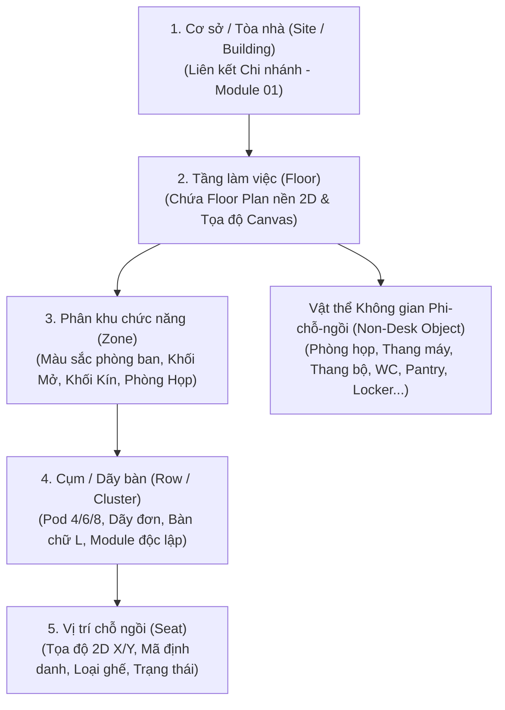
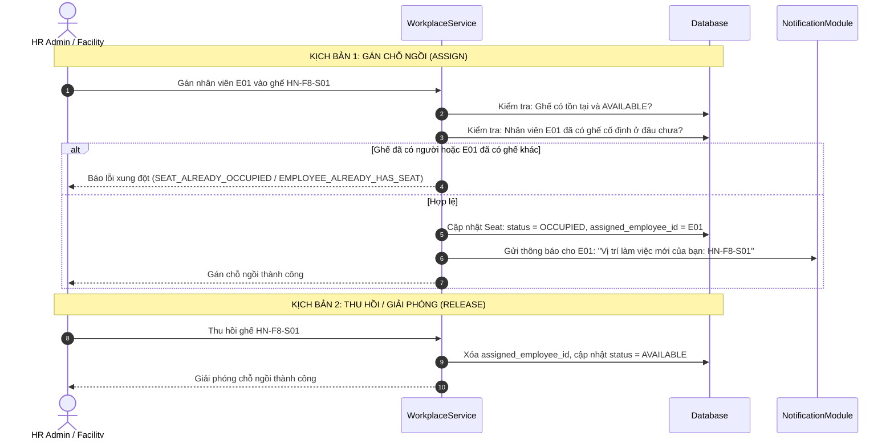
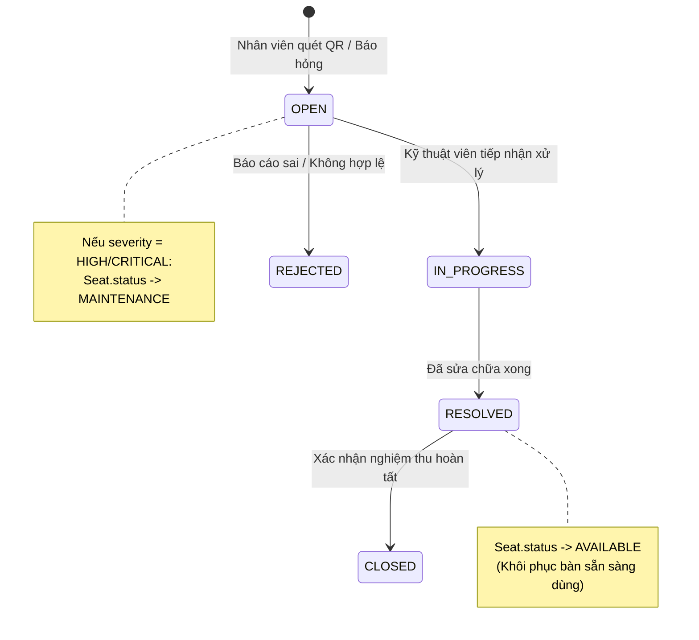
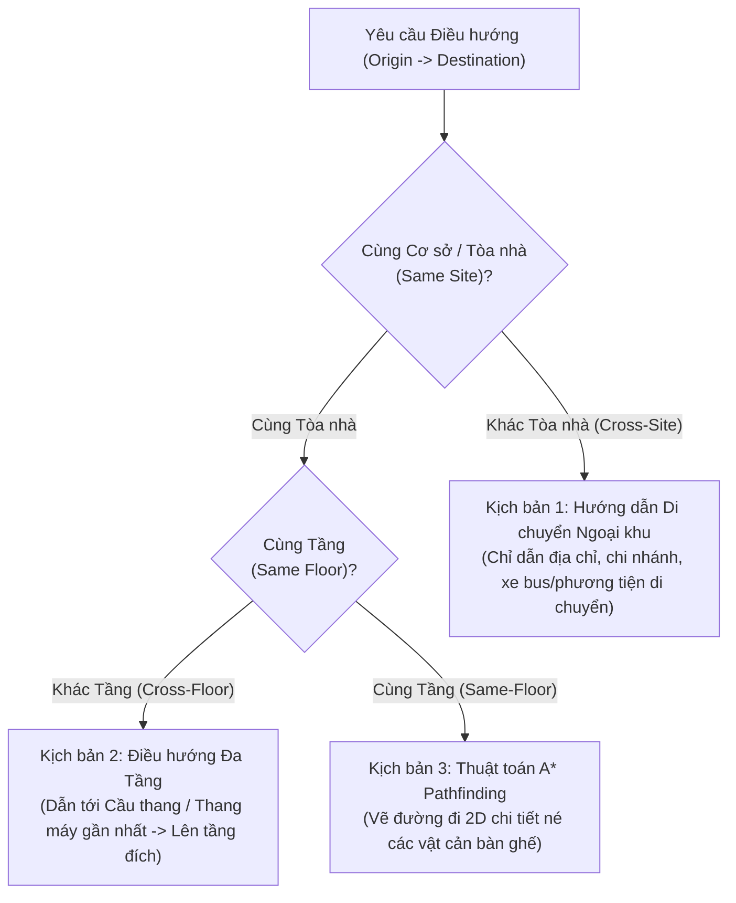
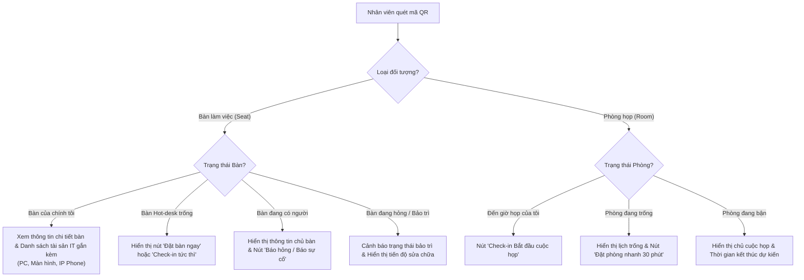
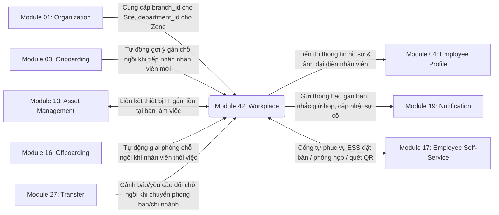

# Module 42: Quản lý Sơ đồ Chỗ ngồi & Không gian Làm việc (Workplace & Seating Chart Management)

> **Tài liệu Phân tích Nghiệp vụ & Đặc tả Chức năng Chi tiết (Business Requirements & Functional Specification Document - BRD/FSD)**  
> **Dự án:** CYCLOSA Human Resource Management System  
> **Phân hệ:** Không gian làm việc số & Tiện ích văn phòng (Digital Workplace & Smart Facility)  
> **Package Backend:** `com.cyclosa.workplace`

---

## 1. TỔNG QUAN PHÂN HỆ (MODULE OVERVIEW)

### 1.1. Bối cảnh & Mục tiêu
Trong doanh nghiệp hiện đại và các mô hình làm việc kết hợp (Hybrid Working / Activity-Based Working), việc quản lý không gian làm việc vật lý đòi hỏi tính trực quan, linh hoạt và số hóa đồng bộ. 

**Module Workplace (Quản lý Sơ đồ Chỗ ngồi & Không gian Làm việc)** được thiết kế nhằm mục tiêu:
1. **Trực quan hóa mặt bằng văn phòng 2D (Interactive Floor Plan & 2D Canvas):** Cho phép ban quản lý tòa nhà (Facility/Admin) thiết kế, bố trí mặt bằng, phân bổ khu vực phòng ban và định vị từng vị trí bàn làm việc không cần lập trình.
2. **Quản lý chỗ ngồi đa chế độ (Hybrid Seating Management):** Hỗ trợ linh hoạt cả **chỗ ngồi cố định (Dedicated Desk)** cho nhân sự full-time, **chỗ ngồi linh hoạt (Hot-desk / Shared Desk)** cho nhân sự làm việc theo ca / hybrid, và **bàn khách / thực tập sinh (Visitor Desk)**.
3. **Quản lý & Đặt phòng họp thông minh (Meeting Room Booking):** Chống trùng lịch (Anti-overlap), kiểm tra trực quan các khung giờ trống/bận trong ngày và hỗ trợ cơ chế check-in xác nhận sử dụng.
4. **Báo cáo & Xử lý sự cố cơ sở vật chất (Facility Issue Ticketing):** Tiếp nhận sự cố hỏng hóc tại bàn hoặc phòng họp, tự động chuyển đổi trạng thái ghế sang bảo trì (`MAINTENANCE`) để ngăn xếp chỗ, tự động khôi phục khi xử lý xong.
5. **Định vị & Điều hướng trong nhà thông minh (5-Tier Indoor Wayfinding & A* Pathfinding):** Tìm kiếm vị trí đồng nghiệp theo tên/mã nhân viên và tự động tính toán lộ trình ngắn nhất né vật cản trong văn phòng.
6. **Tương tác chạm nhanh qua Smart QR Code:** Quét mã QR dán tại từng bàn / phòng họp bằng điện thoại để check-in tức thì, tra cứu thông tin thiết bị hoặc báo hỏng hóc trong 3 giây.
7. **Tích hợp chặt chẽ vòng đời nhân sự & tài sản:** Tự động gợi ý gán chỗ khi Onboarding (Module 03), nhắc nhở/giải phóng chỗ khi Transfer (Module 27) và Offboarding (Module 16), đồng bộ tài sản IT tại bàn (Module 13).

---

## 2. KIẾN TRÚC MÔ HÌNH PHÂN CẤP KHÔNG GIAN (5-TIER SPACE HIERARCHY)

Cấu trúc không gian làm việc được chuẩn hóa theo mô hình cây **5 cấp độc lập**, cho phép mở rộng quy mô từ doanh nghiệp một văn phòng đến tập đoàn đa chi nhánh / đa tòa nhà:



### 2.1. Chi tiết các cấp không gian

| Cấp độ | Entity / Đối tượng | Thuộc tính chính | Mô tả nghiệp vụ |
|---|---|---|---|
| **Cấp 1** | **WorkplaceSite** | `id`, `companyId`, `branchId`, `code`, `name`, `address`, `totalFloors` | Đại diện cho một tòa nhà hoặc cơ sở làm việc. Liên kết trực tiếp với `branch_id` trong Chiều Địa lý của Module 01 (Organization). |
| **Cấp 2** | **WorkplaceFloor** | `id`, `siteId`, `floorNumber`, `name`, `floorPlanUrl`, `width`, `height`, `scale` | Tầng làm việc cụ thể trong tòa nhà (VD: Tầng 3, Tầng 8, Tầng M). Chứa metadata bản vẽ nền (2D Floor Plan) và tỷ lệ tọa độ canvas. |
| **Cấp 3** | **WorkplaceZone** | `id`, `floorId`, `code`, `name`, `colorCode`, `shapeType`, `departmentId` | Phân khu chức năng trong tầng (VD: Khu vực Dev, Khu vực Kinh doanh, Open Space). Được gán mã màu riêng để phân biệt giữa các phòng ban. |
| **Cấp 4** | **WorkplaceRow** | `id`, `zoneId`, `code`, `name`, `clusterType`, `deskShape`, `totalSeats` | Cụm hoặc dãy bàn vật lý (VD: Dãy A1, Cụm Pod-04). Hỗ trợ sinh hàng loạt danh sách bàn làm việc theo khuôn mẫu chuẩn. |
| **Cấp 5** | **WorkplaceSeat** | `id`, `rowId`, `seatCode`, `seatType`, `status`, `x`, `y`, `rotationAngle`, `assignedEmployeeId` | Đơn vị vị trí làm việc nhỏ nhất có tọa độ 2D (x, y) trên canvas. Chứa thông tin nhân viên được gán, loại bàn và trạng thái sử dụng. |
| **Tiện ích** | **WorkplaceNonDeskObject** | `id`, `floorId`, `objectType`, `name`, `x`, `y`, `width`, `height`, `isBookable`, `capacity` | Các đối tượng không gian phi-chỗ-ngồi: Phòng họp, Thang máy, Cầu thang bộ, Cửa thoát hiểm, WC, Pantry, Máy in, Locker, Waypoint điều hướng. |

### 2.2. Quy ước đặt mã định danh Chỗ ngồi (Naming Convention)
Mã vị trí chỗ ngồi (`seat_code`) được chuẩn hóa tự động theo cấu trúc phân cấp để định vị nhanh:
$$\mathbf{M\tilde{a}\ Ch\tilde{o}\ Ng\grave{o}i} = \text{\{SiteCode\}}-\text{\{Floor\}}-\text{\{ZoneCode\}}-\text{\{RowCode\}}-\text{\{SeatNumber\}}$$
- **Ví dụ:** `HN01-F08-ZDEV-R02-S06`  
  $\rightarrow$ Tòa nhà Hà Nội 01 - Tầng 8 - Phân khu Dev - Dãy 02 - Bàn số 06.

---

## 3. CÁC TÍNH NĂNG NGHIỆP VỤ CỐT LÕI (CORE BUSINESS FEATURES)

---

### 3.1. Trình thiết kế Sơ đồ Mặt bằng 2D (Visual Floor Plan & Canvas Layout Editor)

#### A. Mục đích & Phạm vi
Cung cấp công cụ trực quan hóa dạng Canvas 2D cho Quản trị viên Facility / HR Admin thiết kế sơ đồ mặt bằng văn phòng chính xác theo tỷ lệ thực tế mà không cần kiến thức đồ họa phức tạp.

```
+-----------------------------------------------------------------------------------+
|  [SITE: Keangnam Hanoi] > [FLOOR: Tầng 08 - Tech Wing]         [Save] [Publish]   |
+-----------------------------------------------------------------------------------+
|  [Toolbox]   |  CANVAS (Floor Plan Layer)                                         |
|  - Zone      |  +--------------------------------------------------------------+  |
|  - Pod (4/6) |  | [Elevator]  [Stairs]               [Pantry]   [WC Restroom]   |  |
|  - Row/Dãy   |  |--------------------------------------------------------------|  |
|  - Seat      |  | [Zone: Tech Dev - Blue]            [Zone: Sales - Green]    |  |
|  - Meeting   |  |  +----+ +----+   +----+ +----+      +----+ +----+            |  |
|  - Waypoint  |  |  |S01 | |S02 |   |S05 | |S06 |      |S09 | |S10 |  [Room A]  |  |
|              |  |  +----+ +----+   +----+ +----+      +----+ +----+  (10 pax)  |  |
|              |  |  |S03 | |S04 |   |S07 | |S08 |      |S11 | |S12 |            |  |
|              |  |  +----+ +----+   +----+ +----+      +----+ +----+            |  |
+--------------+--+--------------------------------------------------------------+--+
```

#### B. Các tính năng chính
1. **Upload & Quản lý Floor Plan nền:**
   - Hỗ trợ tải lên ảnh sơ đồ kiến trúc (PNG, SVG, JPG) làm lớp nền (background layer).
   - Cho phép thiết lập kích thước thực (`width`, `height` tính theo pixel hoặc mét) và hệ số tỷ lệ (`scale`).
2. **Kéo thả & Định vị vật thể (Drag & Drop Canvas):**
   - Đặt các Phân khu (Zone) theo hình chữ nhật (`RECTANGLE`) hoặc đa giác (`POLYGON`).
   - Đặt các cụm bàn (Row/Cluster) và chỗ ngồi đơn lẻ (Seat).
   - Thiết lập góc xoay (`rotation_angle`: 0°, 90°, 180°, 270° hoặc tùy biến) để khớp với hướng bàn thực tế.
3. **Sinh danh sách bàn tự động theo khuôn mẫu (Bulk Generate Seats):**
   - Admin chỉ cần chọn Dãy bàn và cấu hình loại cụm:
     - `POD_4`: Cụm 4 bàn đối xứng (2x2).
     - `POD_6`: Cụm 6 bàn đối xứng (2x3).
     - `POD_8`: Cụm 8 bàn đối xứng (2x4).
     - `SINGLE_ROW`: Dãy bàn thẳng một hàng (1xN).
     - `DOUBLE_ROW`: Dãy bàn đôi song song (2xN).
   - Hệ thống tự động tính toán tọa độ $X, Y$, gán khoảng cách đệm (spacing), sinh mã bàn và lưu trữ toàn bộ chỉ trong 1 thao tác.
4. **Quản lý đối tượng phi-chỗ-ngồi (Non-Desk Objects):**
   - Đánh dấu vị trí: Phòng họp (`MEETING_ROOM`), Thang máy (`ELEVATOR`), Thang bộ (`STAIRS`), Lối thoát hiểm (`FIRE_EXIT`), Nhà vệ sinh (`RESTROOM`), Khu ăn uống (`PANTRY`), Máy in (`PRINTER`), Tủ đồ (`LOCKER`), Điểm điều hướng (`WAYPOINT`).
   - Cấu hình thuộc tính phòng họp: Sức chứa (`capacity`), thiết bị hội nghị (`has_projector`, `has_video_conference`), cho phép nhân viên tự đặt (`is_bookable = true`).

---

### 3.2. Quản lý Chỗ ngồi Cố định (Dedicated Desk Management)

#### A. Quy tắc nghiệp vụ
1. **Nguyên tắc Độc quyền (Exclusivity Rule):** Một nhân viên tại một thời điểm chỉ được gán tối đa **01 chỗ ngồi cố định** trong toàn bộ hệ thống doanh nghiệp.
2. **Trạng thái chỗ ngồi:**
   - Khi chưa gán: `status = AVAILABLE`
   - Khi đã gán cho nhân viên: `status = OCCUPIED`, lưu trữ `assigned_employee_id` và thời điểm `assigned_at`.
   - Khi nhân viên bị khóa/chuyển đi: chuyển về `AVAILABLE` hoặc `BLOCKED`.
3. **Chỉ gán cho bàn loại Dedicated:** Chỉ cho phép gán cố định đối với chỗ ngồi có `seat_type = DEDICATED` hoặc `VISITOR` (không được gán cố định vào bàn `HOT_DESK`).
4. **Ràng buộc Chi nhánh / Công ty:** Vị trí bàn được gán phải thuộc cùng Công ty/Chi nhánh của nhân viên.

#### B. Quy trình Gán & Thu hồi Chỗ ngồi



---

### 3.3. Đặt Bàn Linh hoạt (Hot-desking & Shared Workspace)

#### A. Quy tắc nghiệp vụ
1. **Đối tượng áp dụng:** Chỉ áp dụng cho các bàn có cấu hình `seat_type = HOT_DESK`.
2. **Hạn mức đặt bàn (Booking Quota):** Mỗi nhân viên chỉ được đặt tối đa **01 bàn hot-desk trong một ngày làm việc**.
3. **Tránh xung đột lịch đặt (Anti-Double Booking):** Hệ thống chặn tuyệt đối việc 2 nhân viên đặt cùng 1 bàn trong cùng 1 ngày (`booking_date`).
4. **Vòng đời của một lượt đặt bàn (Booking Lifecycle):**
   - `PENDING` $\rightarrow$ `CONFIRMED` $\rightarrow$ `CHECKED_IN` $\rightarrow$ `COMPLETED`
   - `CANCELLED`: Người dùng chủ động hủy trước giờ quy định.
   - `EXPIRED`: Hết ngày làm việc hoặc quá thời hạn check-in mà nhân viên không đến xác nhận.
5. **Cơ chế Tự động Hủy / Giải phóng (Auto-Release / Cutoff Policy):**
   - Nhân viên phải thực hiện **Check-in** (qua ứng dụng Web ESS hoặc Quét mã QR tại bàn) trước mốc thời gian quy định (mặc định trước 10:00 sáng).
   - Nếu quá thời hạn quy định mà chưa Check-in, hệ thống tự động chuyển trạng thái sang `EXPIRED` và giải phóng bàn để người khác có thể sử dụng.

---

### 3.4. Quản lý & Đặt Phòng Họp (Meeting Room Booking)

#### A. Quy tắc nghiệp vụ
1. **Điều kiện phòng đặt:** Chỉ các đối tượng phi-chỗ-ngồi có `object_type = MEETING_ROOM` và `is_bookable = true` mới xuất hiện trên cổng đặt phòng.
2. **Kiểm tra Chống Trùng Lịch (Anti-Overlap Algorithm):**
   - Hai cuộc họp không được giao thoa thời gian trên cùng 1 phòng:
   $$\text{Điều kiện trùng lịch: } \left( \text{Start}_{\text{new}} < \text{End}_{\text{existing}} \right) \;\land\; \left( \text{End}_{\text{new}} > \text{Start}_{\text{existing}} \right)$$
   - Các lượt đặt ở trạng thái `CANCELLED` hoặc `REJECTED` sẽ bị loại trừ khi kiểm tra trùng.
3. **Tra cứu thời gian trống (Room Availability Timeline):**
   - Cung cấp API trả về danh sách các cuộc họp đã xác nhận trong ngày của từng phòng họp, giúp giao diện hiển thị thanh Timeline trực quan (Xanh: Trống / Đỏ: Bận) để nhân viên chọn khung giờ thích hợp.
4. **Check-in Phòng họp:** Cho phép người chủ trì quét mã QR tại cửa phòng họp để xác nhận bắt đầu cuộc họp, tránh tình trạng "giữ phòng ảo" nhưng không sử dụng.

---

### 3.5. Báo cáo & Xử lý Sự cố Cơ sở Vật chất (Facility Issue Ticketing)

#### A. Quy tắc nghiệp vụ
1. **Phạm vi gắn sự cố:** Phiếu báo cáo sự cố (`WorkplaceIssueTicket`) được gắn trực tiếp vào một **Vị trí Chỗ ngồi cụ thể (`seat_id`)** hoặc **Phòng họp / Tiện ích (`non_desk_object_id`)**.
2. **Phân loại sự cố (`issue_type`):**
   - `HARDWARE`: Hỏng màn hình, case máy tính, chuột/phím gắn tại bàn.
   - `NETWORK`: Mất mạng LAN, chập chờn Wi-Fi, hỏng dây mạng.
   - `ELECTRICAL`: Cháy ổ cắm, mất điện khu vực, hỏng đèn chiếu sáng.
   - `FURNITURE`: Ghế gãy/hỏng ben hơi nâng hạ, bàn cập kênh, hỏng hộc tủ.
   - `CLEANLINESS`: Bàn bẩn, cần vệ sinh khử khuẩn.
   - `OTHER`: Sự cố khác.
3. **Mức độ nghiêm trọng (`severity`):** `LOW`, `MEDIUM`, `HIGH`, `CRITICAL`.
4. **Cơ chế Tự động Khóa / Mở bàn (Auto-Status Transition):**
   - Khi nhân viên tạo ticket với mức độ `HIGH` hoặc `CRITICAL` tại một bàn làm việc:
     $$\text{Tạo Ticket (HIGH/CRITICAL)} \longrightarrow \text{Tự động chuyển Seat.status} = \mathbf{MAINTENANCE}$$
     *(Ngăn chặn việc nhân viên khác đặt bàn hot-desk hoặc HR gán người vào bàn đang hỏng).*
   - Khi Admin / Kỹ thuật viên hoàn tất sửa chữa và chuyển trạng thái ticket sang `RESOLVED` hoặc `CLOSED`:
     $$\text{Đóng Ticket (RESOLVED/CLOSED)} \longrightarrow \text{Tự động khôi phục Seat.status} = \mathbf{AVAILABLE}$$



---

### 3.6. Điều hướng trong Nhà Thông minh (5-Tier Indoor Wayfinding & A* Pathfinding)

#### A. Mô hình Điều hướng Đa Tầng & Đa Cơ sở (Multi-Tier Wayfinding)
Khi người dùng yêu cầu chỉ đường từ **Điểm A (Xuất phát)** đến **Điểm B (Đích đến)** (Ví dụ: Từ bàn của tôi đến bàn đồng nghiệp Nguyễn Văn A, hoặc đến Phòng họp VIP 1), hệ thống tự động phân loại thành 3 kịch bản:



#### B. Thuật toán Tìm đường A* (A* Grid Pathfinding Engine)
- **Cơ chế hoạt động:**
  1. Mặt bằng tầng được số hóa thành lưới ma trận tọa độ 2D (Grid Matrix).
  2. Các vật thể bàn ghế đang có người, tường ngăn, phòng kín được đánh dấu là **Vật cản (Obstacles / Non-walkable nodes)**.
  3. Các lối đi chính, hành lang và khoảng cách giữa các hàng ghế được đánh dấu là **Đường đi bộ (Walkable corridors)**.
  4. Thuật toán **A* (A-Star)** tính toán đường đi tối ưu dựa trên hàm chi phí:
     $$f(n) = g(n) + h(n)$$
     - $g(n)$: Chi phí thực tế từ điểm xuất phát đến nút hiện tại.
     - $h(n)$: Khoảng cách ước lượng (Manhattan / Euclidean Distance) từ nút hiện tại đến điểm đích.
  5. API trả về mảng các tọa độ $\big[(x_1, y_1), (x_2, y_2), \dots, (x_k, y_k)\big]$ để giao diện người dùng (Frontend Canvas) vẽ đường line dẫn hướng nhấp nháy mượt mà.

---

### 3.7. Mã QR Thông minh tại Vị trí Làm việc (Smart Workplace QR Code)

#### A. Cấu trúc Mã QR
Mỗi bàn làm việc và phòng họp được sinh một mã QR độc bản mã hóa định danh và chữ ký bảo mật:
$$\text{QR Payload} = \texttt{CYCLOSA:WORKPLACE:SEAT:}\{\text{seat\_id}\} \quad\text{hoặc}\quad \texttt{CYCLOSA:WORKPLACE:ROOM:}\{\text{room\_id}\}$$

#### B. Ma trận Hành động khi Quét mã QR (QR Scan Action Matrix)



---

### 3.8. Tích hợp Quản lý Tài sản IT gắn tại Bàn (Asset Integration - Module 13)

- **Mô tả:** Cho phép liên kết các tài sản cố định (Máy tính bàn, Màn hình phụ, Docking station, Điện thoại IP bàn, Máy in mã vạch...) từ **Module 13 (Asset Management)** vào từng vị trí bàn làm việc (`WorkplaceSeatLinkedAsset`).
- **Lợi ích:**
  - Nhân viên khi ngồi vào bàn có thể xem ngay danh sách cấu hình máy tính và thiết bị gắn sẵn tại bàn.
  - Khi kiểm kê tài sản định kỳ hoặc bàn giao thiết bị, IT/Facility chỉ cần quét mã QR tại bàn để đối soát danh mục tài sản thực tế mà không cần lục tìm sổ sách.

---

## 4. MA TRẬN PHÂN QUYỀN TRUY CẬP (RBAC & SECURITY)

Hệ thống tuân thủ kiến trúc phân quyền bảo mật đa tầng của CYCLOSA:

| Mã quyền (Permission Key) | Tên quyền hiển thị | Nhóm người dùng áp dụng | Mô tả phạm vi nghiệp vụ |
|---|---|---|---|
| `workplace.view` | Xem Sơ đồ & Tra cứu Không gian | Mọi nhân viên, HR, Admin | Xem bản đồ văn phòng, tìm vị trí đồng nghiệp, tra cứu lịch phòng họp, điều hướng wayfinding. |
| `workplace.manage` | Quản trị Thiết kế & Bố trí Không gian | Facility Admin, HR Admin | Toàn quyền CRUD Tòa nhà, Tầng, Phân khu, Dãy bàn, Chỗ ngồi, Canvas Layout Editor, gán/thu hồi ghế, sinh mã QR. |
| `workplace.booking.view` | Xem Báo cáo & Lịch Đặt chỗ | Facility, Lễ tân, Manager | Lọc và xem danh sách đặt bàn hot-desk và danh sách đặt phòng họp toàn công ty. |
| `workplace.booking.manage` | Quản trị Đặt chỗ & Phê duyệt | Facility Admin, Lễ tân | Tạo lịch đặt hộ, hủy lịch vi phạm quy định, xác nhận check-in thủ công. |
| `workplace.ticket.view` | Xem Phiếu Sự cố Cơ sở Vật chất | Facility Team, IT Support | Xem danh sách sự cố hỏng hóc thiết bị, bàn ghế, điện mạng tại các tầng. |
| `workplace.ticket.manage` | Tiếp nhận & Xử lý Sự cố | Facility Manager, Kỹ thuật viên | Tiếp nhận phiếu, cập nhật tiến độ, hoàn tất sửa chữa (tự động mở khóa bàn). |
| `my_workplace.view` | Tự phục vụ: Xem vị trí & Lịch của tôi | Tất cả nhân viên (ESS) | Xem vị trí bàn cố định của mình, xem lịch sử đặt bàn/phòng họp cá nhân. |
| `my_workplace.manage` | Tự phục vụ: Thao tác Đặt & Báo sự cố | Tất cả nhân viên (ESS) | Tự đặt bàn hot-desk, tự đặt phòng họp, tự hủy/check-in, tự gửi phiếu báo hỏng thiết bị. |

---

## 5. TÍCH HỢP LIÊN PHÂN HỆ (INTER-MODULE INTEGRATION)



1. **Với Module 01 (Cơ cấu Tổ chức):**
   - Tòa nhà (`WorkplaceSite`) gắn liền với Chi nhánh (`branch_id`).
   - Phân khu (`WorkplaceZone`) liên kết với Đơn vị tổ chức (`department_id`) để tô màu nhận diện sơ đồ theo phòng ban.
2. **Với Module 03 (Onboarding):**
   - Khi nhân viên mới hoàn tất thủ tục gia nhập, hệ thống tự động hiển thị gợi ý danh sách bàn trống gần khu vực của phòng ban để HR gán chỗ ngay trong Onboarding Checklist.
3. **Với Module 13 (Quản lý Tài sản):**
   - Liên kết mã tài sản (Asset Code) vào `workplace_seat_linked_assets`, giúp đồng bộ hóa dữ liệu quản lý tài sản gắn liền không gian vật lý.
4. **Với Module 16 (Nghỉ việc - Offboarding):**
   - Khi tạo quyết định thôi việc và chạy quy trình Clearance, hệ thống tự động kiểm tra và thực hiện lệnh **Release Seat**, đưa bàn về trạng thái `AVAILABLE` cho nhân sự kế tiếp.
5. **Với Module 27 (Điều chuyển - Transfer):**
   - Khi nhân sự chuyển bộ phận hoặc chi nhánh làm việc, hệ thống tạo nhiệm vụ nhắc nhở cập nhật và bố trí lại chỗ ngồi mới.
6. **Với Module 19 (Thông báo):**
   - Bắn thông báo đẩy (Push/Email/In-app) khi: (1) Được gán chỗ ngồi mới, (2) Đặt phòng họp thành công kèm lịch nhắc trước 15 phút, (3) Phiếu sự cố kỹ thuật đã được sửa xong.

---

## 6. ĐẶC TẢ DANH MỤC API ENDPOINTS (RESTFUL API SPECIFICATION)

### 6.1. Nhóm Quản trị Không gian & Sơ đồ (`WorkplaceManagementController`)
- **Base Path:** `/api/v1/workplace`

| Method | Endpoint | Quyền yêu cầu | Mô tả tóm tắt |
|---|---|---|---|
| `POST` | `/sites` | `workplace.manage` | Tạo mới tòa nhà / cơ sở làm việc |
| `PUT` | `/sites/{id}` | `workplace.manage` | Cập nhật thông tin tòa nhà |
| `GET` | `/sites` | `workplace.view` | Lấy danh sách cơ sở có phân trang & tìm kiếm |
| `GET` | `/sites/{id}` | `workplace.view` | Xem chi tiết thông tin một cơ sở |
| `DELETE`| `/sites/{id}` | `workplace.manage` | Xóa cơ sở làm việc |
| `POST` | `/floors` | `workplace.manage` | Tạo mới tầng làm việc |
| `PUT` | `/floors/{id}` | `workplace.manage` | Cập nhật thông tin tầng |
| `GET` | `/sites/{siteId}/floors` | `workplace.view` | Lấy danh sách các tầng thuộc một cơ sở |
| `DELETE`| `/floors/{id}` | `workplace.manage` | Xóa tầng làm việc |
| `POST` | `/zones` | `workplace.manage` | Tạo mới phân khu chức năng (Zone) |
| `PUT` | `/zones/{id}` | `workplace.manage` | Cập nhật thông tin phân khu |
| `GET` | `/floors/{floorId}/zones` | `workplace.view` | Lấy danh sách các phân khu trên một tầng |
| `DELETE`| `/zones/{id}` | `workplace.manage` | Xóa phân khu |
| `POST` | `/rows` | `workplace.manage` | Tạo mới cụm / dãy bàn làm việc |
| `PUT` | `/rows/{id}` | `workplace.manage` | Cập nhật cụm / dãy bàn |
| `GET` | `/zones/{zoneId}/rows` | `workplace.view` | Lấy danh sách cụm bàn thuộc phân khu |
| `DELETE`| `/rows/{id}` | `workplace.manage` | Xóa cụm bàn |
| `POST` | `/seats` | `workplace.manage` | Tạo mới một vị trí chỗ ngồi làm việc |
| `POST` | `/rows/{rowId}/bulk-generate-seats` | `workplace.manage` | **Sinh hàng loạt bàn tự động theo khuôn mẫu Pod 4/6/8** |
| `PUT` | `/seats/{id}` | `workplace.manage` | Cập nhật thông tin & tọa độ hình học 2D của bàn |
| `GET` | `/seats/{id}` | `workplace.view` | **Xem chi tiết bàn (vị trí 5 cấp + tài sản gắn liền)** |
| `GET` | `/seats` | `workplace.view` | Lọc danh sách bàn có phân trang (phòng ban, trạng thái, loại bàn) |
| `DELETE`| `/seats/{id}` | `workplace.manage` | Xóa chỗ ngồi |
| `POST` | `/seats/{id}/assign` | `workplace.manage` | **Gán chỗ ngồi cố định cho nhân viên** |
| `POST` | `/seats/{id}/release` | `workplace.manage` | **Giải phóng / thu hồi chỗ ngồi** |
| `PATCH` | `/seats/{id}/status` | `workplace.manage` | Đổi trạng thái bàn (Khóa, Bảo trì, Khả dụng) |
| `POST` | `/seats/{id}/link-asset/{assetId}` | `workplace.manage` | Gắn tài sản IT lên bàn làm việc |
| `DELETE`| `/seats/{id}/unlink-asset/{assetId}` | `workplace.manage` | Gỡ tài sản IT khỏi bàn làm việc |
| `POST` | `/seats/{id}/qr-code` | `workplace.manage` | Sinh chuỗi mã QR chuẩn cho bàn |
| `GET` | `/floors/{floorId}/canvas-layout` | `workplace.view` | **Tải toàn bộ dữ liệu 2D Canvas của tầng (Background, Zones, Rows, Seats, Objects)** |
| `POST` | `/floors/{floorId}/floor-plan` | `workplace.manage` | Cấu hình / Cập nhật sơ đồ nền 2D của tầng |
| `POST` | `/non-desk-objects` | `workplace.manage` | Tạo vật thể không gian (Phòng họp, Tiện ích...) |
| `PUT` | `/non-desk-objects/{id}` | `workplace.manage` | Cập nhật vật thể không gian |
| `DELETE`| `/non-desk-objects/{id}` | `workplace.manage` | Xóa vật thể không gian |
| `GET` | `/analytics/occupancy-report` | `workplace.view` | **Báo cáo thống kê tỷ lệ lấp đầy & hiệu suất sử dụng văn phòng** |

---

### 6.2. Nhóm Quản trị Đặt chỗ Bàn & Phòng Họp (`WorkplaceBookingAdminController`)
- **Base Path:** `/api/v1/workplace/bookings`

| Method | Endpoint | Quyền yêu cầu | Mô tả tóm tắt |
|---|---|---|---|
| `GET` | `/hotdesk` | `workplace.booking.view` | Lọc danh sách đặt bàn linh hoạt hot-desk có phân trang |
| `POST` | `/hotdesk` | `workplace.booking.manage` | Tạo lượt đặt bàn hot-desk thủ công |
| `POST` | `/hotdesk/{id}/cancel` | `workplace.booking.manage` | Hủy lượt đặt bàn hot-desk |
| `POST` | `/hotdesk/{id}/check-in` | `workplace.booking.manage` | Xác nhận check-in bàn hot-desk |
| `GET` | `/rooms` | `workplace.booking.view` | Lọc danh sách đặt phòng họp có phân trang |
| `POST` | `/rooms` | `workplace.booking.manage` | Tạo lịch đặt phòng họp mới (có kiểm tra chống trùng) |
| `POST` | `/rooms/{id}/cancel` | `workplace.booking.manage` | Hủy lịch đặt phòng họp |
| `POST` | `/rooms/{id}/check-in` | `workplace.booking.manage` | Check-in phòng họp |
| `GET` | `/rooms/{roomId}/availability` | `workplace.booking.view` | **Kiểm tra timeline các khung giờ trống/bận của phòng họp theo ngày** |

---

### 6.3. Nhóm Quản lý Sự cố Cơ sở Vật chất (`WorkplaceIssueAdminController`)
- **Base Path:** `/api/v1/workplace/issue-tickets`

| Method | Endpoint | Quyền yêu cầu | Mô tả tóm tắt |
|---|---|---|---|
| `GET` | `/` | `workplace.ticket.view` | Lọc danh sách sự cố cơ sở vật chất toàn công ty |
| `GET` | `/{id}` | `workplace.ticket.view` | Xem chi tiết phiếu báo sự cố |
| `PATCH` | `/{id}/status` | `workplace.ticket.manage` | **Cập nhật tiến độ / Đóng ticket (Tự động khôi phục bàn về AVAILABLE)** |

---

### 6.4. Nhóm Điều hướng, Định vị & Quét QR (`WorkplaceNavigationController`)
- **Base Path:** `/api/v1/workplace/navigation`

| Method | Endpoint | Quyền yêu cầu | Mô tả tóm tắt |
|---|---|---|---|
| `POST` | `/route` | `workplace.view` | **Tính toán lộ trình điều hướng trong nhà (A* Pathfinding 5 cấp né vật cản)** |
| `POST` | `/scan-qr` | `workplace.view` | **Quét mã QR tại bàn/phòng họp $\rightarrow$ Phân giải vị trí & Gợi ý hành động tức thì** |
| `GET` | `/colleagues` | `workplace.view` | Tìm kiếm vị trí chỗ ngồi đồng nghiệp theo tên / mã nhân viên |
| `GET` | `/colleagues/{employeeId}` | `workplace.view` | Tra cứu vị trí chỗ ngồi chi tiết của một đồng nghiệp cụ thể |
| `GET` | `/bookable-rooms` | `workplace.view` | Lấy danh sách các phòng họp mở cho phép đặt |

---

### 6.5. Nhóm Cổng Tự phục vụ Nhân viên ESS (`MyWorkplaceController`)
- **Base Path:** `/api/v1/my-workplace`

| Method | Endpoint | Quyền yêu cầu | Mô tả tóm tắt |
|---|---|---|---|
| `GET` | `/seat` | `my_workplace.view` | **Xem vị trí bàn làm việc cố định & danh sách thiết bị IT tại bàn của tôi** |
| `GET` | `/hotdesk-bookings` | `my_workplace.view` | Xem danh sách các lượt đặt bàn hot-desk của tôi |
| `POST` | `/hotdesk-bookings` | `my_workplace.manage` | **Tự đặt bàn làm việc linh hoạt cho ngày hôm nay / ngày mai** |
| `POST` | `/hotdesk-bookings/{id}/cancel` | `my_workplace.manage` | Tự hủy lượt đặt bàn của tôi |
| `POST` | `/hotdesk-bookings/{id}/check-in` | `my_workplace.manage` | Tự check-in bàn linh hoạt của tôi |
| `GET` | `/room-bookings` | `my_workplace.view` | Xem danh sách các lịch đặt phòng họp do tôi tạo |
| `POST` | `/room-bookings` | `my_workplace.manage` | **Tự đặt phòng họp cho nhóm làm việc** |
| `POST` | `/room-bookings/{id}/cancel` | `my_workplace.manage` | Tự hủy lịch đặt phòng họp của tôi |
| `POST` | `/room-bookings/{id}/check-in` | `my_workplace.manage` | Tự check-in phòng họp của tôi |
| `POST` | `/issue-tickets` | `my_workplace.manage` | **Báo cáo sự cố hỏng hóc tại bàn của tôi hoặc phòng họp** |
| `GET` | `/issue-tickets` | `my_workplace.view` | Xem danh sách các sự cố do chính tôi đã gửi báo cáo |

---

## 7. DANH MỤC MÃ LỖI NGHIỆP VỤ ĐẶC THÙ (ERROR CODE CATALOG)

Dải mã lỗi chuẩn hóa dành riêng cho Module 42 (`42001` – `42046`):

| Mã lỗi (Code) | Enum Name | HTTP Status | Thông điệp lỗi chi tiết |
|---|---|:---:|---|
| **42001** | `SITE_NOT_FOUND` | 404 | Không tìm thấy thông tin tòa nhà / cơ sở làm việc |
| **42002** | `SITE_CODE_ALREADY_EXISTS` | 409 | Mã tòa nhà / cơ sở này đã tồn tại trong công ty |
| **42003** | `FLOOR_NOT_FOUND` | 404 | Không tìm thấy thông tin tầng làm việc |
| **42004** | `FLOOR_ALREADY_EXISTS` | 409 | Tầng này đã tồn tại trong tòa nhà |
| **42005** | `ZONE_NOT_FOUND` | 404 | Không tìm thấy thông tin khu vực làm việc |
| **42006** | `ROW_NOT_FOUND` | 404 | Không tìm thấy thông tin dãy bàn |
| **42007** | `SEAT_NOT_FOUND` | 404 | Không tìm thấy thông tin chỗ ngồi làm việc |
| **42008** | `SEAT_CODE_ALREADY_EXISTS` | 409 | Mã chỗ ngồi này đã tồn tại trong công ty |
| **42009** | `SEAT_NOT_AVAILABLE` | 409 | Chỗ ngồi này hiện không khả dụng (đang có người hoặc bảo trì) |
| **42010** | `SEAT_ALREADY_OCCUPIED` | 409 | Chỗ ngồi này đã được gán cho một nhân viên khác |
| **42011** | `SEAT_NOT_OCCUPIED` | 400 | Chỗ ngồi này hiện chưa được gán cho nhân viên nào |
| **42012** | `SEAT_NOT_HOTDESK` | 400 | Chỗ ngồi này không phải là loại bàn linh hoạt (hot-desk) |
| **42013** | `EMPLOYEE_ALREADY_HAS_SEAT` | 409 | Nhân viên này đã được gán một chỗ ngồi cố định khác |
| **42014** | `ASSET_ALREADY_LINKED` | 409 | Tài sản này đã được liên kết với chỗ ngồi |
| **42015** | `ASSET_LINK_NOT_FOUND` | 404 | Không tìm thấy liên kết tài sản tại chỗ ngồi này |
| **42016** | `NON_DESK_OBJECT_NOT_FOUND` | 404 | Không tìm thấy đối tượng tiện ích / phòng họp |
| **42017** | `NOT_A_MEETING_ROOM` | 400 | Đối tượng này không phải là phòng họp |
| **42018** | `FLOOR_PLAN_NOT_FOUND` | 404 | Không tìm thấy bản vẽ sơ đồ tầng |
| **42019** | `HOTDESK_BOOKING_NOT_FOUND` | 404 | Không tìm thấy thông tin đặt bàn hot-desk |
| **42020** | `HOTDESK_ALREADY_BOOKED` | 409 | Bàn này đã được đặt trong ngày được chọn |
| **42021** | `HOTDESK_ALREADY_HAS_BOOKING_FOR_DAY` | 409 | Bạn đã có lịch đặt bàn hot-desk trong ngày này |
| **42022** | `HOTDESK_BOOKING_INVALID_STATUS` | 400 | Trạng thái đặt bàn không hợp lệ để thực hiện thao tác này |
| **42023** | `ROOM_BOOKING_NOT_FOUND` | 404 | Không tìm thấy lịch đặt phòng họp |
| **42024** | `ROOM_BOOKING_TIME_OVERLAPPING` | 409 | Phòng họp đã kín lịch trong khung giờ này (xung đột thời gian) |
| **42025** | `ROOM_BOOKING_INVALID_TIME` | 400 | Thời gian bắt đầu và kết thúc đặt phòng không hợp lệ |
| **42026** | `ROOM_BOOKING_INVALID_STATUS` | 400 | Trạng thái đặt phòng không hợp lệ để thực hiện thao tác |
| **42027** | `ISSUE_TICKET_NOT_FOUND` | 404 | Không tìm thấy phiếu báo cáo sự cố cơ sở vật chất |
| **42028** | `NAVIGATION_POINT_NOT_FOUND` | 404 | Không tìm thấy điểm xuất phát hoặc điểm đến để điều hướng |
| **42029** | `NAVIGATION_SAME_POINT` | 400 | Điểm xuất phát và điểm đến không được trùng nhau |
| **42030** | `QR_CODE_INVALID` | 400 | Mã QR không hợp lệ hoặc đã hết hạn |
| **42031** | `CURRENT_USER_NOT_LINKED_EMPLOYEE` | 400 | Tài khoản đăng nhập chưa được liên kết với hồ sơ nhân viên |
| **42032** | `EMPLOYEE_NOT_FOUND` | 404 | Không tìm thấy thông tin nhân viên |
| **42033** | `BRANCH_NOT_FOUND` | 404 | Không tìm thấy thông tin chi nhánh |
| **42035** | `EMPLOYEE_HAS_NO_ASSIGNED_SEAT` | 400 | Nhân viên chưa được gán vị trí chỗ ngồi làm việc cố định |
| **42038** | `SEAT_IN_MAINTENANCE` | 409 | Chỗ ngồi đang trong trạng thái bảo trì hoặc bị khóa |
| **42039** | `SEAT_NOT_AVAILABLE_FOR_HOTDESK` | 400 | Chỗ ngồi này không mở cho việc đặt bàn linh hoạt hot-desk |
| **42045** | `ROOM_TIME_CONFLICT` | 409 | Khung giờ đặt phòng họp bị trùng với cuộc họp khác đã xác nhận |

---

## 8. BÁO CÁO THỐNG KÊ & CHỈ SỐ KHÔNG GIAN (WORKPLACE ANALYTICS)

Hệ thống cung cấp dashboard phân tích hiệu suất khai thác mặt bằng văn phòng (`WorkplaceOccupancyReportResponse`):

1. **Tổng quan Năng lực Không gian (Capacity Overview):**
   - Tổng số bàn làm việc (`totalSeats`).
   - Phân bổ theo loại bàn: Số bàn cố định (`totalDedicatedSeats`), Số bàn linh hoạt (`totalHotdeskSeats`), Số bàn khách (`totalVisitorSeats`).
2. **Tỷ lệ Lấp đầy Thực tế (Occupancy Rate):**
   $$\text{Tỷ lệ lấp đầy cố định} = \frac{\text{Số bàn Dedicated đang có người (Occupied)}}{\text{Tổng số bàn Dedicated}} \times 100\%$$
   $$\text{Tỷ lệ sử dụng Hot-desk} = \frac{\text{Số lượt Check-in Hot-desk trong ngày}}{\text{Tổng số bàn Hot-desk khả dụng}} \times 100\%$$
3. **Hiệu suất Khai thác Phòng họp (Meeting Room Utilization):**
   - Tổng số giờ phòng họp được đặt / Tổng số giờ làm việc chuẩn trong tháng.
   - Thống kê các phòng họp có tần suất sử dụng cao nhất và thấp nhất.
4. **Chỉ số Sức khỏe Cơ sở Vật chất (Facility Health Metrics):**
   - Số lượng sự cố đang mở (`Open Tickets`).
   - Thời gian trung bình xử lý sự cố (Mean Time to Resolve - MTTR).
   - Tỷ lệ bàn bị gián đoạn do bảo trì (`Maintenance Downtime`).

---

## 9. TỔNG KẾT & ĐỊNH HƯỚNG PHÁT TRIỂN

Module **Workplace Management (Module 42)** là mảnh ghép quan trọng giúp CYCLOSA hoàn thiện bức tranh quản trị nhân sự toàn diện: từ **Con người (Human)** $\rightarrow$ **Cơ cấu tổ chức (Org)** $\rightarrow$ **Tài sản (Asset)** $\rightarrow$ **Không gian làm việc vật lý (Workplace)**.

Module đã được thiết kế tuân thủ 100% các tiêu chuẩn kiến trúc backend cao cấp của CYCLOSA:
- Không inject Repository chéo module.
- RBAC động 5 cấp DataScope.
- Bọc toàn bộ phản hồi qua `ApiResponse<T>` / `PageData<T>`.
- Khử triệt để N+1 Query thông qua Batch Enrichment & Join Fetch.
- Sẵn sàng tích hợp API với các nền tảng thiết bị thông minh IoT (Cảm biến nhiệt độ, Cảm biến người ngồi tại bàn PIR Sensor, Màn hình E-ink hiển thị tên tại bàn làm việc).
