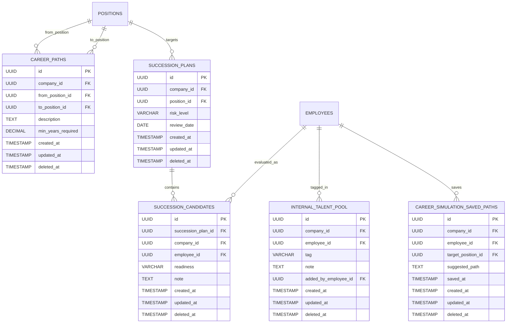
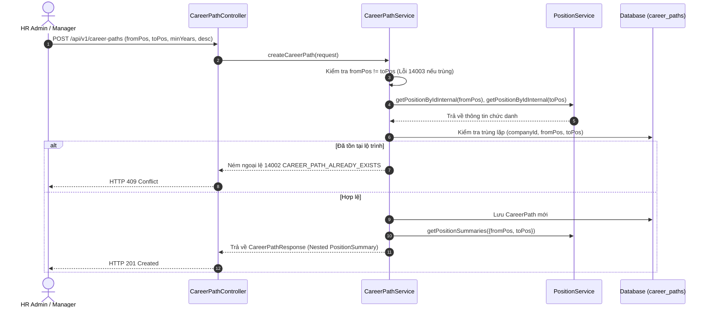
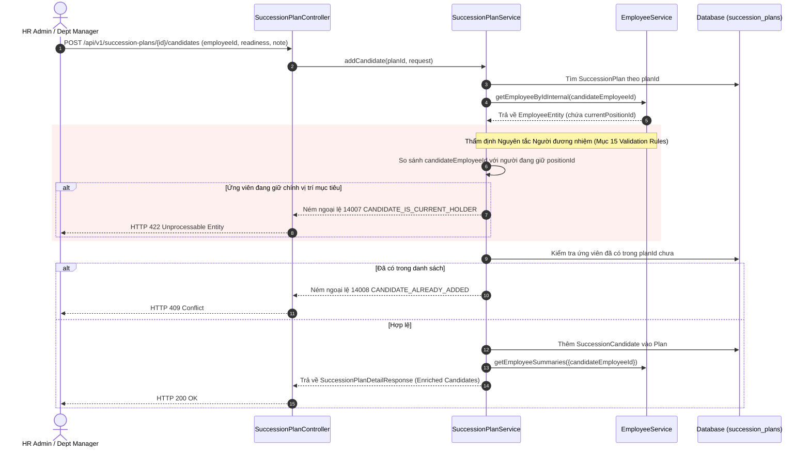
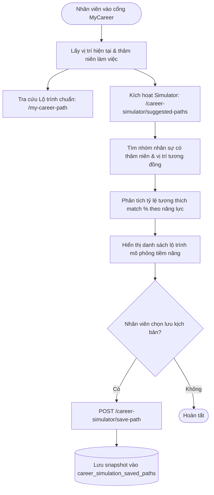

# Tài liệu Nghiệp vụ Module: Phát triển Nhân sự & Quy hoạch Kế nhiệm (Career & Talent Management)

> **Module Code:** `talent` (hợp nhất Module 14 Career & Talent và Module 32 Career Pathing Simulator)  
> **Package:** `com.cyclosa.talent`  
> **Phiên bản:** 2.0 (Chuẩn hóa Backend Standards & Automation)  
> **Căn cứ nghiệp vụ:**  
> - **Khung Quản trị Nhân tài Doanh nghiệp (Enterprise Talent Management Framework):** Thiết lập lộ trình thăng tiến chuẩn, giữ chân nhân tài, bồi dưỡng nhân sự kế thừa.  
> - **Quy định Thẩm định Ứng viên Kế nhiệm (Mục 15 Validation Rules):** Ứng viên kế nhiệm không được trùng với người đang đảm nhiệm chính vị trí mục tiêu.  
> - **Kho Nhân tài Nội bộ (Internal Talent Pool):** Gắn thẻ phân loại năng lực (HiPo, Key Talent, Leadership Potential, Tech Expert) phục vụ quy hoạch chiến lược.  
> - **Mô phỏng Sự nghiệp Dựa trên Dữ liệu (Data-driven Career Simulator):** Phân tích hồ sơ tương đồng và gợi ý lộ trình khả dĩ cho nhân viên (ESS).

---

## 1. Tôn chỉ Nghiệp vụ & Nguyên tắc Thiết kế (Core Principles)

Phân hệ **Career & Talent** đóng vai trò chiến lược trong hệ sinh thái CYCLOSA HRM. Sau khi nhân sự có hồ sơ (Module 04: Employee), được đánh giá hiệu suất định kỳ (Module 09: Performance) và xem xét khen thưởng (Module 12: Discipline), phân hệ này cung cấp các công cụ kết nối dữ liệu để hoạch định phát triển nguồn nhân lực chất lượng cao.

```
┌─────────────────────────┐       ┌────────────────────────────────┐       ┌─────────────────────────┐
│   Module 01: Org / Pos  │       │  Module Talent & Career        │       │  Module 04: Employee    │
│  - Vị trí chức danh     │ ────> │  - Lộ trình thăng tiến chuẩn   │ <──── │  - Hồ sơ nhân viên      │
│  - Sơ đồ phòng ban      │       │  - Kế hoạch kế nhiệm & Ứng viên│       │  - Vị trí đảm nhiệm     │
└─────────────────────────┘       │  - Kho nhân tài (HiPo)         │       └─────────────────────────┘
                                  │  - Mô phỏng lộ trình Simulator │
                                  └────────────────────────────────┘
```

### 1.1. Chuẩn hóa Thiết kế Không dùng Interface + Impl thừa thãi (Concrete Service Pattern)
Theo chuẩn kiến trúc tại `docs/BACKEND_STANDARDS.md`:
- Toàn bộ service của module được viết trực tiếp dưới dạng **Concrete Service**:
  - `CareerPathService.java`: Quản lý lộ trình thăng tiến chuẩn giữa các chức danh/vị trí công việc.
  - `SuccessionPlanService.java`: Lập kế hoạch kế nhiệm cho vị trí trọng yếu, thêm/cập nhật/xóa ứng viên kế nhiệm, thẩm định mức độ sẵn sàng.
  - `InternalTalentPoolService.java`: Quản trị kho nhân tài nội bộ, gắn thẻ nhận diện năng lực (`HiPo`, `Key Talent`,...).
  - `CareerSimulatorService.java`: Thuật toán đối chiếu hồ sơ tương đồng, gợi ý lộ trình thăng tiến mô phỏng, phân tích xu hướng theo phòng ban, quản lý kịch bản đã lưu.
- **Tuyệt đối không tạo thư mục `impl/`** hay interface 1-1 hình thức.

### 1.2. Đóng gói Kiến trúc Modular Monolith & Giao tiếp Liên Module
1. **Lấy dữ liệu hạ tầng qua Public Service của module lân cận:**
   - `PositionService` (Module 01 - Organization): `getPositionByIdInternal`, `getPositionSummaries` — kiểm tra vị trí tồn tại, nạp tên/mã chức danh cho lộ trình và kế hoạch kế nhiệm.
   - `OrganizationalUnitService` (Module 01 - Organization): `getUnitSummary` — hỗ trợ thống kê xu hướng chuyển động nhân sự theo đơn vị.
   - `EmployeeService` (Module 04 - Employee): `getEmployeeByIdInternal`, `findEmployeeIdByUserId`, `getEmployeeSummaries`, `getCurrentPositionOfEmployee` — xác thực nhân viên, lấy vị trí hiện tại của nhân sự, enrich thông tin người đề xuất và ứng viên kế nhiệm.
2. **Không inject Repository của module khác**, không truy cập trực tiếp Entity module khác.
3. **Batch Enrichment chống N+1 Query:** 100% API danh sách và chi tiết gom `Set<UUID>` (`positionIds`, `employeeIds`, `unitIds`) và gọi batch 1 lần duy nhất qua các hàm Summary DTO (`PositionSummary`, `EmployeeSummary`, `OrgUnitSummary`).

### 1.3. Bất biến & Tính Toàn vẹn Dữ liệu Kế nhiệm (Integrity & Validation Rules)
- **Quy tắc Người đương nhiệm (Chặn cứng Điều 15 Validation Rules):** Ứng viên kế nhiệm **tuyệt đối không được trùng với người đang đảm nhiệm chính vị trí mục tiêu** của kế hoạch đó (`14007 CANDIDATE_IS_CURRENT_HOLDER`).
- **Quy tắc Lộ trình Thăng tiến:**
  - Vị trí xuất phát (`from_position_id`) không được trùng với vị trí đích (`to_position_id`) (`14003 SAME_FROM_TO_POSITION`).
  - Trong cùng một công ty, không được tạo 2 lộ trình trùng cặp `(from_position_id, to_position_id)` (`14002 CAREER_PATH_ALREADY_EXISTS`).
- **Quy tắc Kế hoạch Kế nhiệm:**
  - Mỗi vị trí trọng yếu chỉ được thiết lập **duy nhất 01 kế hoạch kế nhiệm** còn hiệu lực trong công ty (`14005 SUCCESSION_PLAN_ALREADY_EXISTS`).
  - Một nhân viên không thể được thêm 2 lần vào cùng 1 kế hoạch kế nhiệm (`14008 CANDIDATE_ALREADY_ADDED`).
- **Quy tắc Kho Nhân tài:**
  - Một nhân viên không được gắn thẻ trùng lặp với cùng một `tag` trong kho nhân tài (`14010 EMPLOYEE_ALREADY_IN_TALENT_POOL`).

### 1.4. Mô phỏng Lộ trình Thông minh & Cổng Tự phục vụ Nhân viên (Simulator & ESS)
- **Thuật toán Phân tích Tương đồng:** Dựa trên vị trí hiện tại và thâm niên của nhân viên để tìm kiếm nhóm hồ sơ tương đồng (`similar-profiles`), từ đó suy diễn các bước dịch chuyển khả dĩ và tính toán tỷ lệ tương thích (`match %`).
- **Cổng Tự phục vụ Nhân viên (ESS - `MyCareerController`):**
  - Mọi nhân viên đã xác thực (`isAuthenticated()`) đều có quyền tự tra cứu lộ trình chuẩn từ vị trí hiện tại của mình, tự kích hoạt mô phỏng gợi ý lộ trình sự nghiệp.
  - Cho phép nhân viên lưu snapshot kịch bản lộ trình mong muốn (`career_simulation_saved_paths`).
  - **Bảo mật kịch bản cá nhân:** Nhân viên chỉ có quyền truy cập, xem lại hoặc xóa kịch bản do chính mình đã lưu (`14012 FORBIDDEN_SIMULATION_ACCESS`).

---

## 2. Mô hình Thực thể & CSDL Chi tiết (Database Schema)



### 2.1. Bảng `career_paths` — Lộ trình Thăng tiến Chuẩn
Lưu trữ khung thăng tiến giữa các chức danh trong cơ cấu tổ chức doanh nghiệp:

| Tên Cột | Kiểu Dữ Liệu | Ràng Buộc | Ý Nghĩa Nghiệp Vụ |
| :--- | :--- | :--- | :--- |
| `id` | `UUID` | `PK, NOT NULL` | Định danh duy nhất của lộ trình thăng tiến. |
| `company_id` | `UUID` | `NOT NULL, INDEX` | Công ty sở hữu cấu hình lộ trình. |
| `from_position_id` | `UUID` | `NOT NULL, INDEX` | Vị trí / chức danh xuất phát. |
| `to_position_id` | `UUID` | `NOT NULL, INDEX` | Vị trí / chức danh đích thăng tiến. |
| `description` | `TEXT` | `NULLABLE` | Mô tả tiêu chuẩn năng lực, chứng chỉ và yêu cầu kỹ năng. |
| `min_years_required`| `DECIMAL(4,1)` | `NULLABLE` | Số năm kinh nghiệm tối thiểu yêu cầu (VD: 2.0 năm). |
| `created_at` | `TIMESTAMP` | `NOT NULL` | Thời điểm tạo bản ghi. |
| `updated_at` | `TIMESTAMP` | `NULLABLE` | Thời điểm cập nhật cuối. |
| `deleted_at` | `TIMESTAMP` | `NULLABLE, INDEX` | Thời điểm xóa mềm (`SQLRestriction`). |

* **Index / Constraint:** `UNIQUE (company_id, from_position_id, to_position_id)` trên các bản ghi chưa xóa mềm.

---

### 2.2. Bảng `succession_plans` — Kế hoạch Kế nhiệm Vị trí Trọng yếu
Lưu trữ kế hoạch quản trị rủi ro thiếu hụt lãnh đạo ở các chức danh chủ chốt:

| Tên Cột | Kiểu Dữ Liệu | Ràng Buộc | Ý Nghĩa Nghiệp Vụ |
| :--- | :--- | :--- | :--- |
| `id` | `UUID` | `PK, NOT NULL` | Định danh duy nhất của kế hoạch kế nhiệm. |
| `company_id` | `UUID` | `NOT NULL, INDEX` | Công ty sở hữu kế hoạch. |
| `position_id` | `UUID` | `NOT NULL, INDEX` | Vị trí trọng yếu cần quy hoạch kế nhiệm. |
| `risk_level` | `VARCHAR(30)` | `NOT NULL` | Mức độ rủi ro: `LOW`, `MEDIUM`, `HIGH`, `CRITICAL`. |
| `review_date` | `DATE` | `NULLABLE` | Ngày định kỳ rà soát, tái đánh giá kế hoạch. |
| `created_at` | `TIMESTAMP` | `NOT NULL` | Thời điểm tạo bản ghi. |
| `updated_at` | `TIMESTAMP` | `NULLABLE` | Thời điểm cập nhật cuối. |
| `deleted_at` | `TIMESTAMP` | `NULLABLE, INDEX` | Thời điểm xóa mềm. |

* **Quan hệ:** `1 - N` với `succession_candidates` (Cascade `ALL`, `orphanRemoval = true`).

---

### 2.3. Bảng `succession_candidates` — Danh sách Ứng viên Kế nhiệm
Chi tiết từng nhân sự được đưa vào danh sách dự nguồn cho vị trí trọng yếu:

| Tên Cột | Kiểu Dữ Liệu | Ràng Buộc | Ý Nghĩa Nghiệp Vụ |
| :--- | :--- | :--- | :--- |
| `id` | `UUID` | `PK, NOT NULL` | Định danh duy nhất bản ghi ứng viên. |
| `succession_plan_id`| `UUID` | `NOT NULL, FK` | Kế hoạch kế nhiệm trực thuộc. |
| `company_id` | `UUID` | `NOT NULL, INDEX` | Công ty sở hữu bản ghi. |
| `employee_id` | `UUID` | `NOT NULL, INDEX` | Nhân sự được đề xuất kế nhiệm (FK `employees`). |
| `readiness` | `VARCHAR(30)` | `NOT NULL` | Mức độ sẵn sàng: `READY_NOW`, `READY_1_2_YEARS`, `READY_3_5_YEARS`. |
| `note` | `TEXT` | `NULLABLE` | Nhận xét đánh giá, lộ trình đào tạo bồi dưỡng cần bổ sung. |
| `created_at` | `TIMESTAMP` | `NOT NULL` | Thời điểm đưa vào danh sách ứng viên. |
| `updated_at` | `TIMESTAMP` | `NULLABLE` | Thời điểm cập nhật đánh giá. |
| `deleted_at` | `TIMESTAMP` | `NULLABLE, INDEX` | Thời điểm xóa mềm. |

---

### 2.4. Bảng `internal_talent_pool` — Kho Nhân tài Nội bộ
Tập hợp hồ sơ các nhân sự tiềm năng cao được doanh nghiệp theo dõi và bồi dưỡng:

| Tên Cột | Kiểu Dữ Liệu | Ràng Buộc | Ý Nghĩa Nghiệp Vụ |
| :--- | :--- | :--- | :--- |
| `id` | `UUID` | `PK, NOT NULL` | Định danh duy nhất bản ghi kho nhân tài. |
| `company_id` | `UUID` | `NOT NULL, INDEX` | Công ty sở hữu bản ghi. |
| `employee_id` | `UUID` | `NOT NULL, INDEX` | Nhân sự tiềm năng được gắn thẻ (FK `employees`). |
| `tag` | `VARCHAR(100)`| `NOT NULL, INDEX` | Thẻ phân loại: `HiPo`, `Key Talent`, `Leadership Potential`, `Tech Expert`. |
| `note` | `TEXT` | `NULLABLE` | Ghi chú lý do đưa vào kho, thành tích nổi bật. |
| `added_by_employee_id` | `UUID` | `NULLABLE` | Nhân sự (HR/Manager) thực hiện đề xuất thêm vào kho. |
| `created_at` | `TIMESTAMP` | `NOT NULL` | Thời điểm đưa vào kho nhân tài. |
| `updated_at` | `TIMESTAMP` | `NULLABLE` | Thời điểm cập nhật thẻ tag/ghi chú. |
| `deleted_at` | `TIMESTAMP` | `NULLABLE, INDEX` | Thời điểm xóa mềm. |

---

### 2.5. Bảng `career_simulation_saved_paths` — Kịch bản Mô phỏng Lộ trình Đã lưu
Lưu trữ kịch bản lộ trình cá nhân hóa do nhân viên tự mô phỏng và lưu trữ:

| Tên Cột | Kiểu Dữ Liệu | Ràng Buộc | Ý Nghĩa Nghiệp Vụ |
| :--- | :--- | :--- | :--- |
| `id` | `UUID` | `PK, NOT NULL` | Định danh duy nhất của kịch bản đã lưu. |
| `company_id` | `UUID` | `NOT NULL, INDEX` | Công ty của nhân viên. |
| `employee_id` | `UUID` | `NOT NULL, INDEX` | Nhân viên sở hữu kịch bản (FK `employees`). |
| `target_position_id`| `UUID` | `NULLABLE` | Vị trí mục tiêu mong muốn đạt tới trong tương lai. |
| `suggested_path` | `TEXT` | `NULLABLE` | Dữ liệu snapshot dạng JSON chứa các bước thăng tiến gợi ý. |
| `saved_at` | `TIMESTAMP` | `NOT NULL` | Thời điểm thực hiện thao tác lưu kịch bản. |
| `created_at` | `TIMESTAMP` | `NOT NULL` | Thời điểm tạo bản ghi. |
| `updated_at` | `TIMESTAMP` | `NULLABLE` | Thời điểm cập nhật. |
| `deleted_at` | `TIMESTAMP` | `NULLABLE, INDEX` | Thời điểm xóa mềm. |

---

## 3. Các Luồng Nghiệp vụ Trọng tâm (Business Workflows)

### 3.1. Luồng Thiết lập & Tra cứu Lộ trình Thăng tiến Chuẩn (F1: Career Paths)



* **Tra cứu lộ trình khả dụng của nhân viên (`GET /api/v1/employees/{id}/career-path`):**
  1. Hệ thống xác định vị trí công việc hiện tại của nhân viên thông qua `employeeService.getCurrentPositionOfEmployee(employeeId)`.
  2. Truy vấn danh sách các `career_paths` có `from_position_id` trùng với vị trí hiện tại.
  3. Batch enrichment nạp thông tin chức danh đích `toPosition` trả về danh sách các hướng thăng tiến tiếp theo kèm số năm kinh nghiệm yêu cầu.

---

### 3.2. Luồng Quy hoạch Kế nhiệm Vị trí Trọng yếu (F2: Succession Planning)



---

### 3.3. Luồng Quản trị Kho Nhân tài Nội bộ (F3: Talent Pool)

* **Thêm nhân sự tiềm năng (`POST /api/v1/internal-talent-pool`):**
  1. Kiểm tra nhân viên tồn tại qua `employeeService.getEmployeeByIdInternal(employeeId)`.
  2. Kiểm tra tính duy nhất: nhân viên đã được gắn chính `tag` này trong công ty hay chưa. Nếu đã có $\rightarrow$ Chặn với lỗi `14010 EMPLOYEE_ALREADY_IN_TALENT_POOL (409 Conflict)`.
  3. Ghi nhận `added_by_employee_id` từ phiên đăng nhập hiện tại của người đề xuất.
  4. Lưu bản ghi và trả về `InternalTalentPoolResponse` bọc đầy đủ `EmployeeSummary` của nhân tài và người thêm.

---

### 3.4. Luồng Mô phỏng Thăng tiến & Trải nghiệm ESS (F4: Career Simulator & MyCareer)



* **Quy tắc Bảo mật Kịch bản Mô phỏng (`14012 FORBIDDEN_SIMULATION_ACCESS`):**
  - Khi xem chi tiết hoặc xóa kịch bản đã lưu (`DELETE /career-simulator/saved-paths/{id}`), hệ thống đối chiếu `employee_id` của bản ghi với `employee_id` của người đang đăng nhập.
  - Tuyệt đối cấm xem hoặc xóa kịch bản của người khác trừ khi có quyền quản trị cấp cao.

---

## 4. Danh mục RESTful API Chi tiết

### 4.1. Nhóm API Lộ trình Thăng tiến Chuẩn (`CareerPathController`)
Base URI: `/api/v1/career-paths`

| HTTP Method | Endpoint URI | Phân Quyền (@PreAuthorize) | DTO Request / Response | Chức Năng Nghiệp Vụ |
| :---: | :--- | :--- | :--- | :--- |
| `POST` | `/` | `@perm.has('career_path.manage')` | `CreateCareerPathRequest` $\rightarrow$ `ApiResponse<CareerPathResponse>` | Thiết lập lộ trình thăng tiến mới giữa 2 vị trí. |
| `GET` | `/` | `@perm.has('career_path.view')` | `CareerPathFilter` $\rightarrow$ `ApiResponse<PageData<CareerPathResponse>>` | Tra cứu danh sách lộ trình (phân trang, lọc theo from/to position). |
| `GET` | `/{id}` | `@perm.has('career_path.view')` | Path `id` $\rightarrow$ `ApiResponse<CareerPathResponse>` | Xem chi tiết lộ trình thăng tiến chuẩn. |
| `PUT` | `/{id}` | `@perm.has('career_path.manage')` | `UpdateCareerPathRequest` $\rightarrow$ `ApiResponse<CareerPathResponse>` | Cập nhật mô tả năng lực, số năm kinh nghiệm yêu cầu. |
| `DELETE` | `/{id}` | `@perm.has('career_path.manage')` | Path `id` $\rightarrow$ `ApiResponse<Void>` | Xóa mềm lộ trình thăng tiến. |
| `GET` | `/api/v1/employees/{id}/career-path` | `@perm.has('career_path.view')` | Path `employeeId` $\rightarrow$ `ApiResponse<List<CareerPathResponse>>` | Tra cứu các lộ trình khả dụng từ vị trí hiện tại của nhân sự. |

---

### 4.2. Nhóm API Kế hoạch Kế nhiệm Vị trí Trọng yếu (`SuccessionPlanController`)
Base URI: `/api/v1/succession-plans`

| HTTP Method | Endpoint URI | Phân Quyền (@PreAuthorize) | DTO Request / Response | Chức Năng Nghiệp Vụ |
| :---: | :--- | :--- | :--- | :--- |
| `POST` | `/` | `@perm.has('succession.manage')` | `CreateSuccessionPlanRequest` $\rightarrow$ `ApiResponse<SuccessionPlanResponse>` | Lập kế hoạch kế nhiệm cho vị trí trọng yếu. |
| `GET` | `/` | `@perm.has('succession.view')` | `SuccessionPlanFilter` $\rightarrow$ `ApiResponse<PageData<SuccessionPlanResponse>>` | Danh sách kế hoạch kế nhiệm (phân trang, lọc vị trí, risk level). |
| `GET` | `/{id}` | `@perm.has('succession.view')` | Path `id` $\rightarrow$ `ApiResponse<SuccessionPlanDetailResponse>` | Chi tiết kế hoạch kèm danh sách ứng viên kế nhiệm đã enrich. |
| `PUT` | `/{id}` | `@perm.has('succession.manage')` | `UpdateSuccessionPlanRequest` $\rightarrow$ `ApiResponse<SuccessionPlanResponse>` | Cập nhật mức độ rủi ro, ngày định kỳ rà soát. |
| `DELETE` | `/{id}` | `@perm.has('succession.manage')` | Path `id` $\rightarrow$ `ApiResponse<Void>` | Xóa mềm kế hoạch kế nhiệm. |
| `POST` | `/{id}/candidates` | `@perm.has('succession.manage')` | `AddSuccessionCandidateRequest` $\rightarrow$ `ApiResponse<SuccessionPlanDetailResponse>` | Thêm ứng viên kế nhiệm (thẩm định chặn người đương nhiệm). |
| `PUT` | `/{id}/candidates/{candidateId}` | `@perm.has('succession.manage')` | `UpdateCandidateReadinessRequest` $\rightarrow$ `ApiResponse<SuccessionPlanDetailResponse>` | Cập nhật mức độ sẵn sàng (`readiness`) và ghi chú ứng viên. |
| `DELETE` | `/{id}/candidates/{candidateId}` | `@perm.has('succession.manage')` | Path `id, candidateId` $\rightarrow$ `ApiResponse<Void>` | Xóa ứng viên khỏi kế hoạch kế nhiệm. |

---

### 4.3. Nhóm API Kho Nhân tài Nội bộ (`InternalTalentPoolController`)
Base URI: `/api/v1/internal-talent-pool`

| HTTP Method | Endpoint URI | Phân Quyền (@PreAuthorize) | DTO Request / Response | Chức Năng Nghiệp Vụ |
| :---: | :--- | :--- | :--- | :--- |
| `POST` | `/` | `@perm.has('talent_pool.manage')` | `AddToTalentPoolRequest` $\rightarrow$ `ApiResponse<InternalTalentPoolResponse>` | Gắn thẻ đưa nhân sự vào kho nhân tài (`HiPo`, `Key Talent`...). |
| `GET` | `/` | `@perm.has('talent_pool.view')` | `TalentPoolFilter` $\rightarrow$ `ApiResponse<PageData<InternalTalentPoolResponse>>` | Tra cứu danh sách nhân tài (phân trang, lọc nhân viên, tag). |
| `GET` | `/{id}` | `@perm.has('talent_pool.view')` | Path `id` $\rightarrow$ `ApiResponse<InternalTalentPoolResponse>` | Chi tiết hồ sơ nhân tài trong kho. |
| `PUT` | `/{id}` | `@perm.has('talent_pool.manage')` | `UpdateTalentPoolRecordRequest` $\rightarrow$ `ApiResponse<InternalTalentPoolResponse>` | Cập nhật thẻ tag hoặc ghi chú đánh giá nhân tài. |
| `DELETE` | `/{id}` | `@perm.has('talent_pool.manage')` | Path `id` $\rightarrow$ `ApiResponse<Void>` | Xóa nhân sự khỏi kho nhân tài. |

---

### 4.4. Nhóm API Phân tích Mô phỏng Nhân sự (`CareerSimulatorController` — Module 32 gộp)
Base URI: `/api/v1/career-simulator`

| HTTP Method | Endpoint URI | Phân Quyền (@PreAuthorize) | DTO Request / Response | Chức Năng Nghiệp Vụ |
| :---: | :--- | :--- | :--- | :--- |
| `GET` | `/employee/{id}/suggested-paths` | `@perm.has('career_simulation.view')` | Path `id` $\rightarrow$ `ApiResponse<List<SuggestedCareerPathResponse>>` | Phân tích và gợi ý các lộ trình thăng tiến kèm tỷ lệ tương đồng (match %). |
| `GET` | `/employee/{id}/similar-profiles` | `@perm.has('career_simulation.view')` | Path `id` $\rightarrow$ `ApiResponse<List<SimilarProfileResponse>>` | Tìm danh sách nhân sự có đặc điểm thâm niên và vị trí tương đồng. |
| `POST` | `/employee/{id}/save-path` | `@perm.has('career_simulation.manage')` | `SaveSimulationPathRequest` $\rightarrow$ `ApiResponse<SavedSimulationResponse>` | Lưu snapshot kịch bản lộ trình mô phỏng cho nhân viên. |
| `GET` | `/department/{id}/trends` | `@perm.has('career_simulation.view')` | Path `id` $\rightarrow$ `ApiResponse<DepartmentCareerTrendsResponse>` | Thống kê xu hướng thăng tiến và luân chuyển theo phòng ban. |

---

### 4.5. Nhóm API Cổng Tự Phục Vụ Nhân Viên (`MyCareerController` — ESS)
Base URI: Hệ thống Cổng cá nhân nhân viên

| HTTP Method | Endpoint URI | Phân Quyền (@PreAuthorize) | DTO Request / Response | Chức Năng Nghiệp Vụ |
| :---: | :--- | :--- | :--- | :--- |
| `GET` | `/api/v1/my-career-path` | `isAuthenticated()` | None $\rightarrow$ `ApiResponse<List<CareerPathResponse>>` | Xem lộ trình thăng tiến chuẩn từ vị trí hiện tại của bản thân. |
| `GET` | `/api/v1/career-simulator/suggested-paths` | `isAuthenticated()` | None $\rightarrow$ `ApiResponse<List<SuggestedCareerPathResponse>>` | Tự xem gợi ý mô phỏng lộ trình thăng tiến cá nhân. |
| `GET` | `/api/v1/career-simulator/similar-profiles` | `isAuthenticated()` | None $\rightarrow$ `ApiResponse<List<SimilarProfileResponse>>` | Tự xem các hồ sơ nhân viên có lộ trình tương đồng với bản thân. |
| `POST` | `/api/v1/career-simulator/save-path` | `isAuthenticated()` | `SaveSimulationPathRequest` $\rightarrow$ `ApiResponse<SavedSimulationResponse>` | Lưu kịch bản lộ trình mong muốn của bản thân. |
| `GET` | `/api/v1/career-simulator/saved-paths` | `isAuthenticated()` | None $\rightarrow$ `ApiResponse<List<SavedSimulationResponse>>` | Xem lại danh sách các kịch bản lộ trình bản thân đã lưu. |
| `DELETE` | `/api/v1/career-simulator/saved-paths/{id}` | `isAuthenticated()` | Path `id` $\rightarrow$ `ApiResponse<Void>` | Xóa kịch bản lộ trình đã lưu của bản thân. |

---

## 5. Danh mục Mã lỗi Module Talent (`TalentErrorCode`)

| Mã Lỗi (Enum) | Mã Số | HTTP Status | Thông Điệp Tiếng Việt | Nguyên Nhân & Ngữ Cảnh Kích Hoạt |
| :--- | :---: | :---: | :--- | :--- |
| `CAREER_PATH_NOT_FOUND` | **14001** | `404 Not Found` | Không tìm thấy lộ trình thăng tiến được chỉ định | `id` lộ trình không tồn tại hoặc đã bị xóa mềm. |
| `CAREER_PATH_ALREADY_EXISTS` | **14002** | `409 Conflict` | Lộ trình thăng tiến giữa hai vị trí này đã tồn tại | Cặp `(from_position, to_position)` đã được cấu hình trong công ty. |
| `SAME_FROM_TO_POSITION` | **14003** | `400 Bad Request` | Vị trí xuất phát và vị trí đích không được trùng nhau | Request có `fromPositionId == toPositionId`. |
| `SUCCESSION_PLAN_NOT_FOUND` | **14004** | `404 Not Found` | Không tìm thấy kế hoạch kế nhiệm | `id` kế hoạch kế nhiệm không tồn tại trong hệ thống. |
| `SUCCESSION_PLAN_ALREADY_EXISTS` | **14005** | `409 Conflict` | Vị trí này đã được thiết lập kế hoạch kế nhiệm | Vị trí trọng yếu đã có kế hoạch kế nhiệm active trong công ty. |
| `SUCCESSION_CANDIDATE_NOT_FOUND` | **14006** | `404 Not Found` | Không tìm thấy ứng viên kế nhiệm trong kế hoạch | `candidateId` không nằm trong kế hoạch kế nhiệm tương ứng. |
| `CANDIDATE_IS_CURRENT_HOLDER` | **14007** | `422 Unprocessable` | Ứng viên kế nhiệm không được trùng với người đang đảm nhiệm chính vị trí này | Vi phạm Mục 15 Validation Rules: nhân sự đang giữ chức vụ mục tiêu. |
| `CANDIDATE_ALREADY_ADDED` | **14008** | `409 Conflict` | Nhân viên này đã được thêm vào danh sách ứng viên kế nhiệm của vị trí | Nhân sự đã tồn tại trong danh sách ứng viên của plan đó. |
| `TALENT_POOL_RECORD_NOT_FOUND` | **14009** | `404 Not Found` | Không tìm thấy bản ghi nhân sự trong kho nhân tài | `id` bản ghi kho nhân tài không tồn tại hoặc đã bị xóa. |
| `EMPLOYEE_ALREADY_IN_TALENT_POOL` | **14010** | `409 Conflict` | Nhân viên này đã được gắn thẻ trong kho nhân tài | Nhân viên đã có bản ghi chứa đúng thẻ `tag` này trong công ty. |
| `SAVED_SIMULATION_NOT_FOUND` | **14011** | `404 Not Found` | Không tìm thấy kịch bản mô phỏng lộ trình đã lưu | `id` kịch bản mô phỏng không tồn tại trong CSDL. |
| `FORBIDDEN_SIMULATION_ACCESS` | **14012** | `403 Forbidden` | Bạn không có quyền truy cập hoặc thao tác trên kịch bản mô phỏng này | Người dùng cố gắng xem hoặc xóa kịch bản mô phỏng của người khác. |
| `CURRENT_USER_NOT_LINKED_EMPLOYEE` | **14013** | `400 Bad Request` | Tài khoản hiện tại chưa được liên kết với hồ sơ nhân viên trong hệ thống | User đăng nhập chưa có hồ sơ tương ứng trong bảng `employees`. |
| `POSITION_NOT_FOUND` | **14014** | `404 Not Found` | Không tìm thấy thông tin vị trí / chức danh trong tổ chức | Vị trí được chỉ định không tồn tại trong Module Organization. |
| `EMPLOYEE_NOT_FOUND` | **14015** | `404 Not Found` | Không tìm thấy thông tin hồ sơ nhân viên | Nhân sự được chỉ định không tồn tại trong Module Employee. |

---

## 6. Phân bổ Quyền Hạn & Ma trận Vai trò (RBAC Matrix)

| Mã Quyền (Permission) | Mô Tả Hành Động | Super Admin | HR Admin | Dept Manager | Employee |
| :--- | :--- | :---: | :---: | :---: | :---: |
| `career_path.view` | Xem danh mục & chi tiết lộ trình thăng tiến chuẩn | **FULL** | **FULL** | **FULL** | **VIEW (Self)** |
| `career_path.manage` | Thêm, sửa, xóa lộ trình thăng tiến chuẩn giữa các chức danh | **FULL** | **FULL** | ⛔ | ⛔ |
| `succession.view` | Xem danh sách & ứng viên kế nhiệm các vị trí trọng yếu | **FULL** | **FULL** | **DEPT ONLY** | ⛔ |
| `succession.manage` | Lập kế hoạch kế nhiệm, thêm/sửa/xóa ứng viên và chấm readiness | **FULL** | **FULL** | **DEPT ONLY** | ⛔ |
| `talent_pool.view` | Tra cứu danh sách nhân sự tiềm năng trong kho nhân tài | **FULL** | **FULL** | **DEPT ONLY** | ⛔ |
| `talent_pool.manage` | Gắn thẻ nhân tài (`HiPo`, `Key Talent`), cập nhật ghi chú đánh giá | **FULL** | **FULL** | ⛔ | ⛔ |
| `career_simulation.view` | Xem phân tích mô phỏng, hồ sơ tương đồng & xu hướng phòng ban | **FULL** | **FULL** | **DEPT ONLY** | **SELF ONLY** |
| `career_simulation.manage`| Lưu snapshot kịch bản mô phỏng và quản lý kịch bản cá nhân | **FULL** | **FULL** | **SELF ONLY** | **SELF ONLY** |
