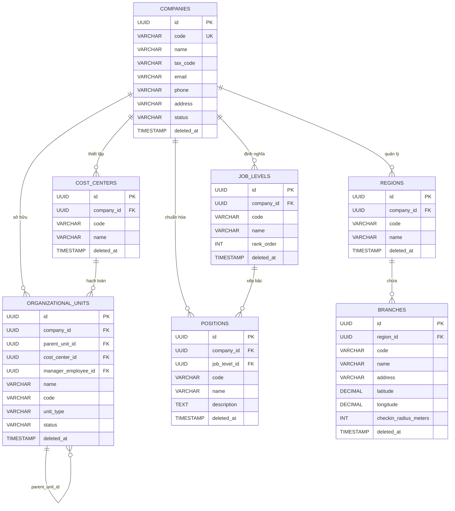
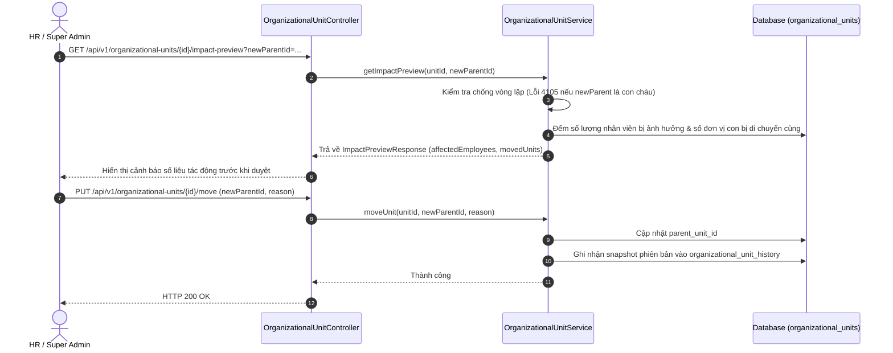

# Tài liệu Nghiệp vụ Module 01: Cơ cấu Tổ chức (Organization Management)

> **Module Code:** `organization`  
> **Package:** `com.cyclosa.organization`  
> **Phiên bản:** 2.0 (Chuẩn hóa Backend Standards & Temporal Hierarchy)  
> **Căn cứ nghiệp vụ & Thiết kế:**  
> - **Triết lý Mô hình 3 Chiều Độc lập:** Phân tách hoàn toàn Phòng ban (Đơn vị) — Chi nhánh (Địa lý) — Chức danh (Vị trí việc làm).  
> - **Cấu trúc Cây Đa cấp & Phiên bản Thời gian (Temporal Tree Hierarchy):** Hỗ trợ tái dựng toàn bộ sơ đồ tổ chức tại bất kỳ thời điểm nào trong quá khứ phục vụ kiểm toán (`atDate`).  
> - **Kế thừa Phân quyền Dữ liệu Đệ quy (DataScope Inheritance):** Cung cấp API `getSelfAndDescendantUnitIds` gom quyền kiểm soát xuống các đơn vị cấp con cháu.  
> - **Kiểm soát Tái cơ cấu (Reorganization Safety):** Ngăn chặn lặp vòng cha-con (`CIRCULAR_PARENT_DEPENDENCY`) và tính toán tác động trước khi di chuyển (`impact-preview`).

---

## 1. Tôn chỉ Nghiệp vụ & Nguyên tắc Thiết kế (Core Principles)

Trong hệ sinh thái **CYCLOSA HRM**, Module **Organization** là nền móng cốt lõi định nghĩa toàn bộ không gian tổ chức của doanh nghiệp:

$$\text{Nhân sự} = \text{Đơn vị tổ chức (Phòng ban)} + \text{Địa lý (Chi nhánh)} + \text{Vị trí việc làm (Chức danh)}$$

```
                        [COMPANIES (Công ty / Pháp nhân)]
                                       │
        ┌──────────────────────────────┼──────────────────────────────┐
        ▼                              ▼                              ▼
【Chiều 1: Đơn vị tổ chức】       【Chiều 2: Địa lý】          【Chiều 3: Vị trí việc làm】
  organizational_units           regions (Vùng miền)           job_levels (Cấp bậc)
  (Cây cha-con đa cấp:           branches (Chi nhánh)          positions (Chức danh phẳng)
   Khối -> Ban -> Phòng -> Nhóm)           │                             │
        │                                 │                             │
        └─────────────────────────┬───────┴─────────────────────────────┘
                                  ▼
                     [EMPLOYEE (Hồ sơ Nhân sự)]
         (Lưu 3 FK độc lập: unit_id + branch_id + position_id)
```

### 1.1. Chuẩn hóa Thiết kế Không dùng Interface + Impl thừa thãi (Concrete Service Pattern)
Theo chuẩn kiến trúc tại `docs/BACKEND_STANDARDS.md`:
- Toàn bộ service của module được viết trực tiếp dưới dạng **Concrete Service**:
  - `CompanyService.java`: Quản trị thông tin công ty, chi nhánh pháp nhân.
  - `OrganizationalUnitService.java`: Quản lý cây phòng ban, điều chuyển cây (`/move`), lịch sử phiên bản (`atDate`), tính toán tác động (`impact-preview`), và kế thừa đệ quy (`getSelfAndDescendantUnitIds`).
  - `PositionService.java` & `JobLevelService.java`: Chuẩn hóa danh mục chức danh và thang cấp bậc.
  - `BranchService.java` & `RegionService.java`: Quản lý mạng lưới chi nhánh, tọa độ GPS và bán kính chấm công.
  - `CostCenterService.java`: Quản lý trung tâm chi phí phân bổ ngân sách.
- **Tuyệt đối không tạo thư mục `impl/`** hay interface 1-1 hình thức.

### 1.2. Đóng gói Kiến trúc Modular Monolith & Cung Cấp Public Service
1. **Module trung tâm cung cấp Summary DTO cho toàn hệ thống:**
   - Cung cấp các hàm công khai nhẹ: `getUnitSummary`, `getUnitSummaries`, `getPositionSummary`, `getPositionSummaries`, `getCompanySummaries`, `getBranchSummary`.
   - Các module nghiệp vụ khác (`employee`, `contract`, `attendance`, `payroll`, `performance`, `talent`) chỉ gọi Public Service này để enrich thông tin, tuyệt đối không truy cập trực tiếp Repository của Organization.
2. **Batch Enrichment chống N+1 Query:** Mọi phương thức cung cấp cho bên ngoài đều hỗ trợ nạp theo lô (`Set<UUID>`).

### 1.3. Cây Đa Cấp Thời Gian Thực (Temporal Tree Hierarchy & Audit Readiness)
- Mỗi đơn vị phòng ban tự tham chiếu đến cha thông qua `parent_unit_id`.
- Mọi biến động di chuyển nút cha, đổi tên đều tự động lưu vào bảng `organizational_unit_history` với dải thời gian `effective_from` và `effective_to`.
- API `GET /api/v1/organizational-units/tree?atDate=...` cho phép vẽ lại chính xác cấu trúc tổ chức tại bất kỳ thời điểm nào trong lịch sử để giải trình cho kiểm toán và thanh tra lao động.

### 1.4. Bảo Vệ Toàn Vẹn Cấu Trúc Khi Tái Cơ Cấu (Safety Guard)
- **Chặn đệ quy vòng (Circular Prevention):** Không cho phép di chuyển một nút cha vào làm con của chính nó hoặc con của các nút con cháu của nó (`4105 CIRCULAR_PARENT_DEPENDENCY`).
- **Khóa an toàn khi xóa (Deletion Guard):**
  - Không cho phép xóa đơn vị nếu còn đơn vị cấp dưới (`4106 CANNOT_DELETE_UNIT_WITH_CHILDREN`).
  - Không cho phép xóa đơn vị nếu vẫn còn nhân sự đang hoạt động trực thuộc (`4107 CANNOT_DELETE_UNIT_WITH_EMPLOYEES`).

---

## 2. Mô hình Thực thể & CSDL Chi tiết (Database Schema)



### 2.1. Bảng `organizational_units` — Đơn Vị Phòng Ban Phân Cấp

| Tên Cột | Kiểu Dữ Liệu | Ràng Buộc | Ý Nghĩa Nghiệp Vụ |
| :--- | :--- | :--- | :--- |
| `id` | `UUID` | `PK, NOT NULL` | Định danh duy nhất của phòng ban/bộ phận. |
| `company_id` | `UUID` | `NOT NULL, INDEX` | Công ty/pháp nhân sở hữu. |
| `parent_unit_id` | `UUID` | `NULLABLE, INDEX` | Khóa ngoại tự tham chiếu tới đơn vị cha (null = Nút gốc/Khối). |
| `code` | `VARCHAR(50)` | `NOT NULL` | Mã phòng ban (duy nhất trong công ty). |
| `name` | `VARCHAR(150)` | `NOT NULL` | Tên hiển thị (ví dụ: "Ban Công Nghệ", "Phòng Backend"). |
| `unit_type` | `VARCHAR(30)` | `NOT NULL` | Cấp bậc: `DIVISION`, `DEPARTMENT`, `TEAM`, `SECTION`. |
| `manager_employee_id`| `UUID` | `NULLABLE` | Nhân sự giữ vai trò Trưởng phòng/Trưởng bộ phận. |
| `cost_center_id` | `UUID` | `NULLABLE` | Trung tâm chi phí liên kết hạch toán ngân sách. |
| `status` | `VARCHAR(20)` | `NOT NULL` | Trạng thái: `ACTIVE`, `INACTIVE`. |
| `deleted_at` | `TIMESTAMP` | `NULLABLE, INDEX` | Thời điểm xóa mềm. |

---

### 2.2. Bảng `branches` — Chi Nhánh Địa Lý & Bán Kính Chấm Công

| Tên Cột | Kiểu Dữ Liệu | Ràng Buộc | Ý Nghĩa Nghiệp Vụ |
| :--- | :--- | :--- | :--- |
| `id` | `UUID` | `PK, NOT NULL` | Định danh duy nhất của chi nhánh. |
| `region_id` | `UUID` | `NOT NULL, FK` | Vùng miền trực thuộc (Miền Bắc, Miền Nam...). |
| `code` | `VARCHAR(50)` | `NOT NULL` | Mã chi nhánh (`HN-OFFICE`, `HCM-OFFICE`...). |
| `name` | `VARCHAR(150)` | `NOT NULL` | Tên văn phòng / địa điểm làm việc. |
| `address` | `VARCHAR(255)` | `NOT NULL` | Địa chỉ văn phòng. |
| `latitude` | `DECIMAL(10,7)`| `NULLABLE` | Tọa độ vĩ độ GPS phục vụ định vị check-in. |
| `longitude` | `DECIMAL(10,7)`| `NULLABLE` | Tọa độ kinh độ GPS phục vụ định vị check-in. |
| `checkin_radius_meters`| `INT` | `DEFAULT 200` | Bán kính hợp lệ (mét) cho phép điểm danh di động. |

---

## 3. Các Luồng Nghiệp vụ Trọng tâm (Business Workflows)

### 3.1. Luồng Tái Cơ Cấu & Điều Chuyển Đơn Vị (F1: Unit Movement & Impact Preview)



---

### 3.2. Luồng Tái Dựng Cây Tổ Chức Trong Quá Khứ (F2: Historical Hierarchy atDate)
1. Khi có yêu cầu kiểm toán các quyết định bổ nhiệm hoặc chi trả lương tại thời điểm `2025-06-01`, Client gọi:
   `GET /api/v1/organizational-units/tree?atDate=2025-06-01`
2. Hệ thống truy vấn bảng `organizational_unit_history` lấy các bản ghi có:
   $$\text{effective\_from} \le \text{atDate} < \text{effective\_to}$$
3. Dựng cấu trúc cây theo dữ liệu snapshot lịch sử và trả về cho người dùng mà không bị ảnh hưởng bởi các thay đổi hiện tại.

---

## 4. Danh mục RESTful API Chi tiết

Base URI: `/api/v1`

| HTTP Method | Endpoint URI | Phân Quyền (@PreAuthorize) | DTO Request / Response | Chức Năng Nghiệp Vụ |
| :---: | :--- | :--- | :--- | :--- |
| `POST` | `/companies` | `@perm.has('organization.manage')` | `CreateCompanyRequest` $\rightarrow$ `ApiResponse<CompanyResponse>` | Khởi tạo công ty / pháp nhân mới. |
| `GET` | `/companies` | `@perm.has('organization.view')` | `CompanyFilter` $\rightarrow$ `ApiResponse<PageData<CompanyResponse>>` | Danh sách công ty có phân trang. |
| `GET` | `/companies/{id}` | `@perm.has('organization.view')` | Path `id` $\rightarrow$ `ApiResponse<CompanyResponse>` | Xem chi tiết thông tin công ty. |
| `PUT` | `/companies/{id}` | `@perm.has('organization.manage')` | `UpdateCompanyRequest` $\rightarrow$ `ApiResponse<CompanyResponse>` | Cập nhật thông tin công ty. |
| `GET` | `/organizational-units/tree` | `@perm.has('organization.view')` | Query `atDate` $\rightarrow$ `ApiResponse<List<UnitTreeResponse>>` | Lấy cây sơ đồ phòng ban phân cấp (hỗ trợ lịch sử `atDate`). |
| `GET` | `/organizational-units/{id}` | `@perm.has('organization.view')` | Path `id` $\rightarrow$ `ApiResponse<OrgUnitDetailResponse>` | Xem chi tiết thông tin đơn vị phòng ban. |
| `POST` | `/organizational-units` | `@perm.has('organization.create')` | `CreateUnitRequest` $\rightarrow$ `ApiResponse<OrgUnitResponse>` | Tạo mới phòng ban / đơn vị. |
| `PUT` | `/organizational-units/{id}` | `@perm.has('organization.update')` | `UpdateUnitRequest` $\rightarrow$ `ApiResponse<OrgUnitResponse>` | Cập nhật thông tin phòng ban. |
| `DELETE`| `/organizational-units/{id}`| `@perm.has('organization.delete')` | Path `id` $\rightarrow$ `ApiResponse<Void>` | Xóa phòng ban (ràng buộc an toàn nhân sự & con). |
| `GET` | `/organizational-units/{id}/impact-preview` | `@perm.has('organization.manage')` | Path `id, newParentId` $\rightarrow$ `ApiResponse<ImpactPreviewResponse>` | Xem trước tác động khi tái cơ cấu đơn vị. |
| `PUT` | `/organizational-units/{id}/move` | `@perm.has('organization.manage')` | `MoveUnitRequest` $\rightarrow$ `ApiResponse<Void>` | Điều chuyển đơn vị sang nhánh cha mới (kèm lý do). |
| `GET` | `/organizational-units/{id}/descendant-ids` | `@perm.has('organization.view')` | Path `id` $\rightarrow$ `ApiResponse<Set<UUID>>` | Lấy toàn bộ ID đơn vị và con cháu (DataScope). |
| `GET` | `/geography/tree` | `@perm.has('organization.view')` | None $\rightarrow$ `ApiResponse<List<RegionResponse>>` | Danh sách vùng miền kèm các chi nhánh trực thuộc. |
| `POST` | `/branches` | `@perm.has('organization.manage')` | `CreateBranchRequest` $\rightarrow$ `ApiResponse<BranchResponse>` | Tạo mới chi nhánh (tọa độ GPS, bán kính). |
| `GET` | `/job-levels` | `@perm.has('organization.view')` | None $\rightarrow$ `ApiResponse<List<JobLevelResponse>>` | Danh sách thang cấp bậc nhân sự. |
| `POST` | `/job-levels` | `@perm.has('organization.manage')` | `CreateJobLevelRequest` $\rightarrow$ `ApiResponse<JobLevelResponse>` | Tạo mới cấp bậc nhân sự. |
| `GET` | `/positions` | `@perm.has('organization.view')` | `PositionFilter` $\rightarrow$ `ApiResponse<PageData<PositionResponse>>` | Danh sách chức danh việc làm (phân trang). |
| `POST` | `/positions` | `@perm.has('organization.create')` | `CreatePositionRequest` $\rightarrow$ `ApiResponse<PositionResponse>` | Tạo mới chức danh việc làm chuẩn hóa. |
| `GET` | `/cost-centers` | `@perm.has('organization.view')` | None $\rightarrow$ `ApiResponse<List<CostCenterResponse>>` | Danh mục trung tâm chi phí hạch toán ngân sách. |

---

## 5. Danh mục Mã lỗi Module Organization (`OrganizationErrorCode`)

| Mã Lỗi (Enum) | Mã Số | HTTP Status | Thông Điệp Tiếng Việt | Nguyên Nhân & Ngữ Cảnh Kích Hoạt |
| :--- | :---: | :---: | :--- | :--- |
| `COMPANY_NOT_FOUND` | **4101** | `404 Not Found` | Không tìm thấy thông tin công ty | `company_id` không tồn tại hoặc đã bị xóa mềm. |
| `COMPANY_CODE_EXISTS` | **4102** | `409 Conflict` | Mã công ty đã tồn tại trong hệ thống | Trùng lặp `company.code` trên toàn hệ thống. |
| `ORG_UNIT_NOT_FOUND` | **4103** | `404 Not Found` | Không tìm thấy đơn vị tổ chức/phòng ban | `unit_id` không tồn tại trong CSDL. |
| `ORG_UNIT_CODE_EXISTS` | **4104** | `409 Conflict` | Mã đơn vị đã tồn tại trong công ty | Trùng `code` đơn vị trong cùng một `company_id`. |
| `CIRCULAR_PARENT_DEPENDENCY` | **4105** | `400 Bad Request` | Không thể di chuyển đơn vị vào chính nó hoặc cấp dưới của nó | Phát hiện quan hệ lặp vòng khi thực hiện `/move`. |
| `CANNOT_DELETE_UNIT_WITH_CHILDREN` | **4106** | `400 Bad Request` | Không thể xóa đơn vị đang có đơn vị cấp dưới | Cố gắng xóa nút cha khi chưa di chuyển các nút con. |
| `CANNOT_DELETE_UNIT_WITH_EMPLOYEES`| **4107** | `400 Bad Request` | Không thể xóa đơn vị đang có nhân sự trực thuộc | Còn nhân sự đang active gắn với phòng ban này. |
| `REGION_NOT_FOUND` | **4108** | `404 Not Found` | Không tìm thấy vùng miền | `region_id` không tồn tại trong hệ thống. |
| `BRANCH_NOT_FOUND` | **4109** | `404 Not Found` | Không tìm thấy chi nhánh | `branch_id` không tồn tại trong hệ thống. |
| `BRANCH_CODE_EXISTS` | **4110** | `409 Conflict` | Mã chi nhánh đã tồn tại trong công ty | Trùng lặp mã chi nhánh trong công ty. |
| `JOB_LEVEL_NOT_FOUND` | **4111** | `404 Not Found` | Không tìm thấy cấp bậc công việc | `job_level_id` không tồn tại trong hệ thống. |
| `JOB_LEVEL_CODE_EXISTS` | **4112** | `409 Conflict` | Mã cấp bậc công việc đã tồn tại | Trùng lặp mã cấp bậc công việc trong công ty. |
| `POSITION_NOT_FOUND` | **4113** | `404 Not Found` | Không tìm thấy vị trí chức danh | `position_id` không tồn tại trong hệ thống. |
| `POSITION_CODE_EXISTS` | **4114** | `409 Conflict` | Mã vị trí chức danh đã tồn tại trong công ty | Trùng lặp mã chức danh trong công ty. |
| `COST_CENTER_NOT_FOUND` | **4115** | `404 Not Found` | Không tìm thấy trung tâm chi phí | `cost_center_id` không tồn tại trong hệ thống. |
| `COST_CENTER_CODE_EXISTS` | **4116** | `409 Conflict` | Mã trung tâm chi phí đã tồn tại | Trùng lặp mã trung tâm chi phí trong công ty. |

---

## 6. Phân bổ Quyền Hạn & Ma trận Vai trò (RBAC Matrix)

| Mã Quyền (Permission) | Mô Tả Hành Động | Super Admin | HR Admin | Dept Manager | Employee |
| :--- | :--- | :---: | :---: | :---: | :---: |
| `organization.view` | Xem cây phòng ban, chi nhánh, chức danh, cấp bậc | **FULL** | **FULL** | **FULL** | **VIEW ONLY** |
| `organization.create` | Tạo mới phòng ban, chức danh việc làm | **FULL** | **FULL** | ⛔ | ⛔ |
| `organization.update` | Sửa thông tin phòng ban, chức danh, chi nhánh | **FULL** | **FULL** | ⛔ | ⛔ |
| `organization.delete` | Xóa mềm phòng ban, chức danh | **FULL** | **FULL** | ⛔ | ⛔ |
| `organization.manage` | Điều chuyển cây phòng ban, xem trước tác động, quản lý công ty/cost center | **FULL** | **FULL** | ⛔ | ⛔ |
