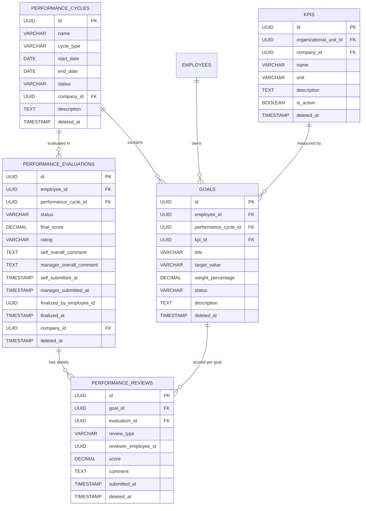
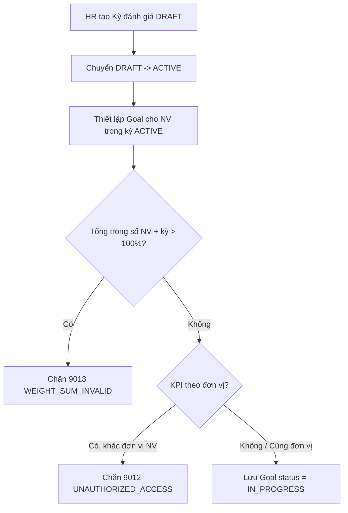
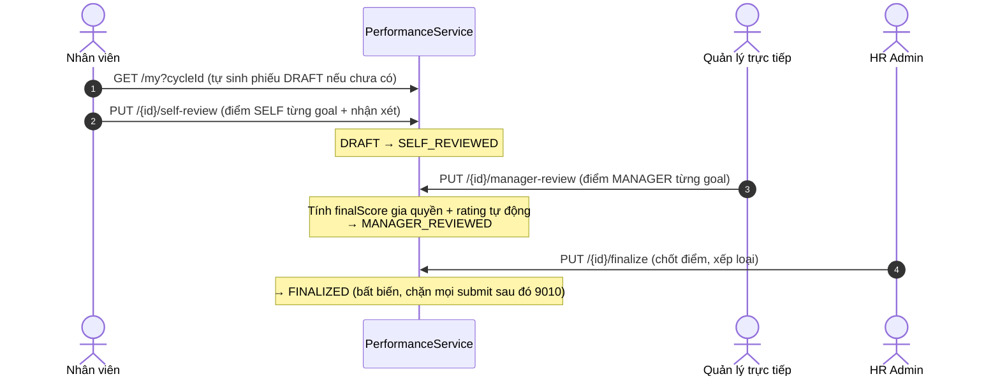

# Tài liệu Nghiệp vụ Module: Đánh giá Hiệu suất & KPI (Performance Management)

> **Module Code:** `performance`  
> **Package:** `com.cyclosa.performance`  
> **Phiên bản:** 2.0 (Chuẩn hóa Backend Standards & Automation)  
> **Căn cứ nghiệp vụ:**  
> - Khung quản trị hiệu suất theo chu kỳ: Quý (`QUARTERLY`), Nửa năm (`SEMI_ANNUAL`), Năm (`ANNUAL`).  
> - Mô hình mục tiêu có trọng số: tổng trọng số mục tiêu của 1 nhân viên trong 1 kỳ **≤ 100%**.  
> - Quy trình đánh giá 4 bước: Tự đánh giá (`SELF`) → Quản lý chấm (`MANAGER`) → Chốt (`FINALIZED`) → Xếp loại tự động (`EXCELLENT / GOOD / SATISFACTORY / NEEDS_IMPROVEMENT / POOR`).

---

## 1. Tôn chỉ Nghiệp vụ & Nguyên tắc Thiết kế (Core Principles)

Module **Performance** là trung tâm đo lường kết quả công việc của nhân sự, đóng vai trò cầu nối giữa **Hồ sơ nhân sự (Employee Profile)**, **Cơ cấu tổ chức (Organization)** và các quyết định nhân sự (thăng tiến, khen thưởng, đào tạo).

```
┌─────────────────────────┐       ┌────────────────────────────────┐       ┌─────────────────────────┐
│   Module 04: Employee   │       │  Module Performance            │       │  Reward / Career        │
│  - Nhân viên, Phòng ban │ ────> │  - Kỳ đánh giá, KPI, Goal      │ ────> │  - Khen thưởng, bổ nhiệm│
│  - Chức danh, Công ty   │       │  - Self-review, Manager-review │       │  - Đào tạo, quy hoạch   │
└─────────────────────────┘       └────────────────────────────────┘       └─────────────────────────┘
```

### 1.1. Chuẩn hóa Thiết kế Không dùng Interface + Impl thừa thãi (Concrete Service Pattern)
Theo chuẩn kiến trúc tại `docs/BACKEND_STANDARDS.md`:
- Toàn bộ service của module được viết trực tiếp dưới dạng **Concrete Service**:
  - `PerformanceService.java`: Service trung tâm duy nhất, phụ trách Kỳ đánh giá, KPI, Goal, Phiếu đánh giá và Chấm điểm.
- **Tuyệt đối không tạo thư mục `impl/`** hay interface 1-1 hình thức.

### 1.2. Đóng gói Kiến trúc Modular Monolith & Giao tiếp Liên Module
1. **Lấy dữ liệu hạ tầng qua Public Service của module lân cận:**
   - `EmployeeService`: `getEmployeeByIdInternal`, `findEmployeeIdByUserId`, `getEmployeeSummaries`, `getSubordinateEmployeeIds` — xác thực nhân viên, chủ phiếu, phân quyền dữ liệu.
   - `CompanyService`: `getCompanySummaries` — enrich thông tin công ty cho KPI.
   - `OrganizationalUnitService` (`Organization`): `getUnitSummary / getUnitSummaries` — enrich phòng ban, kiểm tra KPI theo đơn vị.
2. **Không inject Repository của module khác**, không truy cập trực tiếp Entity module khác.
3. **Batch Enrichment chống N+1 Query:** mọi API danh sách gom `Set<UUID>` (employeeIds, unitIds, companyIds, cycleIds) rồi gọi batch 1 lần.

### 1.3. Bất biến Phiếu đã Chốt (Finalized Immutability)
- Phiếu đánh giá ở trạng thái `FINALIZED` là **bất biến**. Mọi thao tác `submitSelfReview`, `submitManagerReview`, `finalizeEvaluation` lại đều bị chặn với mã `EVALUATION_ALREADY_FINALIZED (9010)`.
- Kỳ đánh giá đã `CLOSED` không được sửa; chỉ xóa kỳ ở trạng thái `DRAFT`.

### 1.4. Tự động Sinh Phiếu & Tính Điểm Gia quyền (Automation)
- API `GET /my` tự động sinh phiếu (`ensureEvaluationExists`) nếu nhân viên chưa có phiếu trong kỳ.
- Điểm tổng (`finalScore`) = trung bình có trọng số theo điểm **MANAGER**: `Σ(score_i × weight_i) / Σ(weight_i)`, làm tròn `HALF_UP` 2 chữ số.
- Xếp loại (`rating`) tự động từ điểm qua hàm `determineRating()`.

---

## 2. Mô hình Thực thể & CSDL Chi tiết (Database Schema)



---

### 2.1. Bảng `performance_cycles` — Kỳ Đánh giá Hiệu suất

| Thuộc tính | Kiểu dữ liệu | Ràng buộc | Diễn giải nghiệp vụ |
| :--- | :--- | :--- | :--- |
| `id` | `UUID` | PK | Khóa chính |
| `company_id` | `UUID` | Nullable | Multi-tenancy (`null` = dùng chung) |
| `name` | `VARCHAR(200)` | Not Null | Tên kỳ, unique theo `companyId` |
| `cycle_type` | `ENUM` | Not Null | `QUARTERLY`, `SEMI_ANNUAL`, `ANNUAL` |
| `start_date` | `DATE` | Not Null | Ngày bắt đầu, bắt buộc `<= end_date` |
| `end_date` | `DATE` | Not Null | Ngày kết thúc |
| `status` | `ENUM` | Not Null, Default `DRAFT` | `DRAFT` (Nháp) → `ACTIVE` (Đang áp dụng) → `CLOSED` (Đã đóng) |
| `description` | `TEXT` | Nullable | Mô tả kỳ |
| `deleted_at` | `TIMESTAMP` | Nullable | Xóa mềm (`BaseEntity`) |

> [!IMPORTANT]
> Chỉ được sửa kỳ khi chưa `CLOSED` (`9010` dùng chung `CYCLE_CANNOT_BE_MODIFIED - 9004`). Chỉ được xóa kỳ ở trạng thái `DRAFT`.

---

### 2.2. Bảng `kpis` — Danh mục Chỉ số KPI

| Thuộc tính | Kiểu dữ liệu | Ràng buộc | Diễn giải nghiệp vụ |
| :--- | :--- | :--- | :--- |
| `id` | `UUID` | PK | Khóa chính |
| `organizational_unit_id` | `UUID` | Nullable | Đơn vị sở hữu KPI (`null` = toàn công ty) |
| `company_id` | `UUID` | Nullable | Multi-tenancy |
| `name` | `VARCHAR(200)` | Not Null | Tên KPI |
| `unit` | `VARCHAR(50)` | Not Null | Đơn vị tính: `%`, `VND`, `Số lượng` |
| `description` | `TEXT` | Nullable | Diễn giải cách đo |
| `is_active` | `BOOLEAN` | Default True | Ẩn/hiện KPI |
| `deleted_at` | `TIMESTAMP` | Nullable | Xóa mềm |

---

### 2.3. Bảng `goals` — Mục tiêu Cá nhân theo Kỳ

| Thuộc tính | Kiểu dữ liệu | Ràng buộc | Diễn giải nghiệp vụ |
| :--- | :--- | :--- | :--- |
| `id` | `UUID` | PK | Khóa chính |
| `employee_id` | `UUID` | FK logic, Not Null | Nhân viên sở hữu mục tiêu |
| `performance_cycle_id` | `UUID` | FK logic, Not Null | Kỳ đánh giá chứa mục tiêu |
| `kpi_id` | `UUID` | Nullable | Liên kết KPI (optional) |
| `title` | `VARCHAR(255)` | Not Null | Tên mục tiêu |
| `target_value` | `VARCHAR(100)` | Not Null | Giá trị mục tiêu dạng chuỗi (VD: `95%`, `100 triệu`) |
| `weight_percentage` | `DECIMAL(5,2)` | Not Null, `0.01 - 100.00` | Trọng số; tổng theo NV + kỳ **≤ 100** |
| `status` | `ENUM` | Default `IN_PROGRESS` khi tạo | `NOT_STARTED`, `IN_PROGRESS`, `COMPLETED`, `CANCELLED` |
| `description` | `TEXT` | Nullable | Chi tiết mục tiêu |
| `deleted_at` | `TIMESTAMP` | Nullable | Xóa mềm |

> [!NOTE]
> KPI gắn theo đơn vị (`organizationalUnitId != null`) chỉ được gán cho nhân viên **cùng đơn vị**, ngược lại chặn `9012 UNAUTHORIZED_ACCESS`.

---

### 2.4. Bảng `performance_evaluations` — Phiếu Đánh giá Tổng hợp

Unique `(employee_id, performance_cycle_id)` — mỗi nhân viên 1 phiếu/kỳ:

| Thuộc tính | Kiểu dữ liệu | Ràng buộc | Diễn giải nghiệp vụ |
| :--- | :--- | :--- | :--- |
| `id` | `UUID` | PK | Khóa chính |
| `employee_id` | `UUID` | Not Null | Nhân viên được đánh giá |
| `performance_cycle_id` | `UUID` | Not Null | Kỳ đánh giá |
| `status` | `ENUM` | Default `DRAFT` | `DRAFT` → `SELF_REVIEWED` → `MANAGER_REVIEWED` → `FINALIZED` |
| `final_score` | `DECIMAL(5,2)` | Nullable, `0 - 100` | Điểm tổng, auto tính ở manager-review, cho phép chốt tay ở finalize |
| `rating` | `ENUM` | Nullable | `EXCELLENT`, `GOOD`, `SATISFACTORY`, `NEEDS_IMPROVEMENT`, `POOR` |
| `self_overall_comment` | `TEXT` | Nullable | Nhận xét chung của nhân viên |
| `manager_overall_comment` | `TEXT` | Nullable | Nhận xét chung của quản lý |
| `self_submitted_at` | `TIMESTAMP` | Nullable | Thời điểm nộp tự đánh giá |
| `manager_submitted_at` | `TIMESTAMP` | Nullable | Thời điểm quản lý chấm |
| `finalized_by_employee_id` | `UUID` | Nullable | Người chốt phiếu |
| `finalized_at` | `TIMESTAMP` | Nullable | Thời điểm chốt |
| `company_id` | `UUID` | Nullable | Snapshot công ty tại lúc tạo phiếu |
| `deleted_at` | `TIMESTAMP` | Nullable | Xóa mềm |

---

### 2.5. Bảng `performance_reviews` — Điểm Chi tiết từng Mục tiêu

Unique `(goal_id, review_type)` — mỗi goal tối đa 2 dòng `SELF` / `MANAGER`:

| Thuộc tính | Kiểu dữ liệu | Ràng buộc | Diễn giải nghiệp vụ |
| :--- | :--- | :--- | :--- |
| `id` | `UUID` | PK | Khóa chính |
| `goal_id` | `UUID` | Not Null | Mục tiêu được chấm |
| `evaluation_id` | `UUID` | Not Null | Phiếu cha |
| `review_type` | `ENUM` | Not Null | `SELF` (Tự chấm), `MANAGER` (Quản lý chấm) |
| `reviewer_employee_id` | `UUID` | Not Null | Người chấm |
| `score` | `DECIMAL(5,2)` | Not Null, `0 - 100` | Điểm cho goal |
| `comment` | `TEXT` | Nullable | Nhận xét từng goal |
| `submitted_at` | `TIMESTAMP` | Not Null | Thời điểm chấm |
| `deleted_at` | `TIMESTAMP` | Nullable | Xóa mềm |

---

## 3. Các Luồng Nghiệp vụ Trọng tâm (Business Workflows)

### 3.1. Luồng Khởi tạo Kỳ & Thiết lập Mục tiêu



**Quy tắc:**
1. `startDate <= endDate`, ngược lại `9003 CYCLE_DATE_INVALID`.
2. Tên kỳ unique trong `companyId`, ngược lại `9002 CYCLE_NAME_EXISTS`.
3. Chỉ tạo/sửa `Goal` khi kỳ ở `ACTIVE`, ngược lại `9004 CYCLE_CANNOT_BE_MODIFIED`.

---

### 3.2. Luồng Đánh giá 4 Bước (Self → Manager → Finalize)



#### Công thức tính điểm tổng:
$$finalScore = \frac{\sum (managerScore_i \times weight_i)}{\sum weight_i}$$
Làm tròn `HALF_UP` 2 chữ số. Chỉ tính các goal đã có điểm `MANAGER`.

#### Bảng xếp loại tự động (`determineRating`):
| Điểm | Xếp loại | Enum |
| :---: | :--- | :--- |
| `≥ 90` | Xuất sắc | `EXCELLENT` |
| `≥ 80` | Tốt | `GOOD` |
| `≥ 65` | Đạt | `SATISFACTORY` |
| `≥ 50` | Cần cải thiện | `NEEDS_IMPROVEMENT` |
| `< 50` | Kém | `POOR` |

---

### 3.3. Quy tắc Chấm điểm & Bảo vệ Dữ liệu
1. **Self-review chỉ chủ phiếu được nộp** (so `currentEmpId` với `evaluation.employeeId`), ngược lại `9012`.
2. **Goal phải thuộc đúng nhân viên của phiếu** khi chấm, ngược lại `9012`.
3. **Upsert theo unique `(goalId, reviewType)`**: chấm lại cùng goal + cùng loại chỉ update, không tạo trùng.
4. **Manager có thể chấm ngay cả khi NV chưa self-review** (không bắt buộc thứ tự cứng).
5. **Finalize ưu tiên `rating` client gửi**, nếu null thì tự tính từ `finalScore`.

---

## 4. Danh mục RESTful API Chi tiết

### 4.1. Nhóm API Kỳ Đánh giá (`/api/v1/kpi-periods` + `/api/v1/performance-cycles`)

| Method | Endpoint | Mô tả chức năng | Quyền yêu cầu | Response DTO |
| :---: | :--- | :--- | :--- | :--- |
| `GET` | `/api/v1/kpi-periods` | Danh sách kỳ đánh giá có phân trang, bộ lọc | `performance.view` | `ApiResponse<PageData<PerformanceCycleResponse>>` |
| `POST` | `/api/v1/kpi-periods` | Khởi tạo kỳ đánh giá mới (luôn `DRAFT`) | `performance.manage` | `ApiResponse<PerformanceCycleResponse>` (201) |
| `GET` | `/api/v1/kpi-periods/{id}` | Chi tiết kỳ đánh giá | `performance.view` | `ApiResponse<PerformanceCycleResponse>` |
| `PUT` | `/api/v1/kpi-periods/{id}` | Cập nhật kỳ (chưa `CLOSED`) | `performance.manage` | `ApiResponse<PerformanceCycleResponse>` |
| `PUT` | `/api/v1/kpi-periods/{id}/status?status=` | Chuyển trạng thái `DRAFT → ACTIVE → CLOSED` | `performance.manage` | `ApiResponse<PerformanceCycleResponse>` |
| `DELETE` | `/api/v1/kpi-periods/{id}` | Xóa kỳ (chỉ `DRAFT`) | `performance.manage` | `ApiResponse<Void>` |

### 4.2. Nhóm API Danh mục KPI (`/api/v1/kpis`)

| Method | Endpoint | Mô tả chức năng | Quyền yêu cầu | Response DTO |
| :---: | :--- | :--- | :--- | :--- |
| `POST` | `/api/v1/kpis` | Khai báo KPI mới | `performance.manage` | `ApiResponse<KpiResponse>` (201) |
| `PUT` | `/api/v1/kpis/{id}` | Cập nhật KPI | `performance.manage` | `ApiResponse<KpiResponse>` |
| `GET` | `/api/v1/kpis/{id}` | Chi tiết KPI | `performance.view` | `ApiResponse<KpiResponse>` |
| `GET` | `/api/v1/kpis` | Tra cứu KPI có phân trang, bộ lọc | `performance.view` | `ApiResponse<PageData<KpiResponse>>` |
| `DELETE` | `/api/v1/kpis/{id}` | Xóa KPI | `performance.manage` | `ApiResponse<Void>` |

### 4.3. Nhóm API Mục tiêu (`/api/v1/goals`)

| Method | Endpoint | Mô tả chức năng | Quyền yêu cầu | Response DTO |
| :---: | :--- | :--- | :--- | :--- |
| `POST` | `/api/v1/goals` | Thiết lập mục tiêu (check tổng trọng số ≤ 100%) | `performance.manage` | `ApiResponse<GoalResponse>` (201) |
| `PUT` | `/api/v1/goals/{id}` | Cập nhật mục tiêu | `performance.manage` | `ApiResponse<GoalResponse>` |
| `GET` | `/api/v1/goals/{id}` | Chi tiết mục tiêu | `performance.view` | `ApiResponse<GoalResponse>` |
| `GET` | `/api/v1/goals` | Tra cứu mục tiêu có phân trang (DataScope) | `performance.view` | `ApiResponse<PageData<GoalResponse>>` |
| `DELETE` | `/api/v1/goals/{id}` | Xóa mục tiêu | `performance.manage` | `ApiResponse<Void>` |

### 4.4. Nhóm API Phiếu Đánh giá (`/api/v1/kpi-evaluations` + `/api/v1/performance/evaluations`)

| Method | Endpoint | Mô tả chức năng | Quyền yêu cầu | Response DTO |
| :---: | :--- | :--- | :--- | :--- |
| `GET` | `/api/v1/kpi-evaluations/my?cycleId=` | NV xem phiếu cá nhân (tự sinh nếu chưa có) | `performance.view_own` | `ApiResponse<PerformanceEvaluationDetailResponse>` |
| `PUT` | `/api/v1/kpi-evaluations/{id}/self-review` | NV nộp tự đánh giá | `performance.view_own` | `ApiResponse<PerformanceEvaluationDetailResponse>` |
| `PUT` | `/api/v1/kpi-evaluations/{id}/manager-review` | Quản lý chấm điểm + auto tính điểm tổng | `performance.evaluate` | `ApiResponse<PerformanceEvaluationDetailResponse>` |
| `PUT` | `/api/v1/kpi-evaluations/{id}/finalize` | Chốt điểm cuối kỳ (Finalize) | `performance.manage` | `ApiResponse<PerformanceEvaluationDetailResponse>` |
| `GET` | `/api/v1/kpi-evaluations` | Tra cứu phiếu theo kỳ/NV có phân trang (DataScope) | `performance.view` | `ApiResponse<PageData<PerformanceEvaluationResponse>>` |
| `GET` | `/api/v1/kpi-evaluations/{id}` | Chi tiết phiếu kèm goals + điểm SELF/MANAGER | `performance.view` | `ApiResponse<PerformanceEvaluationDetailResponse>` |

---

## 5. Danh mục Mã lỗi Module Performance (`PerformanceErrorCode`)

Dải mã `9001 - 9015`, định nghĩa tại `PerformanceErrorCode.java`:

| Mã lỗi | Enum Name | HTTP Status | Thông điệp lỗi chuẩn |
| :---: | :--- | :---: | :--- |
| `9001` | `CYCLE_NOT_FOUND` | 404 Not Found | Không tìm thấy kỳ đánh giá hiệu suất |
| `9002` | `CYCLE_NAME_EXISTS` | 409 Conflict | Tên kỳ đánh giá đã tồn tại trong công ty |
| `9003` | `CYCLE_DATE_INVALID` | 400 Bad Request | Ngày bắt đầu không được sau ngày kết thúc |
| `9004` | `CYCLE_CANNOT_BE_MODIFIED` | 409 Conflict | Kỳ đánh giá đã đóng hoặc đã lưu trữ, không thể chỉnh sửa |
| `9005` | `KPI_NOT_FOUND` | 404 Not Found | Không tìm thấy chỉ số KPI |
| `9006` | `KPI_CODE_EXISTS` | 409 Conflict | Mã chỉ số KPI đã tồn tại trong công ty |
| `9007` | `GOAL_NOT_FOUND` | 404 Not Found | Không tìm thấy mục tiêu hiệu suất |
| `9008` | `EVALUATION_NOT_FOUND` | 404 Not Found | Không tìm thấy phiếu đánh giá hiệu suất |
| `9009` | `EVALUATION_ALREADY_EXISTS` | 409 Conflict | Phiếu đánh giá cho nhân viên trong kỳ này đã tồn tại |
| `9010` | `EVALUATION_ALREADY_FINALIZED` | 409 Conflict | Phiếu đánh giá đã được hoàn tất phê duyệt, không thể chỉnh sửa |
| `9011` | `SELF_EVALUATION_NOT_SUBMITTED` | 400 Bad Request | Nhân viên chưa gửi bản tự đánh giá |
| `9012` | `UNAUTHORIZED_ACCESS` | 403 Forbidden | Bạn không có quyền truy cập hoặc đánh giá phiếu này |
| `9013` | `WEIGHT_SUM_INVALID` | 400 Bad Request | Tổng trọng số các mục tiêu đánh giá phải bằng 100% |
| `9014` | `CURRENT_USER_NOT_LINKED_EMPLOYEE` | 400 Bad Request | Tài khoản hiện tại chưa được liên kết với nhân viên |
| `9015` | `EMPLOYEE_NOT_FOUND` | 404 Not Found | Không tìm thấy thông tin nhân viên được chỉ định |

---

## 6. Phân bổ Quyền Hạn & Ma trận Vai trò (RBAC Matrix)

| Mã quyền (Permission Code) | Diễn giải quyền | Gán vai trò mặc định & DataScope |
| :--- | :--- | :--- |
| `performance.view` | Xem kỳ, KPI, mục tiêu, phiếu đánh giá | `DEPARTMENT_MANAGER` (DEPARTMENT), `HR_ADMIN` (COMPANY), `SUPER_ADMIN` (ALL); `getGoals/getEvaluations` lọc `OWN / TEAM / DEPARTMENT / COMPANY / ALL` |
| `performance.manage` | Quản trị kỳ-KPI-Goal + chốt phiếu cuối kỳ | `HR_ADMIN` (COMPANY), `SUPER_ADMIN` (ALL) |
| `performance.view_own` | NV xem phiếu của chính mình + nộp tự đánh giá | `EMPLOYEE` (OWN), `DEPARTMENT_MANAGER` (OWN), `HR_ADMIN` (OWN) |
| `performance.evaluate` | Quản lý chấm điểm nhân viên | `DEPARTMENT_MANAGER` (DEPARTMENT), `HR_ADMIN` (COMPANY), `SUPER_ADMIN` (ALL) |
