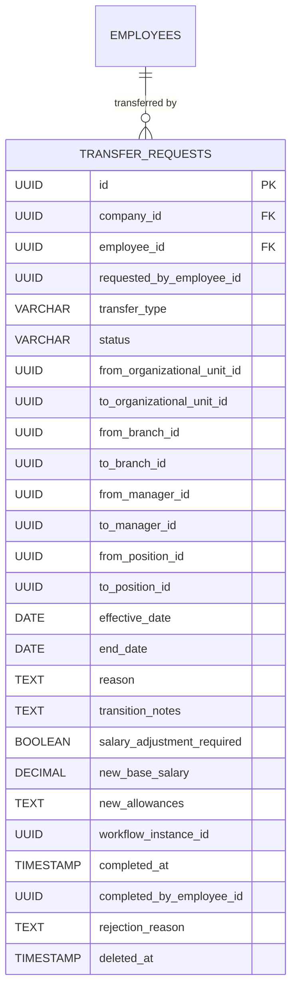
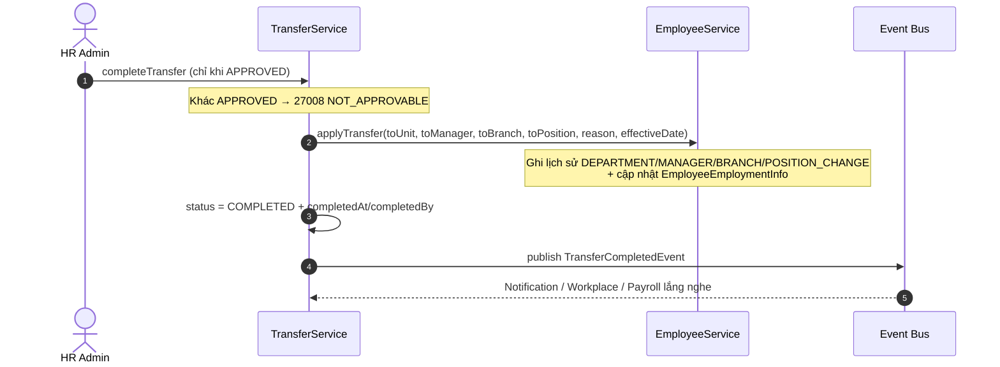

# Tài liệu Nghiệp vụ Module: Điều chuyển Nhân sự (Employee Transfer Management)

> **Module Code:** `transfer`  
> **Package:** `com.cyclosa.transfer`  
> **Phiên bản:** 2.0 (Chuẩn hóa Backend Standards & Automation)  
> **Phạm vi nghiệp vụ:**  
> - Điều chuyển nội bộ khác phòng ban, khác chi nhánh, sang công ty con, thay đổi chức vụ, điều chuyển tạm thời có thời hạn.  
> - Vòng đời: Nháp (`DRAFT`) → Chờ duyệt (`PENDING_APPROVAL`) → Đã duyệt (`APPROVED`) → Hoàn thành (`COMPLETED`), kèm nhánh từ chối/hủy.  
> - Khi hoàn thành, tự động áp dụng vào hồ sơ nhân viên (`EmployeeEmploymentInfo`) + ghi lịch sử biến động + bắn sự kiện cho module khác.  
> - ⚠️ **Trạng thái code hiện tại:** module có đầy đủ Entity/Service/Event/Repository/DTO nhưng **chưa có Controller** (chưa có API, `@Operation`, `@PreAuthorize`). Mục 4 dưới đây là đặc tả API suy ra từ `TransferService` để FE/BE thống nhất khi triển khai.

---

## 1. Tôn chỉ Nghiệp vụ & Nguyên tắc Thiết kế (Core Principles)

Module **Transfer** là trung tâm ghi nhận mọi biến động điều chuyển nhân sự trong tập đoàn, đảm bảo mỗi lần chuyển đơn vị/chi nhánh/quản lý/chức vụ đều có **ngày hiệu lực**, **lý do**, **phê duyệt** và **vết lịch sử** đầy đủ.

```
┌─────────────────────────┐       ┌────────────────────────────────┐       ┌─────────────────────────┐
│   Module 04: Employee   │       │  Module Transfer               │       │ Notification / Payroll  │
│  - Hồ sơ, Đơn vị,       │ ────> │  - Phiếu điều chuyển (WF)       │ ────> │  - BáoChecksum biến động │
│    Chi nhánh, Chức vụ   │       │  - applyTransfer + Event        │       │  - Điều chỉnh lương      │
└─────────────────────────┘       └────────────────────────────────┘       └─────────────────────────┘
```

### 1.1. Chuẩn hóa Thiết kế Không dùng Interface + Impl thừa thãi (Concrete Service Pattern)
Theo chuẩn kiến trúc tại `docs/BACKEND_STANDARDS.md`:
- Toàn bộ service của module được viết trực tiếp dưới dạng **Concrete Service**:
  - `TransferService.java`: Tạo, sửa, trình duyệt, hủy, hoàn thành điều chuyển, tra cứu phân trang, lịch sử theo nhân viên.
- **Tuyệt đối không tạo thư mục `impl/`** hay interface 1-1 hình thức.

### 1.2. Đóng gói Kiến trúc Modular Monolith & Giao tiếp Liên Module
1. **Lấy dữ liệu hạ tầng qua Public Service của module lân cận:**
   - `EmployeeService`: `getEmployeeByIdInternal`, `findEmployeeIdByUserId`, `getEmployeeSummaries`, `applyTransfer` — snapshot đơn vị gốc, xác thực người tạo, áp dụng kết quả.
   - `OrganizationalUnitService`: `existsById`, `getUnitSummaries` — validate đơn vị đích, enrich.
   - `WorkflowEngineService`: `startWorkflow(TRANSFER_REQUEST)` — trình duyệt đa cấp.
2. **Giao tiếp Bất đồng bộ qua Domain Events:**
   - Khi `completeTransfer` thành công, phát `TransferCompletedEvent` (`companyId, employeeId, transferRequestId, fromUnit/toUnit, fromBranch/toBranch, fromManager/toManager, effectiveDate, salaryAdjustmentApplied`) để Notification, Workplace (đổi chỗ ngồi), Payroll (điều chỉnh lương) nghe qua `@TransactionalEventListener`.
3. **Batch Enrichment chống N+1 Query:** list/detail gom `employeeIds + unitIds` gọi batch 1 lần.

### 1.3. Bất biến Phiếu đã Trình duyệt (Submission Immutability)
- Chỉ được sửa (`updateTransferRequest`) khi còn `DRAFT`; đã `submit` thì chặn `27002 TRANSFER_ALREADY_SUBMITTED`.
- Chỉ được hoàn thành (`completeTransfer`) khi đã `APPROVED`, ngược lại `27008 TRANSFER_NOT_APPROVABLE`.
- Cấm hủy khi đã `COMPLETED` hoặc đã `CANCELLED` (`27004 TRANSFER_CANNOT_CANCEL`).

### 1.4. Tự động Snapshot & Áp dụng (Snapshot & Apply Automation)
- Khi tạo phiếu, tự snapshot `fromUnit / fromBranch / fromManager / fromPosition` từ hồ sơ hiện tại của nhân viên.
- Khi hoàn thành, tự gọi `EmployeeService.applyTransfer` để cập nhật `EmployeeEmploymentInfo` + ghi lịch sử biến động (`DEPARTMENT_CHANGE / MANAGER_CHANGE / BRANCH_CHANGE / POSITION_CHANGE`) theo ngày hiệu lực.
- Khi chưa có `WorkflowDefinition` cho `TRANSFER_REQUEST`, `submit` tự fallback sang `APPROVED` (kèm warn log) thay vì treo phiếu.

---

## 2. Mô hình Thực thể & CSDL Chi tiết (Database Schema)



---

### 2.1. Bảng `transfer_requests` — Phiếu Điều chuyển

| Thuộc tính | Kiểu dữ liệu | Ràng buộc | Diễn giải nghiệp vụ |
| :--- | :--- | :--- | :--- |
| `id` | `UUID` | PK | Khóa chính |
| `company_id` | `UUID` | Not Null | Multi-tenancy (mọi đọc chi tiết qua `findByIdAndCompanyId`) |
| `employee_id` | `UUID` | Not Null | Nhân viên được điều chuyển |
| `requested_by_employee_id` | `UUID` | Nullable | Người tạo (HR hoặc chính NV), suy từ user đăng nhập |
| `transfer_type` | `ENUM` | Not Null | `INTERNAL_UNIT` (khác phòng, cùng chi nhánh), `CROSS_BRANCH` (khác chi nhánh), `CROSS_COMPANY` (sang công ty con), `POSITION_CHANGE` (đổi chức vụ kèm chuyển), `TEMPORARY` (tạm thời có thời hạn) |
| `status` | `ENUM` | Default `DRAFT` | `DRAFT` → `PENDING_APPROVAL` → `APPROVED` → `COMPLETED`; nhánh `REJECTED` (qua workflow) / `CANCELLED` |
| `from_organizational_unit_id` | `UUID` | Nullable | Đơn vị gốc (snapshot khi tạo) |
| `to_organizational_unit_id` | `UUID` | Not Null | Đơn vị đích (bắt buộc tồn tại) |
| `from_branch_id / to_branch_id` | `UUID` | Nullable | Chi nhánh gốc/đích |
| `from_manager_id / to_manager_id` | `UUID` | Nullable | Quản lý gốc/mới (employeeId của manager) |
| `from_position_id / to_position_id` | `UUID` | Nullable | Chức vụ gốc/đích |
| `effective_date` | `DATE` | Not Null | Ngày hiệu lực, không được quá khứ |
| `end_date` | `DATE` | Nullable | Ngày kết thúc — dùng cho `TEMPORARY`, bắt buộc `>= effectiveDate` nếu có |
| `reason` | `TEXT` | Not Null | Lý do điều chuyển |
| `transition_notes` | `TEXT` | Nullable | Ghi chú bàn giao |
| `salary_adjustment_required` | `BOOLEAN` | Default False | Có điều chỉnh lương kèm theo |
| `new_base_salary` | `DECIMAL(18,2)` | Nullable, `>= 0` | Lương cơ bản mới (chỉ lưu, chưa tự áp vào payroll) |
| `new_allowances` | `TEXT` | Nullable | JSON phụ cấp mới `[{code, amount}]` |
| `workflow_instance_id` | `UUID` | Nullable | Phiên duyệt bên Workflow Engine |
| `completed_at` | `TIMESTAMP` | Nullable | Thời điểm HR bấm hoàn thành |
| `completed_by_employee_id` | `UUID` | Nullable | HR thực hiện hoàn thành |
| `rejection_reason` | `TEXT` | Nullable | Lý do từ chối (field có sẵn, workflow điền) |
| `deleted_at` | `TIMESTAMP` | Nullable | Xóa mềm (`BaseEntity`) |

> [!IMPORTANT]
> Điều chuyển tạm thời (`TEMPORARY`) nên có `endDate`; nếu khai báo thì bắt buộc `endDate >= effectiveDate` (`27010`).

---

## 3. Các Luồng Nghiệp vụ Trọng tâm (Business Workflows)

### 3.1. Luồng Tạo & Trình duyệt (DRAFT → Workflow)

```mermaid
flowchart TD
    A[HR/NV tạo phiếu DRAFT] --> B{effectiveDate >= today?}
    B -- Không --> Z1[27009 EFFECTIVE_DATE_PAST]
    B -- Có --> C{TEMPORARY + endDate < effective?}
    C -- Có --> Z2[27010 END_DATE_BEFORE_EFFECTIVE]
    C -- Không --> D{NV đã có phiếu PENDING/APPROVED?}
    D -- Có --> Z3[27007 PENDING_EXISTS]
    D -- Không --> E{Đơn vị đích tồn tại?}
    E -- Không --> Z4[27005 INVALID_TARGET_UNIT]
    E -- Có --> F{Trùng đơn vị hiện tại<br/>(toUnit == current + không đổi position/manager)?}
    F -- Có --> Z5[27006 ALREADY_IN_UNIT]
    F -- Không --> G[Lưu DRAFT + snapshot from-*]
    G --> H[Submit]
    H --> I{Có WorkflowDefinition TRANSFER_REQUEST?}
    I -- Có --> J[PENDING_APPROVAL + workflowInstanceId]
    I -- Không --> K[Fallback APPROVED + warn log]
```

### 3.2. Luồng Hoàn thành & Áp dụng vào Hồ sơ (Complete → Apply + Event)



**Chi tiết `applyTransfer`:** với mỗi chiều (`toUnit / toManager / toBranch / toPosition`) khác null và khác giá trị cũ → `recordHistory(changeType, oldValue, newValue, effectiveDate, reason)` rồi set vào `empInfo` và save. NV chưa có `EmployeeEmploymentInfo` → badRequest.

### 3.3. Quy tắc Sửa / Hủy

| Thao tác | Điều kiện | Vi phạm |
| :--- | :--- | :--- |
| `updateTransferRequest` (patch từng field non-null) | Chỉ khi `DRAFT` | `27002 ALREADY_SUBMITTED` |
| Đổi `toUnit` khi sửa | Phải tồn tại | `27005 INVALID_TARGET_UNIT` |
| Đổi `effectiveDate` khi sửa | `>= today` | `27009 EFFECTIVE_DATE_PAST` |
| Đổi `endDate` khi sửa | `>= effectiveDate` | `27010 END_DATE_BEFORE_EFFECTIVE` |
| `cancelTransferRequest` | Cấm khi `COMPLETED / CANCELLED` | `27004 CANNOT_CANCEL` |
| `DRAFT / PENDING_APPROVAL / APPROVED / REJECTED` hủy | Cho phép → `CANCELLED` | — |

---

## 4. Danh mục RESTful API Chi tiết (Đặc tả đề xuất — chưa có Controller)

> [!NOTE]
> Code hiện tại chưa có `TransferController`. Bảng dưới suy ra 1-1 từ public method của `TransferService` để thống nhất khi triển khai. Khi viết controller phải bổ sung `@Tag` (không tiền tố số), `@Operation`, cặp `@PreAuthorize("@perm.has('...')")` + `@RequirePermission("...")`, bọc `ResponseEntity<ApiResponse<T>>`, Filter kế thừa `BaseFilterRequest`, trả `PageData<T>`.

| Method (đề xuất) | Endpoint (đề xuất) | Ánh xạ Service method | Mô tả chức năng | Quyền đề xuất |
| :---: | :--- | :--- | :--- | :--- |
| `POST` | `/api/v1/transfers` | `createTransferRequest` | Tạo phiếu điều chuyển (luôn `DRAFT` + snapshot) | `transfer.create` |
| `POST` | `/api/v1/transfers/{id}/submit` | `submitTransferRequest` | Trình duyệt (Workflow hoặc fallback duyệt) | `transfer.submit` |
| `PUT` | `/api/v1/transfers/{id}` | `updateTransferRequest` | Sửa phiếu (chỉ `DRAFT`) | `transfer.update` |
| `POST` | `/api/v1/transfers/{id}/cancel` | `cancelTransferRequest` | Hủy phiếu | `transfer.cancel` |
| `POST` | `/api/v1/transfers/{id}/complete` | `completeTransfer` | Hoàn thành + áp dụng vào hồ sơ + bắn event | `transfer.complete` |
| `GET` | `/api/v1/transfers` | `filterTransferRequests(TransferFilter)` | Tra cứu phân trang (`employeeId, status, transferType, fromUnit, toUnit, fromDate, toDate, keyword reason`) | `transfer.view` |
| `GET` | `/api/v1/transfers/{id}` | `getTransferById` | Chi tiết phiếu | `transfer.view` |
| `GET` | `/api/v1/employees/{id}/transfers` | `getTransfersByEmployee` | Lịch sử điều chuyển của NV (`effectiveDate DESC`) | `transfer.view` |

**Sort cho phép:** `createdAt, effectiveDate, status, transferType`.

---

## 5. Danh mục Mã lỗi Module Transfer (`TransferErrorCode`)

Dải mã `27001 - 27010`, định nghĩa tại `TransferErrorCode.java` (prefix 27xxx):

| Mã lỗi | Enum Name | HTTP Status | Thông điệp lỗi chuẩn |
| :---: | :--- | :--- | :--- |
| `27001` | `TRANSFER_NOT_FOUND` | 404 Not Found | Không tìm thấy yêu cầu điều chuyển |
| `27002` | `TRANSFER_ALREADY_SUBMITTED` | 409 Conflict | Yêu cầu đã được gửi đi, không thể chỉnh sửa |
| `27003` | `TRANSFER_ALREADY_COMPLETED` | 409 Conflict | Yêu cầu điều chuyển đã hoàn thành |
| `27004` | `TRANSFER_CANNOT_CANCEL` | 400 Bad Request | Không thể hủy yêu cầu ở trạng thái này |
| `27005` | `TRANSFER_INVALID_TARGET_UNIT` | 400 Bad Request | Đơn vị tổ chức đích không hợp lệ |
| `27006` | `TRANSFER_EMPLOYEE_ALREADY_IN_UNIT` | 409 Conflict | Nhân viên đã thuộc đơn vị tổ chức này |
| `27007` | `TRANSFER_PENDING_EXISTS` | 409 Conflict | Nhân viên đã có yêu cầu điều chuyển đang chờ phê duyệt |
| `27008` | `TRANSFER_NOT_APPROVABLE` | 400 Bad Request | Yêu cầu không ở trạng thái có thể thực hiện |
| `27009` | `TRANSFER_EFFECTIVE_DATE_PAST` | 400 Bad Request | Ngày hiệu lực không được là ngày trong quá khứ |
| `27010` | `TRANSFER_END_DATE_BEFORE_EFFECTIVE` | 400 Bad Request | Ngày kết thúc phải sau ngày hiệu lực |

---

## 6. Phân bổ Quyền Hạn & Ma trận Vai trò (RBAC Matrix — Đề xuất bổ sung)

> [!IMPORTANT]
> Hiện chưa có permission `transfer.*` trong code và chưa seed trong `RolePermissionDataInitializer`. Bắt buộc bổ sung trước khi viết Controller (chuẩn Backend Standards mục 4: endpoint nghiệp vụ phải có cặp `@PreAuthorize` + `@RequirePermission`, service lọc list phải `getDataScope`).

| Mã quyền (đề xuất) | Diễn giải quyền | Gán vai trò đề xuất & DataScope |
| :--- | :--- | :--- |
| `transfer.view` | Xem phiếu, chi tiết, lịch sử điều chuyển | `DEPARTMENT_MANAGER` (DEPARTMENT), `HR_ADMIN` (COMPANY), `SUPER_ADMIN` (ALL) |
| `transfer.create` | Tạo phiếu điều chuyển | `HR_ADMIN` (COMPANY), `SUPER_ADMIN` (ALL) |
| `transfer.update` | Sửa phiếu `DRAFT` | `HR_ADMIN` (COMPANY), `SUPER_ADMIN` (ALL) |
| `transfer.submit` | Trình duyệt lên Workflow | `HR_ADMIN` (COMPANY), `SUPER_ADMIN` (ALL) |
| `transfer.cancel` | Hủy phiếu | `HR_ADMIN` (COMPANY), `SUPER_ADMIN` (ALL) |
| `transfer.complete` | Hoàn thành + áp dụng vào hồ sơ | `HR_ADMIN` (COMPANY), `SUPER_ADMIN` (ALL) |
