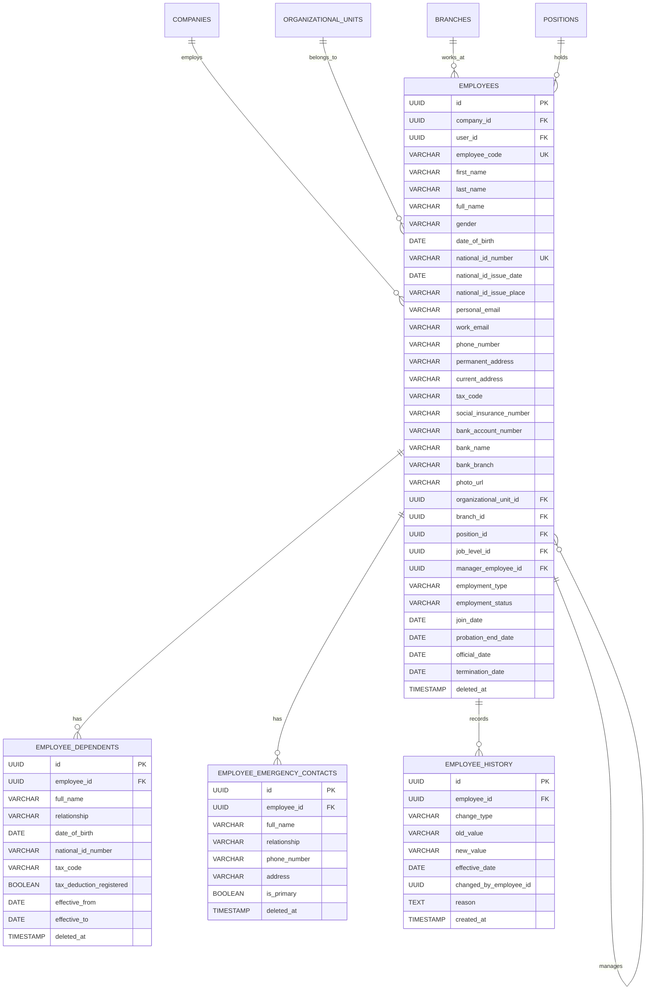
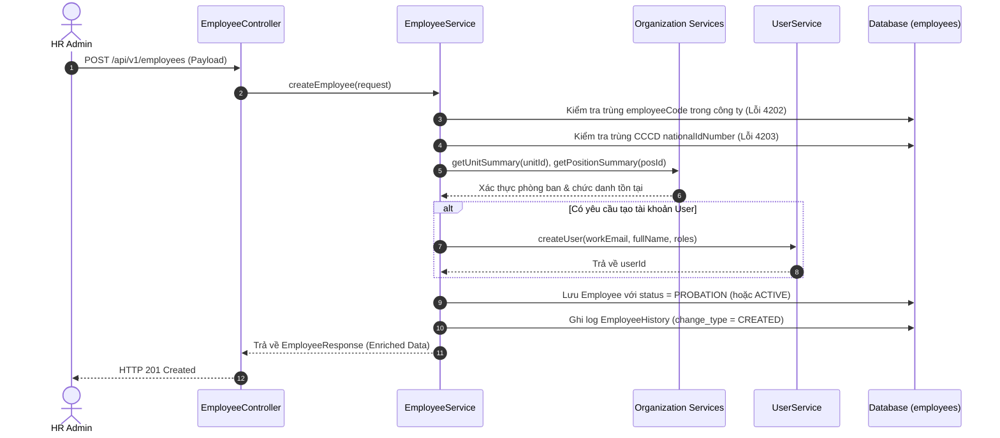

# Tài liệu Nghiệp vụ Module 04: Hồ sơ Nhân sự (Employee Master Data & Lifecycle)

> **Module Code:** `employee`  
> **Package:** `com.cyclosa.employee`  
> **Phiên bản:** 2.0 (Chuẩn hóa Backend Standards & Master Data)  
> **Căn cứ pháp lý & Tiêu chuẩn:**  
> - **Bộ luật Lao động 2019** (Luật số 45/2019/QH14) — Quản lý hồ sơ lao động, thử việc và biến động việc làm.  
> - **Luật Thuế Thu nhập Cá nhân & Nghị quyết 954/2020/UBTVQH14:** Quản lý mã số thuế, người phụ thuộc và đăng ký giảm trừ gia cảnh.  
> - **Luật Bảo hiểm Xã hội 2014 & Luật Việc làm 2013:** Định danh số sổ BHXH và cơ sở trích nộp chế độ.  
> - **Nghị định 13/2023/NĐ-CP:** Bảo vệ dữ liệu cá nhân (CCCD, tài khoản ngân hàng, thông tin sức khỏe, liên hệ khẩn cấp).

---

## 1. Tôn chỉ Nghiệp vụ & Nguyên tắc Thiết kế (Core Principles)

Trong toàn bộ hệ sinh thái **CYCLOSA HRM**, **Hồ sơ Nhân sự (Employee Master Data)** là mắt xích hội tụ trung tâm của mọi phân hệ:

```
┌─────────────────────────────────┐       ┌────────────────────────────────┐       ┌─────────────────────────────────┐
│   Module 01: Organization       │       │    Module 04: Employee         │       │   Module 05: Contract           │
│  - Phòng ban, Chi nhánh         │ ────> │  - Master Data Nhân sự         │ ────> │  - Hợp đồng lao động, phụ lục   │
│  - Chức danh, Cấp bậc           │       │  - Người phụ thuộc, Liên hệ    │       │  - Trợ cấp, Mức lương pháp lý   │
└─────────────────────────────────┘       │  - Lịch sử biến động công tác  │       └─────────────────────────────────┘
                                          └────────────────────────────────┘
                                                           │
                                                           ▼
                                          ┌────────────────────────────────┐
                                          │   Payroll, Attendance, Leave   │
                                          │  - Chấm công GPS & Ca kíp      │
                                          │  - Quỹ phép & Phê duyệt đơn    │
                                          │  - Tính lương & Thuế TNCN      │
                                          └────────────────────────────────┘
```

### 1.1. Chuẩn hóa Thiết kế Không dùng Interface + Impl thừa thãi (Concrete Service Pattern)
Theo chuẩn kiến trúc tại `docs/BACKEND_STANDARDS.md`:
- Toàn bộ service của module được viết trực tiếp dưới dạng **Concrete Service**:
  - `EmployeeService.java`: Service trung tâm duy nhất quản lý hồ sơ nhân viên, tìm kiếm phân trang, cập nhật thông tin công tác, trạng thái vòng đời, liên kết tài khoản user và cung cấp các hàm Public Service cho các module khác.
  - `EmployeeDependentService.java`: Quản lý danh sách người phụ thuộc và đăng ký giảm trừ gia cảnh.
  - `EmployeeEmergencyContactService.java`: Quản lý thông tin liên hệ khẩn cấp và bảo trợ tai nạn lao động.
- **Tuyệt đối không tạo thư mục `impl/`** hay interface 1-1 hình thức.

### 1.2. Đóng gói Kiến trúc Modular Monolith & Giao tiếp Liên Module
1. **Lấy dữ liệu hạ tầng qua Public Service của module lân cận:**
   - `PositionService` & `JobLevelService` (Module 01 - Organization): `getPositionByIdInternal`, `getPositionSummaries`, `getJobLevelSummaries`.
   - `OrganizationalUnitService` (Module 01 - Organization): `getUnitSummary`, `getSelfAndDescendantUnitIds` — phục vụ lọc dữ liệu đệ quy theo cây phòng ban.
   - `BranchService` (Module 01 - Organization): `getBranchSummary` — xác định địa bàn làm việc và tọa độ GPS check-in.
   - `UserService` (Module Auth/Role): tạo tài khoản người dùng, liên kết `userId` với `employeeId`.
2. **Batch Enrichment chống N+1 Query:** Mọi API danh sách gom `Set<UUID>` (`unitIds`, `branchIds`, `positionIds`, `managerIds`) và gọi batch 1 lần để nạp dữ liệu vào các Nested Summary Object (`OrgUnitSummary`, `BranchSummary`, `PositionSummary`, `EmployeeSummary`).

### 1.3. Mô hình 3 Chiều Độc Lập & Bất Biến Biến Động Công Tác (Audit History)
- Mỗi nhân viên gắn với **3 chiều độc lập**: `organizational_unit_id` (Phòng ban), `branch_id` (Chi nhánh làm việc), `position_id` (Chức danh). 3 thông tin này hoàn toàn tách biệt, cho phép điều chuyển địa bàn hoặc bổ nhiệm chức danh mà không làm xáo trộn sơ đồ phòng ban.
- **Bất biến Lịch sử (`employee_history`):** Mọi thao tác điều chuyển đơn vị, bổ nhiệm chức danh, thay đổi người quản lý hoặc cập nhật trạng thái làm việc đều **tự động ghi log vào bảng `employee_history`**, không được xóa đè dữ liệu cũ.

### 1.4. Phân Quyền Dữ Liệu Khắt Khe (DataScope Enforcement)
- Dữ liệu nhân sự chứa thông tin nhân thân nhạy cảm (CCCD, thuế, người phụ thuộc, ngân hàng).
- Bắt buộc kiểm soát theo **5 cấp DataScope**:
  - `OWN`: Nhân viên chỉ xem/sửa hồ sơ của chính mình.
  - `TEAM`: Quản lý trực tiếp (`manager_employee_id`) xem được cấp dưới.
  - `DEPARTMENT`: Trưởng đơn vị xem toàn bộ nhân sự trong phòng ban và các phòng ban con cháu đệ quy.
  - `COMPANY`: HR / Ban Giám đốc xem nhân sự trong toàn công ty.
  - `ALL`: Super Admin quản trị xuyên suốt các công ty con.

---

## 2. Mô hình Thực thể & CSDL Chi tiết (Database Schema)



### 2.1. Bảng `employees` — Hồ Sơ Nhân Viên Gốc (Master Table)
Chứa toàn bộ thông tin định danh, nhân thân, pháp lý và chức vụ hiện tại của nhân sự:

| Tên Cột | Kiểu Dữ Liệu | Ràng Buộc | Ý Nghĩa Nghiệp Vụ |
| :--- | :--- | :--- | :--- |
| `id` | `UUID` | `PK, NOT NULL` | Định danh duy nhất của hồ sơ nhân viên. |
| `company_id` | `UUID` | `NOT NULL, INDEX` | Công ty/pháp nhân quản lý. |
| `user_id` | `UUID` | `NULLABLE, UNIQUE` | Tài khoản đăng nhập hệ thống (User) liên kết. |
| `employee_code` | `VARCHAR(50)` | `NOT NULL, INDEX` | Mã nhân viên (duy nhất trong phạm vi công ty). |
| `full_name` | `VARCHAR(150)` | `NOT NULL, INDEX` | Họ và tên đầy đủ của nhân sự. |
| `gender` | `VARCHAR(10)` | `NOT NULL` | Giới tính: `MALE`, `FEMALE`, `OTHER`. |
| `date_of_birth` | `DATE` | `NOT NULL` | Ngày sinh (bắt buộc $\ge 18$ tuổi theo BLLĐ 2019). |
| `national_id_number`| `VARCHAR(20)` | `NOT NULL, INDEX` | Số CCCD/Hộ chiếu (chặn trùng lặp toàn hệ thống). |
| `work_email` | `VARCHAR(100)` | `NULLABLE, INDEX` | Email công vụ dùng để nhận thông báo, phiếu lương. |
| `organizational_unit_id` | `UUID` | `NOT NULL, INDEX` | Phòng ban / đơn vị trực thuộc (FK). |
| `branch_id` | `UUID` | `NOT NULL, INDEX` | Chi nhánh / địa điểm làm việc thực tế (FK). |
| `position_id` | `UUID` | `NOT NULL, INDEX` | Chức danh công việc chuẩn hóa (FK). |
| `manager_employee_id` | `UUID` | `NULLABLE, INDEX` | Quản lý trực tiếp (người duyệt đơn phép/công). |
| `employment_status` | `VARCHAR(30)` | `NOT NULL, INDEX` | Trạng thái: `PROBATION`, `ACTIVE`, `ON_LEAVE`, `TERMINATED`. |
| `join_date` | `DATE` | `NOT NULL` | Ngày bắt đầu vào làm việc tại doanh nghiệp. |
| `deleted_at` | `TIMESTAMP` | `NULLABLE, INDEX` | Thời điểm xóa mềm. |

---

### 2.2. Bảng `employee_dependents` — Người Phụ Thuộc (Giảm Trừ Gia Cảnh)

| Tên Cột | Kiểu Dữ Liệu | Ràng Buộc | Ý Nghĩa Nghiệp Vụ |
| :--- | :--- | :--- | :--- |
| `id` | `UUID` | `PK, NOT NULL` | Định danh duy nhất của người phụ thuộc. |
| `employee_id` | `UUID` | `NOT NULL, FK` | Nhân viên bảo trợ (FK `employees`). |
| `full_name` | `VARCHAR(150)` | `NOT NULL` | Họ tên người phụ thuộc (con cái, cha mẹ già...). |
| `relationship` | `VARCHAR(50)` | `NOT NULL` | Quan hệ nhân thân: `CHILD`, `SPOUSE`, `PARENT`, `OTHER`. |
| `tax_deduction_registered` | `BOOLEAN` | `NOT NULL, DEFAULT FALSE` | Đã đăng ký giảm trừ thành công với cơ quan Thuế hay chưa. |
| `effective_from` | `DATE` | `NOT NULL` | Tháng bắt đầu tính giảm trừ gia cảnh (4.4 triệu/tháng). |
| `effective_to` | `DATE` | `NULLABLE` | Tháng kết thúc giảm trừ (khi con đủ 18 tuổi hoặc qua đời). |

---

## 3. Các Luồng Nghiệp vụ Trọng tâm (Business Workflows)

### 3.1. Luồng Tiếp Nhận Nhân Sự Mới (F1: Onboarding / Create Employee)



---

### 3.2. Luồng Điều Chuyển / Bổ Nhiệm & Ghi Nhận Lịch Sử (F2: Job Movement)
1. HR hoặc Người có thẩm quyền gọi `PUT /api/v1/employees/{id}/employment-info`.
2. Hệ thống kiểm tra hợp lệ:
   - Quản lý mới không được là chính nhân viên đó (`4206 SELF_MANAGER_NOT_ALLOWED`).
   - Phòng ban mới, chức danh mới phải tồn tại và đang hoạt động.
3. So sánh giá trị cũ và mới:
   - Nếu đổi đơn vị $\rightarrow$ Ghi log `DEPARTMENT_CHANGE`.
   - Nếu đổi chức vụ $\rightarrow$ Ghi log `POSITION_CHANGE`.
   - Nếu đổi quản lý $\rightarrow$ Ghi log `MANAGER_CHANGE`.
4. Cập nhật hồ sơ nhân viên trong một transaction an toàn.

---

### 3.3. Luồng Chấm Dứt Lao Động & Khóa Tài Khoản (F3: Offboarding / Termination)
Khi chuyển trạng thái nhân viên sang `TERMINATED`:
- Hệ thống cập nhật `employment_status = TERMINATED` và lưu `termination_date`.
- **Tự động liên kết hạ tầng Auth:** Gọi `userService.lockUser(userId)` chuyển tài khoản người dùng sang trạng thái `LOCKED`.
- Thu hồi toàn bộ Refresh Token đang hoạt động, vô hiệu hóa phiên làm việc của nhân viên trên Mobile App và Web Portal.

---

## 4. Danh mục RESTful API Chi tiết

Base URI: `/api/v1/employees`

| HTTP Method | Endpoint URI | Phân Quyền (@PreAuthorize) | DTO Request / Response | Chức Năng Nghiệp Vụ |
| :---: | :--- | :--- | :--- | :--- |
| `POST` | `/` | `@perm.has('employee.create')` | `CreateEmployeeRequest` $\rightarrow$ `ApiResponse<EmployeeResponse>` | Tiếp nhận nhân sự mới (hỗ trợ tự động tạo tài khoản user). |
| `GET` | `/` | `@perm.has('employee.view')` | `EmployeeFilter` $\rightarrow$ `ApiResponse<PageData<EmployeeResponse>>` | Tra cứu danh sách nhân sự (phân trang, lọc theo DataScope). |
| `GET` | `/{id}` | `@perm.has('employee.view')` | Path `id` $\rightarrow$ `ApiResponse<EmployeeDetailResponse>` | Xem chi tiết hồ sơ toàn diện (nhân thân, chức vụ, quản lý). |
| `PUT` | `/{id}/personal-info` | `@perm.has('employee.update')` | `UpdatePersonalInfoRequest` $\rightarrow$ `ApiResponse<EmployeeResponse>` | Cập nhật thông tin cá nhân, CCCD, tài khoản ngân hàng. |
| `PUT` | `/{id}/employment-info`| `@perm.has('employee.manage_job')` | `UpdateEmploymentInfoRequest` $\rightarrow$ `ApiResponse<EmployeeResponse>` | Điều chuyển công tác, bổ nhiệm chức vụ, đổi quản lý. |
| `PUT` | `/{id}/status` | `@perm.has('employee.manage_status')`| `UpdateStatusRequest` $\rightarrow$ `ApiResponse<EmployeeResponse>` | Cập nhật trạng thái vòng đời (kèm tự động khóa tài khoản). |
| `GET` | `/{id}/dependents` | `@perm.has('employee.view')` | Path `id` $\rightarrow$ `ApiResponse<List<DependentResponse>>` | Danh sách người phụ thuộc phục vụ giảm trừ gia cảnh. |
| `POST` | `/{id}/dependents` | `@perm.has('employee.update')` | `CreateDependentRequest` $\rightarrow$ `ApiResponse<DependentResponse>` | Đăng ký người phụ thuộc mới. |
| `DELETE` | `/{id}/dependents/{depId}` | `@perm.has('employee.update')` | Path `id, depId` $\rightarrow$ `ApiResponse<Void>` | Xóa người phụ thuộc khỏi danh sách giảm trừ. |
| `GET` | `/{id}/emergency-contacts` | `@perm.has('employee.view')` | Path `id` $\rightarrow$ `ApiResponse<List<EmergencyContactResponse>>`| Danh sách người liên hệ khẩn cấp khi có tai nạn/sự cố. |
| `POST` | `/{id}/emergency-contacts` | `@perm.has('employee.update')` | `CreateEmergencyContactRequest` $\rightarrow$ `ApiResponse<EmergencyContactResponse>` | Thêm thông tin liên hệ khẩn cấp. |
| `GET` | `/{id}/history` | `@perm.has('employee.view')` | Path `id` $\rightarrow$ `ApiResponse<List<EmployeeHistoryResponse>>` | Tra cứu toàn bộ lịch sử biến động công tác của nhân sự. |

---

## 5. Danh mục Mã lỗi Module Employee (`EmployeeErrorCode`)

| Mã Lỗi (Enum) | Mã Số | HTTP Status | Thông Điệp Tiếng Việt | Nguyên Nhân & Ngữ Cảnh Kích Hoạt |
| :--- | :---: | :---: | :--- | :--- |
| `EMPLOYEE_NOT_FOUND` | **4201** | `404 Not Found` | Không tìm thấy hồ sơ nhân viên | `employee_id` không tồn tại trong CSDL hoặc đã bị xóa mềm. |
| `EMPLOYEE_CODE_EXISTS` | **4202** | `409 Conflict` | Mã nhân viên đã tồn tại trong công ty | Trùng lặp trường `employee_code` trong cùng `company_id`. |
| `NATIONAL_ID_EXISTS` | **4203** | `409 Conflict` | Số CCCD/Hộ chiếu đã được đăng ký cho nhân viên khác | Trùng lặp `national_id_number` trên hệ thống. |
| `INVALID_EMPLOYMENT_STATUS` | **4204** | `400 Bad Request` | Trạng thái nhân viên không hợp lệ cho thao tác này | Chuyển đổi trạng thái sai quy trình (VD: từ `TERMINATED` sang `PROBATION`). |
| `DEPENDENT_NOT_FOUND` | **4205** | `404 Not Found` | Không tìm thấy thông tin người phụ thuộc | ID người phụ thuộc không tồn tại hoặc không thuộc nhân viên này. |
| `SELF_MANAGER_NOT_ALLOWED` | **4206** | `400 Bad Request` | Quản lý trực tiếp không thể là chính nhân viên đó | Chọn chính `employee_id` làm `manager_employee_id`. |
| `EMPLOYEE_ACCESS_DENIED` | **4207** | `403 Forbidden` | Bạn không có quyền truy cập hồ sơ nhân viên này | Vi phạm DataScope (User cố truy cập nhân sự ngoài thẩm quyền). |
| `EMERGENCY_CONTACT_NOT_FOUND` | **4208** | `404 Not Found` | Không tìm thấy thông tin người liên hệ khẩn cấp | ID liên hệ khẩn cấp không tồn tại trong hệ thống. |
| `USER_ALREADY_LINKED` | **4209** | `409 Conflict` | Tài khoản người dùng này đã được gắn cho nhân viên khác | `userId` đã được liên kết với một hồ sơ nhân viên khác. |
| `INVALID_IMPORT_FILE` | **4210** | `400 Bad Request` | File tải lên không hợp lệ hoặc không đúng định dạng Excel | File import sai định dạng mime hoặc không phải đuôi `.xlsx, .xls`. |
| `EMPTY_IMPORT_FILE` | **4211** | `400 Bad Request` | File import không chứa dữ liệu hợp lệ | File Excel trống không có dòng dữ liệu nào ngoài dòng tiêu đề. |
| `IMPORT_FAILED` | **4212** | `400 Bad Request` | Nhập danh sách nhân viên hàng loạt thất bại | Quá trình parse và lưu hàng loạt xảy ra lỗi dữ liệu không hợp lệ. |

---

## 6. Phân bổ Quyền Hạn & Ma trận Vai trò (RBAC Matrix)

| Mã Quyền (Permission) | Mô Tả Hành Động | Super Admin | HR Admin | Dept Manager | Employee |
| :--- | :--- | :---: | :---: | :---: | :---: |
| `employee.view` | Xem danh sách & chi tiết hồ sơ nhân sự | **FULL (ALL)** | **FULL (COMPANY)** | **DEPT & TEAM** | **SELF ONLY (OWN)** |
| `employee.create` | Tiếp nhận nhân sự mới vào hệ thống | **FULL** | **FULL** | ⛔ | ⛔ |
| `employee.update` | Sửa thông tin cá nhân, CCCD, ngân hàng | **FULL** | **FULL** | ⛔ | **SELF (Hạn chế)** |
| `employee.manage_job` | Điều chuyển công tác, bổ nhiệm chức vụ | **FULL** | **FULL** | **Đề xuất / Xem** | ⛔ |
| `employee.manage_status`| Cập nhật trạng thái vòng đời (Thôi việc/Nghỉ) | **FULL** | **FULL** | ⛔ | ⛔ |
| `employee.import` | Nhập khẩu danh sách nhân viên hàng loạt | **FULL** | **FULL** | ⛔ | ⛔ |
