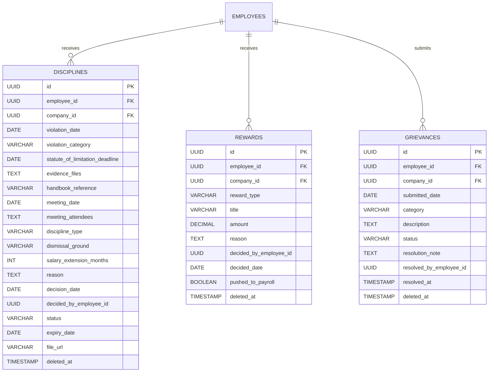
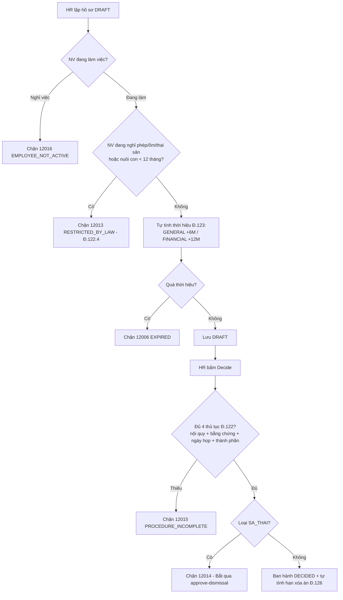
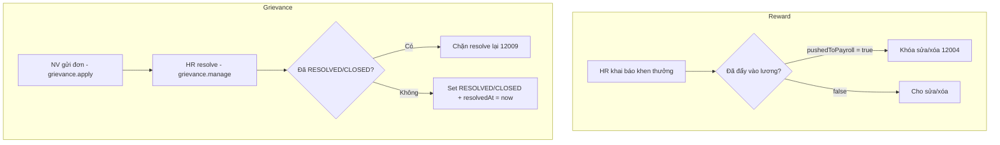

# Tài liệu Nghiệp vụ Module: Khen thưởng, Kỷ luật & Khiếu nại (Reward & Discipline Management)

> **Module Code:** `discipline`  
> **Package:** `com.cyclosa.discipline`  
> **Phiên bản:** 2.0 (Chuẩn hóa Backend Standards & Automation)  
> **Căn cứ pháp lý:**  
> - **Bộ luật Lao động 2019** (Luật số 45/2019/QH14)  
>   - *Điều 122:* Nguyên tắc, trình tự xử lý kỷ luật lao động (bắt buộc có nội quy, bằng chứng, họp xử lý có thành phần tham dự).  
>   - *Điều 122.4:* Các trường hợp cấm xử lý kỷ luật (nghỉ phép, nghỉ ốm, thai sản, nuôi con dưới 12 tháng).  
>   - *Điều 123:* Thời hiệu xử lý kỷ luật (06 tháng thường, 12 tháng đối với vi phạm tài chính, tài sản, bí mật).  
>   - *Điều 124:* Các hình thức kỷ luật (khiển trách, kéo dài nâng lương ≤ 06 tháng, cách chức, sa thải).  
>   - *Điều 125:* Các căn cứ sa thải (trộm cắp, tiết lộ bí mật, tái phạm, tự ý bỏ việc).  
>   - *Điều 126:* Xóa kỷ luật (khiển trách 03 tháng, kéo dài nâng lương/cách chức 06 tháng, sa thải không xóa).

---

## 1. Tôn chỉ Nghiệp vụ & Nguyên tắc Thiết kế (Core Principles)

Module **Reward & Discipline** là trung tâm pháp lý ghi nhận toàn bộ vòng đời khen thưởng – kỷ luật – khiếu nại của nhân sự, đảm bảo mọi quyết định xử lý đều **đúng trình tự BLLĐ**, **còn thời hiệu** và **tự động hết hiệu lực (xóa án)** khi đủ thời gian.

```
┌─────────────────────────┐       ┌────────────────────────────────┐       ┌─────────────────────────┐
│   Module 04: Employee   │       │  Module Discipline             │       │  Offboarding / Payroll  │
│  - Nhân viên, Nghỉ phép │ ────> │  - Kỷ luật, Khen thưởng         │ ────> │  - Thôi việc kỷ luật     │
│  - Người phụ thuộc      │       │  - Khiếu nại, Thời hiệu Đ.123   │       │  - Thưởng đẩy vào lương  │
└─────────────────────────┘       └────────────────────────────────┘       └─────────────────────────┘
```

### 1.1. Chuẩn hóa Thiết kế Không dùng Interface + Impl thừa thãi (Concrete Service Pattern)
Theo chuẩn kiến trúc tại `docs/BACKEND_STANDARDS.md`:
- Toàn bộ service của module được viết trực tiếp dưới dạng **Concrete Service**:
  - `RewardDisciplineService.java`: Lập hồ sơ kỷ luật, ban hành quyết định, phê duyệt sa thải, khen thưởng, giải quyết khiếu nại, kiểm tra thời hiệu, tự động xóa án.
  - `DisciplineScheduler.java`: Job quét hằng ngày lúc **02:30 AM** để chuyển `DECIDED → EXPIRED` khi đến hạn xóa kỷ luật Điều 126.
- **Tuyệt đối không tạo thư mục `impl/`** hay interface 1-1 hình thức.

### 1.2. Đóng gói Kiến trúc Modular Monolith & Giao tiếp Liên Module
1. **Lấy dữ liệu hạ tầng qua Public Service của module lân cận:**
   - `EmployeeService`: `getEmployeeByIdInternal`, `findEmployeeIdByUserId`, `getEmployeeSummaries` — xác thực nhân viên, người ký, phân quyền dữ liệu.
   - `LeaveRequestService`: `isEmployeeOnApprovedLeave` — kiểm tra cấm xử lý kỷ luật khi đang nghỉ (Điều 122.4).
   - `OffboardingService`: `createTermination` — tự động khởi tạo thủ tục thôi việc khi phê duyệt sa thải.
2. **Giao tiếp nội bộ an toàn:** kiểm tra người phụ thuộc (`CHILD` < 12 tháng) qua Employee để chặn xử lý trái luật.
3. **Batch Enrichment chống N+1 Query:** danh sách khen thưởng/kỷ luật/khiếu nại gom `employeeIds` gọi `getEmployeeSummaries` 1 lần.

### 1.3. Bất biến Quyết định đã Ban hành (Decision Immutability)
- Hồ sơ kỷ luật ở trạng thái `DECIDED / EXPIRED` **không được sửa/xóa** (`12005 DISCIPLINE_ALREADY_APPROVED`).
- Khen thưởng đã `pushedToPayroll = true` **khóa sửa/xóa** (`12004 REWARD_ALREADY_PUSHED_TO_PAYROLL`).
- Khiếu nại đã `RESOLVED / CLOSED` không được resolve lại (`12009 GRIEVANCE_ALREADY_RESOLVED`).

### 1.4. Tự động hóa Thời hiệu & Xóa án (Statute Automation)
- Khi lập hồ sơ, hệ thống **tự tính `statuteOfLimitationDeadline`**: `violationDate + 6 tháng` (thường) hoặc `+ 12 tháng` (tài chính/tài sản/bí mật).
- Khi ban hành, hệ thống **tự tính `expiryDate` (hạn xóa án Điều 126)**: khiển trách `+3 tháng`, kéo dài nâng lương/cách chức `+6 tháng`, sa thải `null` (không xóa).
- Scheduler **02:30 AM hằng ngày** tự chuyển án hết hạn sang `EXPIRED`.

---

## 2. Mô hình Thực thể & CSDL Chi tiết (Database Schema)



---

### 2.1. Bảng `disciplines` — Hồ sơ Xử lý Kỷ luật Lao động

| Thuộc tính | Kiểu dữ liệu | Ràng buộc | Diễn giải nghiệp vụ |
| :--- | :--- | :--- | :--- |
| `id` | `UUID` | PK | Khóa chính |
| `employee_id` | `UUID` | FK logic, Not Null | Nhân viên bị kỷ luật (phải đang làm việc) |
| `company_id` | `UUID` | Not Null | Auto-fill từ `employee.company` nếu request thiếu |
| `violation_date` | `DATE` | Not Null | Ngày vi phạm, không được ở tương lai |
| `violation_category` | `ENUM` | Not Null | `GENERAL` (thời hiệu 6 tháng), `FINANCIAL_ASSET_CONFIDENTIAL` (12 tháng) |
| `statute_of_limitation_deadline` | `DATE` | Not Null | Tự tính từ `violationDate + 6/12 tháng` (Điều 123) |
| `evidence_files` | `TEXT` | Nullable, bắt buộc khi `decide` | Bằng chứng vi phạm (Điều 122) |
| `handbook_reference` | `VARCHAR(255)` | Nullable, bắt buộc khi `decide` | Căn cứ nội quy lao động |
| `meeting_date` | `DATE` | Nullable, bắt buộc khi `decide` | Ngày họp xử lý, `>= violationDate` |
| `meeting_attendees` | `TEXT` | Nullable, bắt buộc khi `decide` | Thành phần tham dự cuộc họp |
| `discipline_type` | `ENUM` | Not Null | `KHIEN_TRACH`, `KEO_DAI_NANG_LUONG`, `CACH_CHUC`, `SA_THAI` (Điều 124) |
| `dismissal_ground` | `ENUM` | Bắt buộc nếu `SA_THAI` | 4 căn cứ Điều 125 |
| `salary_extension_months` | `INT` | Chỉ dùng khi `KEO_DAI_NANG_LUONG` | Từ 1 đến 6 tháng |
| `reason` | `TEXT` | Nullable | Lý do/mô tả vi phạm |
| `decision_date` | `DATE` | Nullable, `>= violationDate` | Ngày ban hành; khi `decide/approveDismissal` auto = hôm nay |
| `decided_by_employee_id` | `UUID` | Nullable | Người ký (map từ `currentUserId`) |
| `status` | `ENUM` | Default `DRAFT` | `DRAFT` → `PENDING_APPROVAL` → `DECIDED` → `EXPIRED` |
| `expiry_date` | `DATE` | Nullable | Hạn xóa kỷ luật Điều 126 (tự tính từ `decisionDate`) |
| `file_url` | `VARCHAR(500)` | Nullable | File quyết định scan |
| `deleted_at` | `TIMESTAMP` | Nullable | Xóa mềm |

> [!IMPORTANT]
> Sa thải (`SA_THAI`) **không được `decide` trực tiếp**, bắt buộc đi qua `approve-dismissal` (`12014 TERMINATION_REQUIRES_APPROVAL`).

---

### 2.2. Bảng `rewards` — Quyết định Khen thưởng

| Thuộc tính | Kiểu dữ liệu | Ràng buộc | Diễn giải nghiệp vụ |
| :--- | :--- | :--- | :--- |
| `id` | `UUID` | PK | Khóa chính |
| `employee_id` | `UUID` | Not Null | Nhân viên được khen |
| `company_id` | `UUID` | Not Null | Auto-fill từ nhân viên |
| `reward_type` | `ENUM` | Not Null | `CERTIFICATE`, `MONETARY`, `PROMOTION_RECOMMENDATION`, `OTHER` |
| `title` | `VARCHAR(255)` | Not Null | Tiêu đề quyết định |
| `amount` | `DECIMAL(15,2)` | Nullable | Tiền thưởng (vinh danh không tiền để null) |
| `reason` | `TEXT` | Nullable | Lý do khen |
| `decided_by_employee_id` | `UUID` | Nullable | Người ký |
| `decided_date` | `DATE` | Not Null | Ngày quyết định |
| `pushed_to_payroll` | `BOOLEAN` | Default False | `true` = đã chốt đẩy vào lương, khóa sửa/xóa |
| `deleted_at` | `TIMESTAMP` | Nullable | Xóa mềm |

---

### 2.3. Bảng `grievances` — Đơn Khiếu nại / Phản ánh Nội bộ

| Thuộc tính | Kiểu dữ liệu | Ràng buộc | Diễn giải nghiệp vụ |
| :--- | :--- | :--- | :--- |
| `id` | `UUID` | PK | Khóa chính |
| `employee_id` | `UUID` | Not Null | Người gửi (fallback từ `currentUserId` nếu request thiếu) |
| `company_id` | `UUID` | Not Null | Auto-fill |
| `submitted_date` | `DATE` | Not Null | Auto = hôm nay khi tạo |
| `category` | `ENUM` | Not Null | `WORKPLACE_CONFLICT`, `COMPENSATION`, `POLICY`, `HARASSMENT`, `OTHER` |
| `description` | `TEXT` | Not Null | Nội dung đơn |
| `status` | `ENUM` | Default `OPEN` | `OPEN` → `INVESTIGATING` → `RESOLVED` → `CLOSED` (API resolve chỉ cho `RESOLVED/CLOSED`) |
| `resolution_note` | `TEXT` | Nullable | HR ghi khi resolve |
| `resolved_by_employee_id` | `UUID` | Nullable | Người giải quyết |
| `resolved_at` | `TIMESTAMP` | Nullable | Auto = now khi resolve |
| `deleted_at` | `TIMESTAMP` | Nullable | Xóa mềm |

---

## 3. Các Luồng Nghiệp vụ Trọng tâm (Business Workflows)

### 3.1. Luồng Lập & Ban hành Kỷ luật thường (Điều 122 – 123 – 124 – 126)



**Hạn xóa án (Điều 126):** `KHIEN_TRACH +3 tháng`, `KEO_DAI_NANG_LUONG / CACH_CHUC +6 tháng`, `SA_THAI = null`.

---

### 3.2. Luồng Sa thải & Tự động Thôi việc (Điều 125)

```mermaid
sequenceDiagram
    autonumber
    actor HR as HR Admin
    participant Svc as RewardDisciplineService
    participant Off as OffboardingService

    HR->>Svc: PUT /disciplines/{id}/approve-dismissal
    Note over Svc: Check SA_THAI + dismissalGround (12007)<br/>Check thủ tục Đ.122 (12015)<br/>Check thời hiệu Đ.123 (12006)
    Svc->>Svc: Ban hành DECIDED (decisionDate = now)
    Svc->>Off: createTermination(DISCIPLINARY_DISMISSAL, disciplineId)
    Off-->>Svc: Khởi tạo bàn giao / thôi việc
    Svc-->>HR: Trả về quyết định sa thải
```

**4 căn cứ sa thải (`DismissalGround` – Điều 125):**
- `THEFT_FRAUD_GAMBLING_ASSAULT_DRUGS`: Trộm cắp, tham ô, cờ bạc, hành hung, dùng ma túy tại nơi làm việc.
- `TRADE_SECRET_IP_SERIOUS_DAMAGE_HARASSMENT`: Tiết lộ bí mật, xâm phạm sở hữu trí tuệ, gây thiệt hại nghiêm trọng, quấy rối.
- `REPEAT_VIOLATION_DURING_ACTIVE_DISCIPLINE`: Tái phạm khi còn hiệu lực kỷ luật.
- `UNAUTHORIZED_ABSENCE`: Tự ý bỏ việc (05 ngày cộng dồn/30 ngày hoặc 20 ngày cộng dồn/365 ngày).

---

### 3.3. Luồng Tự động Xóa án Hằng ngày (Daily Expire Sweep)

Vào lúc **02:30 AM hằng ngày** (`DisciplineScheduler`, cron `0 30 2 * * ?`):
1. Truy vấn `findByStatusAndExpiryDateLessThanEqual(DECIDED, today)`.
2. Chuyển toàn bộ sang `EXPIRED`, ghi log Điều 126.
3. Trả về số lượng đã xóa án.

---

### 3.4. Luồng Khen thưởng & Khiếu nại



**Bảo vệ xem đơn khiếu nại:** nếu user không có `grievance.manage` và DataScope `grievance.view = OWN` thì chỉ được xem đơn của chính mình, ngược lại `12012`.

---

## 4. Danh mục RESTful API Chi tiết

### 4.1. Nhóm API Kỷ luật (`/api/v1/disciplines`)

| Method | Endpoint | Mô tả chức năng | Quyền yêu cầu | Response DTO |
| :---: | :--- | :--- | :--- | :--- |
| `POST` | `/api/v1/disciplines` | Lập hồ sơ kỷ luật (tự tính thời hiệu Điều 123) | `discipline.manage` | `ApiResponse<DisciplineResponse>` (201) |
| `PUT` | `/api/v1/disciplines/{id}` | Cập nhật hồ sơ (khi chưa `DECIDED`) | `discipline.manage` | `ApiResponse<DisciplineResponse>` |
| `GET` | `/api/v1/disciplines/{id}` | Xem chi tiết hồ sơ | `discipline.view` | `ApiResponse<DisciplineDetailResponse>` |
| `GET` | `/api/v1/disciplines` | Danh sách có phân trang, bộ lọc | `discipline.view` | `ApiResponse<PageData<DisciplineResponse>>` |
| `GET` | `/api/v1/disciplines/{id}/statute-of-limitation-check` | Kiểm tra thời hiệu Điều 123 | `discipline.view` | `ApiResponse<StatuteOfLimitationResponse>` |
| `PUT` | `/api/v1/disciplines/{id}/decide` | Ban hành quyết định (tính hạn xóa án Điều 126) | `discipline.manage` | `ApiResponse<DisciplineResponse>` |
| `PUT` | `/api/v1/disciplines/{id}/approve-dismissal` | Phê duyệt sa thải + kích hoạt thôi việc | `discipline.manage` | `ApiResponse<DisciplineResponse>` |
| `DELETE` | `/api/v1/disciplines/{id}` | Xóa hồ sơ (chỉ khi chưa `DECIDED`) | `discipline.manage` | `ApiResponse<Void>` |

### 4.2. Nhóm API Khen thưởng (`/api/v1/rewards`)

| Method | Endpoint | Mô tả chức năng | Quyền yêu cầu | Response DTO |
| :---: | :--- | :--- | :--- | :--- |
| `POST` | `/api/v1/rewards` | Khai báo quyết định khen thưởng | `reward.manage` | `ApiResponse<RewardResponse>` (201) |
| `PUT` | `/api/v1/rewards/{id}` | Cập nhật (chưa đẩy vào lương) | `reward.manage` | `ApiResponse<RewardResponse>` |
| `GET` | `/api/v1/rewards/{id}` | Chi tiết quyết định | `reward.view` | `ApiResponse<RewardDetailResponse>` |
| `GET` | `/api/v1/rewards` | Danh sách có phân trang, bộ lọc | `reward.view` | `ApiResponse<PageData<RewardResponse>>` |
| `DELETE` | `/api/v1/rewards/{id}` | Xóa (chưa đẩy vào lương) | `reward.manage` | `ApiResponse<Void>` |

### 4.3. Nhóm API Khiếu nại (`/api/v1/grievances`)

| Method | Endpoint | Mô tả chức năng | Quyền yêu cầu | Response DTO |
| :---: | :--- | :--- | :--- | :--- |
| `POST` | `/api/v1/grievances` | NV gửi đơn khiếu nại / phản ánh | `grievance.apply` | `ApiResponse<GrievanceResponse>` (201) |
| `PUT` | `/api/v1/grievances/{id}/resolve` | HR phản hồi và đóng đơn | `grievance.manage` | `ApiResponse<GrievanceResponse>` |
| `GET` | `/api/v1/grievances/{id}` | Xem chi tiết đơn (check `OWN`) | `grievance.view` | `ApiResponse<GrievanceDetailResponse>` |
| `GET` | `/api/v1/grievances` | Danh sách có phân trang, bộ lọc | `grievance.view` | `ApiResponse<PageData<GrievanceResponse>>` |

---

## 5. Danh mục Mã lỗi Module Discipline (`DisciplineErrorCode`)

Dải mã `12001 - 12016`, định nghĩa tại `DisciplineErrorCode.java`:

| Mã lỗi | Enum Name | HTTP Status | Thông điệp lỗi chuẩn |
| :---: | :--- | :---: | :--- |
| `12001` | `DISCIPLINE_NOT_FOUND` | 404 Not Found | Không tìm thấy hồ sơ xử lý kỷ luật |
| `12002` | `REWARD_NOT_FOUND` | 404 Not Found | Không tìm thấy quyết định khen thưởng |
| `12003` | `GRIEVANCE_NOT_FOUND` | 404 Not Found | Không tìm thấy đơn khiếu nại, phản ánh |
| `12004` | `REWARD_ALREADY_PUSHED_TO_PAYROLL` | 409 Conflict | Khoản khen thưởng đã được chốt và đẩy vào bảng lương, không thể sửa hoặc xóa |
| `12005` | `DISCIPLINE_ALREADY_APPROVED` | 409 Conflict | Biên bản kỷ luật này đã được phê duyệt quyết định trước đó |
| `12006` | `STATUTE_OF_LIMITATIONS_EXPIRED` | 422 Unprocessable | Đã quá thời hiệu xử lý kỷ luật lao động theo quy định của Bộ luật Lao động |
| `12007` | `DISMISSAL_REQUIRES_GROUND` | 400 Bad Request | Kỷ luật sa thải bắt buộc phải có căn cứ theo Điều 125 Bộ luật Lao động |
| `12008` | `SALARY_EXTENSION_MONTHS_INVALID` | 400 Bad Request | Thời hạn kéo dài nâng bậc lương không được vượt quá 6 tháng theo Điều 124 BLLĐ |
| `12009` | `GRIEVANCE_ALREADY_RESOLVED` | 409 Conflict | Đơn khiếu nại này đã được giải quyết và đóng hồ sơ |
| `12010` | `CURRENT_USER_NOT_LINKED_EMPLOYEE` | 400 Bad Request | Tài khoản hiện tại chưa được liên kết với hồ sơ nhân viên trong hệ thống |
| `12011` | `EMPLOYEE_NOT_FOUND` | 404 Not Found | Không tìm thấy thông tin nhân viên được chỉ định |
| `12012` | `UNAUTHORIZED_DISCIPLINE_ACCESS` | 403 Forbidden | Bạn không có quyền truy cập hồ sơ kỷ luật / khen thưởng này |
| `12013` | `DISCIPLINE_RESTRICTED_BY_LAW` | 422 Unprocessable | Không được xử lý kỷ luật đối với nhân viên đang nghỉ phép, nghỉ ốm, thai sản hoặc nuôi con dưới 12 tháng tuổi theo Điều 122.4 BLLĐ |
| `12014` | `TERMINATION_REQUIRES_APPROVAL` | 422 Unprocessable | Kỷ luật sa thải bắt buộc phải qua Workflow phê duyệt cấp cao trước khi ban hành |
| `12015` | `DISCIPLINE_PROCEDURE_INCOMPLETE` | 422 Unprocessable | Kỷ luật lao động bắt buộc phải có đầy đủ căn cứ nội quy, bằng chứng vi phạm, ngày họp và thành phần tham dự theo Điều 122 BLLĐ |
| `12016` | `EMPLOYEE_NOT_ACTIVE` | 400 Bad Request | Nhân viên không ở trạng thái đang làm việc |

---

## 6. Phân bổ Quyền Hạn & Ma trận Vai trò (RBAC Matrix)

| Mã quyền (Permission Code) | Diễn giải quyền | Gán vai trò mặc định & DataScope |
| :--- | :--- | :--- |
| `discipline.manage` | Lập, sửa, ban hành, sa thải, xóa kỷ luật | `HR_ADMIN` (COMPANY), `SUPER_ADMIN` (ALL) |
| `discipline.view` | Xem hồ sơ kỷ luật | `DEPARTMENT_MANAGER` (DEPARTMENT), `HR_ADMIN` (COMPANY), `SUPER_ADMIN` (ALL); list lọc `OWN / TEAM / DEPARTMENT / COMPANY / ALL` |
| `reward.manage` | Khai báo, sửa, xóa khen thưởng | `HR_ADMIN` (COMPANY), `SUPER_ADMIN` (ALL) |
| `reward.view` | Xem khen thưởng | `DEPARTMENT_MANAGER` (DEPARTMENT), `HR_ADMIN` (COMPANY), `SUPER_ADMIN` (ALL) |
| `grievance.apply` | NV gửi đơn khiếu nại | `EMPLOYEE` (OWN), `DEPARTMENT_MANAGER` (OWN), `HR_ADMIN` (OWN) |
| `grievance.manage` | HR giải quyết khiếu nại (bypass check `OWN` khi xem) | `HR_ADMIN` (COMPANY), `SUPER_ADMIN` (ALL) |
| `grievance.view` | Xem danh sách / chi tiết đơn | `DEPARTMENT_MANAGER` (DEPARTMENT), `HR_ADMIN` (COMPANY), `SUPER_ADMIN` (ALL); detail check `OWN` → `12012` nếu xem đơn người khác |
