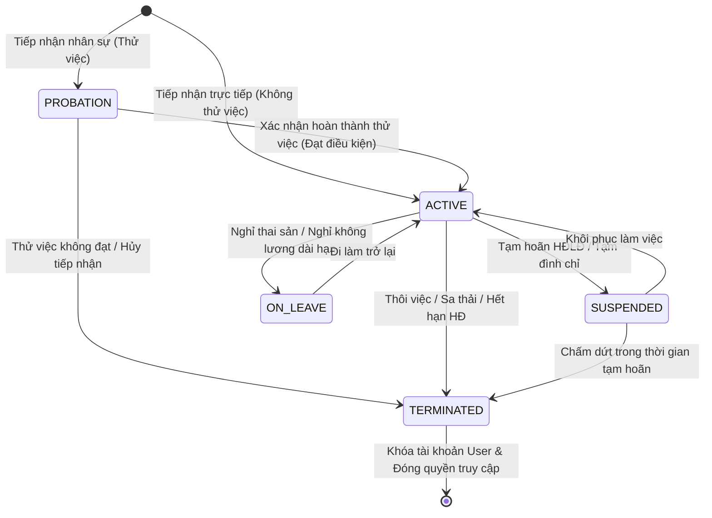

# ĐẶC TẢ CHI TIẾT VÀ KIẾN TRÚC TRIỂN KHAI MODULE 05: HỒ SƠ NHÂN SỰ & VÒNG ĐỜI NHÂN VIÊN (EMPLOYEE PROFILE & LIFECYCLE)

> **Tài liệu căn cứ & tham chiếu:**
> - Nghiệp vụ chi tiết: [`Nghiep-vu.docx`](file:///f:/Project/CYCLOSA/ba/Nghiep-vu.docx) (Mục 5: Hồ sơ nhân sự - Employee Profile & Lifecycle)
> - Thiết kế CSDL & Data Dictionary: [`database.md`](file:///f:/Project/CYCLOSA/ba/database.md) (§8.6 Module 5: Employee Profile & Lifecycle)
> - Danh mục API chuẩn: [`api-list.md`](file:///f:/Project/CYCLOSA/ba/api-list.md) (Mục 5: Hồ sơ nhân sự - 37 APIs)
> - Tài liệu cấu trúc tham chiếu chuẩn: [`module-quan-ly-to-chuc.md`](file:///f:/Project/CYCLOSA/cyclosa_be/docs/ba/module-quan-ly-to-chuc.md) (Module 01: Organization Management)
> - Quy chuẩn phân quyền liên kết: [`module-phan-quyen.md`](file:///f:/Project/CYCLOSA/cyclosa_be/docs/ba/module-phan-quyen.md) (Module 03: DataScope `OWN`, `TEAM`, `DEPARTMENT`, `COMPANY`, `ALL`)
> - Module nền tảng xác thực: [`module-auth.md`](file:///f:/Project/CYCLOSA/cyclosa_be/docs/ba/module-auth.md) (Module 0: Users & Multi-tenancy)
> - Chuẩn kiến trúc codebase: [`com.cyclosa.product`](file:///f:/Project/CYCLOSA/cyclosa_be/src/main/java/com/cyclosa/product) (Direct `@Service` class, không dùng `impl/`)

---

## 1. PHÂN TÍCH ĐẶC TẢ NGHIỆP VỤ & NGUYÊN LÝ CỐT LÕI

### 1.1. Nguyên lý phân tách Danh tính nhân sự và Công tác 3 chiều độc lập

Trong hệ sinh thái CYCLOSA HRM, thực thể **Nhân viên (`Employee`)** là trái tim trung tâm (Core Backbone) liên kết mọi nghiệp vụ. Hệ thống áp dụng triệt để nguyên tắc **phân tách tuyệt đối giữa Danh tính nhân sự ổn định** và **Diễn biến công tác biến thiên theo thời gian**:

$$\mathbf{Hồ\ sơ\ nhân\ sự} = \mathbf{Danh\ tính\ cốt\ lõi\ (Employee)} + \mathbf{Bộ\ 3\ chiều\ công\ tác\ (Work\ Assignment)} + \mathbf{Vòng\ đời\ làm\ việc\ (Status\ History)}$$

1. **Bảng `employees` (Danh tính ổn định không đổi theo phân công):**
   - Chỉ lưu các thuộc tính pháp lý và sinh học gắn liền với con người lao động: Họ tên, Ngày sinh, Giới tính, Mã số thuế cá nhân, Mã số BHXH, Địa chỉ liên hệ, SĐT, Email cá nhân và Ngày bắt đầu làm việc (`start_date`).
   - Tuyệt đối **không lưu trực tiếp** phòng ban, chi nhánh, chức danh, cấp bậc hay quản lý trực tiếp trên bảng `employees`.
2. **Bộ 3 chiều độc lập (Three-Dimensional Independence) tại `employee_work_assignments`:**
   - **Chiều Tổ chức (`department_id`):** Đơn vị phòng ban trực thuộc trong cây phân cấp hành chính (Module 01).
   - **Chiều Địa lý (`branch_id`):** Chi nhánh, địa điểm làm việc thực tế nơi nhân viên check-in chấm công định vị GPS.
   - **Chiều Chức danh & Cấp bậc (`job_title_id`, `job_level_id`):** Tiêu chuẩn năng lực chuyên môn và thứ tự cấp bậc thẩm quyền.
   - Khi luân chuyển 1 chiều (ví dụ: chuyển chi nhánh làm việc từ Hà Nội vào Đà Nẵng), hệ thống chỉ sinh thêm 1 bản ghi mới tại `employee_work_assignments` với `effective_from`, giữ nguyên các chiều phòng ban và chức danh mà không làm xáo trộn dữ liệu còn lại.
3. **Cấp trên trực tiếp (`manager_employee_id`):**
   - Lưu trữ người quản lý trực tiếp theo thời gian hiệu lực, làm căn cứ định tuyến luồng duyệt nghỉ phép (Module 14), chấm công ngoại lệ (Module 09), đánh giá KPI (Module 11) và phân quyền quản lý `TEAM`.

---

### 1.2. Mô hình hiệu lực theo thời gian của Lịch sử công tác (Effective-Dated Work Assignments)

Mỗi nhân sự trong suốt quá trình công tác tại doanh nghiệp sẽ trải qua nhiều lần bổ nhiệm, điều chuyển, nâng ngạch hoặc thuyên chuyển cơ sở:

* Bản ghi công tác được định danh qua cặp: `(employee_id, effective_from)`.
* Hệ thống **không lưu `effective_to`** để tránh dư thừa và mâu thuẫn dữ liệu: `effective_to` của một phân công chính là ngày liền kề trước `effective_from` của bản ghi tiếp theo (derived on query).
* **Quy tắc Time-Travel Querying (Truy vấn tại thời điểm $T$):**
  Để lấy trạng thái công tác (phòng ban, chức danh, chi nhánh, quản lý) của nhân viên tại ngày $T$:
  $$\text{assignment}(T) = \operatorname*{arg\,max}_{a \in \text{WorkAssignments}(emp),\ a.\text{effective\_from} \le T} (a.\text{effective\_from})$$

---

### 1.3. Mô hình Quản lý Vòng đời nhân sự (Employee Lifecycle State Machine)

Trạng thái làm việc của nhân viên được theo dõi lịch sử độc lập tại bảng `employee_status_history`:



- **`PROBATION` (Thử việc):** Nhân viên mới tuyển dụng, đang trong thời gian thử việc có ngày hẹn `probation_end_date`.
- **`ACTIVE` (Chính thức đang làm việc):** Nhân viên đang làm việc bình thường, hưởng đầy đủ quyền lợi, được giao việc, phân ca và tính lương.
- **`SUSPENDED` (Tạm đình chỉ / Tạm hoãn):** Tạm ngừng làm việc theo quyết định kỷ luật hoặc tạm hoãn hợp đồng (nghĩa vụ quân sự...).
- **`ON_LEAVE` (Nghỉ dài hạn):** Nghỉ chế độ thai sản, nghỉ ốm đau dài ngày hoặc nghỉ việc riêng không hưởng lương trên 1 tháng.
- **`TERMINATED` (Đã thôi việc):** Nhân viên đã hoàn tất thủ tục nghỉ việc. Tự động vô hiệu hóa tài khoản `users`, hủy phiên làm việc và khóa truy cập dữ liệu nội bộ.

---

### 1.4. Quản lý Dữ liệu Định danh & Bảo mật Thông tin Nhạy cảm (PII / Sensitive Data)

1. **Giấy tờ định danh (`employee_identity_documents`):**
   - Một nhân sự có thể sở hữu đồng thời Căn cước công dân (CCCD) và Hộ chiếu (Passport) $\rightarrow$ Tách bảng quan hệ $1:N$.
   - Ràng buộc toàn vẹn duy nhất: `UNIQUE (document_type, document_number)`. Ngăn chặn tuyệt đối việc trùng lặp số CCCD giữa các nhân viên trong toàn hệ sinh thái.
2. **Tài khoản ngân hàng nhận lương (`employee_bank_accounts`):**
   - Quan hệ $1:1$ với nhân viên. Lưu tên ngân hàng, chi nhánh và số tài khoản để phục vụ Module 10 (Payroll) giải ngân lương tự động.
3. **Phân quyền bảo vệ dữ liệu nhạy cảm (`employee.view_sensitive`):**
   - Số tài khoản ngân hàng, số CCCD, mức lương và thông tin giảm trừ thuế là **dữ liệu nhạy cảm**.
   - Người chỉ có quyền `employee.view` thông thường sẽ bị ẩn/masking dữ liệu nhạy cảm (VD: `03809******`). Chỉ người có quyền chức năng `employee.view_sensitive` (HR Specialist, Kế toán trưởng) mới được xem dạng plain-text đầy đủ.

---

### 1.5. Cơ chế Đăng ký Khuôn mặt Sinh trắc học (Biometric Face Enrollment)

Để phục vụ điểm danh nhận diện khuôn mặt chống gian lận (Module 09 - Attendance):
- **Nguyên tắc bảo vệ dữ liệu cá nhân & Nghị định 13/2023/NĐ-CP:**
  - Bắt buộc ghi nhận thời điểm người lao động đồng thuận cấp phép xử lý dữ liệu sinh trắc: `consent_given_at`.
  - Lưu mã tham chiếu vector đặc trưng `template_ref`, điểm chất lượng ảnh `quality_score`, cờ kiểm tra thực thể sống `liveness_verified`.
  - Hỗ trợ quyền thu hồi và xóa dữ liệu sinh trắc (`revoked_at`, `revoke_reason`) khi nhân viên yêu cầu hoặc khi thôi việc.
  - **Tách biệt rõ ràng:** `employees.portrait_file_id` là ảnh thẻ hồ sơ nhân sự thông thường; còn `face_enrollments` là dữ liệu vector sinh trắc học đã mã hóa.

---

### 1.6. Ràng buộc Nghiệp vụ cốt lõi (Business Invariants)

1. **Sinh mã nhân viên duy nhất (`employee_code`):**
   - Mã nhân viên không được trùng lặp trong toàn bộ hệ thống (`UNIQUE`).
   - Sinh tự động theo định dạng chuẩn hóa: `NV-{YYYY}-{5 chữ số tự tăng}` (Ví dụ: `NV-2026-00042`).
2. **Kiểm tra chống trùng lặp pháp lý khi tiếp nhận:**
   - Hệ thống tự động kiểm tra số CCCD/Hộ chiếu, Mã số thuế cá nhân (`personal_tax_code`), Mã số BHXH (`social_insurance_number`). Nếu đã tồn tại nhân viên đang hoạt động mang các số này, hệ thống chặn tiếp nhận và trả mã lỗi `409 CONFLICT`.
3. **Quy tắc Quản lý trực tiếp (No Self-Management):**
   - Nhân viên không thể tự làm người quản lý trực tiếp của chính mình:
     $$\text{manager\_employee\_id} \ne \text{employee\_id}$$
4. **Điều kiện chuyển Chính thức (`official-eligibility`):**
   - Nhân viên đang ở trạng thái `PROBATION` chỉ được chuyển sang `ACTIVE` khi thỏa mãn đồng thời:
     a. Có ít nhất một bản ghi đánh giá thử việc (`probation_evaluations`) với kết quả `PASSED`.
     b. Tiến trình hội nhập (Module 06) đã hoàn thành tất cả các hạng mục bắt buộc.
     c. Đã có hợp đồng lao động chính thức được ký kết hoặc sẵn sàng kích hoạt (Module 08).
5. **Đóng băng hồ sơ khi đã thôi việc:**
   - Khi nhân viên mang trạng thái `TERMINATED`, không cho phép thêm mới ngày công, nộp đơn nghỉ phép hoặc chỉnh sửa chức danh công tác, trừ quyền xem lịch sử của quản trị viên.

---

## 2. THIẾT KẾ CƠ SỞ DỮ LIỆU & QUAN HỆ THỰC THỂ (ERD)

### 2.1. Lược đồ quan hệ thực thể (Mermaid ERD)

```mermaid
erDiagram
    users ||--o| employees : "linked_user"
    companies ||--|{ employees : "employs"
    departments ||--|{ employee_work_assignments : "department"
    branches ||--|{ employee_work_assignments : "branch"
    job_titles ||--|{ employee_work_assignments : "job_title"
    job_levels ||--|{ employee_work_assignments : "job_level"
    employees ||--o{ employee_work_assignments : "manager"
    
    employees ||--|{ employee_identity_documents : "identities"
    employees ||--o| employee_bank_accounts : "bank_account"
    employees ||--o{ employee_dependents : "dependents"
    employees ||--o{ employee_emergency_contacts : "emergency_contacts"
    employees ||--|{ employee_work_assignments : "work_assignments"
    employees ||--|{ employee_status_history : "status_history"
    employees ||--o{ probation_evaluations : "evaluations"
    employees ||--o{ probation_evaluations : "evaluated_by"
    employees ||--o| face_enrollments : "face_biometrics"

    employees {
        UUID id PK "Khóa chính (BaseEntity)"
        UUID company_id FK "Công ty chủ quản"
        UUID user_id FK,UK "Tài khoản đăng nhập hệ thống"
        VARCHAR(30) employee_code UK "Mã nhân viên (NV-YYYY-XXXXX)"
        VARCHAR(100) last_name "Họ và tên đệm"
        VARCHAR(50) first_name "Tên nhân viên"
        DATE date_of_birth "Ngày tháng năm sinh"
        VARCHAR(20) gender "MALE, FEMALE, OTHER"
        VARCHAR(30) phone "Số điện thoại liên hệ"
        VARCHAR(255) personal_email "Email cá nhân"
        VARCHAR(500) address "Địa chỉ thường trú / liên hệ"
        DATE start_date "Ngày bắt đầu vào làm việc"
        DATE probation_end_date "Ngày kết thúc thử việc dự kiến"
        VARCHAR(20) personal_tax_code UK "Mã số thuế thu nhập cá nhân"
        VARCHAR(20) social_insurance_number UK "Mã số sổ Bảo hiểm xã hội"
        VARCHAR(500) portrait_url "Đường dẫn ảnh thẻ chân dung"
        UUID source_application_id UK "Hồ sơ ứng viên trúng tuyển"
    }

    employee_identity_documents {
        UUID id PK "Khóa chính"
        UUID employee_id FK "Nhân viên sở hữu"
        VARCHAR(20) document_type "CITIZEN_ID, PASSPORT"
        VARCHAR(30) document_number "Số định danh CCCD/Hộ chiếu"
        DATE issue_date "Ngày cấp"
        VARCHAR(200) issue_place "Nơi cấp (Cục CS QLHC...)"
        DATE expiry_date "Ngày hết hạn hiệu lực"
    }

    employee_bank_accounts {
        UUID id PK "Khóa chính"
        UUID employee_id FK,UK "Nhân viên (1:1)"
        VARCHAR(150) bank_name "Tên ngân hàng (Vietcombank...)"
        VARCHAR(150) bank_branch_name "Chi nhánh mở tài khoản"
        VARCHAR(30) account_number "Số tài khoản nhận lương"
    }

    employee_dependents {
        UUID id PK "Khóa chính"
        UUID employee_id FK "Nhân viên bảo trợ"
        VARCHAR(150) full_name "Họ tên người phụ thuộc"
        DATE date_of_birth "Ngày sinh"
        VARCHAR(30) relationship "SPOUSE, CHILD, PARENT, OTHER"
        VARCHAR(30) identity_number "Số định danh cá nhân / Giấy khai sinh"
        DATE tax_deduction_from "Ngày bắt đầu tính giảm trừ gia cảnh"
        DATE tax_deduction_to "Ngày kết thúc giảm trừ gia cảnh"
    }

    employee_emergency_contacts {
        UUID id PK "Khóa chính"
        UUID employee_id FK "Nhân viên"
        VARCHAR(150) full_name "Họ tên người liên hệ"
        VARCHAR(50) relationship "Mối quan hệ (Bố, Mẹ, Vợ...)"
        VARCHAR(30) phone "Số điện thoại liên lạc khẩn"
        VARCHAR(500) address "Địa chỉ người liên hệ"
    }

    employee_work_assignments {
        UUID id PK "Khóa chính phân công"
        UUID employee_id FK "Nhân viên"
        DATE effective_from "Ngày bắt đầu có hiệu lực"
        UUID department_id FK "Phòng ban trực thuộc (Chiều Tổ chức)"
        UUID branch_id FK "Chi nhánh làm việc (Chiều Địa lý)"
        UUID job_title_id FK "Chức danh công việc"
        UUID job_level_id FK "Cấp bậc chuyên môn"
        UUID manager_employee_id FK "Cấp trên quản lý trực tiếp"
        VARCHAR(30) employment_type "FULL_TIME, PART_TIME, INTERN, CONTRACTOR"
        VARCHAR(30) change_reason "HIRE, PROMOTION, TRANSFER, RESTRUCTURE"
        UUID transfer_request_id FK "Phiếu điều chuyển phê duyệt"
    }

    employee_status_history {
        UUID id PK "Khóa chính"
        UUID employee_id FK "Nhân viên"
        VARCHAR(30) status "PROBATION, ACTIVE, SUSPENDED, ON_LEAVE, TERMINATED"
        DATE effective_from "Ngày trạng thái bắt đầu có hiệu lực"
        VARCHAR(500) note "Ghi chú lý do chuyển trạng thái"
    }

    probation_evaluations {
        UUID id PK "Khóa chính"
        UUID employee_id FK "Nhân viên được đánh giá"
        VARCHAR(20) result "PASSED, FAILED, EXTENDED"
        DATE evaluation_date "Ngày họp đánh giá thử việc"
        UUID evaluated_by_employee_id FK "Người lập phiếu đánh giá"
        TEXT comment "Nhận xét chi tiết kết quả thử việc"
    }

    face_enrollments {
        UUID id PK "Khóa chính"
        UUID employee_id FK,UK "Nhân viên đăng ký sinh trắc"
        VARCHAR(255) template_ref UK "Mã tham chiếu vector nhận diện"
        DECIMAL quality_score "Điểm chất lượng ảnh (0 - 100)"
        BOOLEAN liveness_verified "Đã xác thực thực thể sống"
        TIMESTAMP consent_given_at "Thời điểm đồng thuận thu thập sinh trắc"
        TIMESTAMP enrolled_at "Thời điểm đăng ký thành công"
        TIMESTAMP revoked_at "Thời điểm thu hồi / xóa dữ liệu"
        VARCHAR(50) revoke_reason "Lý do thu hồi dữ liệu khuôn mặt"
    }
```



---

### 2.2. Chi tiết các bảng Cơ sở Dữ liệu

#### 1. Bảng `employees` (Hồ sơ nhân sự cốt lõi)
| Tên cột | Kiểu dữ liệu | Ràng buộc | Mô tả |
| :--- | :--- | :--- | :--- |
| `id` | `UUID` | `PRIMARY KEY` | Khóa chính kế thừa `BaseEntity` |
| `company_id` | `UUID` | `FK -> companies.id, NOT NULL` | Pháp nhân công ty nhân viên làm việc |
| `user_id` | `UUID` | `FK -> users.id, UNIQUE, NULL` | Tài khoản đăng nhập (NULL nếu chưa cấp user) |
| `employee_code` | `VARCHAR(30)` | `NOT NULL, UNIQUE` | Mã nhân viên chuẩn (VD: `NV-2026-00042`) |
| `last_name` | `VARCHAR(100)` | `NOT NULL` | Họ và tên đệm |
| `first_name` | `VARCHAR(50)` | `NOT NULL` | Tên nhân viên (dùng để sắp xếp Alphabet) |
| `date_of_birth` | `DATE` | `NOT NULL` | Ngày tháng năm sinh |
| `gender` | `VARCHAR(20)` | `NOT NULL` | `MALE`, `FEMALE`, `OTHER` |
| `phone` | `VARCHAR(30)` | `NOT NULL` | Số điện thoại di động chính |
| `personal_email` | `VARCHAR(255)` | `NULL` | Email cá nhân phục vụ gửi mã kích hoạt/phiếu lương |
| `address` | `VARCHAR(500)` | `NULL` | Địa chỉ thường trú hoặc nơi ở hiện tại |
| `start_date` | `DATE` | `NOT NULL` | Ngày bắt đầu vào làm việc tại công ty |
| `probation_end_date` | `DATE` | `NULL` | Hạn kết thúc thử việc (nếu có áp dụng thử việc) |
| `personal_tax_code` | `VARCHAR(20)` | `UNIQUE, NULL` | Mã số thuế thu nhập cá nhân |
| `social_insurance_number`| `VARCHAR(20)`| `UNIQUE, NULL` | Mã số sổ bảo hiểm xã hội |
| `portrait_url` | `VARCHAR(500)` | `NULL` | URL ảnh thẻ chân dung (trên Cloudinary/S3) |
| `source_application_id` | `UUID` | `UNIQUE, NULL` | Tham chiếu đơn ứng tuyển trúng tuyển (Module 04) |

#### 2. Bảng `employee_identity_documents` (Giấy tờ định danh pháp lý)
| Tên cột | Kiểu dữ liệu | Ràng buộc | Mô tả |
| :--- | :--- | :--- | :--- |
| `id` | `UUID` | `PRIMARY KEY` | Khóa chính kế thừa `BaseEntity` |
| `employee_id` | `UUID` | `FK -> employees.id, NOT NULL` | Nhân viên sở hữu giấy tờ |
| `document_type` | `VARCHAR(20)` | `NOT NULL` | `CITIZEN_ID` (CCCD), `PASSPORT` (Hộ chiếu) |
| `document_number`| `VARCHAR(30)` | `NOT NULL` | Số CCCD/Hộ chiếu |
| `issue_date` | `DATE` | `NOT NULL` | Ngày cấp giấy tờ |
| `issue_place` | `VARCHAR(200)` | `NOT NULL` | Cơ quan/nơi cấp giấy tờ |
| `expiry_date` | `DATE` | `NULL` | Ngày hết hạn hiệu lực (bắt buộc với Hộ chiếu) |

*Ràng buộc duy nhất:* `UNIQUE (document_type, document_number)`

#### 3. Bảng `employee_bank_accounts` (Tài khoản ngân hàng nhận lương)
| Tên cột | Kiểu dữ liệu | Ràng buộc | Mô tả |
| :--- | :--- | :--- | :--- |
| `id` | `UUID` | `PRIMARY KEY` | Khóa chính |
| `employee_id` | `UUID` | `FK -> employees.id, NOT NULL, UNIQUE` | Một nhân viên gắn tối đa 1 tài khoản nhận lương |
| `bank_name` | `VARCHAR(150)` | `NOT NULL` | Tên ngân hàng (Vietcombank, MB, Techcombank...) |
| `bank_branch_name`| `VARCHAR(150)`| `NULL` | Tên chi nhánh ngân hàng |
| `account_number` | `VARCHAR(30)` | `NOT NULL` | Số tài khoản ngân hàng chính xác |

#### 4. Bảng `employee_dependents` (Người phụ thuộc & Giảm trừ gia cảnh)
| Tên cột | Kiểu dữ liệu | Ràng buộc | Mô tả |
| :--- | :--- | :--- | :--- |
| `id` | `UUID` | `PRIMARY KEY` | Khóa chính |
| `employee_id` | `UUID` | `FK -> employees.id, NOT NULL` | Nhân viên đăng ký người phụ thuộc |
| `full_name` | `VARCHAR(150)` | `NOT NULL` | Họ tên người phụ thuộc |
| `date_of_birth` | `DATE` | `NOT NULL` | Ngày sinh (kiểm tra điều kiện con dưới 18 tuổi) |
| `relationship` | `VARCHAR(30)` | `NOT NULL` | `SPOUSE`, `CHILD`, `PARENT`, `SIBLING`, `OTHER` |
| `identity_number`| `VARCHAR(30)` | `NULL` | Số CCCD hoặc mã định danh trên giấy khai sinh |
| `tax_deduction_from`| `DATE` | `NULL` | Ngày bắt đầu được tính giảm trừ thuế TNCN |
| `tax_deduction_to` | `DATE` | `NULL` | Ngày hết hạn giảm trừ thuế (NULL = còn hiệu lực) |

#### 5. Bảng `employee_emergency_contacts` (Người liên hệ khẩn cấp)
| Tên cột | Kiểu dữ liệu | Ràng buộc | Mô tả |
| :--- | :--- | :--- | :--- |
| `id` | `UUID` | `PRIMARY KEY` | Khóa chính |
| `employee_id` | `UUID` | `FK -> employees.id, NOT NULL` | Nhân viên sở hữu |
| `full_name` | `VARCHAR(150)` | `NOT NULL` | Họ tên người liên hệ khẩn cấp |
| `relationship` | `VARCHAR(50)` | `NOT NULL` | Mối quan hệ thân nhân (Vợ, Chồng, Bố, Mẹ...) |
| `phone` | `VARCHAR(30)` | `NOT NULL` | Số điện thoại liên lạc khẩn cấp |
| `address` | `VARCHAR(500)` | `NULL` | Địa chỉ cư trú của người liên hệ |

#### 6. Bảng `employee_work_assignments` (Lịch sử công tác 3 chiều theo thời gian)
| Tên cột | Kiểu dữ liệu | Ràng buộc | Mô tả |
| :--- | :--- | :--- | :--- |
| `id` | `UUID` | `PRIMARY KEY` | Khóa chính |
| `employee_id` | `UUID` | `FK -> employees.id, NOT NULL` | Nhân viên được phân công |
| `effective_from` | `DATE` | `NOT NULL` | Ngày phân công bắt đầu có hiệu lực |
| `department_id` | `UUID` | `FK -> departments.id, NOT NULL` | **Chiều 1: Phòng ban trực thuộc** |
| `branch_id` | `UUID` | `FK -> branches.id, NOT NULL` | **Chiều 2: Chi nhánh làm việc (Tọa độ GPS)** |
| `job_title_id` | `UUID` | `FK -> job_titles.id, NOT NULL` | **Chiều 3: Chức danh công việc** |
| `job_level_id` | `UUID` | `FK -> job_levels.id, NOT NULL` | Cấp bậc chuyên môn năng lực |
| `manager_employee_id`| `UUID` | `FK -> employees.id, NULL` | Cấp trên quản lý trực tiếp duyệt đơn |
| `employment_type`| `VARCHAR(30)` | `NOT NULL` | `FULL_TIME`, `PART_TIME`, `INTERN`, `CONTRACTOR` |
| `change_reason` | `VARCHAR(30)` | `NOT NULL` | `HIRE`, `PROMOTION`, `TRANSFER`, `RESTRUCTURE` |
| `transfer_request_id`| `UUID` | `FK -> transfer_requests.id, NULL` | Phiếu điều chuyển nghiệp vụ liên kết (Module 15) |

*Ràng buộc duy nhất:* `UNIQUE (employee_id, effective_from)`  
*Ràng buộc toàn vẹn:* `CHECK (manager_employee_id <> employee_id)`

#### 7. Bảng `employee_status_history` (Lịch sử trạng thái làm việc)
| Tên cột | Kiểu dữ liệu | Ràng buộc | Mô tả |
| :--- | :--- | :--- | :--- |
| `id` | `UUID` | `PRIMARY KEY` | Khóa chính |
| `employee_id` | `UUID` | `FK -> employees.id, NOT NULL` | Nhân viên |
| `status` | `VARCHAR(30)` | `NOT NULL` | `PROBATION`, `ACTIVE`, `SUSPENDED`, `ON_LEAVE`, `TERMINATED` |
| `effective_from` | `DATE` | `NOT NULL` | Ngày trạng thái có hiệu lực |
| `note` | `VARCHAR(500)` | `NULL` | Diễn giải lý do đổi trạng thái |

*Ràng buộc duy nhất:* `UNIQUE (employee_id, effective_from)`

#### 8. Bảng `probation_evaluations` (Đánh giá kết quả thử việc)
| Tên cột | Kiểu dữ liệu | Ràng buộc | Mô tả |
| :--- | :--- | :--- | :--- |
| `id` | `UUID` | `PRIMARY KEY` | Khóa chính |
| `employee_id` | `UUID` | `FK -> employees.id, NOT NULL` | Nhân viên thử việc được đánh giá |
| `result` | `VARCHAR(20)` | `NOT NULL` | `PASSED` (Đạt), `FAILED` (Không đạt), `EXTENDED` (Gia hạn) |
| `evaluation_date`| `DATE` | `NOT NULL` | Ngày họp hội đồng đánh giá |
| `evaluated_by_employee_id`| `UUID` | `FK -> employees.id, NOT NULL`| Người quản lý / Trưởng bộ môn đánh giá |
| `comment` | `TEXT` | `NULL` | Nhận xét chi tiết về thái độ, năng lực, kỹ năng |

#### 9. Bảng `face_enrollments` (Dữ liệu sinh trắc khuôn mặt chấm công)
| Tên cột | Kiểu dữ liệu | Ràng buộc | Mô tả |
| :--- | :--- | :--- | :--- |
| `id` | `UUID` | `PRIMARY KEY` | Khóa chính |
| `employee_id` | `UUID` | `FK -> employees.id, NOT NULL, UNIQUE`| Mỗi nhân viên có tối đa 1 mẫu sinh trắc hợp lệ |
| `template_ref` | `VARCHAR(255)` | `NOT NULL, UNIQUE` | Mã định danh vector khuôn mặt lưu trên Face Engine |
| `quality_score` | `DECIMAL(5,2)` | `NOT NULL` | Điểm chất lượng ảnh gương mặt (thang điểm 100) |
| `liveness_verified`| `BOOLEAN` | `NOT NULL, DEFAULT FALSE` | Đã xác thực chống giả mạo khuôn mặt (ảnh in/video) |
| `consent_given_at`| `TIMESTAMP` | `NOT NULL` | Thời điểm người dùng ký đồng thuận cung cấp sinh trắc |
| `enrolled_at` | `TIMESTAMP` | `NOT NULL` | Thời điểm hoàn tất thu thập mẫu |
| `revoked_at` | `TIMESTAMP` | `NULL` | Thời điểm thu hồi mẫu sinh trắc (NULL = đang dùng) |
| `revoke_reason` | `VARCHAR(50)` | `NULL` | `EMPLOYEE_REQUEST`, `OFFBOARDING`, `DATA_CORRUPTION` |

---

## 3. DANH MỤC ENDPOINTS & CONTRACT SPECIFICATION (37 APIS)

Toàn bộ 37 endpoints theo chuẩn của [`api-list.md`](file:///f:/Project/CYCLOSA/ba/api-list.md):

```
Quyền yêu cầu chính:
- employee.view          : Xem danh sách, tra cứu hồ sơ theo phạm vi dữ liệu (OWN/TEAM/DEPARTMENT/COMPANY/ALL)
- employee.create        : Tiếp nhận và khởi tạo hồ sơ nhân viên mới
- employee.update        : Cập nhật thông tin lý lịch, giấy tờ, ngân hàng, người phụ thuộc
- employee.view_sensitive: Xem dữ liệu nhạy cảm (số CCCD, tài khoản ngân hàng, MST đầy đủ)
- employee.assign        : Bổ nhiệm, phân công điều chỉnh công tác (phòng ban, chức danh, quản lý)
- employee.status        : Đổi trạng thái làm việc, đánh giá thử việc, xác nhận chuyển chính thức
- employee.export        : Xuất danh sách nhân viên ra Excel/CSV (xử lý bất đồng bộ)
- employee.face_manage   : Đăng ký, kiểm định chất lượng và thu hồi dữ liệu sinh trắc khuôn mặt
- Auth                   : Quyền của chính nhân viên đã đăng nhập đối với hồ sơ của mình (My Profile)
```

### 3.1. Nhóm Hồ sơ nhân viên chính (Employee Profiles - 7 APIs)
| STT | Phương thức | Endpoint | Mô tả chức năng | Quyền yêu cầu |
|:---:|:---:|---|---|:---:|
| 1 | `GET` | `/api/v1/employees` | Danh sách nhân viên phân trang (Lọc theo `keyword`, `departmentId`, `branchId`, `jobTitleId`, `status`) | `employee.view` |
| 2 | `POST` | `/api/v1/employees` | Tạo mới hồ sơ nhân sự (nhập tay hoặc tiếp nhận từ ứng viên trúng tuyển `sourceApplicationId`) | `employee.create` |
| 3 | `GET` | `/api/v1/employees/{employeeId}` | Xem hồ sơ đầy đủ chi tiết (tính toán bộ 3 chiều công tác và trạng thái hiện hành) | `employee.view` |
| 4 | `PUT` | `/api/v1/employees/{employeeId}` | Cập nhật thông tin cá nhân và pháp lý | `employee.update` |
| 5 | `GET` | `/api/v1/employees/export` | Yêu cầu xuất danh sách hồ sơ nhân sự ra file Excel (xử lý bất đồng bộ) | `employee.export` |
| 6 | `GET` | `/api/v1/me/profile` | Tra cứu hồ sơ thông tin của chính người dùng đang đăng nhập | `Auth` |
| 7 | `PUT` | `/api/v1/me/profile` | Tự cập nhật các trường được phép (SĐT, Email cá nhân, địa chỉ, người liên hệ khẩn cấp) | `Auth` |

### 3.2. Nhóm Giấy tờ định danh & Ngân hàng (Identities & Banking - 6 APIs)
| STT | Phương thức | Endpoint | Mô tả chức năng | Quyền yêu cầu |
|:---:|:---:|---|---|:---:|
| 8 | `GET` | `/api/v1/employees/{employeeId}/identity-documents` | Danh sách giấy tờ định danh (CCCD/Hộ chiếu) | `employee.view_sensitive` |
| 9 | `POST` | `/api/v1/employees/{employeeId}/identity-documents` | Thêm giấy tờ định danh mới (kiểm tra chống trùng số định danh) | `employee.update` |
| 10 | `PUT` | `/api/v1/identity-documents/{documentId}` | Sửa thông tin ngày cấp, nơi cấp giấy tờ | `employee.update` |
| 11 | `DELETE` | `/api/v1/identity-documents/{documentId}` | Xóa giấy tờ định danh | `employee.update` |
| 12 | `GET` | `/api/v1/employees/{employeeId}/bank-account` | Xem chi tiết tài khoản ngân hàng nhận lương | `employee.view_sensitive` |
| 13 | `PUT` | `/api/v1/employees/{employeeId}/bank-account` | Cài đặt / cập nhật số tài khoản nhận lương | `employee.update` |

### 3.3. Nhóm Người phụ thuộc & Liên hệ khẩn cấp (Dependents & Emergency Contacts - 8 APIs)
| STT | Phương thức | Endpoint | Mô tả chức năng | Quyền yêu cầu |
|:---:|:---:|---|---|:---:|
| 14 | `GET` | `/api/v1/employees/{employeeId}/dependents` | Danh sách người phụ thuộc đăng ký giảm trừ gia cảnh | `employee.view` |
| 15 | `POST` | `/api/v1/employees/{employeeId}/dependents` | Thêm người phụ thuộc mới | `employee.update` |
| 16 | `PUT` | `/api/v1/dependents/{dependentId}` | Sửa thông tin và khoảng thời gian giảm trừ thuế gia cảnh | `employee.update` |
| 17 | `DELETE` | `/api/v1/dependents/{dependentId}` | Xóa người phụ thuộc | `employee.update` |
| 18 | `GET` | `/api/v1/employees/{employeeId}/emergency-contacts` | Danh sách người liên hệ khẩn cấp | `employee.view` |
| 19 | `POST` | `/api/v1/employees/{employeeId}/emergency-contacts` | Thêm người liên hệ khẩn cấp | `employee.update` |
| 20 | `PUT` | `/api/v1/emergency-contacts/{contactId}` | Cập nhật thông tin người liên hệ khẩn cấp | `employee.update` |
| 21 | `DELETE` | `/api/v1/emergency-contacts/{contactId}` | Xóa người liên hệ khẩn cấp | `employee.update` |

### 3.4. Nhóm Công tác & Phân công nhiệm vụ (Work Assignments - 4 APIs)
| STT | Phương thức | Endpoint | Mô tả chức năng | Quyền yêu cầu |
|:---:|:---:|---|---|:---:|
| 22 | `GET` | `/api/v1/employees/{employeeId}/work-assignments` | Tra cứu toàn bộ lịch sử công tác 3 chiều của nhân viên | `employee.view` |
| 23 | `GET` | `/api/v1/employees/{employeeId}/work-assignments/at` | Tra cứu phân công công tác có hiệu lực tại ngày chỉ định (`date`) | `employee.view` |
| 24 | `POST` | `/api/v1/employees/{employeeId}/work-assignments` | Thêm bản ghi phân công công tác mới (Bổ nhiệm, luân chuyển nội bộ) | `employee.assign` |
| 25 | `GET` | `/api/v1/employees/{employeeId}/direct-reports` | Danh sách nhân viên cấp dưới trực tiếp do nhân sự này quản lý | `employee.view` |

### 3.5. Nhóm Trạng thái làm việc & Thử việc (Lifecycle & Probation - 6 APIs)
| STT | Phương thức | Endpoint | Mô tả chức năng | Quyền yêu cầu |
|:---:|:---:|---|---|:---:|
| 26 | `GET` | `/api/v1/employees/{employeeId}/status-history` | Toàn bộ lịch sử biến động trạng thái làm việc | `employee.view` |
| 27 | `POST` | `/api/v1/employees/{employeeId}/status-changes` | Chuyển trạng thái làm việc (Tạm đình chỉ `SUSPENDED`, Nghỉ chế độ...) | `employee.status` |
| 28 | `GET` | `/api/v1/employees/{employeeId}/probation-evaluations` | Xem kết quả đánh giá thử việc của nhân viên | `employee.view` |
| 29 | `POST` | `/api/v1/employees/{employeeId}/probation-evaluations` | Ghi nhận kết quả đánh giá thử việc (`PASSED`, `FAILED`, `EXTENDED`) | `employee.status` |
| 30 | `GET` | `/api/v1/employees/{employeeId}/official-eligibility` | Kiểm tra tự động các điều kiện để chuyển chính thức | `employee.status` |
| 31 | `POST` | `/api/v1/employees/{employeeId}/confirm-official` | Phê duyệt chuyển chính thức `PROBATION` $\rightarrow$ `ACTIVE` | `employee.status` |

### 3.6. Nhóm Đăng ký Khuôn mặt Sinh trắc học (Face Enrollments - 6 APIs)
| STT | Phương thức | Endpoint | Mô tả chức năng | Quyền yêu cầu |
|:---:|:---:|---|---|:---:|
| 32 | `GET` | `/api/v1/employees/{employeeId}/face-enrollments` | Lịch sử đăng ký và thu hồi mẫu sinh trắc khuôn mặt | `employee.face_manage` |
| 33 | `POST` | `/api/v1/employees/{employeeId}/face-enrollments` | Đăng ký mẫu khuôn mặt (HR thực hiện với sự đồng thuận của NV) | `employee.face_manage` |
| 34 | `POST` | `/api/v1/face-enrollments/{enrollmentId}/revoke` | Thu hồi / hủy hiệu lực mẫu sinh trắc khuôn mặt | `employee.face_manage` |
| 35 | `GET` | `/api/v1/me/face-enrollment` | Kiểm tra tình trạng đăng ký khuôn mặt của chính tôi | `Auth` |
| 36 | `POST` | `/api/v1/me/face-enrollment` | Nhân viên tự đăng ký mẫu khuôn mặt qua Camera di động | `Auth` |
| 37 | `DELETE` | `/api/v1/me/face-enrollment` | Nhân viên yêu cầu xóa bỏ dữ liệu sinh trắc cá nhân | `Auth` |

---

## 4. KIẾN TRÚC MÃ NGUỒN BACKEND (`com.cyclosa.employee`)

Theo chuẩn kiến trúc direct `@Service` class của dự án:

```
com.cyclosa.employee
├── controller
│   ├── EmployeeController.java               # REST APIs cho Hồ sơ nhân viên & Me profile
│   ├── EmployeeDocumentController.java       # REST APIs cho Giấy tờ định danh & Ngân hàng
│   ├── EmployeeFamilyController.java         # REST APIs cho Người phụ thuộc & Liên hệ khẩn cấp
│   ├── EmployeeAssignmentController.java     # REST APIs cho Lịch sử công tác & Cấp dưới
│   ├── EmployeeLifecycleController.java      # REST APIs cho Trạng thái, Thử việc & Chuyển chính thức
│   └── FaceEnrollmentController.java         # REST APIs cho Sinh trắc khuôn mặt
├── service
│   ├── EmployeeService.java                  # Quản lý hồ sơ, tiếp nhận, xuất file Excel
│   ├── EmployeeDocumentService.java          # Giấy tờ định danh & Ngân hàng (mã hóa dữ liệu)
│   ├── EmployeeFamilyService.java            # Người phụ thuộc & Khẩn cấp
│   ├── EmployeeAssignmentService.java        # Time-travel công tác, cây cấp trên/cấp dưới
│   ├── EmployeeLifecycleService.java         # Máy trạng thái, kiểm tra điều kiện chuyển chính thức
│   └── FaceEnrollmentService.java            # Đăng ký & thu hồi vector sinh trắc
├── repository
│   ├── EmployeeRepository.java               # JPA Specification tìm kiếm lọc đa tiêu chí
│   ├── EmployeeIdentityDocumentRepository.java
│   ├── EmployeeBankAccountRepository.java
│   ├── EmployeeDependentRepository.java
│   ├── EmployeeEmergencyContactRepository.java
│   ├── EmployeeWorkAssignmentRepository.java # Truy vấn max(effective_from) <= targetDate
│   ├── EmployeeStatusHistoryRepository.java  # Truy vấn trạng thái hiện hành
│   ├── ProbationEvaluationRepository.java
│   └── FaceEnrollmentRepository.java
├── entity
│   ├── Employee.java                         # extends BaseEntity
│   ├── EmployeeIdentityDocument.java         # extends BaseEntity
│   ├── EmployeeBankAccount.java              # extends BaseEntity
│   ├── EmployeeDependent.java                # extends BaseEntity
│   ├── EmployeeEmergencyContact.java         # extends BaseEntity
│   ├── EmployeeWorkAssignment.java           # extends BaseEntity
│   ├── EmployeeStatusHistory.java            # extends BaseEntity
│   ├── ProbationEvaluation.java              # extends BaseEntity
│   └── FaceEnrollment.java                   # extends BaseEntity
├── dto
│   ├── request
│   │   ├── CreateEmployeeRequest.java
│   │   ├── UpdateEmployeeRequest.java
│   │   ├── CreateIdentityDocumentRequest.java
│   │   ├── UpdateBankAccountRequest.java
│   │   ├── CreateDependentRequest.java
│   │   ├── CreateEmergencyContactRequest.java
│   │   ├── CreateWorkAssignmentRequest.java
│   │   ├── ChangeStatusRequest.java
│   │   ├── CreateProbationEvaluationRequest.java
│   │   └── EnrollFaceRequest.java
│   └── response
│       ├── EmployeeSummaryResponse.java      # Trả danh sách (kèm công tác & trạng thái hiện tại)
│       ├── EmployeeDetailResponse.java       # Hồ sơ đầy đủ
│       ├── WorkAssignmentResponse.java
│       ├── StatusHistoryResponse.java
│       ├── OfficialEligibilityResponse.java  # Kết quả kiểm tra điều kiện chuyển chính thức
│       ├── DependentResponse.java
│       └── FaceEnrollmentResponse.java
└── exception
    └── EmployeeErrorCode.java                # Dải mã lỗi 1500 - 1599
```

---

## 5. THUẬT TOÁN ĐẶC THÙ & QUY TẮC NGHIỆP VỤ (CORE ALGORITHMS)

### 5.1. Thuật toán Sinh mã Nhân viên Tự động (Auto Employee Code Generation)

Hệ thống đảm bảo tính duy nhất và không bị trùng lặp ngay cả khi có nhiều giao dịch tiếp nhận đồng thời thông qua cơ chế khóa phân tán Redis hoặc Database Sequence:

$$\text{Format:} \quad \mathbf{NV\text{-}\{YYYY\}\text{-}\{INDEX\}}$$
* $\{YYYY\}$: Năm hiện tại tiếp nhận (Ví dụ: `2026`).
* $\{INDEX\}$: Số thứ tự tự tăng định dạng 5 chữ số có độn số 0 (Ví dụ: `00001`, `00042`).

```java
@Transactional
public String generateNextEmployeeCode(UUID companyId) {
    int currentYear = LocalDate.now().getYear();
    String prefix = String.format("NV-%d-", currentYear);
    
    // Khóa bi quan hoặc atomic sequence để tránh race condition
    Integer maxSequence = employeeRepository.findMaxSequenceByPrefix(companyId, prefix);
    int nextSequence = (maxSequence == null) ? 1 : maxSequence + 1;
    
    return String.format("%s%05d", prefix, nextSequence);
}
```

---

### 5.2. Thuật toán Xác định Công tác Hiện hành (Time-Travel Work Assignment)

Khi xem hồ sơ nhân viên tại ngày $T$ (mặc định $T = \text{hôm nay}$):

```java
public EmployeeWorkAssignment getCurrentAssignment(UUID employeeId, LocalDate asOfDate) {
    return workAssignmentRepository
        .findFirstByEmployeeIdAndEffectiveFromLessThanEqualOrderByEffectiveFromDesc(employeeId, asOfDate)
        .orElseThrow(() -> new AppException(EmployeeErrorCode.NO_VALID_WORK_ASSIGNMENT));
}
```

---

### 5.3. Thuật toán Kiểm tra Điều kiện Chuyển Chính thức (`official-eligibility`)

Kiểm tra tự động trước khi cho phép kích hoạt chuyển trạng thái từ `PROBATION` sang `ACTIVE`:

```java
public OfficialEligibilityResponse checkOfficialEligibility(UUID employeeId) {
    Employee employee = findEmployeeById(employeeId);
    EmployeeStatus currentStatus = getCurrentStatus(employeeId);
    
    if (currentStatus != EmployeeStatus.PROBATION) {
        return OfficialEligibilityResponse.notEligible("Nhân viên không ở trạng thái Thử việc.");
    }

    // 1. Kiểm tra kết quả đánh giá thử việc
    boolean hasPassedEvaluation = probationEvaluationRepository
        .findTopByEmployeeIdOrderByEvaluationDateDesc(employeeId)
        .map(e -> e.getResult() == ProbationResult.PASSED)
        .orElse(false);

    // 2. Kiểm tra tiến trình hội nhập hoàn tất các task bắt buộc (Module 06)
    boolean isOnboardingCompleted = onboardingClient.isMandatoryTasksCompleted(employeeId);

    // 3. Kiểm tra đã có hợp đồng chính thức sẵn sàng kích hoạt (Module 08)
    boolean hasActiveContract = contractClient.hasOfficialContract(employeeId);

    boolean eligible = hasPassedEvaluation && isOnboardingCompleted && hasActiveContract;
    return new OfficialEligibilityResponse(eligible, hasPassedEvaluation, isOnboardingCompleted, hasActiveContract);
}
```

---

### 5.4. Lọc Dữ liệu theo Phạm vi Quyền hạn (Data Scope Filtering)

Áp dụng quy chuẩn của Module 03 (Phân quyền):

| Phạm vi (`data_scope`) | Nguyên tắc lọc bản ghi nhân viên |
| :--- | :--- |
| `OWN` | Chỉ trả về hồ sơ có `user_id == currentUserId` |
| `TEAM` | Trả về nhân viên có `manager_employee_id == currentEmployeeId` hoặc chính bản thân |
| `DEPARTMENT` | Lấy các nhân viên thuộc phòng ban của người dùng (kèm con cháu đệ quy nếu phòng ban có `is_permission_inherited = TRUE`) |
| `COMPANY` | Toàn bộ nhân viên cùng thuộc `company_id` |
| `ALL` | Toàn bộ nhân viên hệ thống (Super Admin) |

---

## 6. MÃ LỖI NGHIỆP VỤ CHUẨN HÓA (`EmployeeErrorCode`)

Dải mã lỗi dành riêng cho Module 05: **`1500 - 1599`**

| Mã lỗi | HTTP Status | Thông điệp tiếng Việt |
| :---: | :---: | :--- |
| `1501` | `404 NOT_FOUND` | Không tìm thấy hồ sơ nhân viên yêu cầu |
| `1502` | `409 CONFLICT` | Mã nhân viên (`employee_code`) đã tồn tại trên hệ thống |
| `1503` | `409 CONFLICT` | Số CCCD hoặc Hộ chiếu đã được đăng ký cho một nhân viên khác |
| `1504` | `409 CONFLICT` | Mã số thuế cá nhân hoặc mã số BHXH đã bị trùng lặp |
| `1505` | `400 BAD_REQUEST`| Nhân viên không thể tự làm người quản lý trực tiếp của chính mình |
| `1506` | `400 BAD_REQUEST`| Không tìm thấy phân công công tác nào có hiệu lực tại ngày chỉ định |
| `1507` | `400 BAD_REQUEST`| Ngày có hiệu lực của công tác mới phải lớn hơn ngày phân công gần nhất |
| `1508` | `422 UNPROCESSABLE`| Chưa đủ điều kiện chuyển chính thức: Chưa đạt đánh giá thử việc |
| `1509` | `422 UNPROCESSABLE`| Chưa đủ điều kiện chuyển chính thức: Chưa hoàn tất các hạng mục hội nhập bắt buộc |
| `1510` | `422 UNPROCESSABLE`| Chưa đủ điều kiện chuyển chính thức: Chưa có hợp đồng lao động chính thức |
| `1511` | `400 BAD_REQUEST`| Nhân viên đã ở trạng thái thôi việc (`TERMINATED`), không thể sửa đổi công tác |
| `1512` | `404 NOT_FOUND` | Không tìm thấy giấy tờ định danh yêu cầu |
| `1513` | `404 NOT_FOUND` | Không tìm thấy thông tin tài khoản ngân hàng của nhân viên |
| `1514` | `404 NOT_FOUND` | Không tìm thấy bản ghi người phụ thuộc yêu cầu |
| `1515` | `400 BAD_REQUEST`| Ngày kết thúc giảm trừ thuế phải lớn hơn hoặc bằng ngày bắt đầu giảm trừ |
| `1516` | `404 NOT_FOUND` | Không tìm thấy người liên hệ khẩn cấp |
| `1517` | `400 BAD_REQUEST`| Điểm chất lượng ảnh sinh trắc khuôn mặt không đạt ngưỡng tối thiểu |
| `1518` | `400 BAD_REQUEST`| Xác thực thực thể sống (Liveness check) thất bại |
| `1519` | `400 BAD_REQUEST`| Chưa có sự đồng thuận (Consent) của người lao động đối với dữ liệu sinh trắc |
| `1520` | `404 NOT_FOUND` | Không tìm thấy mẫu đăng ký khuôn mặt của nhân viên |

---

## 7. KẾ HOẠCH TRIỂN KHAI THEO SPRINT (IMPLEMENTATION ROADMAP)

| Giai đoạn | Nhiệm vụ kỹ thuật | Đầu ra nghiệm thu |
| :--- | :--- | :--- |
| **Sprint 5.1** | **Database Migration & Entities**<br>- Tạo Flyway script `V4__create_employee_tables.sql` (9 bảng CSDL).<br>- Khai báo các thực thể JPA `Employee`, `EmployeeIdentityDocument`, `EmployeeBankAccount`, `EmployeeDependent`, `EmployeeEmergencyContact`, `EmployeeWorkAssignment`, `EmployeeStatusHistory`, `ProbationEvaluation`, `FaceEnrollment`. | Bảng CSDL tạo thành công, `mvnw test-compile` đạt 0 lỗi. |
| **Sprint 5.2** | **Quản lý Hồ sơ Nhân sự & Tiếp nhận (Core Profile & Hire)**<br>- Sinh mã nhân viên tự động `NV-{YYYY}-{INDEX}`.<br>- CRUD Hồ sơ nhân viên, hỗ trợ liên kết tạo tài khoản User.<br>- Kiểm tra chống trùng số CCCD/MST/BHXH.<br>- Endpoint hồ sơ cá nhân `/me/profile`. | 7 APIs (STT 1-7) hoạt động chuẩn xác kèm unit tests. |
| **Sprint 5.3** | **Giấy tờ pháp lý, Ngân hàng, Người phụ thuộc & Khẩn cấp**<br>- Quản lý giấy tờ định danh (CCCD, Hộ chiếu).<br>- Quản lý tài khoản ngân hàng nhận lương.<br>- Quản lý người phụ thuộc & giảm trừ thuế.<br>- Quản lý người liên hệ khẩn cấp.<br>- Cơ chế bảo vệ trường nhạy cảm `employee.view_sensitive`. | 14 APIs (STT 8-21) hoàn thiện. |
| **Sprint 5.4** | **Phân công Công tác 3 chiều & Cấp trên trực tiếp**<br>- Quản lý lịch sử công tác 3 chiều hiệu lực theo thời gian (`effective_from`).<br>- Thuật toán Time-travel query (`/work-assignments/at`).<br>- Chặn tự quản lý chính mình.<br>- Danh sách cấp dưới trực tiếp (`/direct-reports`). | 4 APIs (STT 22-25) hoàn thiện. |
| **Sprint 5.5** | **Vòng đời nhân sự, Thử việc & Chuyển chính thức**<br>- Máy trạng thái vòng đời nhân sự (`status-history`, `status-changes`).<br>- Đánh giá thử việc (`probation-evaluations`).<br>- Kiểm tra điều kiện tự động (`official-eligibility`).<br>- Phê duyệt chuyển chính thức `PROBATION` $\rightarrow$ `ACTIVE`. | 6 APIs (STT 26-31) hoàn thiện. |
| **Sprint 5.6** | **Đăng ký Khuôn mặt Sinh trắc học & Tích hợp Kiểm thử**<br>- Đăng ký mẫu khuôn mặt, kiểm tra liveness và consent.<br>- Thu hồi dữ liệu sinh trắc.<br>- Kiểm thử toàn diện 37 API endpoints.<br>- Cập nhật [`API_TRACKING.md`](file:///f:/Project/CYCLOSA/cyclosa_fe/docs/API_TRACKING.md). | Hoàn tất Module 05, sẵn sàng kết nối Frontend và làm nền tảng cho Module 08 (Hợp đồng) và Module 09 (Chấm công). |

