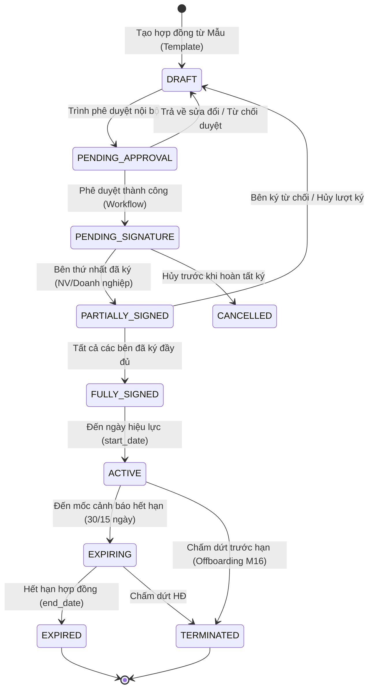
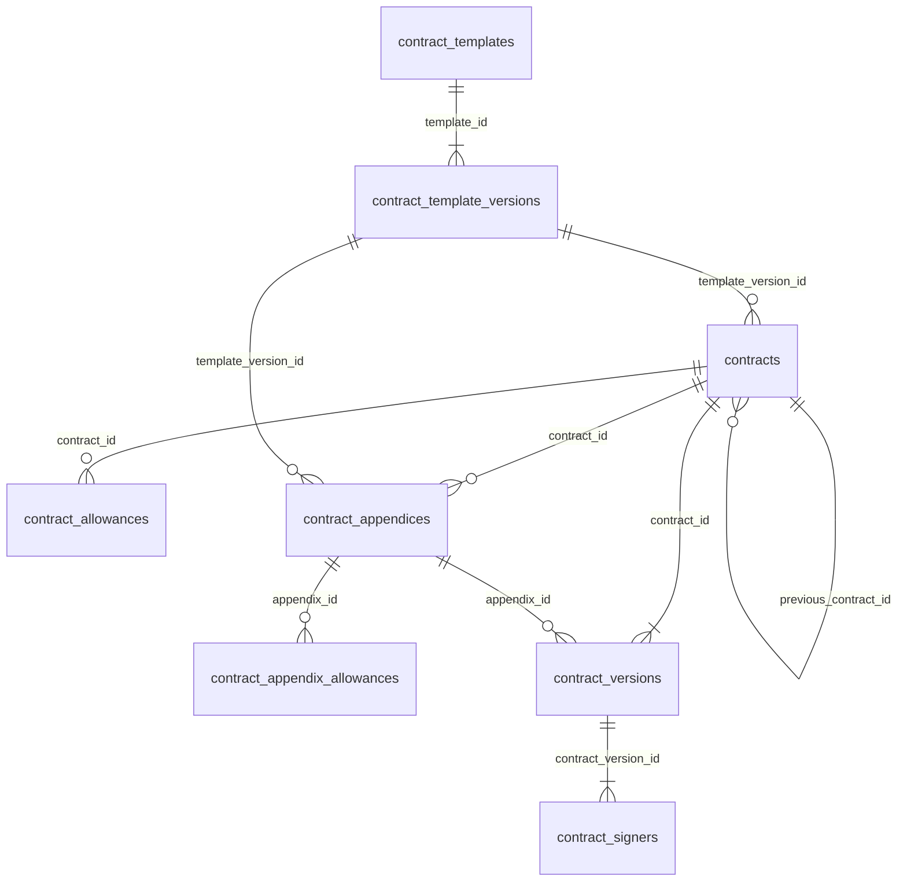
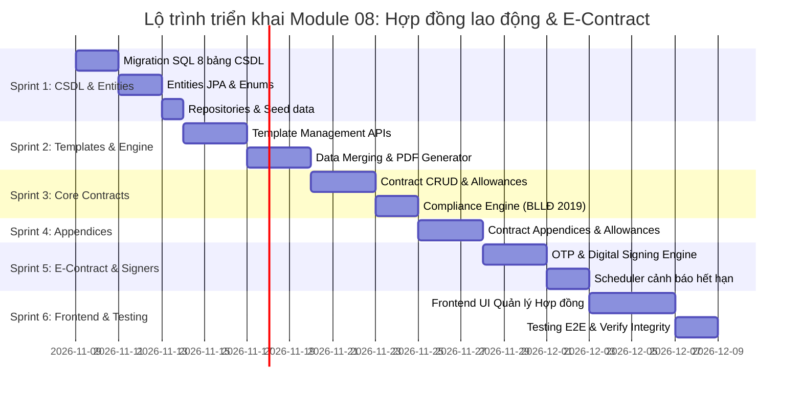

# ĐẶC TẢ CHI TIẾT VÀ KIẾN TRÚC TRIỂN KHAI MODULE 08: QUẢN LÝ HỢP ĐỒNG LAO ĐỘNG & KÝ ĐIỆN TỬ (CONTRACT MANAGEMENT & E-CONTRACT)

> **Tài liệu căn cứ & tham chiếu:**
> - Nghiệp vụ chi tiết: [`Nghiep-vu.docx`](file:///f:/Project/CYCLOSA/ba/Nghiep-vu.docx) (Mục 8: Hợp đồng lao động & Hợp đồng điện tử)
> - Thiết kế CSDL & Data Dictionary: [`database.md`](file:///f:/Project/CYCLOSA/ba/database.md) (§8.9 Module 8: Contract Management)
> - Danh mục API chuẩn: [`api-list.md`](file:///f:/Project/CYCLOSA/ba/api-list.md) (Mục 8: Hợp đồng & Hợp đồng điện tử - 42 APIs)
> - Quy chuẩn phân quyền liên kết: [`module-phan-quyen.md`](file:///f:/Project/CYCLOSA/cyclosa_be/docs/ba/module-phan-quyen.md) (Module 03: DataScope `OWN`, `TEAM`, `DEPARTMENT`, `COMPANY`, `ALL`)
> - Module nhân sự cốt lõi: [`module-ho-so-nhan-su.md`](file:///f:/Project/CYCLOSA/cyclosa_be/docs/ba/module-ho-so-nhan-su.md) (Module 05: Employee Profile Backbone)
> - Tham số pháp lý & Luật lao động: [`module-phap-ly-va-anh-huong-tham-so.md`](file:///f:/Project/CYCLOSA/ba/module-phap-ly-va-anh-huong-tham-so.md) (Bộ luật Lao động 2019 - BLLĐ 2019)
> - Chuẩn kiến trúc codebase: [`com.cyclosa.product`](file:///f:/Project/CYCLOSA/cyclosa_be/src/main/java/com/cyclosa/product) (Direct `@Service` class, không dùng `impl/`)

---

## 1. PHÂN TÍCH ĐẶC TẢ NGHIỆP VỤ & NGUYÊN LÝ CỐT LÕI

### 1.1. Khung pháp lý & Tuân thủ Bộ luật Lao động 2019 (BLLĐ 2019)

Trong hệ thống CYCLOSA HRM, **Hợp đồng lao động (`Contract`)** là văn bản pháp lý cao nhất xác lập mối quan hệ lao động chính thức giữa Doanh nghiệp và Người lao động. Module 08 được thiết kế tuân thủ nghiêm ngặt các quy định của **Bộ luật Lao động số 45/2019/QH14**:

1. **Phân loại hợp đồng theo luật định (Điều 20 BLLĐ 2019):**
   - `INDEFINITE` (**Hợp đồng không xác định thời hạn**): Hai bên không xác định thời hạn, thời điểm chấm dứt hiệu lực (`end_date = NULL`).
   - `FIXED_TERM` (**Hợp đồng xác định thời hạn**): Hai bên xác định thời hạn tối đa không quá **36 tháng** kể từ ngày có hiệu lực.
   - `PROBATION` (**Thỏa thuận thử việc riêng**): Giao kết hợp đồng thử việc riêng trước khi ký HĐLĐ chính thức (Thời hạn tối đa: 180 ngày với quản lý doanh nghiệp; 60 ngày với trình độ CĐ/ĐH trở lên; 30 ngày với trung cấp/công nhân; tiền lương tối thiểu bằng 85% lương chính thức theo Điều 25, 26 BLLĐ 2019).
   - `SERVICE` (**Hợp đồng dịch vụ / Cộng tác viên**): Ký với cá nhân tự do, không chịu sự điều chỉnh của BLLĐ về bảo hiểm xã hội bắt buộc và trợ cấp thôi việc.

2. **Quy tắc chuyển hóa loại hợp đồng & Giới hạn tái ký (Khoản 2 Điều 20 BLLĐ 2019):**
   - Khi hợp đồng xác định thời hạn lần thứ nhất hết hạn mà người lao động tiếp tục làm việc:
     - Trong vòng **30 ngày**, hai bên phải tiến hành ký kết HĐLĐ mới.
     - Trong thời gian chưa ký HĐLĐ mới, HĐ cũ vẫn có hiệu lực.
     - Sau 30 ngày nếu không ký HĐ mới, HĐ xác định thời hạn đã giao kết đương nhiên trở thành **HĐLĐ không xác định thời hạn**.
   - **Giới hạn số lần ký:** Hai bên chỉ được ký tiếp **tối đa 01 lần** hợp đồng xác định thời hạn (tức tối đa 2 hợp đồng xác định thời hạn liên tiếp thông qua liên kết `previous_contract_id`). Nếu tiếp tục sử dụng lao động sau lần thứ hai, bắt buộc phải giao kết **HĐLĐ không xác định thời hạn** (ngoại trừ giám đốc doanh nghiệp nhà nước, người lao động cao tuổi, người lao động nước ngoài theo luật).
   - Hệ thống trang bị tính năng **Tự động kiểm tra tuân thủ (`compliance-check`)** ngăn chặn vi phạm vượt quá số lần ký quy định.

3. **Nguyên tắc Bất biến thời hạn trong Phụ lục Hợp đồng (Điều 22 & 33 BLLĐ 2019):**
   - Phụ lục hợp đồng lao động (`contract_appendices`) quy định chi tiết, sửa đổi, bổ sung một số điều khoản của HĐLĐ nhưng **tuyệt đối không được sửa đổi thời hạn** của hợp đồng lao động làm thay đổi bản chất loại hợp đồng đã giao kết.
   - Bảng `contract_appendices` chỉ cho phép cập nhật: Mức lương cơ bản mới (`new_base_salary`), Mức lương đóng bảo hiểm mới (`new_insurance_salary`), Chức danh mới (`new_job_title_id`), Chi nhánh/Địa điểm làm việc mới (`new_branch_id`, `new_work_location`) và Phụ cấp kèm theo (`contract_appendix_allowances`).

4. **Cảnh báo trước khi hết hạn hợp đồng (Khoản 1 Điều 45 BLLĐ 2019):**
   - Người sử dụng lao động phải thông báo bằng văn bản cho người lao động về thời điểm chấm dứt HĐLĐ khi hợp đồng hết hạn ít nhất **15 ngày**.
   - Hệ thống xây dựng Scheduled Job tự động quét hợp đồng sắp hết hạn hàng ngày, bắn thông báo nhắc việc cho HR và cấp quản lý trước **30 ngày** và **15 ngày**.

---

### 1.2. Nguyên tắc Snapshot điều khoản thỏa thuận pháp lý (Legal Terms Immutability)

Hợp đồng lao động đại diện cho **ý chí thỏa thuận song phương tại thời điểm giao kết**. Do đó, hệ thống áp dụng nguyên tắc:

$$\mathbf{Điều\ khoản\ Hợp\ đồng} \neq \mathbf{Trạng\ thái\ nhân\ sự\ hiện\ hành}$$

* Mức lương cơ bản (`base_salary`), Mức lương đóng BHXH (`insurance_salary`), Phụ cấp (`contract_allowances`), Chức danh (`job_title_id`), Phòng ban (`department_id`), Chi nhánh (`branch_id`) được lưu trữ dưới dạng **Snapshot bất biến** trên bản ghi `contracts`.
* Khi nhân viên được điều chuyển công tác hàng ngày trên Module 05 (`employee_work_assignments`) hoặc được điều chỉnh mức lương trên bảng lương Module 10, nội dung trên hợp đồng pháp lý ban đầu **không bị thay đổi**.
* Bất kỳ sự thay đổi thỏa thuận pháp lý nào về lương hoặc vị trí làm việc đều bắt buộc phải ban hành **Phụ lục hợp đồng (`contract_appendices`)** có chữ ký hai bên.

---

### 1.3. Vòng đời hợp đồng & Quy trình ký điện tử E-Contract (State Machine & Multi-party Signing)



#### Quy trình Ký điện tử đa bên (Multi-party E-Signing Flow):
1. **Thứ tự ký (`signing_order`):**
   - **Lượt 1 (`signing_order = 1`, `EMPLOYEE`):** Người lao động đọc văn bản, nhận mã OTP qua Email/SMS hoặc dùng chữ ký số cá nhân để ký xác nhận đồng thuận.
   - **Lượt 2 (`signing_order = 2`, `EMPLOYER`):** Người đại diện pháp luật của Doanh nghiệp (`employer_representative_id`) thực hiện ký số số hóa (Token USB hoặc Chữ ký số từ xa HSM).
2. **Hình thức ký (`signing_form` & `signing_method`):**
   - `DIGITAL_SIGNATURE`: Chữ ký số tiêu chuẩn (PKI, X.509 Certificate).
   - `OTP_CONFIRMATION`: Xác thực chữ ký điện tử qua mã OTP bảo mật kèm dấu thời gian.
   - `WET_INK`: Ký trực tiếp trên giấy (áp dụng cho hợp đồng `PAPER` - HR tải scan bản có chữ ký sống lên hệ thống xác nhận).
3. **Bằng chứng toàn vẹn pháp lý (Legal Evidence & Integrity):**
   - Mã băm SHA-256 (`sha256_hash`) của tệp PDF tại thời điểm ký để đảm bảo văn bản không bị chỉnh sửa trái phép sau khi ký.
   - Lưu trữ mã giao dịch định danh duy nhất (`transaction_id`), số serial chứng thư số (`certificate_serial`), đơn vị cấp chứng thư (`certificate_issuer`), dấu thời gian tin cậy (`timestamp_token`) và tệp bằng chứng (`evidence_file_id`).
   - Tự động nộp lưu kho văn bản số hóa (`archived_document_id`) sang Module 07 (Digital Records).

---

### 1.4. Động cơ Mẫu hợp đồng linh hoạt (Contract Template Engine)

Hệ thống cho phép cấu hình mẫu hợp đồng theo từng pháp nhân và phân quyền áp dụng:

1. **Mẫu hợp đồng (`contract_templates`):** Phân loại theo `template_kind` (`LABOR_CONTRACT`, `APPENDIX`, `OFFER_LETTER`), loại hợp đồng (`contract_type`), gắn với chức danh, phòng ban hoặc chi nhánh cụ thể.
2. **Phiên bản tệp mẫu (`contract_template_versions`):** Hỗ trợ tệp định dạng `DOCX` hoặc `HTML` chứa các biến placeholder tiêu chuẩn:
   - Thông tin nhân viên: `{{employee_code}}`, `{{employee_name}}`, `{{date_of_birth}}`, `{{gender}}`, `{{identity_number}}`, `{{identity_issue_date}}`, `{{identity_issue_place}}`, `{{address}}`, `{{phone}}`.
   - Thông tin pháp nhân: `{{company_name}}`, `{{company_tax_code}}`, `{{company_address}}`, `{{representative_name}}`, `{{representative_title}}`.
   - Điều khoản hợp đồng: `{{contract_no}}`, `{{job_title}}`, `{{department_name}}`, `{{work_location}}`, `{{start_date}}`, `{{end_date}}`, `{{base_salary}}`, `{{insurance_salary}}`, `{{allowance_list}}`, `{{pay_day}}`.
3. Khi sinh hợp đồng, hệ thống tự động điền dữ liệu (Merge Data), kết xuất file PDF chính thức phiên bản 1 (`contract_versions`) và lưu trữ bảo mật.

---

## 2. DATA DICTIONARY & THIẾT KẾ CƠ SỞ DỮ LIỆU (DATABASE SCHEMA)

Toàn bộ CSDL sử dụng **UUID v4** làm khóa chính, tuân thủ quy chuẩn phân vùng đa công ty (`company_id`), hỗ trợ Soft Delete (`deleted = FALSE`) và truy vết Audit.



### 2.1. Bảng `contract_templates` (Mẫu hợp đồng & thư mời)
Quản lý danh mục các biểu mẫu văn bản hợp đồng được áp dụng trong tập đoàn.

| Tên cột | Kiểu dữ liệu | Ràng buộc | Mô tả |
| :--- | :--- | :--- | :--- |
| `id` | `UUID` | `PRIMARY KEY` | Khóa chính |
| `company_id` | `UUID` | `FK -> companies.id, NOT NULL` | Công ty / Pháp nhân sở hữu mẫu |
| `name` | `VARCHAR(200)` | `NOT NULL` | Tên mẫu (VD: HĐLĐ Xác định thời hạn Khối Văn phòng) |
| `template_kind` | `VARCHAR(30)` | `NOT NULL` | `LABOR_CONTRACT`, `APPENDIX`, `OFFER_LETTER` |
| `contract_type` | `VARCHAR(30)` | `NULL` | `FIXED_TERM`, `INDEFINITE`, `PROBATION`, `SERVICE` (NULL = Mọi loại) |
| `job_title_id` | `UUID` | `FK -> job_titles.id, NULL` | Áp dụng riêng cho chức danh (NULL = Mọi chức danh) |
| `department_id` | `UUID` | `FK -> departments.id, NULL` | Áp dụng riêng cho phòng ban |
| `branch_id` | `UUID` | `FK -> branches.id, NULL` | Áp dụng riêng cho chi nhánh |
| `is_active` | `BOOLEAN` | `NOT NULL, DEFAULT TRUE` | Cờ kích hoạt sử dụng |
| `deleted` | `BOOLEAN` | `NOT NULL, DEFAULT FALSE` | Cờ xóa mềm |
| `created_at` | `TIMESTAMP` | `NOT NULL` | Thời điểm tạo |
| `updated_at` | `TIMESTAMP` | `NULL` | Thời điểm cập nhật cuối |

### 2.2. Bảng `contract_template_versions` (Phiên bản tệp biểu mẫu)
Lưu trữ các phiên bản tệp mẫu DOCX/HTML chứa placeholder variables để bảo toàn lịch sử văn bản đã ký.

| Tên cột | Kiểu dữ liệu | Ràng buộc | Mô tả |
| :--- | :--- | :--- | :--- |
| `id` | `UUID` | `PRIMARY KEY` | Khóa chính |
| `template_id` | `UUID` | `FK -> contract_templates.id, NOT NULL` | Thuộc mẫu hợp đồng nào |
| `version_no` | `INT` | `NOT NULL` | Số thứ tự phiên bản mẫu (1, 2, 3...) |
| `format` | `VARCHAR(20)` | `NOT NULL` | `DOCX`, `HTML` |
| `file_url` | `VARCHAR(500)` | `NOT NULL` | Đường dẫn lưu trữ tệp mẫu chứa biến `{{...}}` |
| `description` | `VARCHAR(500)` | `NULL` | Ghi chú lý do cập nhật phiên bản |
| `created_at` | `TIMESTAMP` | `NOT NULL` | Thời điểm tạo phiên bản |

*Ràng buộc duy nhất:* `UNIQUE (template_id, version_no)`

### 2.3. Bảng `contracts` (Hợp đồng lao động cốt lõi)
Lưu trữ toàn bộ thông tin điều khoản thỏa thuận pháp lý song phương giữa doanh nghiệp và người lao động.

| Tên cột | Kiểu dữ liệu | Ràng buộc | Mô tả |
| :--- | :--- | :--- | :--- |
| `id` | `UUID` | `PRIMARY KEY` | Khóa chính |
| `contract_no` | `VARCHAR(50)` | `NOT NULL, UNIQUE` | Mã số hợp đồng (VD: `HDLD-2026/0012`) |
| `employee_id` | `UUID` | `FK -> employees.id, NOT NULL` | Người lao động ký kết |
| `employer_company_id` | `UUID` | `FK -> companies.id, NOT NULL` | Pháp nhân doanh nghiệp ký kết |
| `employer_representative_id` | `UUID` | `FK -> employees.id, NOT NULL` | Người đại diện doanh nghiệp ký |
| `template_version_id` | `UUID` | `FK -> contract_template_versions.id, NOT NULL` | Phiên bản biểu mẫu sử dụng |
| `contract_type` | `VARCHAR(30)` | `NOT NULL` | `FIXED_TERM`, `INDEFINITE`, `PROBATION`, `SERVICE` |
| `previous_contract_id` | `UUID` | `FK -> contracts.id, NULL` | Hợp đồng liền trước (căn cứ đếm số lần tái ký) |
| `source_offer_id` | `UUID` | `NULL` | Thư mời nhận việc làm căn cứ (từ Tuyển dụng) |
| `job_title_id` | `UUID` | `FK -> job_titles.id, NOT NULL` | Chức danh công việc thỏa thuận |
| `department_id` | `UUID` | `FK -> departments.id, NOT NULL` | Phòng ban công tác thỏa thuận |
| `branch_id` | `UUID` | `FK -> branches.id, NOT NULL` | Chi nhánh làm việc thỏa thuận |
| `work_location` | `VARCHAR(500)` | `NOT NULL` | Địa điểm làm việc ghi rõ trong hợp đồng |
| `working_time_description` | `VARCHAR(500)` | `NOT NULL` | Thời giờ làm việc (VD: 8h00 - 17h30 từ thứ 2 đến thứ 6) |
| `base_salary` | `DECIMAL(18,2)` | `NOT NULL` | Mức lương chính thỏa thuận |
| `insurance_salary` | `DECIMAL(18,2)` | `NULL` | Mức lương căn cứ đóng BHXH bắt buộc |
| `payment_method` | `VARCHAR(30)` | `NOT NULL, DEFAULT 'BANK_TRANSFER'` | `BANK_TRANSFER` (Chuyển khoản), `CASH` (Tiền mặt) |
| `pay_day_of_month` | `SMALLINT` | `NOT NULL, DEFAULT 5` | Ngày trả lương cố định hàng tháng (1 - 31) |
| `signing_form` | `VARCHAR(30)` | `NOT NULL` | `ELECTRONIC` (Ký điện tử), `PAPER` (Ký giấy truyền thống) |
| `start_date` | `DATE` | `NOT NULL` | Ngày hợp đồng bắt đầu có hiệu lực |
| `end_date` | `DATE` | `NULL` | Ngày hết hạn hợp đồng (Bắt buộc `NULL` khi `INDEFINITE`) |
| `signed_date` | `DATE` | `NULL` | Ngày ký ghi trên văn bản |
| `status` | `VARCHAR(30)` | `NOT NULL, DEFAULT 'DRAFT'` | `DRAFT`, `PENDING_APPROVAL`, `PENDING_SIGNATURE`, `ACTIVE`, `CANCELLED`, `EXPIRED`, `TERMINATED` |
| `archived_document_id` | `UUID` | `NULL, UNIQUE` | Bản lưu kho hồ sơ tài liệu số (Module 07) |
| `deleted` | `BOOLEAN` | `NOT NULL, DEFAULT FALSE` | Cờ xóa mềm |
| `created_at` | `TIMESTAMP` | `NOT NULL` | Thời điểm tạo |
| `updated_at` | `TIMESTAMP` | `NULL` | Thời điểm cập nhật cuối |

*Ràng buộc toàn vẹn:* `CHECK (end_date IS NULL OR end_date >= start_date)`

### 2.4. Bảng `contract_allowances` (Phụ cấp thỏa thuận theo hợp đồng)
Danh mục các khoản phụ cấp lương cố định thỏa thuận theo hợp đồng.

| Tên cột | Kiểu dữ liệu | Ràng buộc | Mô tả |
| :--- | :--- | :--- | :--- |
| `id` | `UUID` | `PRIMARY KEY` | Khóa chính |
| `contract_id` | `UUID` | `FK -> contracts.id, NOT NULL` | Hợp đồng áp dụng |
| `name` | `VARCHAR(150)` | `NOT NULL` | Tên phụ cấp (Phụ cấp ăn trưa, xăng xe, trách nhiệm...) |
| `amount` | `DECIMAL(18,2)` | `NOT NULL` | Số tiền phụ cấp mỗi tháng |
| `is_taxable` | `BOOLEAN` | `NOT NULL, DEFAULT TRUE` | Tính vào thu nhập chịu thuế TNCN hay miễn thuế |

*Ràng buộc duy nhất:* `UNIQUE (contract_id, name)`

### 2.5. Bảng `contract_appendices` (Phụ lục hợp đồng lao động)
Quản lý các lần điều chỉnh, bổ sung điều khoản hợp đồng. Tuyệt đối không thay đổi thời hạn HĐ.

| Tên cột | Kiểu dữ liệu | Ràng buộc | Mô tả |
| :--- | :--- | :--- | :--- |
| `id` | `UUID` | `PRIMARY KEY` | Khóa chính |
| `contract_id` | `UUID` | `FK -> contracts.id, NOT NULL` | Hợp đồng gốc |
| `appendix_no` | `INT` | `NOT NULL` | Số thứ tự phụ lục (1, 2, 3...) |
| `template_version_id` | `UUID` | `FK -> contract_template_versions.id, NOT NULL` | Mẫu phụ lục sử dụng |
| `effective_date` | `DATE` | `NOT NULL` | Ngày phụ lục bắt đầu có hiệu lực |
| `description` | `TEXT` | `NOT NULL` | Diễn giải lý do và nội dung điều chỉnh |
| `new_base_salary` | `DECIMAL(18,2)` | `NULL` | Mức lương cơ bản mới (nếu có điều chỉnh) |
| `new_insurance_salary` | `DECIMAL(18,2)` | `NULL` | Mức lương đóng BHXH mới |
| `new_job_title_id` | `UUID` | `FK -> job_titles.id, NULL` | Chức danh mới (nếu thăng chức/chuyển ngạch) |
| `new_branch_id` | `UUID` | `FK -> branches.id, NULL` | Chi nhánh mới |
| `new_work_location` | `VARCHAR(500)` | `NULL` | Địa điểm làm việc mới |
| `status` | `VARCHAR(30)` | `NOT NULL, DEFAULT 'DRAFT'` | `DRAFT`, `PENDING_APPROVAL`, `PENDING_SIGNATURE`, `ACTIVE`, `CANCELLED` |
| `archived_document_id` | `UUID` | `NULL, UNIQUE` | Bản lưu kho tài liệu số |
| `deleted` | `BOOLEAN` | `NOT NULL, DEFAULT FALSE` | Cờ xóa mềm |

*Ràng buộc duy nhất:* `UNIQUE (contract_id, appendix_no)`

### 2.6. Bảng `contract_appendix_allowances` (Phụ cấp điều chỉnh theo phụ lục)
| Tên cột | Kiểu dữ liệu | Ràng buộc | Mô tả |
| :--- | :--- | :--- | :--- |
| `id` | `UUID` | `PRIMARY KEY` | Khóa chính |
| `appendix_id` | `UUID` | `FK -> contract_appendices.id, NOT NULL` | Phụ lục áp dụng |
| `name` | `VARCHAR(150)` | `NOT NULL` | Tên khoản phụ cấp điều chỉnh |
| `amount` | `DECIMAL(18,2)` | `NOT NULL` | Mức tiền mới (0 = Bãi bỏ phụ cấp cũ) |
| `is_taxable` | `BOOLEAN` | `NOT NULL, DEFAULT TRUE` | Tính thuế TNCN |

### 2.7. Bảng `contract_versions` (Phiên bản văn bản tệp PDF hợp đồng/phụ lục)
Lưu vết từng phiên bản tệp PDF sinh ra phục vụ quá trình trình duyệt và ký kết.

| Tên cột | Kiểu dữ liệu | Ràng buộc | Mô tả |
| :--- | :--- | :--- | :--- |
| `id` | `UUID` | `PRIMARY KEY` | Khóa chính |
| `contract_id` | `UUID` | `FK -> contracts.id, NOT NULL` | Hợp đồng |
| `appendix_id` | `UUID` | `FK -> contract_appendices.id, NULL` | Phụ lục (NULL = Văn bản của HĐ chính) |
| `version_no` | `INT` | `NOT NULL` | Số phiên bản văn bản (1, 2, 3...) |
| `file_url` | `VARCHAR(500)` | `NOT NULL` | Đường dẫn tệp PDF hợp đồng hoàn chỉnh |
| `sha256_hash` | `VARCHAR(64)` | `NOT NULL` | Giá trị băm SHA-256 bảo đảm tính toàn vẹn |
| `change_reason` | `VARCHAR(500)` | `NULL` | Diễn giải lý do phát hành phiên bản mới |
| `created_at` | `TIMESTAMP` | `NOT NULL` | Thời điểm phát hành |

### 2.8. Bảng `contract_signers` (Các bên ký kết & Bằng chứng giao kết E-Contract)
Quản lý các lượt ký, thứ tự ký và bằng chứng số hóa của từng bên tham gia giao kết.

| Tên cột | Kiểu dữ liệu | Ràng buộc | Mô tả |
| :--- | :--- | :--- | :--- |
| `id` | `UUID` | `PRIMARY KEY` | Khóa chính |
| `contract_version_id` | `UUID` | `FK -> contract_versions.id, NOT NULL` | Phiên bản văn bản được ký |
| `signer_employee_id` | `UUID` | `FK -> employees.id, NOT NULL` | Danh tính nhân sự ký |
| `signer_side` | `VARCHAR(20)` | `NOT NULL` | `EMPLOYER` (Đại diện Cty), `EMPLOYEE` (Người LĐ) |
| `signing_order` | `INT` | `NOT NULL` | Thứ tự ký (1: Người LĐ, 2: Người sử dụng LĐ) |
| `signing_method` | `VARCHAR(30)` | `NOT NULL` | `DIGITAL_SIGNATURE`, `OTP_CONFIRMATION`, `WET_INK` |
| `status` | `VARCHAR(20)` | `NOT NULL, DEFAULT 'PENDING'` | `PENDING`, `SIGNED`, `DECLINED`, `VOIDED` |
| `signed_at` | `TIMESTAMP` | `NULL` | Thời điểm hoàn tất ký |
| `decline_reason` | `VARCHAR(500)` | `NULL` | Bắt buộc nhập khi từ chối ký (`DECLINED`) |
| `otp_code` | `VARCHAR(10)` | `NULL` | Mã OTP đang chờ xác thực (TTL 5 phút) |
| `otp_expired_at` | `TIMESTAMP` | `NULL` | Hạn của mã OTP |
| `certificate_serial` | `VARCHAR(100)` | `NULL` | Số Serial chứng thư số PKI |
| `certificate_issuer` | `VARCHAR(200)` | `NULL` | Tổ chức cấp chứng thư (VNPT-CA, Viettel-CA...) |
| `certificate_validity` | `VARCHAR(20)` | `NULL` | `VALID`, `EXPIRED`, `REVOKED`, `UNVERIFIED` |
| `transaction_id` | `VARCHAR(100)` | `NULL, UNIQUE` | Mã giao dịch ký số định danh duy nhất |
| `timestamp_token` | `TEXT` | `NULL` | Dấu thời gian tin cậy (Time-Stamp Token RFC 3161) |
| `evidence_file_url` | `VARCHAR(500)` | `NULL` | Tệp lưu vết bằng chứng ký số |

*Ràng buộc duy nhất:* `UNIQUE (contract_version_id, signing_order)` và `UNIQUE (contract_version_id, signer_employee_id)`.

---

## 3. DANH MỤC ENDPOINTS & CONTRACT SPECIFICATION (42 APIS)

Toàn bộ 42 APIs tuân thủ chuẩn RESTful, tích hợp tiền tố `/api/v1` và cơ chế phân quyền RBAC đa cấp:

```
Quyền yêu cầu chính:
- contract.view           : Tra cứu danh sách, chi tiết hợp đồng theo phạm vi dữ liệu (OWN/TEAM/DEPARTMENT/COMPANY/ALL)
- contract.create         : Khởi tạo hợp đồng, phụ lục, sửa đổi dự thảo, kiểm tra tuân thủ
- contract.template_manage: Quản lý biểu mẫu hợp đồng, tải lên phiên bản mẫu DOCX/HTML
- contract.sign_manage    : Phát hành bản ký, cấu hình người ký, xác nhận ký giấy WET_INK
- contract.archive        : Đồng bộ bản hợp đồng đã ký hoàn tất vào kho lưu trữ số Module 07
- Auth                    : Quyền của chính nhân viên đã đăng nhập (ký hợp đồng của tôi, xem HĐ của tôi)
```

### 3.1. Nhóm Mẫu hợp đồng (Contract Templates - 8 APIs)
| STT | Phương thức | Endpoint | Mô tả chức năng | Quyền yêu cầu |
|:---:|:---:|---|---|:---:|
| 1 | `GET` | `/api/v1/contract-templates` | Danh sách mẫu hợp đồng (Query: `templateKind`, `contractType`, `jobTitleId`, `departmentId`, `branchId`, `active`) | `contract.view` |
| 2 | `POST` | `/api/v1/contract-templates` | Tạo mới mẫu hợp đồng | `contract.template_manage` |
| 3 | `GET` | `/api/v1/contract-templates/{templateId}` | Lấy chi tiết mẫu hợp đồng | `contract.view` |
| 4 | `PUT` | `/api/v1/contract-templates/{templateId}` | Cập nhật thuộc tính và phạm vi áp dụng của mẫu | `contract.template_manage` |
| 5 | `POST` | `/api/v1/contract-templates/{templateId}/deactivate` | Ngừng sử dụng mẫu hợp đồng | `contract.template_manage` |
| 6 | `GET` | `/api/v1/contract-templates/{templateId}/versions` | Danh sách các phiên bản tệp mẫu | `contract.view` |
| 7 | `POST` | `/api/v1/contract-templates/{templateId}/versions` | Tải lên phiên bản mẫu mới (tệp DOCX/HTML chứa biến `{{...}}`) | `contract.template_manage` |
| 8 | `GET` | `/api/v1/contract-template-versions/{versionId}/download` | Tải tệp biểu mẫu để xem hoặc chỉnh sửa | `contract.view` |

### 3.2. Nhóm Hợp đồng lao động cốt lõi (Contracts - 12 APIs)
| STT | Phương thức | Endpoint | Mô tả chức năng | Quyền yêu cầu |
|:---:|:---:|---|---|:---:|
| 9 | `POST` | `/api/v1/contracts` | Tạo hợp đồng từ mẫu + nhân sự (Tự điền biến, sinh `contract_no`, lưu phụ cấp) | `contract.create` |
| 10 | `GET` | `/api/v1/contracts` | Danh sách hợp đồng phân trang (Lọc theo `employeeId`, `contractType`, `status`, `expiringWithinDays`) | `contract.view` |
| 11 | `GET` | `/api/v1/contracts/expiring` | Danh sách hợp đồng sắp hết hạn theo mốc cấu hình (VD: trong vòng 30 ngày) | `contract.view` |
| 12 | `GET` | `/api/v1/contracts/{contractId}` | Chi tiết hợp đồng, tính toán trạng thái ký, thời hạn và số lần tái ký | `contract.view` |
| 13 | `PUT` | `/api/v1/contracts/{contractId}` | Sửa đổi điều khoản hợp đồng (Chỉ áp dụng khi ở trạng thái `DRAFT`) | `contract.create` |
| 14 | `PUT` | `/api/v1/contracts/{contractId}/allowances` | Cập nhật / thay thế danh mục phụ cấp thỏa thuận trong hợp đồng | `contract.create` |
| 15 | `POST` | `/api/v1/contracts/{contractId}/compliance-check` | Tự động kiểm tra tuân thủ BLLĐ 2019 (thời hạn, số lần ký tiếp, lương thử việc...) | `contract.create` |
| 16 | `POST` | `/api/v1/contracts/{contractId}/submit` | Trình phê duyệt nội bộ hợp đồng qua Workflow Engine | `contract.create` |
| 17 | `POST` | `/api/v1/contracts/{contractId}/send-for-signature` | Phát hành bản ký và gửi thông báo mời các bên ký (khi đã duyệt) | `contract.sign_manage` |
| 18 | `POST` | `/api/v1/contracts/{contractId}/cancel` | Hủy hợp đồng trước khi hoàn tất ký | `contract.create` |
| 19 | `POST` | `/api/v1/contracts/{contractId}/renew` | Tái ký hợp đồng mới kế tiếp (`previous_contract_id`) | `contract.create` |
| 20 | `POST` | `/api/v1/contracts/{contractId}/archive` | Đồng bộ hợp đồng đã ký hoàn tất sang kho lưu trữ số (Module 07) | `contract.archive` |

### 3.3. Nhóm Hợp đồng theo đối tượng & Tự phục vụ (Self-Service - 2 APIs)
| STT | Phương thức | Endpoint | Mô tả chức năng | Quyền yêu cầu |
|:---:|:---:|---|---|:---:|
| 21 | `GET` | `/api/v1/employees/{employeeId}/contracts` | Xem toàn bộ lịch sử hợp đồng của một nhân viên | `contract.view` |
| 22 | `GET` | `/api/v1/me/contracts` | Nhân viên tự tra cứu danh sách hợp đồng của chính mình | `Auth` |

### 3.4. Nhóm Phiên bản văn bản & Kiểm tra toàn vẹn (Contract Versions - 4 APIs)
| STT | Phương thức | Endpoint | Mô tả chức năng | Quyền yêu cầu |
|:---:|:---:|---|---|:---:|
| 23 | `GET` | `/api/v1/contracts/{contractId}/versions` | Lấy danh sách các phiên bản văn bản PDF của hợp đồng / phụ lục | `contract.view` |
| 24 | `POST` | `/api/v1/contracts/{contractId}/versions` | Phát hành phiên bản PDF mới (hủy lượt ký cũ nếu sửa nội dung) | `contract.create` |
| 25 | `GET` | `/api/v1/contract-versions/{versionId}/download` | Tải xuống tệp PDF hợp đồng | `contract.view` |
| 26 | `GET` | `/api/v1/contract-versions/{versionId}/verify-integrity` | Kiểm tra tính toàn vẹn văn bản bằng mã băm SHA-256 và chữ ký số | `contract.view` |

### 3.5. Nhóm Ký điện tử & Bằng chứng giao kết (Signing & Evidence - 7 APIs)
| STT | Phương thức | Endpoint | Mô tả chức năng | Quyền yêu cầu |
|:---:|:---:|---|---|:---:|
| 27 | `GET` | `/api/v1/contract-versions/{versionId}/signers` | Danh sách các bên ký, thứ tự và tiến độ ký | `contract.view` |
| 28 | `POST` | `/api/v1/contract-signers/{signerId}/request-otp` | Gửi mã OTP xác thực ký điện tử qua Email/SMS | `Auth` |
| 29 | `POST` | `/api/v1/contract-signers/{signerId}/sign` | Ký hợp đồng điện tử (bằng OTP hoặc Chữ ký số PKI/Token) | `Auth` |
| 30 | `POST` | `/api/v1/contract-signers/{signerId}/decline` | Người ký từ chối ký kèm lý do | `Auth` |
| 31 | `POST` | `/api/v1/contract-signers/{signerId}/confirm-wet-ink` | HR xác nhận nhân viên đã ký trực tiếp trên bản giấy (WET_INK) | `contract.sign_manage` |
| 32 | `GET` | `/api/v1/contract-signers/{signerId}/evidence` | Tra cứu chứng cứ giao kết: Serial chứng thư, mã giao dịch, dấu thời gian | `contract.view` |
| 33 | `GET` | `/api/v1/me/contract-signing-tasks` | Danh sách văn bản hợp đồng đang chờ chính người dùng đăng nhập ký | `Auth` |

### 3.6. Nhóm Phụ lục hợp đồng (Contract Appendices - 9 APIs)
| STT | Phương thức | Endpoint | Mô tả chức năng | Quyền yêu cầu |
|:---:|:---:|---|---|:---:|
| 34 | `GET` | `/api/v1/contracts/{contractId}/appendices` | Lấy danh sách tất cả các phụ lục của một hợp đồng | `contract.view` |
| 35 | `POST` | `/api/v1/contracts/{contractId}/appendices` | Tạo mới phụ lục hợp đồng (chỉ các trường `new_*`, không đổi thời hạn) | `contract.create` |
| 36 | `GET` | `/api/v1/contract-appendices/{appendixId}` | Xem chi tiết phụ lục hợp đồng | `contract.view` |
| 37 | `PUT` | `/api/v1/contract-appendices/{appendixId}` | Chỉnh sửa điều khoản phụ lục (Chỉ áp dụng khi `DRAFT`) | `contract.create` |
| 38 | `PUT` | `/api/v1/contract-appendices/{appendixId}/allowances` | Thay thế danh mục phụ cấp điều chỉnh trong phụ lục | `contract.create` |
| 39 | `POST` | `/api/v1/contract-appendices/{appendixId}/submit` | Trình phê duyệt phụ lục qua Workflow Engine | `contract.create` |
| 40 | `POST` | `/api/v1/contract-appendices/{appendixId}/send-for-signature` | Phát hành bản ký phụ lục và mời các bên ký | `contract.sign_manage` |
| 41 | `POST` | `/api/v1/contract-appendices/{appendixId}/cancel` | Hủy phụ lục hợp đồng trước khi ký hoàn tất | `contract.create` |
| 42 | `POST` | `/api/v1/contract-appendices/{appendixId}/archive` | Đồng bộ phụ lục đã ký hoàn tất vào kho tài liệu số | `contract.archive` |

---

## 4. DẢI MÃ LỖI NGHIỆP VỤ CHUẨN HÓA (BUSINESS ERROR CODES)

Module 08 sử dụng tiền tố lỗi `CONTRACT_` tương ứng dải mã HTTP chuẩn:

| Mã lỗi (Error Code) | HTTP Status | Thông điệp lỗi chi tiết | Nguyên nhân & Hướng xử lý |
| :--- | :---: | :--- | :--- |
| `CONTRACT_NOT_FOUND` | `404` | Không tìm thấy hợp đồng yêu cầu. | ID hợp đồng không tồn tại hoặc đã bị xóa mềm. |
| `CONTRACT_TEMPLATE_NOT_FOUND` | `404` | Không tìm thấy biểu mẫu hợp đồng. | Biểu mẫu hợp đồng không tồn tại trong công ty. |
| `CONTRACT_TEMPLATE_VERSION_NOT_FOUND` | `404` | Không tìm thấy phiên bản tệp biểu mẫu. | Phiên bản mẫu đã bị gỡ bỏ. |
| `CONTRACT_NO_ALREADY_EXISTS` | `409` | Số hợp đồng đã tồn tại trên hệ thống. | Trùng số hợp đồng `contract_no`. |
| `INVALID_CONTRACT_DATES` | `400` | Ngày kết thúc hợp đồng phải sau ngày bắt đầu. | `end_date` nhỏ hơn hoặc bằng `start_date`. |
| `INDEFINITE_CONTRACT_CANNOT_HAVE_END_DATE` | `400` | Hợp đồng không xác định thời hạn không được có ngày kết thúc. | Loại HĐ `INDEFINITE` nhưng có truyền `end_date`. |
| `MAX_FIXED_TERM_CONTRACTS_EXCEEDED` | `409` | Đã đạt giới hạn tối đa 02 lần ký HĐ xác định thời hạn theo Điều 20 BLLĐ 2019. | Phải chuyển sang ký Hợp đồng không xác định thời hạn. |
| `CANNOT_MODIFY_SIGNED_CONTRACT` | `400` | Không thể sửa đổi trực tiếp hợp đồng đã ký hoặc đang trình ký. | Phải tạo Phụ lục hợp đồng (`contract_appendices`). |
| `APPENDIX_CANNOT_CHANGE_TERM` | `400` | Phụ lục hợp đồng không được phép thay đổi thời hạn hợp đồng. | Vi phạm Điều 22, 33 BLLĐ 2019. |
| `PROBATION_SALARY_BELOW_LEGAL_MIN` | `400` | Tiền lương thử việc phải đạt ít nhất 85% mức lương chính thức. | Vi phạm Điều 26 BLLĐ 2019. |
| `INVALID_SIGNING_ORDER` | `400` | Chưa đến lượt ký của bên này theo quy định thứ tự ký kết. | Người đại diện chưa thể ký khi Người lao động chưa ký. |
| `SIGNER_ALREADY_SIGNED` | `409` | Bên ký này đã hoàn tất ký, không thể ký lại. | Lượt ký đã ở trạng thái `SIGNED`. |
| `OTP_EXPIRED_OR_INVALID` | `400` | Mã xác thực OTP không chính xác hoặc đã hết thời gian hiệu lực. | Yêu cầu gửi lại mã OTP mới. |
| `DIGITAL_SIGNATURE_INVALID` | `400` | Chữ ký số không hợp lệ hoặc chứng thư số đã bị thu hồi. | Kiểm tra USB Token / Chứng thư số HSM. |
| `CONTRACT_DOCUMENT_HASH_MISMATCH` | `400` | Tệp văn bản đã bị sửa đổi trái phép (sai lệch mã băm SHA-256). | Phát hiện vi phạm tính toàn vẹn văn bản. |
| `CANNOT_CANCEL_COMPLETED_CONTRACT` | `400` | Hợp đồng đã ký kết hoàn tất không thể hủy bỏ đơn phương tại đây. | Phải thực hiện quy trình chấm dứt HĐLĐ (Module 16). |

---

## 5. LỘ TRÌNH TRIỂN KHAI BACKEND & FRONTEND (6 SPRINTS)



### 🔹 Sprint 1: Thiết kế CSDL, Entities, Enums & Repositories
1. Viết migration SQL `migration_contract_module.sql` (8 bảng CSDL, UUID v4, Soft delete, Audit, Indexes).
2. Tạo 8 Entities JPA trong `com.cyclosa.contract.entity` và các Enums tương ứng.
3. Tạo 8 Repositories Spring Data JPA trong `com.cyclosa.contract.repository`.
4. Seed dữ liệu mẫu: 2 Mẫu hợp đồng chuẩn, các loại hợp đồng, phân quyền `contract.*`.

### 🔹 Sprint 2: Động cơ Mẫu hợp đồng & Kết xuất PDF (Template & Generation)
1. Xây dựng `ContractTemplateService`: Quản lý mẫu hợp đồng, tải lên file mẫu DOCX/HTML (`template_versions`).
2. Tích hợp thư viện Docx4j / OpenPDF: Đọc file mẫu, thay thế placeholder variables `{{...}}` bằng dữ liệu nhân viên và điều khoản.
3. Sinh file PDF phiên bản 1 (`contract_versions`), tính toán giá trị băm `sha256_hash` để lưu trữ bảo mật.

### 🔹 Sprint 3: Quản lý Hợp đồng & Động cơ Tuân thủ BLLĐ 2019
1. Xây dựng `ContractService`: Tạo hợp đồng, tự sinh số `contract_no`, lưu phụ cấp `contract_allowances`.
2. Xây dựng `ContractComplianceService`: Kiểm tra giới hạn 2 lần ký xác định thời hạn, kiểm tra tỷ lệ lương thử việc tối thiểu 85%, kiểm tra hợp lệ ngày hiệu lực.
3. Tích hợp phân quyền DataScope theo phòng ban / chi nhánh.

### 🔹 Sprint 4: Quản lý Phụ lục Hợp đồng (Appendices & Adjustments)
1. Xây dựng `ContractAppendixService`: Tạo phụ lục HĐLĐ số 1, 2...
2. Chặn thay đổi thời hạn hợp đồng, chỉ cho phép cập nhật lương, phụ cấp, chức danh, địa điểm.
3. Sinh file PDF phụ lục, lưu trữ phiên bản tệp và danh sách bên ký tương ứng.

### 🔹 Sprint 5: Ký điện tử E-Contract & Scheduled Job Cảnh báo Hết hạn
1. Xây dựng `ContractSigningService`:
   - Quản lý danh sách người ký theo thứ tự (`EMPLOYEE` $\rightarrow$ `EMPLOYER`).
   - Ký bằng OTP qua Email (sinh mã OTP 6 số, TTL 5 phút).
   - Ký bằng Chữ ký số (Lưu chứng thư, Serial, Transaction ID, Dấu thời gian RFC 3161).
   - HR xác nhận ký giấy `WET_INK`.
2. Xây dựng Scheduled Task `@Scheduled(cron = "0 0 7 * * ?")`: Quét tự động mỗi 7h sáng phát hiện hợp đồng sắp hết hạn trong vòng 30 ngày và 15 ngày, gửi thông báo nhắc việc cho HR.

### 🔹 Sprint 6: Xây dựng Giao diện Frontend (`cyclosa_fe`) & Kiểm thử toàn diện
1. Khai báo TypeScript types & RTK Query `contract-api.ts`.
2. Màn hình Bảng danh sách hợp đồng (`/contracts`): Lọc theo trạng thái, loại hợp đồng, tab "Sắp hết hạn".
3. Modal Soạn thảo hợp đồng mới, Modal Xem trước PDF & Lịch sử phiên bản.
4. Giao diện Ký điện tử cho nhân viên (Xem văn bản, bấm Gửi mã OTP, nhập OTP xác nhận ký).
5. Kiểm thử E2E: Tạo hợp đồng -> Phê duyệt -> Ký điện tử -> Kiểm tra băm toàn vẹn -> Tái ký hợp đồng.

