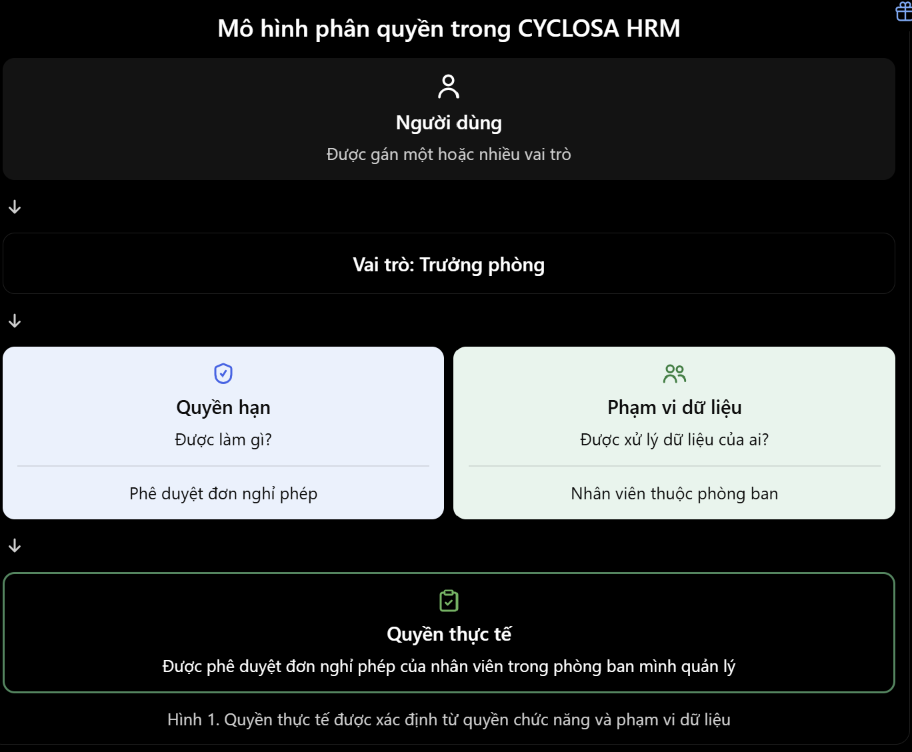
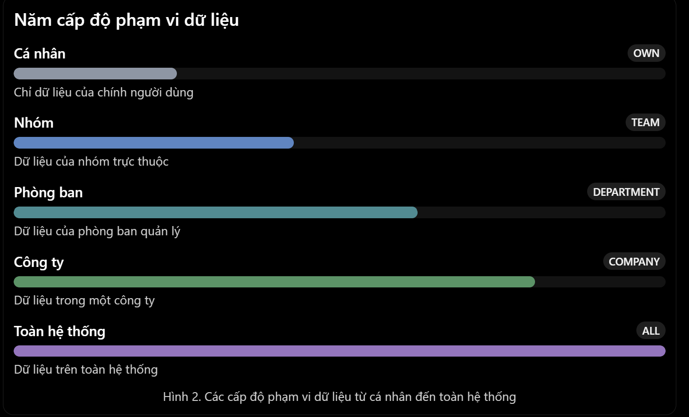
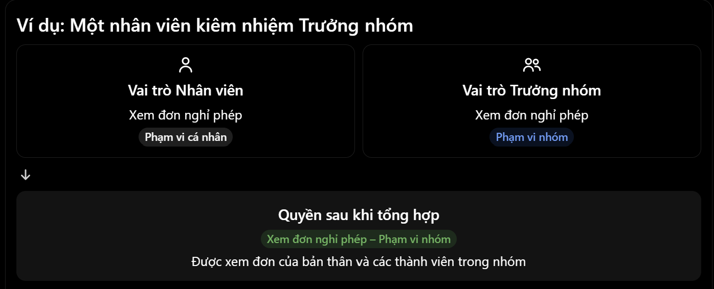
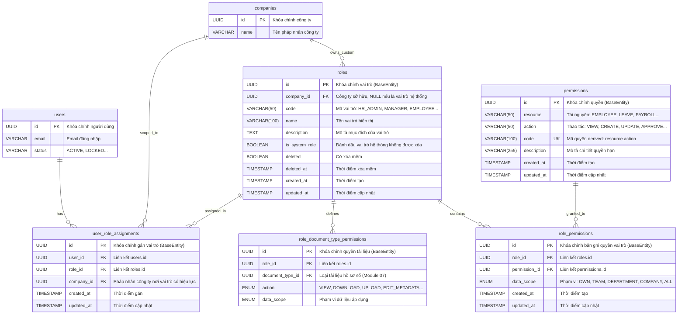
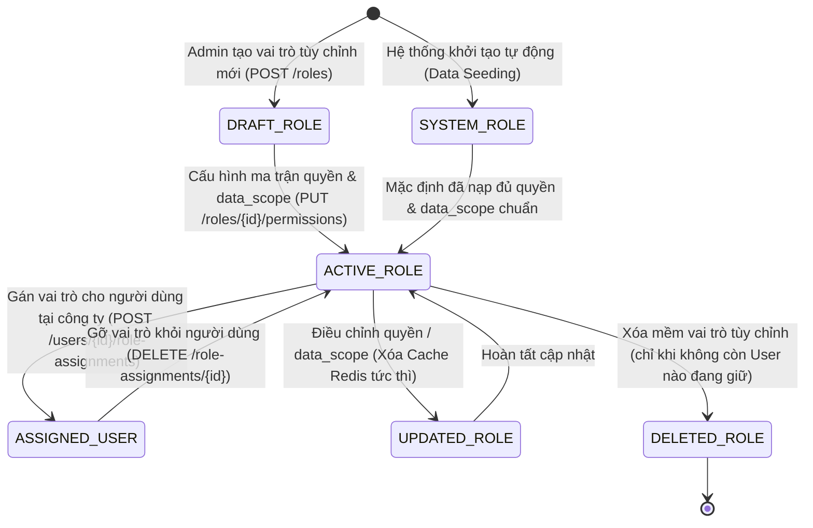
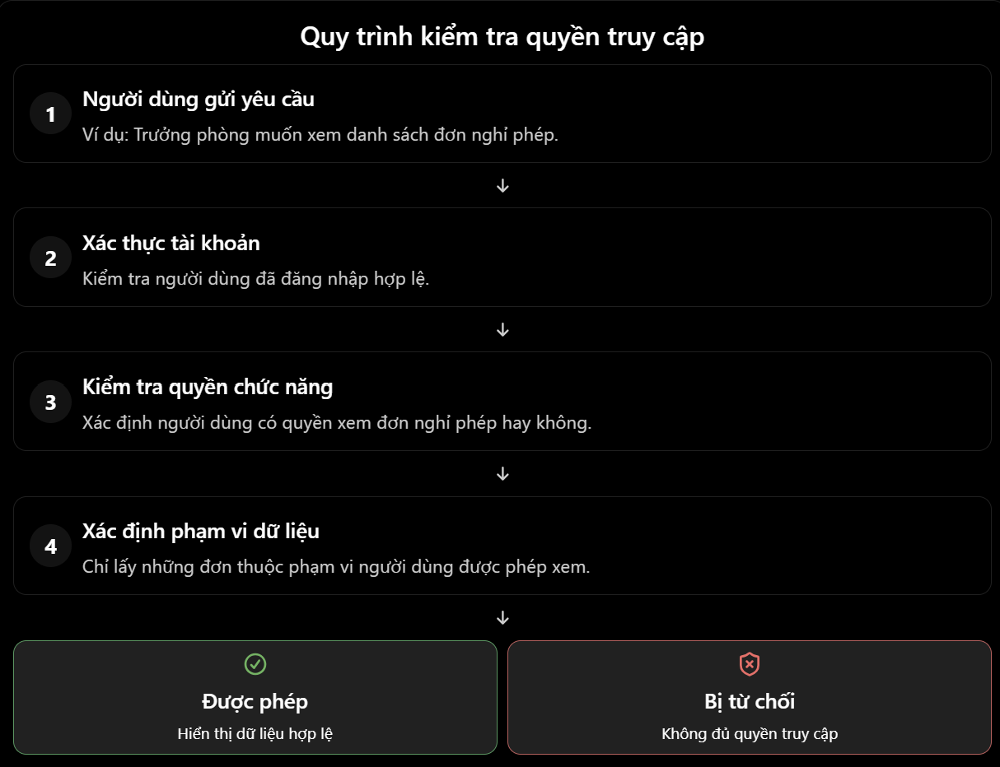
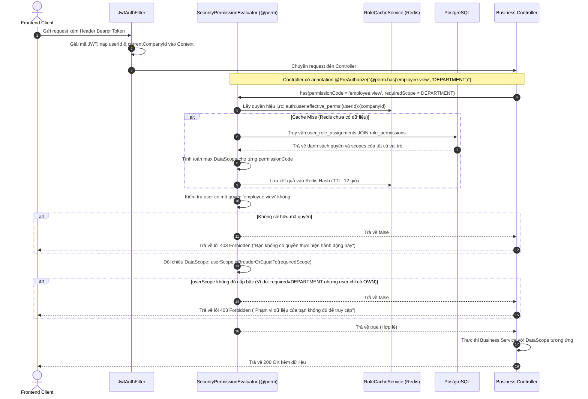
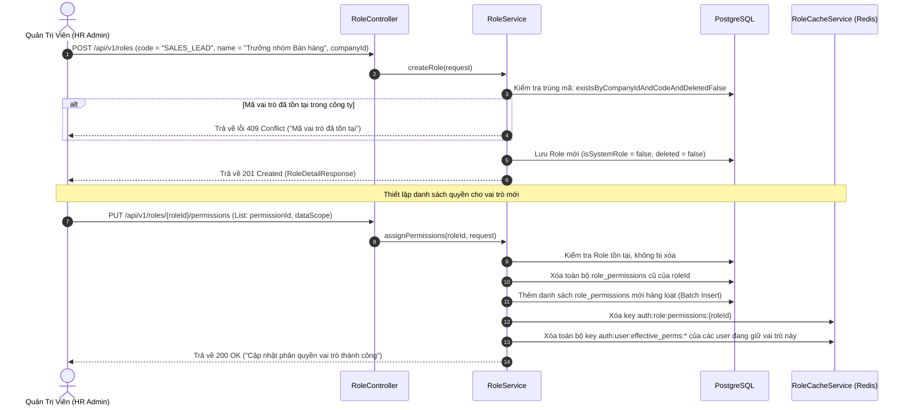
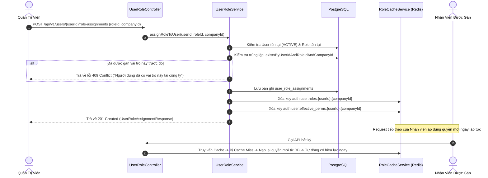

# ĐẶC TẢ CHI TIẾT VÀ KIẾN TRÚC TRIỂN KHAI MODULE 03: PHÂN QUYỀN (ROLE-BASED ACCESS CONTROL & DATA SCOPE)

> **Tài liệu căn cứ & tham chiếu:**
> - Nghiệp vụ chi tiết: [`Nghiep-vu.docx`](file:///f:/Project/CYCLOSA/ba/Nghiep-vu.docx) (Chương 3: Phân quyền & Quản trị vai trò)
> - Thiết kế CSDL & Data Dictionary: [`database.md`](file:///f:/Project/CYCLOSA/ba/database.md) (§8.4 Module 3 & Giả định [A9])
> - Danh mục API chuẩn: [`api-list.md`](file:///f:/Project/CYCLOSA/ba/api-list.md) (Mục 3. Phân quyền)
> - Ma trận phân quyền & 10 Role chuẩn: [`HRM-Roles-Phan-Quyen.md`](file:///f:/Project/CYCLOSA/ba/HRM-Roles-Phan-Quyen.md)
> - Lộ trình triển khai hệ thống: [`thu-tu-code-module.md`](file:///f:/Project/CYCLOSA/ba/thu-tu-code-module.md) (Sprint 1 - Module 03)
> - Module nền tảng liên kết: [`module-auth.md`](file:///f:/Project/CYCLOSA/cyclosa_be/docs/ba/module-auth.md) (Module 0: Xác thực)
> - Module khuôn mẫu chuẩn: [`com.cyclosa.product`](file:///f:/Project/CYCLOSA/cyclosa_be/src/main/java/com/cyclosa/product) (Class-based Service, không dùng `impl/`)

---

## 1. PHÂN TÍCH ĐẶC TẢ NGHIỆP VỤ & RÀNG BUỘC PHÁP LÝ

### 1.1. Bối cảnh & Mô hình phân quyền 2 trục (Two-Dimensional Authorization)
Trong hệ thống Quản trị Nguồn nhân lực Doanh nghiệp (CYCLOSA HRM), kiểm soát quyền truy cập là cốt lõi bảo vệ dữ liệu nhân sự nhạy cảm:
* **Hạn chế của mô hình RBAC truyền thống:** Nếu chỉ phân quyền theo tên vai trò thuần túy (`Role = MANAGER`), hệ thống không thể phân biệt giữa *Trưởng phòng Kinh doanh* (chỉ được xem nhân viên phòng mình) với *Giám đốc Khối* (xem toàn bộ chi nhánh), dẫn đến việc phải sinh hàng loạt Role tĩnh gây phình to hệ thống (`MANAGER_DEPT_A`, `MANAGER_BRANCH_B`).
* **Mô hình 2 trục kết hợp: Quyền chức năng × Phạm vi dữ liệu (Functional Permission × Data Scope):**
  1. **Trục 1 - Quyền chức năng (`Permission`):** Định danh thao tác nghiệp vụ cụ thể dạng `resource.action` (ví dụ: `employee.view`, `leave.approve`, `payroll.process`).
  2. **Trục 2 - Phạm vi dữ liệu (`DataScope`):** Gắn độc lập **trên từng quyền của vai trò**, xác định biên giới dữ liệu mà người dùng được phép tác động:
     - `OWN` (Cấp 1): Chỉ dữ liệu của bản thân người dùng.
     - `TEAM` (Cấp 2): Dữ liệu của nhân viên cấp dưới trực tiếp (Direct Reports).
     - `DEPARTMENT` (Cấp 3): Dữ liệu của phòng ban người dùng trực thuộc và các phòng ban con đệ quy.
     - `COMPANY` (Cấp 4): Toàn bộ dữ liệu trong phạm vi pháp nhân/công ty được gán vai trò.
     - `ALL` (Cấp 5): Toàn bộ tập đoàn (mọi công ty con).


*Hình 3.1: Mô hình phân quyền 2 trục trong CYCLOSA HRM (Trích từ tài liệu đặc tả nghiệp vụ)*


*Hình 3.2: 5 cấp độ phạm vi dữ liệu từ Cá nhân đến Toàn hệ thống*

---

### 1.2. Danh mục 10 Vai trò Chuẩn hóa (Standard System Roles)

Hệ thống thiết lập sẵn 10 vai trò mặc định (System Roles) theo [`HRM-Roles-Phan-Quyen.md`](file:///f:/Project/CYCLOSA/ba/HRM-Roles-Phan-Quyen.md):

| # | Mã vai trò (`code`) | Tên vai trò hiển thị | Mô tả nghiệp vụ | Phạm vi dữ liệu mặc định (`DataScope`) |
|:---:|---|---|---|:---:|
| 1 | `SUPER_ADMIN` | Quản trị viên tối cao | Toàn quyền cấu hình nền tảng, quản trị tenant, giám sát kỹ thuật | `ALL` |
| 2 | `HR_ADMIN` | Trưởng phòng Nhân sự | Quản trị toàn bộ nghiệp vụ nhân sự trong phạm vi công ty | `COMPANY` |
| 3 | `HR_SPECIALIST` | Chuyên viên Nhân sự | Thực thi nghiệp vụ hồ sơ, hợp đồng, C&B, khen thưởng, kỷ luật | `COMPANY` (theo mảng) |
| 4 | `RECRUITER` | Chuyên viên Tuyển dụng | Quản lý tin tuyển dụng, hồ sơ ứng viên, điều phối phỏng vấn (không xem lương) | `COMPANY` |
| 5 | `PAYROLL_ACCOUNTANT` | Kế toán Tiền lương | Đối soát bảng lương, bảo hiểm, quyết toán thuế TNCN (độc lập với HR) | `COMPANY` |
| 6 | `EXECUTIVE` | Ban Lãnh đạo / BOD | Xem báo cáo tổng quan BI, dashboard sức khỏe doanh nghiệp (chỉ xem) | `COMPANY` / `ALL` |
| 7 | `MANAGER` | Cán bộ Quản lý | Quản lý và phê duyệt đơn từ, đánh giá hiệu suất nhân viên cấp dưới | `DEPARTMENT` / `TEAM` |
| 8 | `EMPLOYEE` | Nhân viên | Tự phục vụ cá nhân (ESS): xem phiếu lương, chấm công, nộp đơn phép | `OWN` |
| 9 | `OFFICE_ADMIN` | Quản trị Hành chính / CSVC | Quản lý sơ đồ mặt bằng, chỗ ngồi làm việc, cấp phát/thu hồi tài sản | `COMPANY` |
| 10 | `AUDITOR` | Kiểm toán & Tuân thủ | Giám sát độc lập Nhật ký kiểm toán (Audit Trail) và Báo cáo tuân thủ | `ALL` / `COMPANY` (Read-only) |

---

### 1.3. Nguyên tắc Đa công ty & Giải quyết Xung đột Quyền

1. **Phân quyền gắn liền với Pháp nhân Công ty (`Multi-Company Assignment`):**
   * Trong mô hình Tập đoàn (Multi-company), một tài khoản `User` duy nhất có thể kiêm nhiệm nhiều vai trò tại các công ty con khác nhau.
   * *Ví dụ:* Nguyễn Văn A là `MANAGER` tại Công ty Công nghệ A, nhưng chỉ là `EMPLOYEE` tại Công ty Cổ phần B.
   * Bảng `user_role_assignments` luôn lưu cặp `(user_id, role_id, company_id)`.
2. **Quy tắc Phân giải Phạm vi Rộng nhất (Highest Data Scope Resolution):**
   * Khi một người dùng được gán nhiều vai trò và các vai trò này cùng cấp một mã quyền chức năng (ví dụ `leave.view`), hệ thống sẽ tự động gộp và chọn phạm vi dữ liệu rộng nhất theo cấp độ:
     $$\text{Effective DataScope} = \max(\text{Scope}_1, \text{Scope}_2, \dots, \text{Scope}_n)$$
     Thứ bậc: $\text{ALL (5)} > \text{COMPANY (4)} > \text{DEPARTMENT (3)} > \text{TEAM (2)} > \text{OWN (1)}$.


*Hình 3.3: Cơ chế kiêm nhiệm vai trò và tổng hợp phạm vi dữ liệu rộng nhất (Trích từ tài liệu đặc tả nghiệp vụ)*

3. **Phân lập nhiệm vụ (Separation of Duties - SoD):**
   * Nghiêm cấm gộp quyền xử lý bảng lương (`payroll.process`) và duyệt chi lương chung với vai trò tuyển dụng để chống gian lận nhân sự ảo.
   * Chuyên viên nhân sự thông thường không được cấp quyền xem chi tiết lương nhân viên khác (`payroll.view_salary`).

---

### 1.4. Ràng buộc pháp lý & Tuân thủ (Compliance Requirements)
1. **Nghị định 13/2023/NĐ-CP & Luật Bảo vệ dữ liệu cá nhân (Luật số 91/2025/QH15):**
   * **Nguyên tắc Đặc quyền tối thiểu (Principle of Least Privilege):** Mọi API truy xuất dữ liệu nhân viên (CCCD, tài khoản ngân hàng, mức lương, sức khỏe) đều phải thẩm định chặt chẽ cả mã quyền lẫn phạm vi dòng dữ liệu (Row-Level Security).
   * **Quyền xem dữ liệu cá nhân của bản thân:** Mọi nhân viên luôn có quyền `OWN` xem dữ liệu của chính mình thông qua cổng ESS mà không cần cấp quyền quản trị.
2. **Luật An toàn thông tin mạng & Kiểm toán nội bộ:**
   * Mọi hành động tạo vai trò mới, sửa đổi danh mục quyền, gán/gỡ vai trò của người dùng đều phải kích hoạt sự kiện phát sinh Nhật ký kiểm toán (**Audit Log - Module 21**) ghi lại `actor_id`, `action`, `old_values`, `new_values`.
   * Vai trò hệ thống (`is_system_role = true`) được bảo vệ nghiêm ngặt: Không được phép sửa mã (`code`) hoặc xóa khỏi CSDL để tránh làm tê liệt hệ thống.

---

## 2. THIẾT KẾ CƠ SỞ DỮ LIỆU & CACHE SCHEMA

Theo §8.4 của `database.md`, toàn bộ các quan hệ phân quyền được mô hình hóa chặt chẽ theo chuẩn cơ sở dữ liệu quan hệ, kết hợp bộ đệm Redis để tối ưu hóa hiệu năng xác thực mỗi request:

### 2.1. Lược đồ quan hệ thực thể (ERD)



---

### 2.2. Danh sách bảng và mô tả chi tiết từng trường

#### 1. Bảng `permissions` — Quyền chức năng hệ thống
* **Mục đích:** Lưu trữ danh mục các quyền hạn chi tiết gắn liền với từng hành động nghiệp vụ.

| Tên trường (Column) | Kiểu dữ liệu | Ràng buộc | Giá trị mặc định | Diễn giải nghiệp vụ |
|---|---|:---:|:---:|---|
| `id` | `UUID` | PK, NN | `uuid_generate_v4()` | Khóa chính quyền hạn (kế thừa `BaseEntity`). |
| `resource` | `VARCHAR(50)` | NN | — | Tài nguyên / phân hệ quản lý (ví dụ: `EMPLOYEE`, `LEAVE`, `PAYROLL`, `ROLE`). |
| `action` | `VARCHAR(50)` | NN | — | Hành động cho phép (ví dụ: `VIEW`, `CREATE`, `UPDATE`, `DELETE`, `APPROVE`). |
| `code` | `VARCHAR(100)` | UQ, NN | — | Mã quyền định dạng chuẩn `resource.action` (ví dụ: `employee.view`, `leave.approve`). |
| `description` | `VARCHAR(255)` | NULL | NULL | Giải thích chi tiết ý nghĩa và phạm vi tác động của quyền. |
| `created_at` | `TIMESTAMP` | NN | `CURRENT_TIMESTAMP` | Thời điểm tạo. |
| `updated_at` | `TIMESTAMP` | NULL | NULL | Thời điểm cập nhật. |

* **Ràng buộc duy nhất:** `UNIQUE (resource, action)` và `UNIQUE (code)`.

---

#### 2. Bảng `roles` — Vai trò người dùng
* **Mục đích:** Quản lý danh mục vai trò mặc định của hệ thống và các vai trò tùy chỉnh do từng công ty tự định nghĩa.
* **Chiến lược xóa:** Áp dụng Xóa mềm (`@SQLDelete` & `@SQLRestriction("deleted = false")`).

| Tên trường (Column) | Kiểu dữ liệu | Ràng buộc | Giá trị mặc định | Diễn giải nghiệp vụ |
|---|---|:---:|:---:|---|
| `id` | `UUID` | PK, NN | `uuid_generate_v4()` | Khóa chính vai trò (kế thừa `BaseEntity`). |
| `company_id` | `UUID` | FK, NULL | NULL | Khóa ngoại tham chiếu `companies.id`. Giá trị `NULL` đại diện cho vai trò mặc định toàn hệ thống. |
| `code` | `VARCHAR(50)` | NN | — | Mã định danh vai trò (ví dụ: `SUPER_ADMIN`, `HR_ADMIN`, `SALES_LEAD`). Không chứa dấu cách. |
| `name` | `VARCHAR(100)` | NN | — | Tên vai trò hiển thị trên giao diện người dùng. |
| `description` | `TEXT` | NULL | NULL | Mô tả chi tiết quyền hạn và trách nhiệm của vai trò. |
| `is_system_role` | `BOOLEAN` | NN | `FALSE` | Cờ nhận diện vai trò hệ thống cốt lõi. Nếu `TRUE`, cấm xóa và cấm sửa mã `code`. |
| `deleted` | `BOOLEAN` | NN | `FALSE` | Cờ xóa mềm. |
| `deleted_at` | `TIMESTAMP` | NULL | NULL | Thời điểm xóa mềm. |
| `created_at` | `TIMESTAMP` | NN | `CURRENT_TIMESTAMP` | Thời điểm tạo bản ghi. |
| `updated_at` | `TIMESTAMP` | NULL | NULL | Thời điểm chỉnh sửa gần nhất. |

* **Ràng buộc duy nhất (Unique Constraints):**
  - Đối với vai trò công ty: `UNIQUE (company_id, code) WHERE deleted = false`.
  - Đối với vai trò hệ thống: `UNIQUE (code) WHERE company_id IS NULL AND deleted = false`.

---

#### 3. Bảng `role_permissions` — Quyền của vai trò kèm phạm vi dữ liệu
* **Mục đích:** Bảng cầu nối thiết lập ma trận phân quyền: Một Role sở hữu những Permission nào và với DataScope gì.

| Tên trường (Column) | Kiểu dữ liệu | Ràng buộc | Giá trị mặc định | Diễn giải nghiệp vụ |
|---|---|:---:|:---:|---|
| `id` | `UUID` | PK, NN | `uuid_generate_v4()` | Khóa chính bản ghi phân quyền. |
| `role_id` | `UUID` | FK, NN | — | Khóa ngoại tham chiếu tới `roles.id`. Xóa cascade khi role bị xóa. |
| `permission_id` | `UUID` | FK, NN | — | Khóa ngoại tham chiếu tới `permissions.id`. |
| `data_scope` | `VARCHAR(30)` | NN | `OWN` | Phạm vi dữ liệu áp dụng cho quyền này: `OWN`, `TEAM`, `DEPARTMENT`, `COMPANY`, `ALL`. |
| `created_at` | `TIMESTAMP` | NN | `CURRENT_TIMESTAMP` | Thời điểm gán quyền. |
| `updated_at` | `TIMESTAMP` | NULL | NULL | Thời điểm cập nhật phạm vi. |

* **Ràng buộc duy nhất:** `UNIQUE (role_id, permission_id)`.

---

#### 4. Bảng `user_role_assignments` — Gán vai trò cho người dùng theo công ty
* **Mục đích:** Xác định người dùng nắm giữ vai trò nào tại pháp nhân công ty cụ thể.

| Tên trường (Column) | Kiểu dữ liệu | Ràng buộc | Giá trị mặc định | Diễn giải nghiệp vụ |
|---|---|:---:|:---:|---|
| `id` | `UUID` | PK, NN | `uuid_generate_v4()` | Khóa chính bản ghi gán vai trò. |
| `user_id` | `UUID` | FK, NN | — | Khóa ngoại tham chiếu tới `users.id`. |
| `role_id` | `UUID` | FK, NN | — | Khóa ngoại tham chiếu tới `roles.id`. |
| `company_id` | `UUID` | FK, NN | — | Khóa ngoại tham chiếu `companies.id` nơi vai trò có hiệu lực. |
| `created_at` | `TIMESTAMP` | NN | `CURRENT_TIMESTAMP` | Thời điểm gán quyền. |
| `updated_at` | `TIMESTAMP` | NULL | NULL | Thời điểm sửa đổi. |

* **Ràng buộc duy nhất:** `UNIQUE (user_id, role_id, company_id)`.

---

### 2.3. Danh mục Kiểu liệt kê (Enums)

#### Enum `DataScope` (`com.cyclosa.common.enums.DataScope`)
Biểu diễn 5 cấp độ phạm vi dữ liệu theo chiều tăng dần:

| Tên giá trị (Value) | Thứ bậc (Level) | Mô tả chi tiết | Đối tượng áp dụng phổ biến |
|---|:---:|---|---|
| `OWN` | 1 | Chỉ xem/thao tác trên dữ liệu của chính tài khoản đăng nhập. | Nhân viên thông thường (`EMPLOYEE`) |
| `TEAM` | 2 | Dữ liệu của các nhân viên cấp dưới trực tiếp báo cáo cho người dùng. | Trưởng nhóm / Team Leader |
| `DEPARTMENT` | 3 | Dữ liệu thuộc phòng ban người dùng đang làm việc và các phòng ban con đệ quy. | Trưởng phòng (`MANAGER`) |
| `COMPANY` | 4 | Toàn bộ dữ liệu của pháp nhân công ty/chi nhánh được chỉ định. | Nhân sự công ty (`HR_ADMIN`, `HR_SPECIALIST`) |
| `ALL` | 5 | Toàn bộ dữ liệu của tất cả công ty con trong hệ sinh thái tập đoàn. | Ban Lãnh đạo (`EXECUTIVE`), Quản trị tối cao (`SUPER_ADMIN`) |

---

### 2.4. Sơ đồ trạng thái vòng đời phân quyền (State Machine Diagram)



---

### 2.5. Cấu trúc Schema & Quản trị Bộ đệm Redis (Cache Schema)

Nhằm đảm bảo API Gateways và Spring Security Filter không phải truy vấn lại bảng `user_role_assignments` và `role_permissions` trong CSDL quan hệ mỗi khi có request:

| STT | Cấu trúc Key trên Redis | Kiểu dữ liệu | Giá trị lưu trữ (Value) | TTL (Thời gian sống) | Mục đích nghiệp vụ |
|:---:|---|:---:|---|:---:|---|
| **1** | `auth:role:permissions:{roleId}` | Hash | Field: `permissionCode`<br/>Value: `dataScope` | **24 giờ**<br/>(86.400 giây) | Cache danh sách quyền và phạm vi dữ liệu của một vai trò. Tự động xóa (invalidation) khi quyền của role bị sửa đổi. |
| **2** | `auth:user:roles:{userId}:{companyId}` | Set | Danh sách mã vai trò: `["HR_ADMIN", "MANAGER"]` | **12 giờ**<br/>(43.200 giây) | Cache các vai trò của người dùng tại công ty hiện hành. Giúp `JwtAuthFilter` nạp Authorities cực nhanh ($< 1\text{ms}$). |
| **3** | `auth:user:effective_perms:{userId}:{companyId}` | Hash | Field: `permissionCode`<br/>Value: `highestDataScope` | **12 giờ**<br/>(43.200 giây) | Cache ma trận quyền hiệu lực cuối cùng đã được giải quyết xung đột $\max(\text{DataScope})$ của user. Xóa ngay khi gán/gỡ role hoặc khi quyền của role thay đổi. |

---

## 3. DANH SÁCH ENDPOINTS CẦN XÂY DỰNG

Khớp $100\%$ theo danh mục đặc tả từ [`api-list.md`](file:///f:/Project/CYCLOSA/ba/api-list.md) (§3. Phân quyền), toàn bộ tiền tố là `/api/v1`:

### 3.1. Nhóm API Quyền chức năng (`/api/v1/permissions/**`)

| # | HTTP Method | Đường dẫn Endpoint | Tóm tắt chức năng | Quyền yêu cầu | Mã HTTP |
|:---:|:---:|---|---|:---:|:---:|
| 1 | `GET` | `/api/v1/permissions` | Lấy danh mục toàn bộ quyền chức năng hệ thống (nhóm theo `resource`). Phục vụ màn hình chọn quyền. | `role.view` | 200 OK |

---

### 3.2. Nhóm API Quản lý Vai trò (`/api/v1/roles/**`)

| # | HTTP Method | Đường dẫn Endpoint | Tóm tắt chức năng | Quyền yêu cầu | Mã HTTP |
|:---:|:---:|---|---|:---:|:---:|
| 2 | `GET` | `/api/v1/roles` | Lấy danh sách vai trò: Lọc theo `companyId`, tìm kiếm theo tên/mã, phân loại vai trò hệ thống / tùy chỉnh. | `role.view` | 200 OK |
| 3 | `POST` | `/api/v1/roles` | Tạo mới vai trò tùy chỉnh cho công ty (`company_id`). | `role.manage` | 201 Created |
| 4 | `GET` | `/api/v1/roles/{roleId}` | Xem thông tin chi tiết một vai trò kèm danh sách quyền hiện có. | `role.view` | 200 OK |
| 5 | `PUT` | `/api/v1/roles/{roleId}` | Cập nhật tên, mô tả của vai trò tùy chỉnh. Cấm sửa vai trò hệ thống (`is_system_role = true`). | `role.manage` | 200 OK |
| 6 | `DELETE` | `/api/v1/roles/{roleId}` | Xóa mềm vai trò tùy chỉnh. Kiểm tra ràng buộc: Từ chối nếu đang có người dùng giữ vai trò này. | `role.manage` | 200 OK |
| 7 | `GET` | `/api/v1/roles/{roleId}/permissions` | Lấy danh sách quyền chức năng và phạm vi dữ liệu (`dataScope`) được gán cho vai trò. | `role.view` | 200 OK |
| 8 | `PUT` | `/api/v1/roles/{roleId}/permissions` | Thiết lập toàn bộ ma trận quyền kèm `dataScope` cho vai trò. Tự động xóa sạch Cache Redis liên quan. | `role.manage` | 200 OK |
| 9 | `GET` | `/api/v1/roles/{roleId}/users` | Lấy danh sách người dùng đang nắm giữ vai trò này (hỗ trợ phân trang). | `role.view` | 200 OK |

---

### 3.3. Nhóm API Gán vai trò cho Người dùng (`/api/v1/users/{userId}/role-assignments` & `/api/v1/role-assignments/**`)

| # | HTTP Method | Đường dẫn Endpoint | Tóm tắt chức năng | Quyền yêu cầu | Mã HTTP |
|:---:|:---:|---|---|:---:|:---:|
| 10 | `GET` | `/api/v1/users/{userId}/role-assignments` | Lấy danh sách các vai trò được gán cho người dùng kèm thông tin công ty tương ứng. | `role.view` | 200 OK |
| 11 | `POST` | `/api/v1/users/{userId}/role-assignments` | Gán vai trò cho người dùng tại một công ty cụ thể (`roleId`, `companyId`). Xóa cache quyền của User. | `role.assign` | 201 Created |
| 12 | `DELETE` | `/api/v1/role-assignments/{assignmentId}` | Thu hồi vai trò đã gán khỏi người dùng. Xóa cache quyền của User trên Redis. | `role.assign` | 200 OK |

---

### 3.4. Nhóm API Phân quyền Truy cập Hồ sơ Tài liệu số (`/api/v1/roles/{roleId}/document-type-permissions`)

| # | HTTP Method | Đường dẫn Endpoint | Tóm tắt chức năng | Quyền yêu cầu | Mã HTTP |
|:---:|:---:|---|---|:---:|:---:|
| 13 | `GET` | `/api/v1/roles/{roleId}/document-type-permissions` | Lấy cấu hình quyền thao tác trên từng loại tài liệu số (CCCD, Hợp đồng, Bằng cấp) của vai trò. | `role.view` | 200 OK |
| 14 | `PUT` | `/api/v1/roles/{roleId}/document-type-permissions` | Cấu hình quyền thao tác tài liệu (`VIEW`, `DOWNLOAD`, `UPLOAD`, `VERIFY`) kèm `data_scope`. | `role.manage` | 200 OK |

---

## 4. CẤU TRÚC CODE DỰ KIẾN (THEO CHUẨN MODULAR MONOLITH)

Tuân thủ nguyên tắc đã chuẩn hóa: **Không tách Interface/Impl ở tầng Service, sử dụng trực tiếp các class `@Service` độc lập**. Toàn bộ mã nguồn Module 03 nằm trong gói `com.cyclosa.authorization`:

```
f:\Project\CYCLOSA\cyclosa_be\src\main\java\com\cyclosa\authorization\
├── controller\
│   ├── PermissionController.java                 # RestController phục vụ /api/v1/permissions/**
│   ├── RoleController.java                       # RestController xử lý vai trò và ma trận quyền /api/v1/roles/**
│   └── UserRoleController.java                   # RestController xử lý gán quyền user /api/v1/role-assignments/**
├── dto\
│   ├── request\
│   │   ├── CreateRoleRequest.java                # Payload tạo vai trò (code, name, description, companyId)
│   │   ├── UpdateRoleRequest.java                # Payload sửa vai trò (name, description)
│   │   ├── RoleFilterRequest.java                # Bộ lọc phân trang vai trò (keyword, companyId, isSystem)
│   │   ├── AssignRolePermissionsRequest.java     # Payload gán danh sách quyền (permissionId, dataScope)
│   │   ├── AssignUserRoleRequest.java            # Payload gán vai trò cho User (roleId, companyId)
│   │   └── RoleDocumentPermissionRequest.java    # Payload gán quyền tài liệu (documentTypeId, action, dataScope)
│   └── response\
│       ├── PermissionResponse.java               # DTO hiển thị danh mục quyền (id, resource, action, code, description)
│       ├── RoleResponse.java                     # DTO danh sách vai trò rút gọn
│       ├── RoleDetailResponse.java               # DTO chi tiết vai trò kèm số lượng user và danh sách quyền
│       ├── RolePermissionResponse.java           # DTO quyền của vai trò kèm dataScope
│       ├── UserRoleAssignmentResponse.java       # DTO chi tiết gán vai trò cho người dùng
│       └── EffectivePermissionResponse.java      # DTO quyền hiệu lực cuối cùng của User kèm max DataScope
├── entity\
│   ├── Permission.java                           # Entity bảng permissions kế thừa BaseEntity
│   ├── Role.java                                 # Entity bảng roles kế thừa BaseEntity, xóa mềm
│   ├── RolePermission.java                       # Entity bảng role_permissions kế thừa BaseEntity
│   ├── UserRoleAssignment.java                   # Entity bảng user_role_assignments kế thừa BaseEntity
│   └── RoleDocumentTypePermission.java           # Entity bảng role_document_type_permissions kế thừa BaseEntity
├── enums\
│   ├── UserRole.java                             # Enum 10 vai trò chuẩn hệ thống (SUPER_ADMIN, HR_ADMIN, ...)
│   └── DocumentAction.java                       # Enum hành động tài liệu (VIEW, DOWNLOAD, UPLOAD, ...)
├── exception\
│   └── RoleErrorCode.java                        # Danh mục mã lỗi dải 3000-3099 (ROLE_NOT_FOUND, SYSTEM_ROLE_PROTECTED, ...)
├── mapper\
│   ├── RoleMapper.java                           # MapStruct chuyển đổi DTO và Entity cho Role
│   └── PermissionMapper.java                     # MapStruct chuyển đổi DTO và Entity cho Permission
├── repository\
│   ├── PermissionRepository.java                 # JPA Repository cho Permission
│   ├── RoleRepository.java                       # JPA Repository cho Role (truy vấn theo code, companyId)
│   ├── RolePermissionRepository.java             # JPA Repository cho RolePermission
│   ├── UserRoleAssignmentRepository.java         # JPA Repository cho UserRoleAssignment
│   └── specification\
│       └── RoleSpecification.java                # Specification tạo truy vấn động cho danh sách Role
├── security\
│   ├── SecurityPermissionEvaluator.java          # Component @Component("perm") thẩm định quyền SpEL trong @PreAuthorize
│   └── RoleCacheService.java                     # Service chuyên biệt quản lý Cache Redis cho Roles & Effective Permissions
└── service\
    ├── PermissionService.java                    # Service quản lý danh mục quyền hệ thống
    ├── RoleService.java                          # Service quản lý vòng đời Role và ma trận quyền
    └── UserRoleService.java                      # Service quản lý gán vai trò người dùng và tính toán quyền hiệu lực
```

---

## 5. CHI TIẾT CÁC LUỒNG NGHIỆP VỤ (SEQUENCE DIAGRAMS)

### 5.1. Luồng Thẩm Định Quyền & Data Scope Mỗi Request (`@PreAuthorize`)


*Hình 3.4: Quy trình 4 bước kiểm tra quyền truy cập và phạm vi dữ liệu chuẩn CYCLOSA HRM (Trích từ tài liệu đặc tả nghiệp vụ)*

Mọi lời gọi API yêu cầu bảo mật quyền chức năng và phạm vi dữ liệu đều đi qua bộ thẩm định SpEL theo đúng quy trình 4 bước trên:



---

### 5.2. Luồng Tạo Vai Trò Tùy Chỉnh & Thiết Lập Ma Trận Quyền



---

### 5.3. Luồng Gán Vai Trò Cho Người Dùng & Thu Hồi Tức Thì



---

## 6. CÁC KỸ THUẬT NÂNG CAO ÁP DỤNG TRONG MODULE

Để đáp ứng yêu cầu chịu tải cao của hệ sinh thái CYCLOSA HRM với hàng chục ngàn nhân viên, Module Phân quyền tích hợp các giải pháp kỹ thuật nâng cao:

### 6.1. Bảo mật & Kiểm soát truy cập phương thức động (Dynamic Method Security)
1. **Custom SpEL Permission Evaluator (`@perm`):**
   - Thay vì hard-code `@PreAuthorize("hasRole('ADMIN')")`, hệ thống sử dụng cú pháp động linh hoạt:
     ```java
     @PreAuthorize("@perm.has('employee.view', T(com.cyclosa.common.enums.DataScope).DEPARTMENT)")
     ```
   - Tách rời hoàn toàn định nghĩa nghiệp vụ khỏi mã nguồn, cho phép doanh nghiệp tùy biến gán quyền cho bất kỳ vai trò mới nào mà không cần sửa code hay build lại backend.
2. **Data Scope Specification Injector:**
   - Khi một API trả về danh sách (ví dụ danh sách nhân viên), Service sử dụng `DataScope` của người dùng để tiêm trực tiếp điều kiện lọc vào `Specification<Employee>`:
     - `OWN`: `root.get("id").equal(currentEmployeeId)`
     - `DEPARTMENT`: `root.get("departmentId").in(subDepartmentIds)`
     - `COMPANY`: `root.get("companyId").equal(currentCompanyId)`
     - `ALL`: không thêm điều kiện lọc theo tổ chức.

---

### 6.2. Bộ đệm Phân quyền Hiệu năng cao (High-Performance Caching & Invalidation)
1. **Chiến lược Cache-Aside 2 tầng:**
   - Dữ liệu quyền hiệu lực (`effective_permissions`) được tính toán sẵn và lưu vào Redis dưới dạng Hash Map để tra cứu với độ phức tạp thời gian đạt tuyệt đối $O(1)$.
   - Thời gian thẩm định quyền trong Filter chỉ mất từ $0.3 - 0.8\text{ms}$.
2. **Event-driven Cache Invalidation (Hủy Cache hướng sự kiện):**
   - Khi Quản trị viên thay đổi ma trận quyền của một Role, hệ thống kích hoạt sự kiện `RolePermissionsChangedEvent`.
   - `RoleCacheService` lắng nghe và chủ động quét xóa toàn bộ cache của các User đang giữ Role đó bằng kỹ thuật Redis Pipeline / Scan, đảm bảo tính nhất quán dữ liệu tức thì (Zero Stale Permissions).

---

### 6.3. Tự động Khởi tạo Dữ liệu Mẫu Hệ thống (System Data Seeding)
* Triển khai component `RolePermissionDataInitializer` implement Spring `ApplicationRunner`:
  - Tự động kiểm tra và khởi tạo đầy đủ danh mục **quyền chức năng chuẩn** (`employee.view`, `leave.approve`, ...) nếu chưa tồn tại.
  - Tự động khởi tạo **10 vai trò hệ thống mặc định** (`SUPER_ADMIN`, `HR_ADMIN`, `MANAGER`, `EMPLOYEE`, ...) và liên kết quyền tương ứng theo đúng bảng ma trận [`HRM-Roles-Phan-Quyen.md`](file:///f:/Project/CYCLOSA/ba/HRM-Roles-Phan-Quyen.md).
  - Tự động gán tài khoản Admin mặc định vào vai trò `SUPER_ADMIN`.

---

## 7. KẾT LUẬN & KẾ HOẠCH TRIỂN KHAI

Tài liệu này là **đặc tả kỹ thuật và kiến trúc chuẩn duy nhất** cho Module 03: Phân quyền của hệ thống CYCLOSA HRM.

### Lộ trình thực hiện chi tiết:
1. **Data Layer:**
   - Tạo các Entity trong `com.cyclosa.authorization.entity`: `Permission`, `Role`, `RolePermission`, `UserRoleAssignment`, `RoleDocumentTypePermission`.
   - Tạo Repository và Specification truy vấn động.
2. **Service Layer:**
   - `RoleCacheService`: Quản lý bộ đệm Redis cho vai trò và quyền hiệu lực.
   - `PermissionService`: Danh mục quyền hệ thống.
   - `RoleService`: Quản trị vai trò và phân bổ quyền kèm `DataScope`.
   - `UserRoleService`: Gán vai trò cho user và giải quyết xung đột phạm vi dữ liệu.
   - Hoàn thiện `SecurityPermissionEvaluator` kết nối với `RoleCacheService`.
3. **Controller & Endpoints:**
   - `PermissionController`: `/api/v1/permissions`
   - `RoleController`: `/api/v1/roles/**`
   - `UserRoleController`: `/api/v1/role-assignments/**`
4. **Cập nhật Module 0 (Auth):**
   - Nạp danh sách quyền thực tế và vai trò vào Access Token JWT thay vì giá trị hardcode `EMPLOYEE`.
5. **Unit Tests & Verification:**
   - Đạt độ bao phủ kiểm thử $100\%$ các luồng thẩm định quyền, gán quyền và phân giải max DataScope.
   - Giữ vững cam kết: **Chưa chạy migrate CSDL vật lý**.

