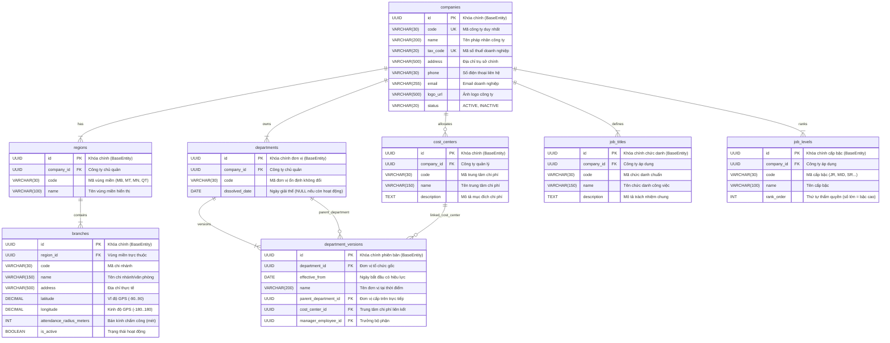

# ĐẶC TẢ CHI TIẾT VÀ KIẾN TRÚC TRIỂN KHAI MODULE 01: QUẢN LÝ TỔ CHỨC (ORGANIZATION MANAGEMENT)

> **Tài liệu căn cứ & tham chiếu:**
> - Nghiệp vụ chi tiết: [`Nghiep-vu.docx`](file:///f:/Project/CYCLOSA/ba/Nghiep-vu.docx) (Mục 1: Quản lý tổ chức - Organization Management)
> - Thiết kế CSDL & Data Dictionary: [`database.md`](file:///f:/Project/CYCLOSA/ba/database.md) (§8.1 & §8.2 Module 1: Organization)
> - Danh mục API chuẩn: [`api-list.md`](file:///f:/Project/CYCLOSA/ba/api-list.md) (Mục 1: Quản lý tổ chức - 37 APIs)
> - Quy chuẩn phân quyền liên kết: [`module-phan-quyen.md`](file:///f:/Project/CYCLOSA/cyclosa_be/docs/ba/module-phan-quyen.md) (Module 03: DataScope `DEPARTMENT`, `COMPANY`)
> - Module nền tảng xác thực: [`module-auth.md`](file:///f:/Project/CYCLOSA/cyclosa_be/docs/ba/module-auth.md) (Module 0: Users & Multi-tenancy)
> - Chuẩn kiến trúc codebase: [`com.cyclosa.product`](file:///f:/Project/CYCLOSA/cyclosa_be/src/main/java/com/cyclosa/product) (Direct `@Service` class, không dùng `impl/`)

---

## 1. PHÂN TÍCH ĐẶC TẢ NGHIỆP VỤ & NGUYÊN LÝ CỐT LÕI

### 1.1. Nguyên lý phân tách 3 chiều độc lập (Three-Dimensional Independence)
Trong hệ sinh thái Quản trị Nguồn nhân lực Doanh nghiệp CYCLOSA HRM, mọi nhân sự đều được định vị qua công thức chuẩn hóa:

$$\mathbf{Nhân\ sự} = \mathbf{Đơn\ vị\ tổ\ chức\ (Phòng\ ban)} + \mathbf{Địa\ lý\ (Chi\ nhánh)} + \mathbf{Vị\ trí\ việc\ làm\ (Chức\ danh\ \&\ Cấp\ bậc)}$$

Ba chiều này hoạt động **hoàn toàn độc lập** với nhau:
1. **Chiều Tổ chức (`Department`):** Quản lý cấu trúc quản trị hành chính theo mô hình cây nhiều cấp (Khối $\rightarrow$ Ban $\rightarrow$ Phòng $\rightarrow$ Đội/Nhóm).
2. **Chiều Địa lý (`Region` & `Branch`):** Quản lý địa bàn kinh doanh và các văn phòng/cơ sở vật lý, nơi nhân viên thực tế làm việc và thực hiện chấm công định vị vệ tinh GPS.
3. **Chiều Chức danh & Cấp bậc (`JobTitle` & `JobLevel`):** Quản lý năng lực chuyên môn, khung tiêu chuẩn chức danh và thứ tự cấp bậc thẩm quyền.

*Ví dụ thực tế:* 
- Nhân viên Nguyễn Văn A thuộc **Phòng Backend**, làm việc tại **Chi nhánh Cầu Giấy (Hà Nội)** với chức danh **Lập trình viên Backend**, cấp bậc **Senior**.
- Khi nhân viên A được cử vào TP.HCM công tác dài hạn tại Chi nhánh Quận 1, hệ thống chỉ cập nhật Chi nhánh mà không cần thay đổi Phòng ban hay Chức danh.
- Khi nhân viên A được thăng chức lên **Lead**, hệ thống chỉ nâng cấp bậc (`JobLevel`) mà không làm xáo trộn sơ đồ tổ chức hay địa bàn làm việc.

---

### 1.2. Mô hình hiệu lực theo thời gian của Cơ cấu phòng ban (Effective-Dated Versioning)
Tổ chức doanh nghiệp luôn vận động và tái cấu trúc (sáp nhập, chia tách, đổi tên, thay đổi trưởng bộ phận). Hệ thống CYCLOSA giải quyết triệt để vấn đề này bằng mô hình **Effective-Dated Hierarchy**:

* Bảng `departments` chỉ đóng vai trò lưu **danh tính ổn định** (identity) của phòng ban: khóa chính `id`, thuộc công ty `company_id`, mã cố định `code` và ngày giải thể `dissolved_date`.
* Toàn bộ thuộc tính biến thiên theo thời gian được lưu tại bảng `department_versions`:
  - `name`: Tên phòng ban tại thời điểm hiệu lực.
  - `parent_department_id`: Đơn vị cấp trên trực tiếp (phục vụ dựng cây phân cấp).
  - `cost_center_id`: Trung tâm chi phí hạch toán ngân sách.
  - `manager_employee_id`: Trưởng bộ phận phụ trách.
  - `effective_from`: Ngày bắt đầu có hiệu lực của phiên bản.

**Quy tắc truy vấn lịch sử (Time-Travel Querying):**
Khi cần xem lại sơ đồ tổ chức tại thời điểm $T$ trong quá khứ: với mỗi `department_id`, hệ thống chọn bản ghi `department_versions` có:
$$\text{effective\_from} \le T \quad \text{với}\ \max(\text{effective\_from})$$

---

### 1.3. Cơ chế Kế thừa Quyền & Phạm vi Dữ liệu theo Cây Tổ chức (Hierarchical Data Scope)
Theo quy chuẩn của Module 03 (Phân quyền):
* Khi người dùng được cấp quyền với phạm vi dữ liệu `DEPARTMENT`, hệ thống tự động cho phép người dùng truy xuất dữ liệu của:
  $$\text{Scope}(D) = \{ D \} \cup \text{Descendants}(D)$$
  *(Đơn vị được cấp quyền và toàn bộ các phòng ban con cháu đệ quy trực thuộc).*
* *Ví dụ:* Giám đốc Khối Công nghệ được xem toàn bộ hồ sơ nhân sự của Khối Công nghệ, bao gồm Phòng Phát triển phần mềm, Phòng QA, Đội Backend, Đội Frontend mà không cần phải gán quyền lẻ cho từng phòng ban con.

---

### 1.4. Quản lý Địa bàn & Hàng rào địa lý chấm công (GPS Geofencing)
Mỗi chi nhánh (`Branch`) thuộc một Vùng miền (`Region`) cụ thể:
* Lưu trữ tọa độ tâm địa lý: `latitude` (vĩ độ), `longitude` (kinh độ) theo chuẩn thập phân `DECIMAL(9,6)`.
* Cấu hình bán kính chấm công hợp lệ `attendance_radius_meters` (ví dụ: 100m).
* Cung cấp dữ liệu nền tảng cho Module 09 (Chấm công): Thiết bị di động của nhân viên gửi tọa độ GPS lên, hệ thống áp dụng công thức **Haversine** để tính khoảng cách giữa nhân viên và chi nhánh:
  $$d \le \text{attendance\_radius\_meters} \implies \text{Hợp lệ}$$

---

### 1.5. Ràng buộc Nghiệp vụ cốt lõi (Business Invariants)
1. **Chống vòng lặp cây tổ chức (Cycle Detection / Anti-Circular Reference):**
   - Nghiêm cấm tuyệt đối việc điều chuyển một phòng ban làm cấp con của chính nó hoặc con cháu của nó.
   - Khi điều chuyển phòng ban $A$ về dưới $B$, hệ thống bắt buộc kiểm tra:
     $$B \notin \text{Descendants}(A) \quad \text{và} \quad B \ne A$$
2. **Xem trước tác động điều chuyển (Impact Preview):**
   - Trước khi phê duyệt chuyển nhánh phòng ban, hệ thống tổng hợp báo cáo xem trước: số lượng đơn vị con bị kéo theo, tổng số nhân viên bị ảnh hưởng công việc.
3. **Quy tắc Giải thể phòng ban (`dissolved_date`):**
   - Không được phép giải thể hoặc xóa phòng ban nếu vẫn còn phòng ban con đang hoạt động hoặc còn nhân viên đang được phân công làm việc tại đơn vị.
4. **Bảo toàn tính toàn vẹn đa công ty (Tenant Boundary):**
   - Một phòng ban con bắt buộc phải cùng thuộc `company_id` với phòng ban cha.
   - Không lưu lặp `company_id` ở bảng chi nhánh (`branches`) vì đã xác định qua `region_id -> regions.company_id`.

---

## 2. THIẾT KẾ CƠ SỞ DỮ LIỆU & QUAN HỆ THỰC THỂ (ERD)

### 2.1. Lược đồ quan hệ thực thể (Mermaid ERD)



---

### 2.2. Chi tiết các bảng Cơ sở Dữ liệu

#### 1. Bảng `companies` (Doanh nghiệp / Pháp nhân)
| Tên cột | Kiểu dữ liệu | Ràng buộc | Mô tả |
| :--- | :--- | :--- | :--- |
| `id` | `UUID` | `PRIMARY KEY` | Khóa chính kế thừa `BaseEntity` |
| `code` | `VARCHAR(30)` | `NOT NULL, UNIQUE` | Mã pháp nhân (VD: `CYC_CORP`, `CYC_HN`) |
| `name` | `VARCHAR(200)` | `NOT NULL` | Tên đầy đủ công ty |
| `tax_code` | `VARCHAR(20)` | `UNIQUE` | Mã số thuế doanh nghiệp |
| `address` | `VARCHAR(500)` | `NOT NULL` | Địa chỉ đăng ký kinh doanh |
| `phone` | `VARCHAR(30)` | `NULL` | Số điện thoại đại diện |
| `email` | `VARCHAR(255)` | `NULL` | Email liên hệ chính |
| `logo_url` | `VARCHAR(500)` | `NULL` | URL ảnh đại diện trên Cloudinary |
| `status` | `VARCHAR(20)` | `NOT NULL, DEFAULT 'ACTIVE'` | `ACTIVE`, `INACTIVE` |

#### 2. Bảng `regions` (Vùng miền địa lý)
| Tên cột | Kiểu dữ liệu | Ràng buộc | Mô tả |
| :--- | :--- | :--- | :--- |
| `id` | `UUID` | `PRIMARY KEY` | Khóa chính kế thừa `BaseEntity` |
| `company_id` | `UUID` | `FK -> companies.id, NOT NULL` | Công ty quản lý vùng miền |
| `code` | `VARCHAR(30)` | `NOT NULL` | Mã vùng (VD: `NORTH`, `CENTRAL`, `SOUTH`) |
| `name` | `VARCHAR(100)` | `NOT NULL` | Tên vùng (Miền Bắc, Miền Trung, Miền Nam) |

*Ràng buộc duy nhất:* `UNIQUE (company_id, code)`

#### 3. Bảng `branches` (Chi nhánh & Tọa độ chấm công)
| Tên cột | Kiểu dữ liệu | Ràng buộc | Mô tả |
| :--- | :--- | :--- | :--- |
| `id` | `UUID` | `PRIMARY KEY` | Khóa chính kế thừa `BaseEntity` |
| `region_id` | `UUID` | `FK -> regions.id, NOT NULL` | Vùng trực thuộc (gián tiếp xác định công ty) |
| `code` | `VARCHAR(30)` | `NOT NULL` | Mã chi nhánh (VD: `HN_HO`, `HCM_CN1`) |
| `name` | `VARCHAR(150)` | `NOT NULL` | Tên chi nhánh / Văn phòng làm việc |
| `address` | `VARCHAR(500)` | `NOT NULL` | Địa chỉ chi tiết |
| `latitude` | `DECIMAL(9,6)` | `NOT NULL` | Vĩ độ GPS tâm chấm công |
| `longitude` | `DECIMAL(9,6)` | `NOT NULL` | Kinh độ GPS tâm chấm công |
| `attendance_radius_meters`| `INT` | `NOT NULL, DEFAULT 100` | Bán kính hợp lệ (mét) |
| `is_active` | `BOOLEAN` | `NOT NULL, DEFAULT TRUE` | Cờ hoạt động |

*Ràng buộc duy nhất:* `UNIQUE (region_id, code)`

#### 4. Bảng `departments` (Danh tính phòng ban cố định)
| Tên cột | Kiểu dữ liệu | Ràng buộc | Mô tả |
| :--- | :--- | :--- | :--- |
| `id` | `UUID` | `PRIMARY KEY` | Khóa chính định danh phòng ban |
| `company_id` | `UUID` | `FK -> companies.id, NOT NULL` | Công ty chủ quản |
| `code` | `VARCHAR(30)` | `NOT NULL` | Mã đơn vị cố định xuyên suốt |
| `dissolved_date` | `DATE` | `NULL` | Ngày giải thể (nếu NULL = còn hoạt động) |

*Ràng buộc duy nhất:* `UNIQUE (company_id, code)`

#### 5. Bảng `department_versions` (Phiên bản hiệu lực theo thời gian)
| Tên cột | Kiểu dữ liệu | Ràng buộc | Mô tả |
| :--- | :--- | :--- | :--- |
| `id` | `UUID` | `PRIMARY KEY` | Khóa chính phiên bản |
| `department_id` | `UUID` | `FK -> departments.id, NOT NULL` | Tham chiếu đơn vị gốc |
| `effective_from` | `DATE` | `NOT NULL` | Ngày bắt đầu có hiệu lực |
| `name` | `VARCHAR(200)` | `NOT NULL` | Tên đơn vị trong phiên bản |
| `parent_department_id` | `UUID` | `FK -> departments.id, NULL` | Đơn vị cấp trên (NULL = cấp gốc: Khối) |
| `cost_center_id` | `UUID` | `FK -> cost_centers.id, NULL` | Trung tâm chi phí liên kết |
| `manager_employee_id` | `UUID` | `NULL` | Trưởng bộ phận phụ trách |

*Ràng buộc duy nhất:* `UNIQUE (department_id, effective_from)`  
*Ràng buộc toàn vẹn:* `CHECK (parent_department_id <> department_id)`

#### 6. Bảng `cost_centers` (Trung tâm chi phí)
| Tên cột | Kiểu dữ liệu | Ràng buộc | Mô tả |
| :--- | :--- | :--- | :--- |
| `id` | `UUID` | `PRIMARY KEY` | Khóa chính |
| `company_id` | `UUID` | `FK -> companies.id, NOT NULL` | Công ty chủ quản |
| `code` | `VARCHAR(30)` | `NOT NULL` | Mã trung tâm chi phí (VD: `CC_TECH`, `CC_MKT`) |
| `name` | `VARCHAR(150)` | `NOT NULL` | Tên trung tâm chi phí |
| `description` | `TEXT` | `NULL` | Diễn giải phân bổ ngân sách |

*Ràng buộc duy nhất:* `UNIQUE (company_id, code)`

#### 7. Bảng `job_titles` (Danh mục Chức danh)
| Tên cột | Kiểu dữ liệu | Ràng buộc | Mô tả |
| :--- | :--- | :--- | :--- |
| `id` | `UUID` | `PRIMARY KEY` | Khóa chính chức danh |
| `company_id` | `UUID` | `FK -> companies.id, NOT NULL` | Công ty áp dụng |
| `code` | `VARCHAR(30)` | `NOT NULL` | Mã chức danh (VD: `BE_DEV`, `FE_DEV`, `HR_SPEC`) |
| `name` | `VARCHAR(150)` | `NOT NULL` | Tên chức danh công việc |
| `description` | `TEXT` | `NULL` | Mô tả tiêu chuẩn công việc |

*Ràng buộc duy nhất:* `UNIQUE (company_id, code)`

#### 8. Bảng `job_levels` (Hệ thống Cấp bậc)
| Tên cột | Kiểu dữ liệu | Ràng buộc | Mô tả |
| :--- | :--- | :--- | :--- |
| `id` | `UUID` | `PRIMARY KEY` | Khóa chính cấp bậc |
| `company_id` | `UUID` | `FK -> companies.id, NOT NULL` | Công ty áp dụng |
| `code` | `VARCHAR(30)` | `NOT NULL` | Mã cấp bậc (VD: `LV1`, `LV2`, `LV3`) |
| `name` | `VARCHAR(100)` | `NOT NULL` | Tên cấp bậc (Intern, Junior, Senior, Lead...) |
| `rank_order` | `INT` | `NOT NULL` | Thứ tự thẩm quyền (1, 2, 3... - số lớn = quyền cao hơn) |

*Ràng buộc duy nhất:* `UNIQUE (company_id, code)`, `UNIQUE (company_id, rank_order)`

---

## 3. DANH MỤC ENDPOINTS & CONTRACT SPECIFICATION (37 APIS)

Toàn bộ 37 endpoints theo chuẩn của [`api-list.md`](file:///f:/Project/CYCLOSA/ba/api-list.md):

```
Quyền yêu cầu:
- organization.view   : Quyền tra cứu, xem sơ đồ tổ chức và danh mục
- organization.manage : Quyền tạo, chỉnh sửa, điều chuyển và giải thể đơn vị
```

### 3.1. Nhóm Doanh nghiệp / Pháp nhân (Companies - 4 APIs)
| STT | Phương thức | Endpoint | Mô tả chức năng | Quyền yêu cầu |
|:---:|:---:|---|---|:---:|
| 1 | `GET` | `/api/v1/companies` | Danh sách công ty (phân trang, từ khóa, trạng thái) | `organization.view` |
| 2 | `POST` | `/api/v1/companies` | Tạo mới công ty / pháp nhân | `organization.manage` |
| 3 | `GET` | `/api/v1/companies/{companyId}` | Xem chi tiết thông tin công ty | `organization.view` |
| 4 | `PUT` | `/api/v1/companies/{companyId}` | Cập nhật thông tin công ty (tên, MST, địa chỉ, logo) | `organization.manage` |

### 3.2. Nhóm Vùng miền Địa lý (Regions - 4 APIs)
| STT | Phương thức | Endpoint | Mô tả chức năng | Quyền yêu cầu |
|:---:|:---:|---|---|:---:|
| 5 | `GET` | `/api/v1/companies/{companyId}/regions` | Danh sách vùng miền của một công ty | `organization.view` |
| 6 | `POST` | `/api/v1/companies/{companyId}/regions` | Tạo mới vùng miền | `organization.manage` |
| 7 | `PUT` | `/api/v1/regions/{regionId}` | Cập nhật tên/mã vùng miền | `organization.manage` |
| 8 | `DELETE` | `/api/v1/regions/{regionId}` | Xóa vùng miền (chỉ khi chưa có chi nhánh trực thuộc) | `organization.manage` |

### 3.3. Nhóm Chi nhánh & Vị trí chấm công GPS (Branches - 5 APIs)
| STT | Phương thức | Endpoint | Mô tả chức năng | Quyền yêu cầu |
|:---:|:---:|---|---|:---:|
| 9 | `GET` | `/api/v1/branches` | Danh sách chi nhánh (lọc: `companyId`, `regionId`, `keyword`) | `organization.view` |
| 10 | `POST` | `/api/v1/regions/{regionId}/branches` | Tạo chi nhánh kèm tọa độ GPS và bán kính chấm công | `organization.manage` |
| 11 | `GET` | `/api/v1/branches/{branchId}` | Xem chi tiết chi nhánh | `organization.view` |
| 12 | `PUT` | `/api/v1/branches/{branchId}` | Cập nhật địa chỉ, tọa độ GPS, bán kính chấm công | `organization.manage` |
| 13 | `DELETE` | `/api/v1/branches/{branchId}` | Xóa chi nhánh (chỉ khi chưa có nhân viên tham chiếu) | `organization.manage` |

### 3.4. Nhóm Trung tâm chi phí (Cost Centers - 4 APIs)
| STT | Phương thức | Endpoint | Mô tả chức năng | Quyền yêu cầu |
|:---:|:---:|---|---|:---:|
| 14 | `GET` | `/api/v1/cost-centers` | Danh sách trung tâm chi phí (lọc theo `companyId`) | `organization.view` |
| 15 | `POST` | `/api/v1/cost-centers` | Tạo mới trung tâm chi phí | `organization.manage` |
| 16 | `PUT` | `/api/v1/cost-centers/{costCenterId}` | Cập nhật mã, tên, mô tả trung tâm chi phí | `organization.manage` |
| 17 | `DELETE` | `/api/v1/cost-centers/{costCenterId}` | Xóa trung tâm chi phí (chỉ khi chưa được phòng ban dùng) | `organization.manage` |

### 3.5. Nhóm Chức danh công việc (Job Titles - 5 APIs)
| STT | Phương thức | Endpoint | Mô tả chức năng | Quyền yêu cầu |
|:---:|:---:|---|---|:---:|
| 18 | `GET` | `/api/v1/job-titles` | Danh sách chức danh (lọc: `companyId`, `keyword`) | `organization.view` |
| 19 | `POST` | `/api/v1/job-titles` | Tạo mới chức danh chuẩn hóa | `organization.manage` |
| 20 | `GET` | `/api/v1/job-titles/{jobTitleId}` | Chi tiết chức danh | `organization.view` |
| 21 | `PUT` | `/api/v1/job-titles/{jobTitleId}` | Sửa chức danh và mô tả tiêu chuẩn | `organization.manage` |
| 22 | `DELETE` | `/api/v1/job-titles/{jobTitleId}` | Xóa chức danh (chỉ khi chưa có nhân viên giữ chức danh) | `organization.manage` |

### 3.6. Nhóm Cấp bậc chuyên môn (Job Levels - 4 APIs)
| STT | Phương thức | Endpoint | Mô tả chức năng | Quyền yêu cầu |
|:---:|:---:|---|---|:---:|
| 23 | `GET` | `/api/v1/job-levels` | Danh sách cấp bậc sắp theo thứ tự `rank_order` | `organization.view` |
| 24 | `POST` | `/api/v1/job-levels` | Tạo cấp bậc mới và chỉ định thứ tự thẩm quyền | `organization.manage` |
| 25 | `PUT` | `/api/v1/job-levels/{jobLevelId}` | Cập nhật cấp bậc | `organization.manage` |
| 26 | `DELETE` | `/api/v1/job-levels/{jobLevelId}` | Xóa cấp bậc (chưa có nhân viên tham chiếu) | `organization.manage` |

### 3.7. Nhóm Cơ cấu Phòng ban & Sơ đồ tổ chức (Departments - 11 APIs)
| STT | Phương thức | Endpoint | Mô tả chức năng | Quyền yêu cầu |
|:---:|:---:|---|---|:---:|
| 27 | `GET` | `/api/v1/departments` | Danh sách phẳng các phòng ban (Query: `companyId`, `includeDissolved`, `asOf`) | `organization.view` |
| 28 | `GET` | `/api/v1/departments/tree` | **Sơ đồ tổ chức dạng cây (Org Tree)**. Query: `companyId`, `asOf` (tra cứu quá khứ) | `organization.view` |
| 29 | `POST` | `/api/v1/departments` | Tạo phòng ban mới (tự động sinh version đầu tiên `effectiveFrom`) | `organization.manage` |
| 30 | `GET` | `/api/v1/departments/{departmentId}` | Chi tiết phòng ban tại thời điểm `asOf` | `organization.view` |
| 31 | `PUT` | `/api/v1/departments/{departmentId}` | Sửa tên/trung tâm chi phí (tạo bản ghi `department_versions` mới) | `organization.manage` |
| 32 | `PUT` | `/api/v1/departments/{departmentId}/manager` | Bổ nhiệm/thay đổi người quản lý trưởng bộ phận | `organization.manage` |
| 33 | `GET` | `/api/v1/departments/{departmentId}/move-impact` | **Xem trước tác động điều chuyển**: Thống kê số phòng ban con và nhân viên bị kéo theo | `organization.manage` |
| 34 | `POST` | `/api/v1/departments/{departmentId}/move` | **Điều chuyển phòng ban sang cấp trên mới** (Chặn đệ quy vòng lặp) | `organization.manage` |
| 35 | `DELETE` | `/api/v1/departments/{departmentId}` | Giải thể phòng ban (đặt `dissolved_date`) | `organization.manage` |
| 36 | `GET` | `/api/v1/departments/{departmentId}/versions` | Tra cứu toàn bộ lịch sử thay đổi cơ cấu của phòng ban | `organization.view` |
| 37 | `GET` | `/api/v1/departments/{departmentId}/employees` | Danh sách nhân viên đang thuộc đơn vị (Query: `includeChildren`, `asOf`) | `organization.view` |

---

## 4. KIẾN TRÚC MÃ NGUỒN BACKEND (`com.cyclosa.organization`)

Cấu trúc package phân lớp chặt chẽ theo chuẩn codebase:

```
com.cyclosa.organization
├── controller
│   ├── CompanyController.java          # REST APIs cho Doanh nghiệp
│   ├── RegionController.java           # REST APIs cho Vùng miền
│   ├── BranchController.java           # REST APIs cho Chi nhánh & GPS
│   ├── DepartmentController.java       # REST APIs cho Cơ cấu Phòng ban & Tree
│   ├── CostCenterController.java       # REST APIs cho Trung tâm chi phí
│   ├── JobTitleController.java         # REST APIs cho Chức danh
│   └── JobLevelController.java         # REST APIs cho Cấp bậc
├── service
│   ├── CompanyService.java             # Direct @Service class
│   ├── RegionService.java              # Direct @Service class
│   ├── BranchService.java              # Direct @Service class
│   ├── DepartmentService.java          # Direct @Service (Dựng cây, kiểm tra vòng lặp, phiên bản)
│   ├── CostCenterService.java          # Direct @Service class
│   ├── JobTitleService.java            # Direct @Service class
│   └── JobLevelService.java            # Direct @Service class
├── repository
│   ├── CompanyRepository.java          # Spring Data JPA + Specification
│   ├── RegionRepository.java
│   ├── BranchRepository.java
│   ├── DepartmentRepository.java
│   ├── DepartmentVersionRepository.java# Truy vấn Time-travel effective_from
│   ├── CostCenterRepository.java
│   ├── JobTitleRepository.java
│   └── JobLevelRepository.java
├── entity
│   ├── Company.java                    # extends BaseEntity
│   ├── Region.java                     # extends BaseEntity
│   ├── Branch.java                     # extends BaseEntity
│   ├── Department.java                 # extends BaseEntity
│   ├── DepartmentVersion.java          # extends BaseEntity
│   ├── CostCenter.java                 # extends BaseEntity
│   ├── JobTitle.java                   # extends BaseEntity
│   └── JobLevel.java                   # extends BaseEntity
├── dto
│   ├── request
│   │   ├── CreateCompanyRequest.java
│   │   ├── UpdateCompanyRequest.java
│   │   ├── CreateBranchRequest.java
│   │   ├── UpdateBranchRequest.java
│   │   ├── CreateDepartmentRequest.java
│   │   ├── UpdateDepartmentRequest.java
│   │   ├── MoveDepartmentRequest.java
│   │   ├── AssignManagerRequest.java
│   │   └── ...
│   └── response
│       ├── CompanyResponse.java
│       ├── BranchResponse.java
│       ├── DepartmentResponse.java
│       ├── DepartmentNodeResponse.java  # DTO cây sơ đồ tổ chức (children: List<DepartmentNodeResponse>)
│       ├── DepartmentImpactResponse.java# DTO thống kê tác động điều chuyển
│       ├── DepartmentVersionResponse.java
│       ├── CostCenterResponse.java
│       ├── JobTitleResponse.java
│       └── JobLevelResponse.java
└── exception
    └── OrganizationErrorCode.java      # Mã lỗi nghiệp vụ 1400 - 1499
```

---

## 5. THUẬT TOÁN ĐẶC THÙ & QUY TẮC NGHIỆP VỤ (CORE ALGORITHMS)

### 5.1. Thuật toán phát hiện chu trình khi điều chuyển phòng ban (Cycle Detection)
Khi người dùng yêu cầu chuyển phòng ban có mã `deptId` sang làm con của `targetParentId`:

```java
public void validateNoCircularDependency(UUID deptId, UUID targetParentId, LocalDate effectiveDate) {
    if (deptId.equals(targetParentId)) {
        throw new AppException(OrganizationErrorCode.CANNOT_MOVE_TO_ITSELF);
    }
    
    // Thu thập toàn bộ danh sách ID con cháu của deptId tại effectiveDate
    Set<UUID> descendants = getDescendantDepartmentIds(deptId, effectiveDate);
    if (descendants.contains(targetParentId)) {
        throw new AppException(OrganizationErrorCode.CIRCULAR_DEPENDENCY_DETECTED);
    }
}
```

### 5.2. Thuật toán dựng cây sơ đồ tổ chức (Org Tree Hierarchy)
1. Lấy toàn bộ các đơn vị của công ty chưa bị giải thể tại thời điểm `asOf`.
2. Với mỗi đơn vị, lấy bản ghi `department_versions` mới nhất tính đến `asOf`.
3. Nhóm các bản ghi theo `parent_department_id` bằng một `Map<UUID, List<DepartmentNodeResponse>>`.
4. Tìm các nút gốc (nơi `parent_department_id == null`) và dựng đệ quy danh sách cây phân nhánh:
   $$\text{BuildTree}(\text{root}) \implies \text{node.children} = \text{map.getOrDefault}(\text{node.id}, \emptyset)$$

### 5.3. Công thức tính khoảng cách GPS Geofence (Haversine Formula)
Dùng trong xác thực chi nhánh và kiểm tra bán kính chấm công:

$$d = 2R \arcsin\left(\sqrt{\sin^2\left(\frac{\Delta \varphi}{2}\right) + \cos(\varphi_1) \cos(\varphi_2) \sin^2\left(\frac{\Delta \lambda}{2}\right)}\right)$$
* $R = 6,371,000$ mét (Bán kính Trái Đất).
* $\varphi_1, \varphi_2$: Vĩ độ của nhân viên và chi nhánh (radian).
* $\Delta \varphi, \Delta \lambda$: Chênh lệch vĩ độ và kinh độ (radian).

---

## 6. MÃ LỖI NGHIỆP VỤ CHUẨN HÓA (`OrganizationErrorCode`)

Dải mã lỗi dành riêng cho Module 01: **`1400 - 1499`**

| Mã lỗi | HTTP Status | Thông điệp tiếng Việt |
| :---: | :---: | :--- |
| `1401` | `404 NOT_FOUND` | Không tìm thấy công ty / pháp nhân yêu cầu |
| `1402` | `409 CONFLICT` | Mã công ty hoặc mã số thuế đã tồn tại trên hệ thống |
| `1403` | `404 NOT_FOUND` | Không tìm thấy phòng ban / đơn vị tổ chức |
| `1404` | `409 CONFLICT` | Mã phòng ban đã tồn tại trong phạm vi công ty |
| `1405` | `400 BAD_REQUEST`| Không thể chuyển phòng ban vào chính nó |
| `1406` | `400 BAD_REQUEST`| Phát hiện vòng lặp: Không thể chuyển phòng ban vào đơn vị trực thuộc của nó |
| `1407` | `400 BAD_REQUEST`| Không thể giải thể phòng ban khi vẫn còn phòng ban con đang hoạt động |
| `1408` | `400 BAD_REQUEST`| Không thể giải thể phòng ban khi vẫn còn nhân viên trực thuộc đang làm việc |
| `1409` | `404 NOT_FOUND` | Không tìm thấy chi nhánh làm việc |
| `1410` | `409 CONFLICT` | Mã chi nhánh đã tồn tại trong vùng miền này |
| `1411` | `400 BAD_REQUEST`| Không thể xóa chi nhánh khi đã có dữ liệu nhân viên liên kết |
| `1412` | `404 NOT_FOUND` | Không tìm thấy chức danh công việc |
| `1413` | `409 CONFLICT` | Mã chức danh đã tồn tại trong công ty |
| `1414` | `404 NOT_FOUND` | Không tìm thấy cấp bậc chuyên môn |
| `1415` | `409 CONFLICT` | Mã cấp bậc hoặc thứ tự thẩm quyền (`rank_order`) đã bị trùng |
| `1416` | `404 NOT_FOUND` | Không tìm thấy trung tâm chi phí |
| `1417` | `409 CONFLICT` | Mã trung tâm chi phí đã tồn tại trong công ty |
| `1418` | `400 BAD_REQUEST`| Ngày hiệu lực mới phải lớn hơn hoặc bằng ngày hiệu lực của phiên bản gần nhất |

---

## 7. KẾ HOẠCH TRIỂN KHAI THEO SPRINT (IMPLEMENTATION ROADMAP)

| Giai đoạn | Nhiệm vụ kỹ thuật | Đầu ra nghiệm thu |
| :--- | :--- | :--- |
| **Sprint 1.1** | **Database Migration & Entities**<br>- Tạo script Flyway `V3__create_organization_tables.sql`.<br>- Khai báo các thực thể JPA `Company`, `Region`, `Branch`, `Department`, `DepartmentVersion`, `CostCenter`, `JobTitle`, `JobLevel`. | Bảng CSDL tạo thành công, `mvnw test-compile` đạt 0 lỗi. |
| **Sprint 1.2** | **Công ty, Vùng miền & Chi nhánh (GPS Geofence)**<br>- Triển khai CRUD Công ty, Vùng miền, Chi nhánh.<br>- Thẩm định tọa độ GPS và bán kính chấm công. | 13 APIs (STT 1-13) hoạt động trơn tru. |
| **Sprint 1.3** | **Chức danh, Cấp bậc & Trung tâm chi phí**<br>- CRUD `JobTitle`, `JobLevel` (sắp xếp `rank_order`), `CostCenter`. | 13 APIs (STT 14-26) hoàn thiện. |
| **Sprint 1.4** | **Cơ cấu Phòng ban & Sơ đồ tổ chức đa cấp (Org Tree)**<br>- Quản lý phiên bản hiệu lực `department_versions`.<br>- Thuật toán dựng cây Org Tree (`/departments/tree`).<br>- Thuật toán chống vòng lặp (Cycle Detection) khi điều chuyển.<br>- Xem trước tác động điều chuyển (`/move-impact`).<br>- Giải thể phòng ban (`dissolved_date`). | 11 APIs (STT 27-37) hoàn thiện với đầy đủ unit test logic cây. |
| **Sprint 1.5** | **Kiểm thử tích hợp & Cập nhật Tài liệu**<br>- Kiểm thử toàn diện 37 API endpoints.<br>- Cập nhật [`API_TRACKING.md`](file:///f:/Project/CYCLOSA/cyclosa_fe/docs/API_TRACKING.md). | Module 01 sẵn sàng làm nền tảng cho Module 05 (Hồ sơ nhân sự) và Frontend. |
