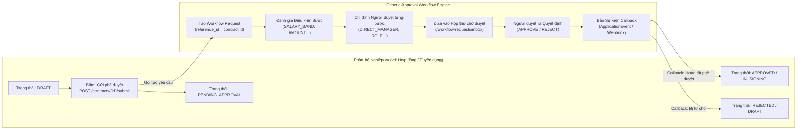
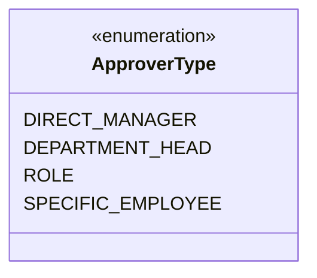
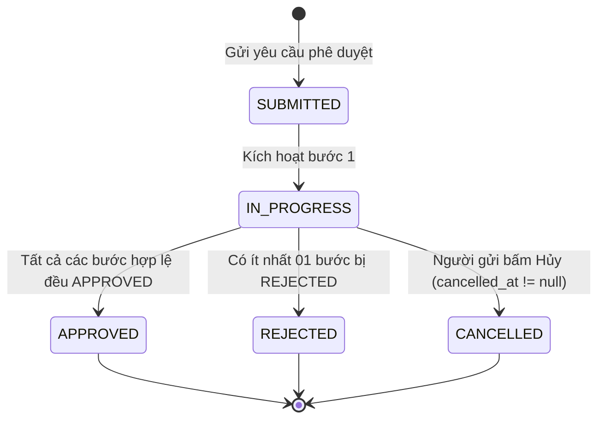
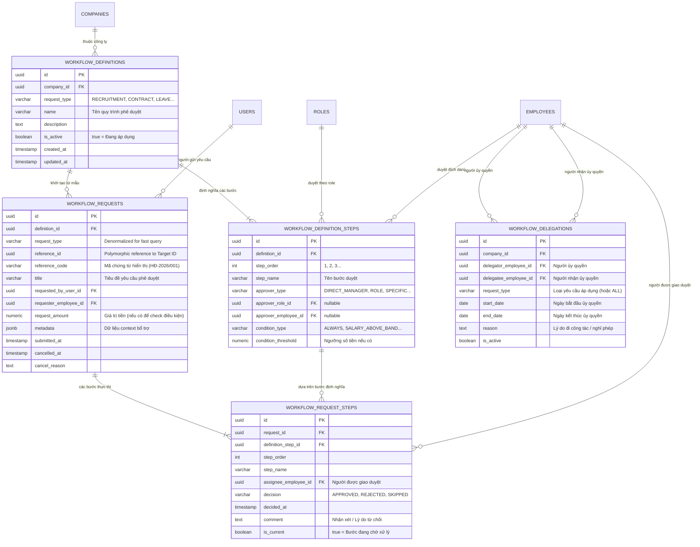
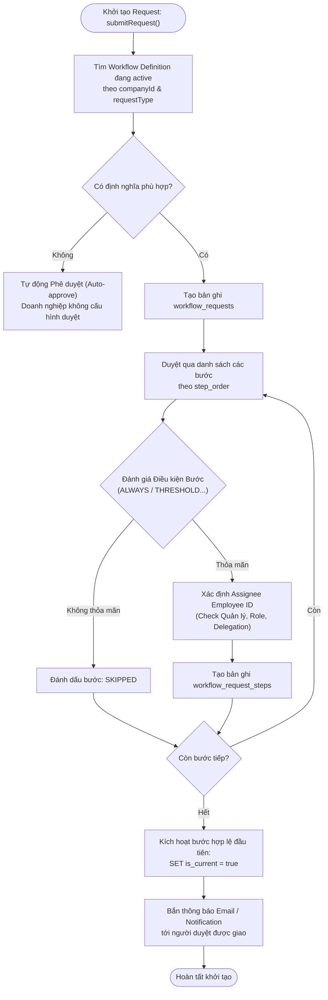
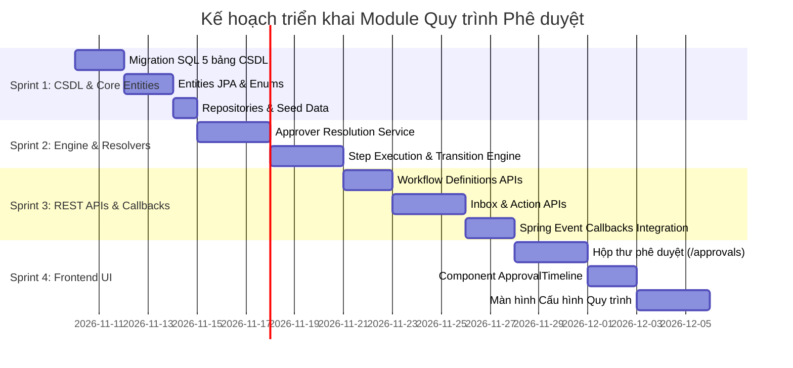

# ĐẶC TẢ CHI TIẾT VÀ KIẾN TRÚC TRIỂN KHAI MODULE NỀN TẢNG: QUY TRÌNH PHÊ DUYỆT DÙNG CHUNG (GENERIC APPROVAL WORKFLOW ENGINE & APPROVAL INBOX)

> **Tài liệu căn cứ & tham chiếu:**
> - Nghiệp vụ chi tiết: [`Nghiep-vu.docx`](file:///f:/Project/CYCLOSA/ba/Nghiep-vu.docx) (Luồng phê duyệt chứng từ & đề xuất xuyên suốt 21 modules)
> - Thiết kế CSDL & Data Dictionary: [`database.md`](file:///f:/Project/CYCLOSA/ba/database.md) (§3.2 Workflow phê duyệt dùng chung, [ASSUMPTION A2, A28], 4 bảng `workflow_*`)
> - Danh mục API chuẩn: [`api-list.md`](file:///f:/Project/CYCLOSA/ba/api-list.md) (§Phụ lục A — Luồng phê duyệt Workflow: `/workflow-definitions` & `/workflow-requests`)
> - Phân quyền RBAC & DataScope: [`module-phan-quyen.md`](file:///f:/Project/CYCLOSA/cyclosa_be/docs/ba/module-phan-quyen.md) (Module 03: Thẩm quyền duyệt theo Scope & Role)
> - Các module nghiệp vụ phụ thuộc:
>   - Tuyển dụng & Thư mời nhận việc: [`module-tuyen-dung.md`](file:///f:/Project/CYCLOSA/cyclosa_be/docs/ba/module-tuyen-dung.md) (`RECRUITMENT_REQUEST`, `OFFER`)
>   - Hợp đồng lao động: [`module-hop-dong-lao-dong.md`](file:///f:/Project/CYCLOSA/cyclosa_be/docs/ba/module-hop-dong-lao-dong.md) (`CONTRACT`, `CONTRACT_APPENDIX`)
>   - Hồ sơ nhân sự: [`module-ho-so-nhan-su.md`](file:///f:/Project/CYCLOSA/cyclosa_be/docs/ba/module-ho-so-nhan-su.md) (`TRANSFER_REQUEST`, `RESIGNATION`, `PROBATION_EVAL`)
>   - Tái cơ cấu tổ chức: [`module-quan-ly-to-chuc.md`](file:///f:/Project/CYCLOSA/cyclosa_be/docs/ba/module-quan-ly-to-chuc.md) (`ORG_SCENARIO`)
> - Chuẩn kiến trúc codebase: [`com.cyclosa.product`](file:///f:/Project/CYCLOSA/cyclosa_be/src/main/java/com/cyclosa/product) (Direct `@Service` class, Domain-driven Architecture)

---

## 1. PHÂN TÍCH ĐẶC TẢ NGHIỆP VỤ & NGUYÊN LÝ CỐT LÕI

### 1.1. Bản chất & Vai trò Hạt nhân của Workflow Engine trong CYCLOSA HRM

Trong một hệ thống Quản trị Doanh nghiệp (Enterprise HRM) hiện đại, phần lớn các hoạt động nhân sự **không phải là thao tác chỉnh sửa dữ liệu đơn lẻ (Simple CRUD)**, mà là **một chuỗi các quyết định có thẩm quyền (Authorized Decision Chains)**. Một quyết định nhân sự luôn liên quan đến nhiều bên:
- Người đề xuất (Requester / Submitter): Nhân viên, Chuyên viên Tuyển dụng, Chuyên viên C&B.
- Các cấp phê duyệt (Approvers): Quản lý trực tiếp, Trưởng phòng ban, Giám đốc nhân sự (CHRO), Giám đốc tài chính (CFO), Tổng Giám đốc (CEO).
- Vết kiểm toán pháp lý (Audit Trail): Ai đã duyệt? Duyệt vào thời điểm nào? Nội dung ý kiến phê duyệt là gì? Lý do từ chối (nếu có)?

**Generic Approval Workflow Engine** của CYCLOSA được thiết kế như một **Nền tảng dịch vụ dùng chung (Shared Core Service)** đáp ứng toàn bộ các yêu cầu trên cho tất cả các phân hệ nghiệp vụ, triệt tiêu hoàn toàn tình trạng:
1. Mỗi module tự đẻ ra các cột `is_approved`, `approved_by`, `approved_at` riêng lẻ gây phân mảnh dữ liệu.
2. Cấp lãnh đạo phải truy cập vào hàng chục màn hình khác nhau (vào menu Hợp đồng để duyệt hợp đồng, vào Tuyển dụng duyệt offer, vào Nhân sự duyệt đơn xin nghỉ) thay vì chỉ cần một **Hộp thư phê duyệt tập trung (Unified Approval Inbox)** duy nhất.
3. Không thể tùy biến linh hoạt số cấp phê duyệt theo quy mô từng Công ty con / Chi nhánh trong mô hình Tập đoàn (Multi-company).

---

### 1.2. Nguyên lý Tách biệt Trách nhiệm (Separation of Concerns: Entity Lifecycle vs. Approval Process)

CYCLOSA áp dụng triệt để nguyên lý:

$$\mathbf{Trạng\ thái\ Vòng\ đời\ Thực\ thể}\ (\text{Entity Lifecycle}) \neq \mathbf{Tiến\ trình\ Phê\ duyệt}\ (\text{Approval Workflow})$$



* **Thực thể nghiệp vụ (`contracts`, `offers`, `recruitment_requests`...):**
  - Chỉ duy trì các trạng thái vòng đời tự thân (ví dụ: `DRAFT` $\rightarrow$ `PENDING_APPROVAL` $\rightarrow$ `APPROVED` $\rightarrow$ `IN_SIGNING` $\rightarrow$ `ACTIVE`).
  - **Không** lưu trữ danh sách người duyệt, chữ ký nháp, nhận xét duyệt hay thứ tự cấp duyệt trong bảng nghiệp vụ.
* **Động cơ phê duyệt (`workflow_*`):**
  - Độc lập quản lý tiến trình luân chuyển: Yêu cầu gồm bao nhiêu bước, bước nào đang chạy, ai đang giữ phiếu, lịch sử phê duyệt qua các mốc thời gian.
  - Sau khi bước cuối cùng được duyệt chấp thuận, Engine kích hoạt cơ chế **Spring ApplicationEvent (`WorkflowCompletedEvent`)** để cập nhật trạng thái nghiệp vụ tương ứng một cách tự động và an toàn giao dịch (`@Transactional`).

---

### 1.3. Cơ chế Định danh Người phê duyệt (Approver Resolution Strategies)

Quy trình phê duyệt CYCLOSA hỗ trợ **4 cơ chế xác định người duyệt** linh hoạt qua enum `ApproverType`:



1. `DIRECT_MANAGER` (**Quản lý trực tiếp của người yêu cầu**):
   - Hệ thống tự động tra cứu cây cơ cấu tổ chức nhân sự tại Module 05: `employees.manager_employee_id` của người tạo yêu cầu hoặc đối tượng của chứng từ.
   - *Quy tắc Ngoại lệ (Fallback):* Nếu nhân viên chưa được gán Quản lý trực tiếp (hoặc là Tổng Giám đốc), hệ thống tự động nhảy cấp lên Trưởng phòng ban hoặc gửi tới Quản trị viên Nhân sự có quyền `workflow.manage`.
2. `DEPARTMENT_HEAD` (**Người đứng đầu đơn vị / Trưởng phòng ban**):
   - Tra cứu chức danh Trưởng phòng từ bảng cơ cấu tổ chức Module 01 (`departments.manager_employee_id`).
3. `ROLE` (**Người nắm giữ Vai trò cụ thể**):
   - Áp dụng khi bước duyệt thuộc thẩm quyền của một chức danh chuyên trách (ví dụ: `ROLE_HR_DIRECTOR`, `ROLE_CFO`, `ROLE_GENERAL_DIRECTOR`).
   - Bất kỳ người dùng nào đang sở hữu Role này đều thấy yêu cầu trong Hộp thư chờ duyệt. Khi một người bấm duyệt, bước đó được tính là hoàn thành (**Cơ chế First-responder Wins**).
4. `SPECIFIC_EMPLOYEE` (**Chỉ định đích danh một nhân viên**):
   - Áp dụng cho các trường hợp đặc biệt cần đích thân một lãnh đạo cụ thể phê duyệt thông qua khóa ngoại `approver_employee_id`.

---

### 1.4. Động cơ Đánh giá Điều kiện Rẽ nhánh (Step Condition Evaluator)

Mỗi bước trong quy trình phê duyệt (`workflow_definition_steps`) có thể kích hoạt tự động hoặc kích hoạt có điều kiện thông qua `condition_type`:

| Loại điều kiện (`StepConditionType`) | Ý nghĩa nghiệp vụ | Tham số kích hoạt (`condition_threshold`) | Ví dụ áp dụng thực tế |
| :--- | :--- | :---: | :--- |
| `ALWAYS` | Luôn luôn áp dụng bước này | `NULL` | Trưởng phòng luôn phải duyệt đơn xin nghỉ của nhân viên. |
| `SALARY_ABOVE_BAND` | Chỉ kích hoạt khi mức lương vượt khung quy định của vị trí | `NULL` | **Offer Approval Matrix:** Lương tuyển dụng vượt `salary_band_max` của Job Opening thì bắt buộc phải thêm bước duyệt của CEO/CFO. |
| `AMOUNT_ABOVE_THRESHOLD` | Chỉ kích hoạt khi tổng giá trị chứng từ vượt mức ngưỡng | Giá trị tiền (DECIMAL) | Đề xuất mua sắm/ngân sách tuyển dụng > 50,000,000 VND mới cần Tổng Giám đốc phê duyệt; dưới mức này chỉ cần Giám đốc khối. |

> **Nguyên tắc Tự động Bỏ qua (Auto-skip):** Nếu một bước có điều kiện đánh giá trả về `FALSE`, hệ thống tự động đánh dấu bước đó là `SKIPPED` và chuyển ngay lập tức sang bước tiếp theo mà không làm tắc nghẽn tiến trình.

---

### 1.5. Các Quy tắc Nghiệp vụ Phòng vệ (Defensive Business Rules)

1. **Chống tự phê duyệt (Self-approval Prevention):**
   - Người tạo yêu cầu (`requested_by_user_id`) **không được phép tự duyệt** yêu cầu của chính mình tại bất kỳ bước nào (trừ khi là quản trị viên hệ thống kiểm thử). Nếu người duyệt được phân công trùng với người yêu cầu, hệ thống sẽ tự động chuyển tiếp (auto-escalate) lên cấp quản lý cao hơn 1 bậc.
2. **Quyền Hủy yêu cầu (Recall / Cancel Request):**
   - Người tạo yêu cầu có quyền Hủy bỏ (`CANCEL`) yêu cầu của mình bất kỳ lúc nào **khi yêu cầu vẫn đang ở trạng thái chờ duyệt** (`cancelled_at IS NULL` và chưa có bước nào bị `REJECTED`). Khi hủy, toàn bộ các bước đang chờ duyệt bị đóng lại.
3. **Tính Bất biến của Lịch sử (Audit Immutability):**
   - Khi một quy trình định nghĩa (`workflow_definitions`) bị chỉnh sửa hoặc thêm/bớt bước, sự thay đổi **chỉ áp dụng cho các yêu cầu phát sinh sau thời điểm đó**. Tất cả các yêu cầu đã gửi trước đó vẫn vận hành bất biến theo cấu trúc bước tại thời điểm nộp đơn.
4. **Cơ chế Bắt buộc Nhập nhận xét khi Từ chối (Mandatory Comment on Rejection):**
   - Khi chọn thao tác `REJECT`, người duyệt **bắt buộc** phải nhập lý do/nhận xét rõ ràng (`comment.length >= 5`) để giải trình cho người đề xuất biết lý do và phương hướng khắc phục.

---

### 1.6. Ma trận Trạng thái Suy diễn của Yêu cầu Phê duyệt (Derived Overall Status)

Theo chuẩn thiết kế của CYCLOSA ([ASSUMPTION A28]), trạng thái tổng thể của `workflow_requests` là **trạng thái suy diễn (derived)** từ tập hợp các bước con `workflow_request_steps`, không lưu cứng trường `status` ở bảng cha để tránh mâu thuẫn trạng thái (Race Condition):



$$\mathbf{Status}(Request) = \begin{cases} 
\mathbf{CANCELLED} & \text{khi } cancelled\_at \neq \text{NULL} \\
\mathbf{REJECTED} & \text{khi } \exists\ step: decision = \text{'REJECTED'} \\
\mathbf{APPROVED} & \text{khi } \forall\ step\ (\text{active}): decision = \text{'APPROVED'} \\
\mathbf{PENDING} & \text{các trường hợp còn lại (đang chờ duyệt)}
\end{cases}$$

---

## 2. KIẾN TRÚC THỰC THỂ DỮ LIỆU & DATABASE SCHEMA

### 2.1. Sơ đồ Quan hệ Thực thể CSDL (Entity Relationship Diagram)



---

### 2.2. Data Dictionary — Bảng `workflow_definitions` (Định nghĩa quy trình phê duyệt)
Mục đích: Thiết lập khung quy trình phê duyệt chuẩn cho từng loại chứng từ nhân sự áp dụng theo phạm vi Công ty / Pháp nhân.

| Tên cột | Kiểu dữ liệu | Ràng buộc | Mô tả chi tiết nghiệp vụ |
| :--- | :--- | :--- | :--- |
| `id` | `UUID` | `PRIMARY KEY` | Khóa chính định danh duy nhất quy trình |
| `company_id` | `UUID` | `FK -> companies.id, NOT NULL` | Công ty / Pháp nhân sở hữu và áp dụng quy trình |
| `request_type` | `VARCHAR(50)` | `NOT NULL` | Loại chứng từ áp dụng: `CONTRACT`, `CONTRACT_APPENDIX`, `RECRUITMENT_REQUEST`, `OFFER`, `LEAVE_REQUEST`, `TRANSFER_REQUEST`, `RESIGNATION`, `PROBATION_EVAL`, `ORG_SCENARIO`... |
| `name` | `VARCHAR(255)` | `NOT NULL` | Tên quy trình hiển thị (VD: "Quy trình Phê duyệt Hợp đồng Lao động & Phụ cấp Khối Văn phòng") |
| `description` | `TEXT` | `NULL` | Diễn giải chi tiết mục đích, phạm vi và đối tượng áp dụng của quy trình |
| `is_active` | `BOOLEAN` | `NOT NULL, DEFAULT TRUE` | Cờ kích hoạt (`true` = Đang áp dụng; `false` = Ngừng kích hoạt / Lưu trữ) |
| `created_at` | `TIMESTAMP WITH TIME ZONE` | `NOT NULL, DEFAULT CURRENT_TIMESTAMP` | Thời điểm khởi tạo quy trình |
| `updated_at` | `TIMESTAMP WITH TIME ZONE` | `NULL` | Thời điểm cập nhật cấu hình quy trình gần nhất |
| `created_by` | `VARCHAR(100)` | `NULL` | Username / Email người tạo cấu hình |
| `updated_by` | `VARCHAR(100)` | `NULL` | Username / Email người cập nhật cấu hình cuối cùng |

*Ràng buộc duy nhất:* `UNIQUE (company_id, request_type, is_active)` — Đảm bảo trong cùng 1 công ty, tại mỗi thời điểm chỉ có duy nhất 01 quy trình được kích hoạt (`is_active = true`) cho mỗi loại chứng từ `request_type`.

---

### 2.3. Data Dictionary — Bảng `workflow_definition_steps` (Các bước tuần tự của quy trình)
Mục đích: Định nghĩa các mốc phê duyệt tuần tự (Step 1 $\rightarrow$ Step 2 $\rightarrow$ Step 3...), chỉ định thẩm quyền người duyệt và điều kiện rẽ nhánh.

| Tên cột | Kiểu dữ liệu | Ràng buộc | Mô tả chi tiết nghiệp vụ |
| :--- | :--- | :--- | :--- |
| `id` | `UUID` | `PRIMARY KEY` | Khóa chính định danh duy nhất bước định nghĩa |
| `definition_id` | `UUID` | `FK -> workflow_definitions.id, NOT NULL` | Thuộc quy trình định nghĩa nào (Xóa quy trình sẽ Cascade xóa các bước) |
| `step_order` | `INT` | `NOT NULL, CHECK (step_order >= 1)` | Thứ tự thực hiện bước (1, 2, 3... chạy theo thứ tự tăng dần) |
| `step_name` | `VARCHAR(150)` | `NOT NULL` | Tên bước duyệt (VD: "Quản lý trực tiếp xác nhận", "Trưởng phòng Nhân sự duyệt lương", "CEO phê duyệt vượt khung") |
| `approver_type` | `VARCHAR(50)` | `NOT NULL` | Cơ chế xác định người duyệt: `DIRECT_MANAGER`, `DEPARTMENT_HEAD`, `ROLE`, `SPECIFIC_EMPLOYEE` |
| `approver_role_id` | `UUID` | `FK -> roles.id, NULL` | Khóa ngoại tới vai trò phê duyệt. Bắt buộc khi `approver_type = 'ROLE'` |
| `approver_employee_id` | `UUID` | `FK -> employees.id, NULL` | Khóa ngoại tới nhân viên được chỉ định đích danh. Bắt buộc khi `approver_type = 'SPECIFIC_EMPLOYEE'` |
| `condition_type` | `VARCHAR(50)` | `NOT NULL, DEFAULT 'ALWAYS'` | Điều kiện kích hoạt bước: `ALWAYS`, `SALARY_ABOVE_BAND`, `AMOUNT_ABOVE_THRESHOLD` |
| `condition_threshold` | `NUMERIC(18,2)` | `NULL` | Ngưỡng giá trị kích hoạt (Số tiền VND) khi `condition_type = 'AMOUNT_ABOVE_THRESHOLD'` |
| `created_at` | `TIMESTAMP WITH TIME ZONE` | `NOT NULL, DEFAULT CURRENT_TIMESTAMP` | Thời điểm tạo bước cấu hình |

*Ràng buộc nghiệp vụ & Kiểm tra:*
- `UNIQUE (definition_id, step_order)`: Trong cùng 1 quy trình, không được phép trùng số thứ tự bước.
- `CHECK`: Khi `approver_type = 'ROLE'` thì `approver_role_id` không được `NULL`; khi `approver_type = 'SPECIFIC_EMPLOYEE'` thì `approver_employee_id` không được `NULL`.

---

### 2.4. Data Dictionary — Bảng `workflow_requests` (Hồ sơ yêu cầu phê duyệt thực tế)
Mục đích: Thực thể đại diện cho một phiếu yêu cầu phê duyệt được sinh ra khi người dùng bấm "Gửi phê duyệt" trên bất kỳ phân hệ nghiệp vụ nào.

| Tên cột | Kiểu dữ liệu | Ràng buộc | Mô tả chi tiết nghiệp vụ |
| :--- | :--- | :--- | :--- |
| `id` | `UUID` | `PRIMARY KEY` | Khóa chính định danh duy nhất yêu cầu phê duyệt |
| `definition_id` | `UUID` | `FK -> workflow_definitions.id, NOT NULL` | Quy trình định nghĩa được áp dụng tại thời điểm nộp đơn |
| `request_type` | `VARCHAR(50)` | `NOT NULL` | Loại chứng từ nghiệp vụ (Denormalized từ `workflow_definitions` để tăng tốc độ truy vấn Hộp thư) |
| `reference_id` | `UUID` | `NOT NULL` | Khóa ngoại đa hình (Polymorphic ID) trỏ tới ID của chứng từ nghiệp vụ (`contracts.id`, `recruitment_requests.id`, `offers.id`...) |
| `reference_code` | `VARCHAR(100)` | `NULL` | Mã chứng từ hiển thị phục vụ tra cứu nhanh (VD: "HĐ-2026/001", "REQ-TECH-04", "OFF-2026-88") |
| `title` | `VARCHAR(255)` | `NOT NULL` | Tiêu đề tóm tắt yêu cầu (VD: "Phê duyệt HĐLĐ cho nhân viên Nguyễn Văn A - Vị trí Senior Frontend") |
| `requested_by_user_id` | `UUID` | `FK -> users.id, NOT NULL` | Tài khoản người dùng thực hiện bấm gửi yêu cầu phê duyệt |
| `requester_employee_id`| `UUID` | `FK -> employees.id, NULL` | Hồ sơ nhân viên tương ứng của người gửi yêu cầu (nếu tài khoản đã gắn với nhân sự) |
| `request_amount` | `NUMERIC(18,2)` | `NULL` | Giá trị tiền gắn kèm yêu cầu (Mức lương, Tổng ngân sách...) để Engine đánh giá điều kiện `AMOUNT_ABOVE_THRESHOLD` |
| `metadata` | `JSONB` | `NOT NULL, DEFAULT '{}'` | Dữ liệu ngữ cảnh bổ trợ (Context Payload) truyền từ module nghiệp vụ (VD: `jobOpeningSalaryMax`, `departmentName`, `candidateName`...) |
| `submitted_at` | `TIMESTAMP WITH TIME ZONE` | `NOT NULL, DEFAULT CURRENT_TIMESTAMP` | Thời điểm chính thức nộp hồ sơ trình duyệt |
| `cancelled_at` | `TIMESTAMP WITH TIME ZONE` | `NULL` | Thời điểm người gửi rút lại / Hủy yêu cầu (`NULL` = Chưa hủy) |
| `cancel_reason` | `TEXT` | `NULL` | Lý do người gửi rút lại hồ sơ yêu cầu |
| `created_at` | `TIMESTAMP WITH TIME ZONE` | `NOT NULL, DEFAULT CURRENT_TIMESTAMP` | Thời điểm tạo bản ghi hệ thống |

---

### 2.5. Data Dictionary — Bảng `workflow_request_steps` (Chi tiết thực thi từng bước duyệt)
Mục đích: Lưu trữ trạng thái chi tiết của từng bước duyệt trong một hồ sơ cụ thể: Ai duyệt, duyệt khi nào, kết quả ra sao, nhận xét là gì.

| Tên cột | Kiểu dữ liệu | Ràng buộc | Mô tả chi tiết nghiệp vụ |
| :--- | :--- | :--- | :--- |
| `id` | `UUID` | `PRIMARY KEY` | Khóa chính định danh duy nhất bước thực thi |
| `request_id` | `UUID` | `FK -> workflow_requests.id, NOT NULL` | Thuộc yêu cầu phê duyệt nào (Cascade xóa khi hủy/xóa request) |
| `definition_step_id` | `UUID` | `FK -> workflow_definition_steps.id, NOT NULL` | Tham chiếu tới cấu hình bước định nghĩa gốc |
| `step_order` | `INT` | `NOT NULL` | Thứ tự bước thực thi |
| `step_name` | `VARCHAR(150)` | `NOT NULL` | Tên bước duyệt tại thời điểm tạo yêu cầu |
| `assignee_employee_id` | `UUID` | `FK -> employees.id, NOT NULL` | Nhân viên được hệ thống chỉ định thẩm quyền duyệt bước này (đã giải mã từ Quản lý trực tiếp, Trưởng phòng, Role, hoặc Ủy quyền) |
| `decision` | `VARCHAR(30)` | `NULL` | Quyết định phê duyệt: `APPROVED` (Chấp thuận), `REJECTED` (Từ chối), `SKIPPED` (Tự động bỏ qua do không thỏa mãn điều kiện), `NULL` (Chưa xử lý) |
| `decided_at` | `TIMESTAMP WITH TIME ZONE` | `NULL` | Thời điểm người duyệt bấm nút phê duyệt hoặc từ chối |
| `comment` | `TEXT` | `NULL` | Ý kiến chỉ đạo, nhận xét, hoặc lý do từ chối (Bắt buộc nhập $\ge 5$ ký tự khi `decision = 'REJECTED'`) |
| `is_current` | `BOOLEAN` | `NOT NULL, DEFAULT FALSE` | Cờ đánh dấu bước **đang chờ xử lý** (`true` = Đang là lượt của người này; `false` = Chưa đến lượt hoặc đã xử lý xong) |
| `created_at` | `TIMESTAMP WITH TIME ZONE` | `NOT NULL, DEFAULT CURRENT_TIMESTAMP` | Thời điểm tạo bản ghi bước |

*Ràng buộc duy nhất & Chỉ mục:*
- `UNIQUE (request_id, definition_step_id)`: Mỗi bước định nghĩa chỉ xuất hiện tối đa 1 lần trong 1 yêu cầu.
- `INDEX idx_wf_step_assignee_pending`: Tối ưu hóa cực nhanh cho truy vấn **Hộp thư việc cần tôi duyệt (`/workflow-requests/inbox`)** thông qua điều kiện `WHERE is_current = true`.

---

### 2.6. Data Dictionary — Bảng `workflow_delegations` (Ủy quyền phê duyệt thay thế)
Mục đích: Cho phép lãnh đạo/cấp quản lý ủy quyền thẩm quyền duyệt chứng từ cho cấp phó hoặc nhân sự chỉ định trong thời gian đi công tác, nghỉ phép, đào tạo.

| Tên cột | Kiểu dữ liệu | Ràng buộc | Mô tả chi tiết nghiệp vụ |
| :--- | :--- | :--- | :--- |
| `id` | `UUID` | `PRIMARY KEY` | Khóa chính định danh duy nhất lượt ủy quyền |
| `company_id` | `UUID` | `FK -> companies.id, NOT NULL` | Công ty / Pháp nhân diễn ra ủy quyền |
| `delegator_employee_id`| `UUID` | `FK -> employees.id, NOT NULL` | Nhân viên ủy quyền (Người đang giữ quyền duyệt gốc) |
| `delegatee_employee_id`| `UUID` | `FK -> employees.id, NOT NULL` | Nhân viên nhận ủy quyền (Người được giao duyệt thay) |
| `request_type` | `VARCHAR(50)` | `NOT NULL, DEFAULT 'ALL'` | Loại chứng từ được ủy quyền: `ALL` (Toàn bộ) hoặc mã cụ thể (`CONTRACT`, `LEAVE_REQUEST`...) |
| `start_date` | `DATE` | `NOT NULL` | Ngày bắt đầu có hiệu lực ủy quyền |
| `end_date` | `DATE` | `NOT NULL` | Ngày kết thúc hiệu lực ủy quyền |
| `reason` | `TEXT` | `NOT NULL` | Lý do ủy quyền (Đi công tác nước ngoài, nghỉ chế độ thai sản, công việc đột xuất...) |
| `is_active` | `BOOLEAN` | `NOT NULL, DEFAULT TRUE` | Cờ kích hoạt lượt ủy quyền (`true` = Hiệu lực; `false` = Thu hồi ủy quyền trước hạn) |
| `created_at` | `TIMESTAMP WITH TIME ZONE` | `NOT NULL, DEFAULT CURRENT_TIMESTAMP` | Thời điểm tạo lệnh ủy quyền |

*Ràng buộc nghiệp vụ & Kiểm tra:*
- `CHECK (end_date >= start_date)`: Ngày kết thúc không được trước ngày bắt đầu.
- `CHECK (delegator_employee_id <> delegatee_employee_id)`: Không được tự ủy quyền cho chính mình.

---

## 3. DANH MỤC RESTFUL API CHUẨN

Tất cả các API được bảo vệ bởi chuẩn Authentication JWT và tuân thủ mã phản hồi thống nhất `ApiResponse<T>`.

### 3.1. Nhóm API Quản trị Định nghĩa Quy trình (`/api/v1/workflow-definitions`)

| STT | Phương thức | Đường dẫn API | Chức năng chi tiết | Quyền yêu cầu |
| :---: | :---: | :--- | :--- | :--- |
| 1 | `GET` | `/api/v1/workflow-definitions` | Danh sách quy trình phê duyệt (Lọc theo `companyId`, `requestType`, `isActive`) | `workflow.manage` |
| 2 | `POST` | `/api/v1/workflow-definitions` | Tạo mới định nghĩa quy trình kèm danh sách các bước | `workflow.manage` |
| 3 | `GET` | `/api/v1/workflow-definitions/{id}` | Chi tiết quy trình và danh sách bước cấu hình | `workflow.manage` |
| 4 | `PUT` | `/api/v1/workflow-definitions/{id}` | Chỉnh sửa quy trình và tái lập thứ tự các bước | `workflow.manage` |
| 5 | `POST` | `/api/v1/workflow-definitions/{id}/activate` | Kích hoạt áp dụng (Tự động vô hiệu hóa quy trình cũ cùng `requestType`) | `workflow.manage` |
| 6 | `POST` | `/api/v1/workflow-definitions/{id}/deactivate` | Ngừng kích hoạt áp dụng quy trình | `workflow.manage` |
| 7 | `DELETE` | `/api/v1/workflow-definitions/{id}` | Xóa định nghĩa quy trình (chỉ khi chưa có yêu cầu nào phát sinh) | `workflow.manage` |

#### Payload mẫu Tạo quy trình (`POST /api/v1/workflow-definitions`):
```json
{
  "companyId": "3fa85f64-5717-4562-b3fc-2c963f66afa6",
  "requestType": "CONTRACT",
  "name": "Quy trình phê duyệt Hợp đồng lao động & Phụ cấp",
  "description": "Áp dụng cho khối văn phòng và chi nhánh Hà Nội",
  "steps": [
    {
      "stepOrder": 1,
      "stepName": "Quản lý trực tiếp xác nhận",
      "approverType": "DIRECT_MANAGER",
      "conditionType": "ALWAYS"
    },
    {
      "stepOrder": 2,
      "stepName": "Trưởng phòng Nhân sự duyệt lương & chế độ",
      "approverType": "ROLE",
      "approverRoleId": "7c9e6679-7425-40de-944b-e07fc1f90ae7",
      "conditionType": "ALWAYS"
    },
    {
      "stepOrder": 3,
      "stepName": "Tổng Giám đốc phê duyệt đặc cách lương cao",
      "approverType": "ROLE",
      "approverRoleId": "1b9d6bcd-bbfd-4b2d-9b5d-ab8dfbbd4bed",
      "conditionType": "AMOUNT_ABOVE_THRESHOLD",
      "conditionThreshold": 50000000.00
    }
  ]
}
```

---

### 3.2. Nhóm API Hộp thư & Xử lý Phê duyệt (`/api/v1/workflow-requests`)

| STT | Phương thức | Đường dẫn API | Chức năng chi tiết | Quyền yêu cầu |
| :---: | :---: | :--- | :--- | :--- |
| 8 | `GET` | `/api/v1/workflow-requests/inbox` | **Hộp thư việc cần tôi duyệt** (Các bước đang gán cho user hiện tại và `is_current = true`) | `Auth` |
| 9 | `GET` | `/api/v1/workflow-requests/my-submitted` | Danh sách các yêu cầu do chính tôi gửi duyệt và trạng thái xử lý | `Auth` |
| 10 | `GET` | `/api/v1/workflow-requests/history` | Lịch sử các hồ sơ tôi đã từng duyệt hoặc từ chối | `Auth` |
| 11 | `GET` | `/api/v1/workflow-requests/{id}` | Chi tiết hồ sơ phê duyệt, dòng thời gian (Timeline) và thông tin người duyệt | `Auth` |
| 12 | `GET` | `/api/v1/workflow-requests/by-reference` | Tra cứu tiến trình phê duyệt theo chứng từ (`requestType`, `referenceId`) | `Auth` |
| 13 | `POST` | `/api/v1/workflow-requests/{id}/steps/{stepId}/approve` | **Phê duyệt bước** (Chấp thuận và chuyển bước kế tiếp) | `Auth` (Đúng Assignee) |
| 14 | `POST` | `/api/v1/workflow-requests/{id}/steps/{stepId}/reject` | **Từ chối bước** (Chấm dứt yêu cầu, bắt buộc có nhận xét) | `Auth` (Đúng Assignee) |
| 15 | `POST` | `/api/v1/workflow-requests/{id}/cancel` | **Người gửi rút lại / Hủy yêu cầu** đang trong quá trình chờ duyệt | `Auth` (Chủ đơn) |

#### Payload Phê duyệt bước (`POST .../approve`):
```json
{
  "comment": "Đã đối soát khung lương theo quy chế tài chính 2026. Đồng ý phê duyệt."
}
```

#### Payload Từ chối bước (`POST .../reject`):
```json
{
  "comment": "Mức phụ cấp trách nhiệm đề xuất không khớp với cấp bậc công việc. Đề nghị HR điều chỉnh lại."
}
```

---

### 3.3. Nhóm API Khởi tạo từ Module Nghiệp vụ (Internal Engine Services)

Module phê duyệt cung cấp Java Service nội bộ cho các module khác gọi trực tiếp trong giao dịch:

```java
public interface WorkflowExecutionService {
    /**
     * Khởi tạo và kích hoạt tiến trình phê duyệt cho một chứng từ nghiệp vụ
     */
    WorkflowRequest submitRequest(SubmitWorkflowCommand command);

    /**
     * Tra cứu trạng thái phê duyệt tổng hợp của chứng từ
     */
    WorkflowStatusSummary getStatusSummary(String requestType, UUID referenceId);
}
```

---

## 4. THUẬT TOÁN ĐIỀU PHỐI TIẾN TRÌNH (ENGINE MECHANICS)

### 4.1. Sơ đồ Hoạt động của Thuật toán Kích hoạt Bước (Step Execution Algorithm)



---

### 4.2. Xử lý Chuyển tiếp Khi Người duyệt Bấm Duyệt (`handleStepApproval`)

Khi một người duyệt bấm `APPROVE`:
1. **Kiểm tra quyền hạn:** Xác minh người dùng hiện tại có phải là `assignee_employee_id` của bước (hoặc là người được nhận ủy quyền hợp lệ từ `workflow_delegations`).
2. **Cập nhật bước hiện tại:**
   - `decision = 'APPROVED'`
   - `decided_at = CURRENT_TIMESTAMP`
   - `is_current = false`
   - `comment = input.comment`
3. **Tìm bước tiếp theo:** Tìm bước kế tiếp có `step_order > current.step_order` và `decision IS NULL`:
   - **Nếu còn bước tiếp theo:** Đặt bước đó thành `is_current = true`, gửi thông báo nhắc việc cho người duyệt mới.
   - **Nếu không còn bước nào tiếp theo (Đã hoàn tất bước cuối cùng):**
     - Đánh dấu toàn bộ quy trình là **`APPROVED`**.
     - Bắn sự kiện nội bộ `WorkflowCompletedEvent(requestType, referenceId, Decision.APPROVED)`.
     - Phân hệ nghiệp vụ lắng nghe sự kiện (`@EventListener`) và cập nhật trạng thái thực thể (ví dụ: chuyển hợp đồng từ `PENDING_APPROVAL` sang `APPROVED` / `IN_SIGNING`).

---

## 5. THIẾT KẾ TRẢI NGHIỆM NGƯỜI DÙNG & GIAO DIỆN FRONTEND (`cyclosa_fe`)

### 5.1. Kiến trúc Menu & Điều hướng Phê duyệt

Trong thanh Sidebar quản trị, bổ sung nhóm chức năng phê duyệt rõ ràng:

```
├── 📋 Phê duyệt hồ sơ (/approvals) [Badge: 3]
│   ├── Chờ tôi duyệt (Inbox)
│   ├── Tôi đã gửi (My Requests)
│   └── Lịch sử đã duyệt (History)
└── ⚙️ Cài đặt hệ thống
    └── Quy trình phê duyệt (/settings/workflows)
```

---

### 5.2. Màn hình Hộp thư Phê duyệt Tập trung (`/approvals/page.tsx`)

Màn hình làm việc chính dành cho cấp quản lý và lãnh đạo:
- **Header chuẩn:** Gồm Tiêu đề *Hộp thư Phê duyệt & Xử lý Hồ sơ* và Breadcrumb *Trang chủ / Hộp thư phê duyệt* (Không có đoạn văn mô tả thừa).
- **Metric Summary Cards:**
  - *Chờ tôi phê duyệt:* Số lượng hồ sơ đang pending cần hành động ngay (Thẻ màu Amber cảnh báo).
  - *Đã duyệt trong tháng:* Tổng số quyết định đã ký duyệt.
  - *Tôi đã gửi duyệt:* Các đề xuất của cá nhân đang chờ sếp cấp trên phản hồi.
- **Bộ lọc đa tiêu chí:** Lọc nhanh theo Loại chứng từ (Hợp đồng, Đề xuất tuyển dụng, Thư mời nhận việc, Đơn nghỉ phép), khoảng ngày gửi, người gửi.
- **Bảng danh sách với Quick Actions:**
  - Nút xem trước nhanh nội dung chứng từ (Slide-over drawer).
  - Nút **Duyệt nhanh (Quick Approve)** hoặc **Từ chối (Reject)** mở Dialog nhập lý do tiện lợi chỉ với 1 cú click.

---

### 5.3. Component Tái sử dụng: Dòng thời gian Phê duyệt (`<ApprovalTimeline />`)

Component nhúng ở cột phụ (Right Sidebar) của tất cả các trang chi tiết chứng từ (Chi tiết Hợp đồng, Chi tiết Tuyển dụng, Chi tiết Thử việc):
- Hiển thị danh sách các bước dưới dạng trục dọc (Vertical Stepper).
- Các trạng thái trực quan:
  - 🟢 **Xanh lá (CheckCircle):** Bước đã được duyệt chấp thuận kèm tên người duyệt, thời gian và nhận xét.
  - 🟡 **Vàng cam (Clock pulse):** Bước đang chờ xử lý (`is_current = true`), hiển thị tên người đang giữ phiếu.
  - 🔴 **Đỏ (XCircle):** Bước bị từ chối kèm lý do màu đỏ nổi bật.
  - ⚪ **Xám (MinusCircle):** Các bước chưa đến lượt hoặc bước bị bỏ qua (`SKIPPED`).

---

## 6. DẢI MÃ LỖI NGHIỆP VỤ CHUẨN HÓA (BUSINESS ERROR CODES)

Module Quy trình phê duyệt sử dụng tiền tố lỗi `WORKFLOW_`:

| Mã lỗi (Error Code) | HTTP Status | Thông điệp lỗi chi tiết | Nguyên nhân & Hướng xử lý |
| :--- | :---: | :--- | :--- |
| `WORKFLOW_DEFINITION_NOT_FOUND` | `404` | Không tìm thấy cấu hình quy trình phê duyệt. | Chưa thiết lập quy trình cho loại chứng từ này trong công ty. |
| `WORKFLOW_REQUEST_NOT_FOUND` | `404` | Không tìm thấy hồ sơ yêu cầu phê duyệt. | Request ID không tồn tại hoặc đã bị hủy. |
| `WORKFLOW_STEP_NOT_FOUND` | `404` | Bước phê duyệt không tồn tại. | Step ID không thuộc về yêu cầu này. |
| `NOT_ASSIGNED_APPROVER` | `403` | Bạn không có thẩm quyền phê duyệt bước này. | Người dùng không phải là Assignee hoặc người được ủy quyền. |
| `STEP_NOT_IN_CURRENT_STATE` | `400` | Bước này chưa đến lượt phê duyệt hoặc đã được xử lý xong. | Phiếu đang ở bước khác hoặc đã có quyết định trước đó. |
| `CANNOT_APPROVE_OWN_REQUEST` | `403` | Bạn không được phép tự phê duyệt yêu cầu do chính mình tạo ra. | Vi phạm nguyên tắc kiểm soát xung đột lợi ích. |
| `REJECTION_REASON_REQUIRED` | `400` | Vui lòng nhập lý do từ chối yêu cầu phê duyệt (tối thiểu 5 ký tự). | Bấm từ chối nhưng không nhập nhận xét. |
| `REQUEST_ALREADY_CANCELLED` | `400` | Yêu cầu phê duyệt này đã bị người gửi rút lại trước đó. | Không thể thao tác trên yêu cầu đã hủy. |
| `DIRECT_MANAGER_NOT_ASSIGNED` | `400` | Nhân viên chưa được gán Quản lý trực tiếp trên sơ đồ tổ chức. | Cần cập nhật `manager_employee_id` cho nhân sự trước khi gửi duyệt. |
| `DELEGATION_DATE_INVALID` | `400` | Ngày kết thúc ủy quyền không được trước ngày bắt đầu. | Cấu hình khoảng thời gian ủy quyền không hợp lệ. |

---

## 7. KẾ HOẠCH TRIỂN KHAI THEO SPRINTS (ROADMAP)



### 🔹 Sprint 1: Cơ sở Dữ liệu & Thực thể Cốt lõi
1. Tạo kịch bản migration SQL 5 bảng: `workflow_definitions`, `workflow_definition_steps`, `workflow_requests`, `workflow_request_steps`, `workflow_delegations`.
2. Tạo các Entity JPA trong package `com.cyclosa.workflow.entity` và Repositories Spring Data JPA.
3. Seed dữ liệu mẫu: Cấu hình quy trình phê duyệt mẫu 2 cấp cho Hợp đồng lao động (`CONTRACT`) và Đề xuất tuyển dụng (`RECRUITMENT_REQUEST`).

### 🔹 Sprint 2: Động cơ Xác định Thẩm quyền & Điều phối Bước
1. Xây dựng `ApproverResolverService`:
   - Phân giải `DIRECT_MANAGER` qua quan hệ quản lý nhân viên.
   - Phân giải `DEPARTMENT_HEAD` qua phòng ban cơ cấu tổ chức.
   - Phân giải `ROLE` qua hệ thống phân quyền Authorization.
   - Tích hợp kiểm tra bảng ủy quyền `workflow_delegations`.
2. Xây dựng `WorkflowExecutionEngine`:
   - Kích hoạt tuần tự các bước.
   - Đánh giá điều kiện `StepConditionEvaluator` (`ALWAYS`, `SALARY_ABOVE_BAND`, `AMOUNT_ABOVE_THRESHOLD`).

### 🔹 Sprint 3: Hệ thống API RESTful & Cơ chế Tích hợp Nghiệp vụ
1. Xây dựng `WorkflowDefinitionController` và `WorkflowRequestController`.
2. Triển khai API `/workflow-requests/inbox`, `/my-submitted`, `/approve`, `/reject`.
3. Tích hợp cơ chế **Spring ApplicationEvent (`WorkflowCompletedEvent`)** để kết nối tự động với Module Hợp đồng lao động (`ContractService`) và Tuyển dụng (`RecruitmentService`).

### 🔹 Sprint 4: Giao diện Người dùng (`cyclosa_fe`)
1. Xây dựng trang Hộp thư Phê duyệt `/approvals` với 3 tabs: *Chờ tôi duyệt*, *Tôi đã gửi*, *Lịch sử đã duyệt*.
2. Xây dựng Component tái sử dụng `<ApprovalTimeline />` nhúng vào trang chi tiết hợp đồng `/contracts/[id]` và chi tiết tuyển dụng.
3. Xây dựng màn hình trực quan cấu hình quy trình `/settings/workflows`.

