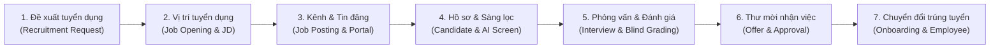
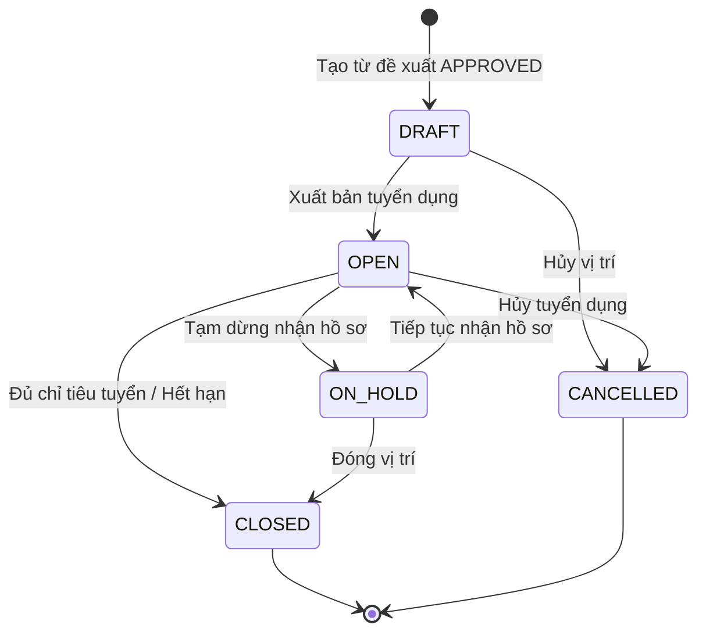
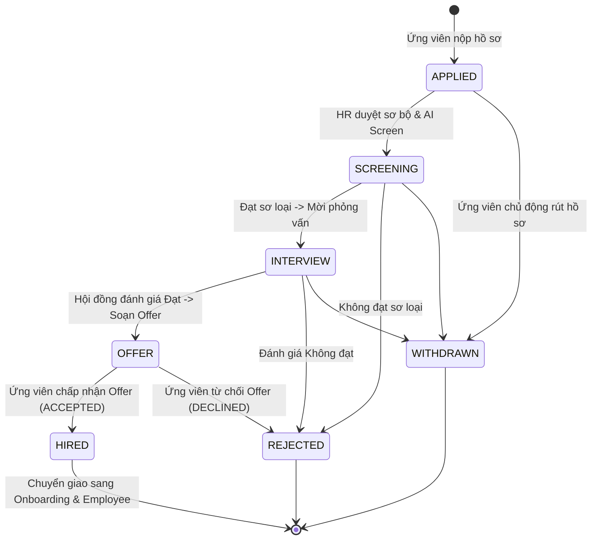
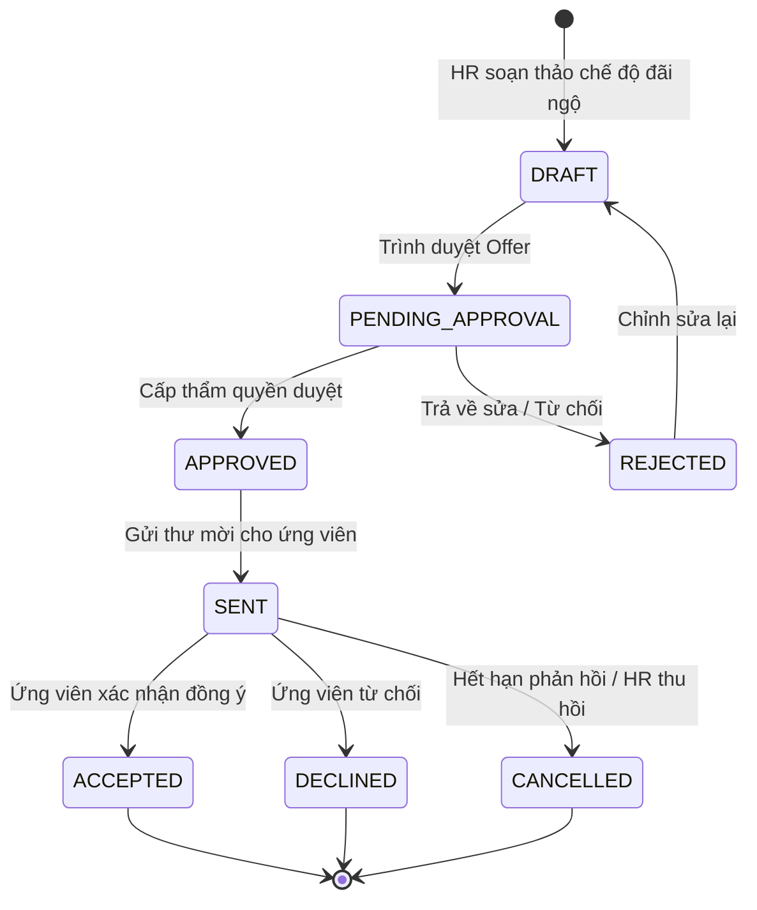
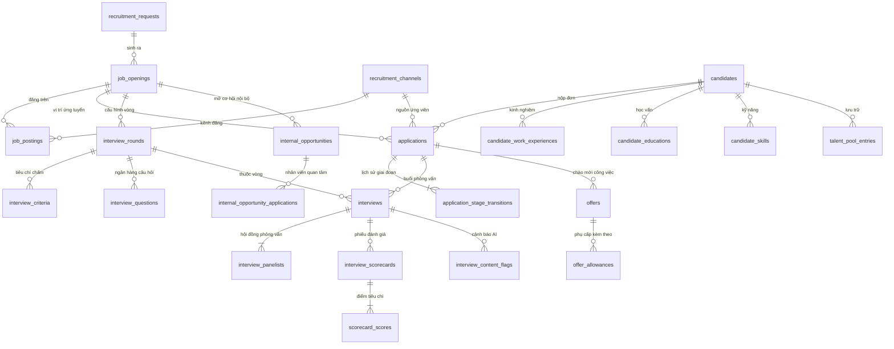
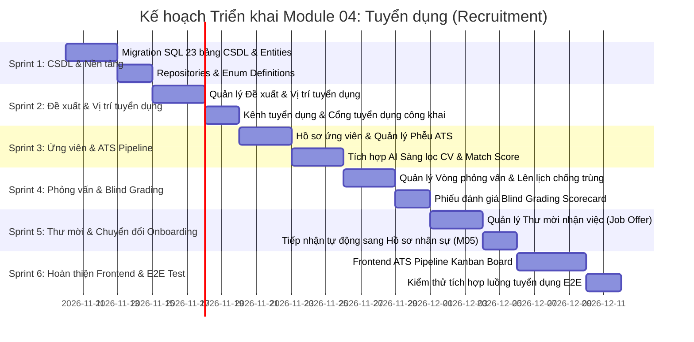

# ĐẶC TẢ CHI TIẾT VÀ KIẾN TRÚC TRIỂN KHAI MODULE 04: TUYỂN DỤNG & THU HÚT NHÂN TÀI (RECRUITMENT & TALENT ACQUISITION)

> **Tài liệu căn cứ & tham chiếu:**
> - Nghiệp vụ chi tiết: [`Nghiep-vu.docx`](file:///f:/Project/CYCLOSA/ba/Nghiep-vu.docx) (Mục 4: Tuyển dụng nhân sự & ATS Pipeline)
> - Thiết kế CSDL & Data Dictionary: [`database.md`](file:///f:/Project/CYCLOSA/ba/database.md) (§4: Recruitment Management)
> - Danh mục API chuẩn: [`api-list.md`](file:///f:/Project/CYCLOSA/ba/api-list.md) (Mục 4: Tuyển dụng - Tuyển mộ, Phỏng vấn, Đánh giá, Thư mời nhận việc)
> - Quy chuẩn các chức năng AI: [`HRM-AI-Features-Business-Rules.md`](file:///f:/Project/CYCLOSA/ba/HRM-AI-Features-Business-Rules.md) (Mục 3: AI Sàng lọc CV, AI Match Score, PII Redaction)
> - Tham số pháp lý & Luật lao động: [`module-phap-ly-va-anh-huong-tham-so.md`](file:///f:/Project/CYCLOSA/ba/module-phap-ly-va-anh-huong-tham-so.md) (BLLĐ 2019, Luật Bảo vệ dữ liệu cá nhân NĐ 356/2025/NĐ-CP & NĐ 13/2023/NĐ-CP)
> - Module nhân sự cốt lõi: [`module-ho-so-nhan-su.md`](file:///f:/Project/CYCLOSA/cyclosa_be/docs/ba/module-ho-so-nhan-su.md) (Module 05: Tiếp nhận ứng viên trúng tuyển sang Employee Profile)
> - Chuẩn kiến trúc codebase: [`com.cyclosa.product`](file:///f:/Project/CYCLOSA/cyclosa_be/src/main/java/com/cyclosa/product) (Direct `@Service` class, không dùng `impl/`)

---

## 1. PHÂN TÍCH ĐẶC TẢ NGHIỆP VỤ & NGUYÊN LÝ CỐT LÕI

### 1.1. Phễu tuyển dụng tổng thể (Full-lifecycle ATS Pipeline Flow)

Hệ thống **CYCLOSA Recruitment (Module 04)** đóng vai trò là "cổng thu hút nhân tài" đầu vào của doanh nghiệp. Module được thiết kế như một hệ thống Quản lý ứng viên tuyển dụng chuyên nghiệp (**Applicant Tracking System - ATS**), vận hành xuyên suốt qua 7 giai đoạn liên hoàn:

1. **Đề xuất tuyển dụng (`recruitment_requests`):**
   - Trưởng bộ phận phát sinh nhu cầu bổ sung nhân sự -> Tạo đề xuất chỉ rõ phòng ban, chức danh, cấp bậc, số lượng và lý do giải trình.
   - Hệ thống tự động đối chiếu với **Định biên nhân sự (Headcount Target)** của vị trí được quản lý tại Module 01 (`job_positions`).
   - Định tuyến qua quy trình phê duyệt (Trưởng bộ phận -> Giám đốc nhân sự / Ban Tổng giám đốc).

2. **Vị trí tuyển dụng (`job_openings`):**
   - Khi đề xuất được duyệt (`APPROVED`), Bộ phận Tuyển dụng (HR/Recruiter) kích hoạt khởi tạo Vị trí tuyển dụng.
   - Thiết lập bản mô tả công việc (JD), yêu cầu năng lực, chế độ đãi ngộ, khung dải lương (`salary_band_min` -> `salary_band_max`), hạn chót nộp hồ sơ (`deadline_date`) và đường dẫn trang ứng tuyển công khai (`landing_slug`).

3. **Kênh tuyển dụng & Xuất bản tin đăng (`recruitment_channels`, `job_postings`):**
   - Quản lý đa kênh: Kênh nội bộ (Internal Talent Portal), Website tuyển dụng công ty (`/careers`), Cổng việc làm đối tác (TopCV, VietnamWorks, LinkedIn), Giới thiệu nội bộ (Employee Referral).
   - Xuất bản đồng bộ nhiều kênh, theo dõi nguồn ứng viên (`source_channel_id`) để đo lường hiệu quả chi phí tuyển dụng (Cost-per-hire) theo từng kênh.

4. **Tiếp nhận hồ sơ & Ứng tuyển đa nguồn (`candidates`, `applications`):**
   - Ứng viên nộp trực tuyến qua Cổng tuyển dụng công khai hoặc HR nhập thủ công từ nguồn săn đầu người (Headhunt).
   - Tự động nhận diện trùng lặp ứng viên dựa trên **Số điện thoại** hoặc **Email**. 
   - Một ứng viên (`candidate_id`) có thể nộp nhiều đơn ứng tuyển (`applications`) cho các vị trí tuyển dụng khác nhau tại các thời điểm khác nhau.
   - Hệ thống theo dõi dịch chuyển giai đoạn qua bảng `application_stage_transitions`.

5. **Phỏng vấn đa vòng & Chấm điểm độc lập (Multi-round Interview & Blind Grading):**
   - Thiết lập các vòng phỏng vấn chuyên biệt theo vị trí: Sơ vấn nhân sự (`HR`), Phỏng vấn chuyên môn (`TECHNICAL`), Phỏng vấn văn hóa (`CULTURE_FIT`), Phỏng vấn cấp cao (`EXECUTIVE`).
   - Mỗi vòng thiết lập tiêu chí đánh giá có trọng số (`weight`) và thang điểm chuẩn (`max_score`).
   - Chống trùng lịch (Availability Check) giữa các thành viên hội đồng phỏng vấn (`interview_panelists`).
   - Nguyên tắc **Blind Grading**: Giám khảo độc lập chỉ được xem điểm và nhận xét của giám khảo khác **sau khi chính mình đã bấm nộp phiếu (`submit`)**.

6. **Thư mời nhận việc & Ma trận phê duyệt Offer (`offers`, `offer_allowances`):**
   - Thiết lập mức lương thỏa thuận, ngày dự kiến đi làm, thời hạn ứng viên phản hồi, các khoản phụ cấp hàng tháng.
   - **Offer Approval Matrix:** Nếu mức lương đề xuất nằm trong khung lương của Job Opening -> Phê duyệt theo thẩm quyền chuẩn của HR Manager. Nếu vượt khung lương (`base_salary > salary_band_max`) -> Hệ thống tự động ép buộc nâng cấp quy trình duyệt qua Ban Giám đốc (CEO/CFO).
   - Tự động sinh file PDF Thư mời nhận việc từ mẫu chuẩn (`OFFER_LETTER`).

7. **Chuyển đổi ứng viên trúng tuyển sang Nhân sự chính thức:**
   - Khi Offer được ứng viên đồng ý (`ACCEPTED`), HR bấm nút **"Tiếp nhận nhân sự"**.
   - Hệ thống tự động đồng bộ hồ sơ ứng viên sang **Hồ sơ nhân sự (Module 05 `employees`)** và khởi tạo quy trình **Hội nhập nhân sự (Module 06 `onboarding_processes`)**, kế thừa toàn bộ thông tin cá nhân, giấy tờ, chức danh, mức lương đã thỏa thuận mà không cần nhập lại.

---

### 1.2. Khung Trí tuệ Nhân tạo trong Tuyển dụng (AI-Powered Talent Acquisition)

Module 04 được trang bị 3 giải pháp AI chuyên sâu theo tài liệu [`HRM-AI-Features-Business-Rules.md`](file:///f:/Project/CYCLOSA/ba/HRM-AI-Features-Business-Rules.md):

#### A. AI Sàng lọc CV & Đánh giá mức độ phù hợp (AI Match Score & Reasoning)
* **Bóc tách hồ sơ (CV Parsing):** Tự động đọc file CV tải lên (PDF, DOCX) và chuyển đổi thành cấu trúc JSON chuẩn `parsed_profile`: Kỹ năng chuyên môn, số năm kinh nghiệm, quá trình công tác, trình độ học vấn.
* **So khớp với Yêu cầu tuyển dụng (JD Matching):**
  - AI so sánh `parsed_profile` với `job_openings.requirements` để tính điểm phù hợp từ **0 - 100 điểm** (`ai_match_score`).
  - Tự động sinh bản giải trình lập luận bằng văn phong tự nhiên (`ai_match_reasoning`): Chỉ rõ điểm mạnh, điểm tương đồng và các kỹ năng còn thiếu.
  - Phân loại độ tin cậy AI: `HIGH`, `MEDIUM`, `LOW`.
* **Cơ chế chống thiên vị & Bảo vệ quyền riêng tư (Fairness & Anti-Bias):**
  - **Bắt buộc có sự đồng thuận (`ai_screening_consent = true`):** Lấy xác nhận từ ứng viên ngay tại form nộp hồ sơ trực tuyến.
  - **PII Redaction bắt buộc:** Trước khi gửi nội dung CV cho mô hình AI, hệ thống tự động loại bỏ các thông tin nhạy cảm có nguy cơ gây định kiến (Ảnh thẻ, giới tính, ngày sinh, tình trạng hôn nhân). Nếu bước lọc PII thất bại, lập tức dừng chấm điểm.
  - Tự động vô hiệu hóa cache: Khi bản mô tả công việc (JD) được cập nhật (`requirements_version` tăng), hệ thống tự động yêu cầu chấm lại điểm cho các hồ sơ chưa có quyết định cuối.

#### B. AI Sinh Bộ câu hỏi Phỏng vấn Thông minh (AI Interview Kit Generator)
* Dựa trên vị trí tuyển dụng (JD) kết hợp với hồ sơ thực tế của từng ứng viên (điểm mạnh, dự án đã làm, các khoảng trống sự nghiệp - employment gap), AI tự động tạo gợi ý danh mục câu hỏi phỏng vấn chuyên sâu cho giám khảo kèm hướng dẫn câu trả lời kỳ vọng (`expected_answer_guideline`).

#### C. AI Quét Cảnh báo Nội dung Phỏng vấn Không phù hợp (Interview Content Scanner)
* Tự động rà soát bộ câu hỏi và phiếu đánh giá của giám khảo để phát hiện các câu hỏi vi phạm pháp luật lao động hoặc có tính chất phân biệt đối xử (câu hỏi về kế hoạch sinh con, tôn giáo, quan điểm chính trị cá nhân), tạo cờ cảnh báo (`interview_content_flags`) để HR rà soát.

---

### 1.3. Ngân hàng hồ sơ (Talent Pool) & Chợ cơ hội nội bộ (Internal Talent Marketplace)

* **Talent Pool:** Các ứng viên có năng lực tốt nhưng chưa phù hợp ở vị trí hiện tại hoặc dự phòng cho các đợt tuyển dụng tương lai sẽ được lưu vào Ngân hàng hồ sơ tiềm năng với nhãn kỹ năng và ghi chú đánh giá.
* **Internal Talent Marketplace:** Khuyến khích luân chuyển nội bộ và tối ưu hóa nguồn lực. Doanh nghiệp có thể đăng các vị trí tuyển dụng hoặc dự án ngắn hạn (`SHORT_TERM_PROJECT`) trong nội bộ công ty để nhân viên hiện hữu bày tỏ sự quan tâm (`INTERESTED`), giúp giữ chân nhân tài và giảm chi phí tuyển dụng bên ngoài.

---

## 2. QUY TRÌNH NGHIỆP VỤ & STATE MACHINES (SƠ ĐỒ TRẠNG THÁI)

### 2.1. Vòng đời Vị trí tuyển dụng (`job_openings`)

### 2.2. Tiến trình Ứng tuyển & ATS Pipeline (`applications`)

### 2.3. Vòng đời Thư mời nhận việc (`offers`)

---

## 3. THIẾT KẾ CƠ SỞ DỮ LIỆU & DATA DICTIONARY CHI TIẾT (23 BẢNG)

### 3.1. Nhóm Đề xuất & Vị trí tuyển dụng

#### 1. `recruitment_requests` — Đề xuất tuyển dụng nhân sự
Bảng lưu trữ nhu cầu bổ sung nhân lực từ các phòng ban chức năng.
| Tên cột | Kiểu dữ liệu | Ràng buộc | Mô tả chi tiết |
| :--- | :--- | :--- | :--- |
| `id` | `VARCHAR(36)` | PK | Khóa chính (UUID v4) |
| `company_id` | `VARCHAR(36)` | FK, NN | Pháp nhân / Công ty |
| `department_id` | `VARCHAR(36)` | FK, NN | Phòng ban phát sinh nhu cầu bổ sung |
| `job_title_id` | `VARCHAR(36)` | FK, NN | Chức danh công việc đề xuất |
| `job_level_id` | `VARCHAR(36)` | FK, NULL | Cấp bậc đề xuất |
| `requested_quantity` | `INT` | NN | Số lượng nhân sự đề xuất tuyển |
| `justification` | `TEXT` | NN | Lý do giải trình bổ sung nhân sự |
| `target_start_date` | `DATE` | NULL | Ngày kỳ vọng nhân sự mới bắt đầu làm việc |
| `requested_by_employee_id` | `VARCHAR(36)` | FK, NN | Nhân viên / Quản lý lập đề xuất |
| `requested_at` | `TIMESTAMP` | NN | Thời điểm lập đề xuất |
| `status` | `VARCHAR(30)` | NN | `PENDING_APPROVAL`, `APPROVED`, `REJECTED`, `CANCELLED` |
| `rejection_reason` | `TEXT` | NULL | Lý do từ chối nếu bị bác bỏ |
| `created_at` | `TIMESTAMP` | NN | Thời điểm tạo bản ghi |
| `updated_at` | `TIMESTAMP` | NN | Thời điểm cập nhật cuối |

#### 2. `job_openings` — Vị trí tuyển dụng (Job Opening)
Vị trí tuyển dụng được phê duyệt và mở để nhận hồ sơ ứng viên.
| Tên cột | Kiểu dữ liệu | Ràng buộc | Mô tả chi tiết |
| :--- | :--- | :--- | :--- |
| `id` | `VARCHAR(36)` | PK | Khóa chính (UUID v4) |
| `recruitment_request_id` | `VARCHAR(36)` | FK, NN | Đề xuất tuyển dụng đã được duyệt |
| `title` | `VARCHAR(255)` | NN | Tiêu đề tin tuyển dụng (Ví dụ: Senior Java Engineer) |
| `required_quantity` | `INT` | NN | Chỉ tiêu số lượng cần tuyển dụng |
| `description` | `TEXT` | NN | Mô tả chi tiết trách nhiệm và công việc |
| `requirements` | `TEXT` | NN | Tiêu chuẩn năng lực, kỹ năng, kinh nghiệm |
| `requirements_version` | `INT` | NN, DEF 1 | Phiên bản JD (tăng mỗi khi sửa, dùng để reset cache AI) |
| `benefits` | `TEXT` | NULL | Quyền lợi, chế độ đãi ngộ, văn hóa môi trường |
| `salary_band_min` | `DECIMAL(15,2)` | NULL | Mức lương khởi điểm tối thiểu của khung |
| `salary_band_max` | `DECIMAL(15,2)` | NULL | Mức lương trần tối đa của khung vị trí |
| `is_salary_negotiable` | `BOOLEAN` | NN, DEF TRUE | Cờ hiển thị "Lương thỏa thuận" |
| `work_location` | `VARCHAR(255)` | NULL | Địa điểm làm việc (Văn phòng, Hybrid, Remote) |
| `deadline_date` | `DATE` | NN | Hạn chót nhận hồ sơ ứng tuyển |
| `landing_slug` | `VARCHAR(255)` | UK, NN | Đường dẫn tĩnh công khai (Ví dụ: `senior-java-hn-2026`) |
| `status` | `VARCHAR(30)` | NN | `DRAFT`, `OPEN`, `ON_HOLD`, `CLOSED`, `CANCELLED` |
| `created_at` | `TIMESTAMP` | NN | Thời điểm tạo bản ghi |
| `updated_at` | `TIMESTAMP` | NN | Thời điểm cập nhật |

#### 3. `recruitment_channels` — Kênh / Nguồn tuyển dụng
Danh mục các nguồn thu hút ứng viên (Website công ty, TopCV, VietnamWorks, Employee Referral, LinkedIn...).
| Tên cột | Kiểu dữ liệu | Ràng buộc | Mô tả chi tiết |
| :--- | :--- | :--- | :--- |
| `id` | `VARCHAR(36)` | PK | Khóa chính (UUID v4) |
| `company_id` | `VARCHAR(36)` | FK, NN | Đơn vị quản lý |
| `name` | `VARCHAR(100)` | NN | Tên kênh / nguồn (Ví dụ: VietnamWorks, TopCV, LinkedIn) |
| `channel_code` | `VARCHAR(50)` | UK, NN | Mã kênh (Ví dụ: `TOPCV`, `REFERRAL`, `INTERNAL`) |
| `is_active` | `BOOLEAN` | NN, DEF TRUE | Trạng thái kích hoạt |

#### 4. `job_postings` — Tin đăng tuyển dụng trên các kênh
Theo dõi tình trạng xuất bản của một vị trí tuyển dụng trên các kênh bên ngoài.
| Tên cột | Kiểu dữ liệu | Ràng buộc | Mô tả chi tiết |
| :--- | :--- | :--- | :--- |
| `id` | `VARCHAR(36)` | PK | Khóa chính (UUID v4) |
| `job_opening_id` | `VARCHAR(36)` | FK, NN | Vị trí tuyển dụng |
| `channel_id` | `VARCHAR(36)` | FK, NN | Kênh tuyển dụng đăng tin |
| `posted_at` | `TIMESTAMP` | NULL | Thời điểm xuất bản lên kênh |
| `expires_at` | `TIMESTAMP` | NULL | Thời điểm hết hạn tin đăng |
| `external_url` | `VARCHAR(500)` | NULL | Đường dẫn bài đăng trên sàn việc làm đối tác |
| `status` | `VARCHAR(30)` | NN | `DRAFT`, `PUBLISHED`, `EXPIRED`, `WITHDRAWN`, `FAILED` |

---

### 3.2. Nhóm Ứng viên & ATS Pipeline

#### 5. `candidates` — Hồ sơ ứng viên tổng thể (Candidate Profile)
Lưu trữ thông tin liên hệ và lý lịch xuyên suốt của ứng viên độc lập với từng vị trí ứng tuyển.
| Tên cột | Kiểu dữ liệu | Ràng buộc | Mô tả chi tiết |
| :--- | :--- | :--- | :--- |
| `id` | `VARCHAR(36)` | PK | Khóa chính (UUID v4) |
| `full_name` | `VARCHAR(150)` | NN | Họ và tên ứng viên |
| `email` | `VARCHAR(100)` | NN | Email liên hệ chính (kiểm tra chống trùng) |
| `phone` | `VARCHAR(20)` | NN | Số điện thoại liên hệ |
| `date_of_birth` | `DATE` | NULL | Ngày sinh |
| `gender` | `VARCHAR(10)` | NULL | Giới tính (`MALE`, `FEMALE`, `OTHER`) |
| `address` | `VARCHAR(255)` | NULL | Địa chỉ hiện tại |
| `resume_url` | `VARCHAR(500)` | NULL | Đường dẫn file CV mới nhất |
| `parsed_profile` | `TEXT` / `JSON` | NULL | Dữ liệu cấu trúc kỹ năng/kinh nghiệm do AI trích xuất |
| `ai_screening_consent` | `BOOLEAN` | NN, DEF FALSE | Xác nhận đồng thuận cho AI xử lý hồ sơ |
| `created_at` | `TIMESTAMP` | NN | Ngày tạo hồ sơ ứng viên |
| `updated_at` | `TIMESTAMP` | NN | Ngày cập nhật |

#### 6. `candidate_work_experiences` — Lịch sử kinh nghiệm làm việc
| Tên cột | Kiểu dữ liệu | Ràng buộc | Mô tả chi tiết |
| :--- | :--- | :--- | :--- |
| `id` | `VARCHAR(36)` | PK | Khóa chính (UUID v4) |
| `candidate_id` | `VARCHAR(36)` | FK, NN | Ứng viên |
| `company_name` | `VARCHAR(150)` | NN | Tên công ty / doanh nghiệp đã từng làm việc |
| `position` | `VARCHAR(100)` | NN | Chức danh / vị trí công tác |
| `start_date` | `DATE` | NN | Ngày bắt đầu |
| `end_date` | `DATE` | NULL | Ngày kết thúc (NULL nếu hiện vẫn đang làm việc) |
| `description` | `TEXT` | NULL | Mô tả nhiệm vụ, dự án, thành tựu nổi bật |

#### 7. `candidate_educations` — Quá trình học vấn & Bằng cấp
| Tên cột | Kiểu dữ liệu | Ràng buộc | Mô tả chi tiết |
| :--- | :--- | :--- | :--- |
| `id` | `VARCHAR(36)` | PK | Khóa chính (UUID v4) |
| `candidate_id` | `VARCHAR(36)` | FK, NN | Ứng viên |
| `institution_name` | `VARCHAR(150)` | NN | Tên trường Đại học / Học viện / Cơ sở đào tạo |
| `degree` | `VARCHAR(100)` | NN | Bằng cấp (Cử nhân, Kỹ sư, Thạc sĩ, Tiến sĩ) |
| `major` | `VARCHAR(100)` | NN | Chuyên ngành đào tạo |
| `start_year` | `INT` | NULL | Năm nhập học |
| `end_year` | `INT` | NULL | Năm tốt nghiệp |
| `gpa` | `VARCHAR(20)` | NULL | Điểm trung bình tốt nghiệp / Xếp loại |

#### 8. `candidate_skills` — Danh mục kỹ năng ứng viên
| Tên cột | Kiểu dữ liệu | Ràng buộc | Mô tả chi tiết |
| :--- | :--- | :--- | :--- |
| `id` | `VARCHAR(36)` | PK | Khóa chính (UUID v4) |
| `candidate_id` | `VARCHAR(36)` | FK, NN | Ứng viên |
| `skill_name` | `VARCHAR(100)` | NN | Tên kỹ năng (Java, React, Spring Boot, SQL, Leadership...) |
| `years_experience` | `INT` | NULL | Số năm kinh nghiệm sử dụng kỹ năng |
| `proficiency_level` | `VARCHAR(30)` | NULL | `BEGINNER`, `INTERMEDIATE`, `ADVANCED`, `EXPERT` |

#### 9. `talent_pool_entries` — Ngân hàng hồ sơ tiềm năng (Talent Pool)
| Tên cột | Kiểu dữ liệu | Ràng buộc | Mô tả chi tiết |
| :--- | :--- | :--- | :--- |
| `id` | `VARCHAR(36)` | PK | Khóa chính (UUID v4) |
| `candidate_id` | `VARCHAR(36)` | FK, NN | Ứng viên tiềm năng |
| `tag` | `VARCHAR(100)` | NULL | Nhãn phân loại (Ví dụ: `High Potential`, `Future Leader`) |
| `note` | `TEXT` | NULL | Ghi chú đánh giá lý do lưu kho hồ sơ |
| `added_by_employee_id` | `VARCHAR(36)` | FK, NN | HR / Recruiter đưa vào kho |
| `added_at` | `TIMESTAMP` | NN | Thời điểm lưu vào Talent Pool |

#### 10. `applications` — Đơn ứng tuyển vào vị trí (Application & AI Screening)
Bản ghi trung tâm của ATS Pipeline, thể hiện lần ứng tuyển của một ứng viên vào một vị trí tuyển dụng.
| Tên cột | Kiểu dữ liệu | Ràng buộc | Mô tả chi tiết |
| :--- | :--- | :--- | :--- |
| `id` | `VARCHAR(36)` | PK | Khóa chính (UUID v4) |
| `candidate_id` | `VARCHAR(36)` | FK, NN | Ứng viên nộp đơn |
| `job_opening_id` | `VARCHAR(36)` | FK, NN | Vị trí tuyển dụng |
| `source_channel_id` | `VARCHAR(36)` | FK, NULL | Kênh nguồn ứng tuyển |
| `referrer_employee_id` | `VARCHAR(36)` | FK, NULL | Nhân viên nội bộ giới thiệu (nếu có) |
| `applied_at` | `TIMESTAMP` | NN | Thời điểm nộp đơn |
| `current_stage` | `VARCHAR(30)` | NN | `APPLIED`, `SCREENING`, `INTERVIEW`, `OFFER`, `HIRED`, `REJECTED`, `WITHDRAWN` |
| `ai_match_score` | `DECIMAL(5,2)` | NULL | Điểm số AI đánh giá mức độ phù hợp (0.00 - 100.00) |
| `ai_match_reasoning` | `TEXT` | NULL | Bản giải trình lập luận điểm mạnh / điểm thiếu của AI |
| `ai_confidence_level` | `VARCHAR(20)` | NULL | Độ tin cậy kết quả AI: `HIGH`, `MEDIUM`, `LOW` |
| `ai_screened_at` | `TIMESTAMP` | NULL | Thời điểm AI thực hiện sàng lọc |
| `ai_screened_requirements_version`| `INT` | NULL | Phiên bản JD tại lúc chấm điểm |
| `rejection_reason` | `TEXT` | NULL | Lý do loại hồ sơ nếu không đạt |
| `created_at` | `TIMESTAMP` | NN | Thời điểm tạo đơn |
| `updated_at` | `TIMESTAMP` | NN | Thời điểm cập nhật cuối |

#### 11. `application_stage_transitions` — Lịch sử chuyển giai đoạn Pipeline
Ghi nhận toàn bộ vết lịch sử dịch chuyển trạng thái của hồ sơ trong phễu tuyển dụng.
| Tên cột | Kiểu dữ liệu | Ràng buộc | Mô tả chi tiết |
| :--- | :--- | :--- | :--- |
| `id` | `VARCHAR(36)` | PK | Khóa chính (UUID v4) |
| `application_id` | `VARCHAR(36)` | FK, NN | Đơn ứng tuyển |
| `from_stage` | `VARCHAR(30)` | NULL | Giai đoạn trước khi chuyển |
| `to_stage` | `VARCHAR(30)` | NN | Giai đoạn mới |
| `transitioned_at` | `TIMESTAMP` | NN | Thời điểm chuyển giai đoạn |
| `transitioned_by_employee_id` | `VARCHAR(36)` | FK, NULL | Người thực hiện chuyển (NULL nếu hệ thống tự chạy) |
| `note` | `TEXT` | NULL | Ghi chú lý do chuyển |

---

### 3.3. Nhóm Phỏng vấn & Phiếu đánh giá (Blind Grading)

#### 12. `interview_rounds` — Các vòng phỏng vấn của vị trí tuyển dụng
| Tên cột | Kiểu dữ liệu | Ràng buộc | Mô tả chi tiết |
| :--- | :--- | :--- | :--- |
| `id` | `VARCHAR(36)` | PK | Khóa chính (UUID v4) |
| `job_opening_id` | `VARCHAR(36)` | FK, NN | Vị trí tuyển dụng |
| `round_no` | `INT` | NN | Thứ tự vòng (1, 2, 3...) |
| `round_type` | `VARCHAR(30)` | NN | `HR`, `TECHNICAL`, `CULTURE_FIT`, `EXECUTIVE`, `FINAL` |
| `name` | `VARCHAR(100)` | NN | Tên vòng (Ví dụ: Vòng phỏng vấn kỹ thuật thuật toán) |
| `description` | `TEXT` | NULL | Mô tả mục tiêu đánh giá của vòng |

#### 13. `interview_criteria` — Tiêu chí đánh giá của vòng phỏng vấn
| Tên cột | Kiểu dữ liệu | Ràng buộc | Mô tả chi tiết |
| :--- | :--- | :--- | :--- |
| `id` | `VARCHAR(36)` | PK | Khóa chính (UUID v4) |
| `interview_round_id` | `VARCHAR(36)` | FK, NN | Thuộc vòng phỏng vấn nào |
| `name` | `VARCHAR(100)` | NN | Tên tiêu chí (Ví dụ: Kỹ năng System Design, Tinh thần học hỏi) |
| `max_score` | `INT` | NN, DEF 10 | Thang điểm tối đa (thường là 5 hoặc 10) |
| `weight` | `DECIMAL(4,2)` | NN, DEF 1.0 | Trọng số tiêu chí trong tổng điểm vòng (Ví dụ: 1.5) |
| `description` | `TEXT` | NULL | Hướng dẫn khung điểm cho giám khảo chấm |

#### 14. `interview_questions` — Ngân hàng câu hỏi phỏng vấn (Standard & AI Generated)
| Tên cột | Kiểu dữ liệu | Ràng buộc | Mô tả chi tiết |
| :--- | :--- | :--- | :--- |
| `id` | `VARCHAR(36)` | PK | Khóa chính (UUID v4) |
| `interview_round_id` | `VARCHAR(36)` | FK, NN | Vòng phỏng vấn áp dụng |
| `application_id` | `VARCHAR(36)` | FK, NULL | Gắn với ứng viên cụ thể (nếu là câu hỏi cá nhân hóa do AI sinh) |
| `question_text` | `TEXT` | NN | Nội dung câu hỏi phỏng vấn |
| `expected_answer_guideline` | `TEXT` | NULL | Gợi ý đáp án kỳ vọng / Thang đo đánh giá |
| `is_ai_generated` | `BOOLEAN` | NN, DEF FALSE | Cờ đánh dấu câu hỏi do AI tạo từ CV & JD |

#### 15. `interviews` — Buổi phỏng vấn cụ thể
| Tên cột | Kiểu dữ liệu | Ràng buộc | Mô tả chi tiết |
| :--- | :--- | :--- | :--- |
| `id` | `VARCHAR(36)` | PK | Khóa chính (UUID v4) |
| `application_id` | `VARCHAR(36)` | FK, NN | Đơn ứng tuyển |
| `interview_round_id` | `VARCHAR(36)` | FK, NN | Vòng phỏng vấn |
| `scheduled_start` | `TIMESTAMP` | NN | Thời gian bắt đầu dự kiến |
| `scheduled_end` | `TIMESTAMP` | NN | Thời gian kết thúc dự kiến |
| `format` | `VARCHAR(20)` | NN | `ONLINE`, `OFFLINE`, `HYBRID` |
| `location_or_link` | `VARCHAR(500)` | NN | Phòng họp trực tiếp hoặc link Google Meet/Teams |
| `status` | `VARCHAR(30)` | NN | `SCHEDULED`, `COMPLETED`, `CANCELLED`, `RESCHEDULED` |
| `cancellation_reason` | `TEXT` | NULL | Lý do hủy buổi phỏng vấn nếu có |

#### 16. `interview_panelists` — Hội đồng phỏng vấn (Interviewer Panel)
| Tên cột | Kiểu dữ liệu | Ràng buộc | Mô tả chi tiết |
| :--- | :--- | :--- | :--- |
| `id` | `VARCHAR(36)` | PK | Khóa chính (UUID v4) |
| `interview_id` | `VARCHAR(36)` | FK, NN | Buổi phỏng vấn |
| `employee_id` | `VARCHAR(36)` | FK, NN | Nhân viên / Giám khảo tham gia hội đồng |
| `is_lead_interviewer`| `BOOLEAN` | NN, DEF FALSE | Cờ chỉ định Trưởng hội đồng phỏng vấn |

#### 17. `interview_scorecards` — Phiếu đánh giá của giám khảo (Blind Grading)
Mỗi giám khảo nộp 1 phiếu đánh giá độc lập. Sau khi nộp (`SUBMITTED`) mới được mở quyền xem phiếu của người khác.
| Tên cột | Kiểu dữ liệu | Ràng buộc | Mô tả chi tiết |
| :--- | :--- | :--- | :--- |
| `id` | `VARCHAR(36)` | PK | Khóa chính (UUID v4) |
| `interview_id` | `VARCHAR(36)` | FK, NN | Buổi phỏng vấn |
| `interviewer_employee_id` | `VARCHAR(36)` | FK, NN | Giám khảo chấm điểm |
| `overall_recommendation` | `VARCHAR(30)` | NULL | `STRONG_YES`, `YES`, `NO`, `STRONG_NO` |
| `general_notes` | `TEXT` | NULL | Nhận xét chung về ưu/nhược điểm ứng viên |
| `status` | `VARCHAR(20)` | NN | `DRAFT`, `SUBMITTED` |
| `submitted_at` | `TIMESTAMP` | NULL | Thời điểm nộp phiếu (mở khóa xem chéo) |

#### 18. `scorecard_scores` — Điểm chi tiết theo từng tiêu chí
| Tên cột | Kiểu dữ liệu | Ràng buộc | Mô tả chi tiết |
| :--- | :--- | :--- | :--- |
| `id` | `VARCHAR(36)` | PK | Khóa chính (UUID v4) |
| `scorecard_id` | `VARCHAR(36)` | FK, NN | Phiếu đánh giá |
| `criterion_id` | `VARCHAR(36)` | FK, NN | Tiêu chí đánh giá |
| `score` | `DECIMAL(4,2)` | NN | Điểm số chấm |
| `comment` | `TEXT` | NULL | Diễn giải lý do cho điểm |

#### 19. `interview_content_flags` — Cảnh báo AI về nội dung phỏng vấn không phù hợp
| Tên cột | Kiểu dữ liệu | Ràng buộc | Mô tả chi tiết |
| :--- | :--- | :--- | :--- |
| `id` | `VARCHAR(36)` | PK | Khóa chính (UUID v4) |
| `interview_id` | `VARCHAR(36)` | FK, NN | Buổi phỏng vấn |
| `flagged_content` | `TEXT` | NN | Đoạn nội dung câu hỏi hoặc nhận xét bị cảnh báo |
| `reason` | `TEXT` | NN | Lý do AI gắn cờ (phân biệt đối xử, vi phạm quyền riêng tư) |
| `review_status` | `VARCHAR(20)` | NN | `PENDING`, `CONFIRMED`, `DISMISSED` |
| `reviewed_by_employee_id` | `VARCHAR(36)` | FK, NULL | HR xử lý cờ cảnh báo |

---

### 3.4. Nhóm Thư mời nhận việc (Job Offer) & Cơ hội nội bộ

#### 20. `offers` — Thư mời nhận việc (Job Offer)
Chứa gói đãi ngộ thỏa thuận chính thức gửi cho ứng viên trước khi ký hợp đồng.
| Tên cột | Kiểu dữ liệu | Ràng buộc | Mô tả chi tiết |
| :--- | :--- | :--- | :--- |
| `id` | `VARCHAR(36)` | PK | Khóa chính (UUID v4) |
| `application_id` | `VARCHAR(36)` | FK, NN | Đơn ứng tuyển trúng tuyển |
| `base_salary` | `DECIMAL(15,2)` | NN | Mức lương cơ bản đề xuất (VNĐ/tháng) |
| `expected_start_date` | `DATE` | NN | Ngày dự kiến bắt đầu làm việc chính thức |
| `response_deadline` | `TIMESTAMP` | NN | Hạn chót ứng viên phản hồi chấp nhận/từ chối |
| `template_version_id` | `VARCHAR(36)` | FK, NULL | Phiên bản biểu mẫu thư mời (Module 08) |
| `offer_letter_url` | `VARCHAR(500)` | NULL | Đường dẫn tệp PDF Thư mời nhận việc đã sinh |
| `status` | `VARCHAR(30)` | NN | `DRAFT`, `PENDING_APPROVAL`, `APPROVED`, `SENT`, `ACCEPTED`, `DECLINED`, `CANCELLED` |
| `decline_reason` | `VARCHAR(50)` | NULL | `SALARY_UNSATISFIED`, `BETTER_OFFER`, `LOCATION_FAR`, `OTHER` |
| `decline_note` | `TEXT` | NULL | Diễn giải chi tiết lý do từ chối của ứng viên |
| `created_at` | `TIMESTAMP` | NN | Thời điểm lập Offer |
| `updated_at` | `TIMESTAMP` | NN | Thời điểm cập nhật cuối |

#### 21. `offer_allowances` — Danh mục phụ cấp kèm theo Thư mời
| Tên cột | Kiểu dữ liệu | Ràng buộc | Mô tả chi tiết |
| :--- | :--- | :--- | :--- |
| `id` | `VARCHAR(36)` | PK | Khóa chính (UUID v4) |
| `offer_id` | `VARCHAR(36)` | FK, NN | Thư mời nhận việc |
| `allowance_type` | `VARCHAR(100)` | NN | Loại phụ cấp (Ăn trưa, Xăng xe, Điện thoại, Dự án) |
| `amount` | `DECIMAL(15,2)` | NN | Số tiền phụ cấp thỏa thuận (VNĐ/tháng) |
| `notes` | `VARCHAR(255)` | NULL | Ghi chú điều kiện hưởng |

#### 22. `internal_opportunities` — Cơ hội việc làm & Dự án nội bộ
| Tên cột | Kiểu dữ liệu | Ràng buộc | Mô tả chi tiết |
| :--- | :--- | :--- | :--- |
| `id` | `VARCHAR(36)` | PK | Khóa chính (UUID v4) |
| `company_id` | `VARCHAR(36)` | FK, NN | Doanh nghiệp |
| `job_opening_id` | `VARCHAR(36)` | FK, NULL | Vị trí tuyển dụng mở liên kết (nếu có) |
| `title` | `VARCHAR(255)` | NN | Tên vị trí hoặc tên dự án ngắn hạn nội bộ |
| `type` | `VARCHAR(30)` | NN | `OPEN_POSITION` (vị trí mở), `SHORT_TERM_PROJECT` (dự án ngắn hạn) |
| `description` | `TEXT` | NN | Mô tả công việc, mục tiêu dự án |
| `start_date` | `DATE` | NULL | Ngày bắt đầu dự kiến |
| `end_date` | `DATE` | NULL | Ngày kết thúc dự kiến (cho dự án ngắn hạn) |
| `status` | `VARCHAR(20)` | NN | `OPEN` (đang nhận quan tâm), `CLOSED` (đã đóng) |

#### 23. `internal_opportunity_applications` — Nhân viên nội bộ tham gia
| Tên cột | Kiểu dữ liệu | Ràng buộc | Mô tả chi tiết |
| :--- | :--- | :--- | :--- |
| `id` | `VARCHAR(36)` | PK | Khóa chính (UUID v4) |
| `opportunity_id` | `VARCHAR(36)` | FK, NN | Cơ hội việc làm / dự án |
| `employee_id` | `VARCHAR(36)` | FK, NN | Nhân viên bày tỏ sự quan tâm |
| `motivation` | `TEXT` | NULL | Lý do ứng tuyển / nguyện vọng đóng góp |
| `status` | `VARCHAR(20)` | NN | `INTERESTED`, `SELECTED`, `REJECTED` |
| `assigned_task` | `TEXT` | NULL | Nhiệm vụ được giao khi được chọn (`SELECTED`) |
| `outcome_note` | `TEXT` | NULL | Đánh giá kết quả đóng góp khi kết thúc dự án |
| `created_at` | `TIMESTAMP` | NN | Thời điểm đăng ký quan tâm |

---

## 4. DANH MỤC 48 REST API VÀ PHÂN QUYỀN RBAC CHI TIẾT

Toàn bộ các endpoints đều được bảo vệ bằng `@PreAuthorize("@perm.has('...')")` kết hợp kiểm soát phạm vi dữ liệu `data_scope`.

### 4.1. Phân nhóm Đề xuất & Vị trí tuyển dụng (12 APIs)

| STT | Phương thức | Endpoint | Mô tả chức năng | Quyền yêu cầu |
| :-: | :--- | :--- | :--- | :--- |
| 1 | `POST` | `/api/v1/recruitment-requests` | Lập đề xuất tuyển dụng mới (`PENDING_APPROVAL`) | `recruitment_request.create` |
| 2 | `GET` | `/api/v1/recruitment-requests` | Lấy danh sách đề xuất tuyển dụng (lọc department, status) | `recruitment_request.view` |
| 3 | `GET` | `/api/v1/recruitment-requests/{id}` | Lấy chi tiết đề xuất và tiến trình phê duyệt | `recruitment_request.view` |
| 4 | `PUT` | `/api/v1/recruitment-requests/{id}` | Sửa đề xuất tuyển dụng (chỉ khi chưa có bước duyệt) | `recruitment_request.create` |
| 5 | `POST` | `/api/v1/recruitment-requests/{id}/cancel` | Hủy đề xuất tuyển dụng | `recruitment_request.create` |
| 6 | `POST` | `/api/v1/job-openings` | Tạo vị trí tuyển dụng từ đề xuất đã duyệt `APPROVED` | `recruitment.manage` |
| 7 | `GET` | `/api/v1/job-openings` | Danh sách vị trí tuyển dụng có phân trang, lọc đa tiêu chí | `recruitment.view` |
| 8 | `GET` | `/api/v1/job-openings/{id}` | Lấy chi tiết vị trí tuyển dụng, số đã tuyển và thống kê hồ sơ | `recruitment.view` |
| 9 | `PUT` | `/api/v1/job-openings/{id}` | Cập nhật bản mô tả công việc (JD), khung lương, hạn chót | `recruitment.manage` |
| 10 | `POST` | `/api/v1/job-openings/{id}/hold` | Tạm dừng nhận hồ sơ tuyển dụng (`ON_HOLD`) | `recruitment.manage` |
| 11 | `POST` | `/api/v1/job-openings/{id}/reopen` | Mở lại vị trí tuyển dụng (`OPEN`) | `recruitment.manage` |
| 12 | `POST` | `/api/v1/job-openings/{id}/close` | Đóng vị trí tuyển dụng (`CLOSED`) | `recruitment.manage` |

### 4.2. Phân nhóm Kênh & Cổng tuyển dụng công khai (7 APIs)

| STT | Phương thức | Endpoint | Mô tả chức năng | Quyền yêu cầu |
| :-: | :--- | :--- | :--- | :--- |
| 13 | `GET` | `/api/v1/recruitment-channels` | Lấy danh mục các kênh/nguồn tuyển dụng | `recruitment.view` |
| 14 | `POST` | `/api/v1/recruitment-channels` | Thêm mới kênh tuyển dụng | `recruitment.manage` |
| 15 | `GET` | `/api/v1/job-openings/{id}/postings` | Danh sách tin đăng của vị trí trên các kênh | `recruitment.view` |
| 16 | `POST` | `/api/v1/job-openings/{id}/postings` | Xuất bản tin đăng đồng loạt lên nhiều kênh | `recruitment.manage` |
| 17 | `GET` | `/api/v1/public/job-openings` | API công khai: Danh sách việc làm đang mở (không cần login) | `Public` |
| 18 | `GET` | `/api/v1/public/job-openings/{slug}` | API công khai: Xem trang chi tiết tuyển dụng theo slug | `Public` |
| 19 | `POST` | `/api/v1/public/job-openings/{slug}/apply` | API công khai: Ứng viên nộp hồ sơ trực tuyến kèm CV | `Public` |

### 4.3. Phân nhóm Ứng viên, ATS Pipeline & AI Sàng lọc (11 APIs)

| STT | Phương thức | Endpoint | Mô tả chức năng | Quyền yêu cầu |
| :-: | :--- | :--- | :--- | :--- |
| 20 | `GET` | `/api/v1/candidates` | Tra cứu danh sách ứng viên (lọc kỹ năng, từ khóa, nguồn) | `candidate.view` |
| 21 | `POST` | `/api/v1/candidates` | HR nhập thủ công hồ sơ ứng viên | `candidate.manage` |
| 22 | `GET` | `/api/v1/candidates/{id}` | Chi tiết lý lịch ứng viên, lịch sử các lần nộp đơn | `candidate.view` |
| 23 | `PUT` | `/api/v1/candidates/{id}` | Cập nhật thông tin liên hệ lý lịch ứng viên | `candidate.manage` |
| 24 | `POST` | `/api/v1/candidates/parse-cv` | AI CV Parser: Tải tệp CV lên bóc tách cấu trúc JSON | `candidate.manage` |
| 25 | `GET` | `/api/v1/talent-pool` | Danh sách ứng viên trong Ngân hàng hồ sơ tiềm năng | `candidate.view` |
| 26 | `POST` | `/api/v1/talent-pool` | Đưa ứng viên vào Talent Pool lưu trữ dài hạn | `candidate.manage` |
| 27 | `GET` | `/api/v1/applications` | Danh sách đơn ứng tuyển trong ATS Pipeline | `candidate.view` |
| 28 | `GET` | `/api/v1/applications/{id}` | Chi tiết hồ sơ ứng tuyển, các vòng phỏng vấn và Offer | `candidate.view` |
| 29 | `POST` | `/api/v1/applications/{id}/stage-transitions` | Dịch chuyển giai đoạn hồ sơ trong phễu ATS | `candidate.manage` |
| 30 | `POST` | `/api/v1/applications/{id}/ai-screen` | Kích hoạt AI chấm điểm độ phù hợp (`ai_match_score` & reasoning)| `application.ai_screen` |

### 4.4. Phân nhóm Phỏng vấn & Blind Grading Scorecards (11 APIs)

| STT | Phương thức | Endpoint | Mô tả chức năng | Quyền yêu cầu |
| :-: | :--- | :--- | :--- | :--- |
| 31 | `GET` | `/api/v1/job-openings/{id}/interview-rounds` | Cấu hình các vòng phỏng vấn của vị trí tuyển dụng | `interview.view` |
| 32 | `POST` | `/api/v1/job-openings/{id}/interview-rounds` | Thêm mới vòng phỏng vấn và bộ tiêu chí chấm điểm | `interview.manage` |
| 33 | `POST` | `/api/v1/applications/{id}/interview-questions/generate` | AI tự động sinh bộ câu hỏi phỏng vấn dựa trên JD & CV | `interview.manage` |
| 34 | `GET` | `/api/v1/interviews/availability` | Kiểm tra lịch rảnh của giám khảo (chống trùng lịch) | `interview.manage` |
| 35 | `POST` | `/api/v1/interviews` | Lên lịch phỏng vấn (chỉ định thời gian, hội đồng, địa điểm) | `interview.manage` |
| 36 | `GET` | `/api/v1/interviews` | Danh sách các buổi phỏng vấn có lọc thời gian, vị trí | `interview.view` |
| 37 | `GET` | `/api/v1/interviews/mine` | Tra cứu lịch phỏng vấn của cá nhân đang đăng nhập | `Auth` |
| 38 | `GET` | `/api/v1/interviews/{id}/scorecards/mine` | Xem/soạn thảo phiếu đánh giá cá nhân của giám khảo | `Auth` |
| 39 | `PUT` | `/api/v1/interviews/{id}/scorecards/mine` | Lưu bản nháp điểm số và nhận xét ứng viên | `Auth` |
| 40 | `POST` | `/api/v1/interviews/{id}/scorecards/mine/submit` | Nộp phiếu đánh giá (mở khóa xem phiếu của người khác) | `Auth` |
| 41 | `GET` | `/api/v1/interviews/{id}/scorecards` | Xem toàn bộ phiếu đánh giá (chỉ khi người xem đã nộp phiếu) | `interview.view` |

### 4.5. Phân nhóm Thư mời nhận việc (Job Offer) & Chuyển đổi Onboarding (7 APIs)

| STT | Phương thức | Endpoint | Mô tả chức năng | Quyền yêu cầu |
| :-: | :--- | :--- | :--- | :--- |
| 42 | `POST` | `/api/v1/offers` | Soạn thảo Thư mời nhận việc cho ứng viên đạt phỏng vấn | `offer.manage` |
| 43 | `GET` | `/api/v1/offers/{id}` | Xem chi tiết chế độ đãi ngộ và phụ cấp trong Offer | `offer.view` |
| 44 | `POST` | `/api/v1/offers/{id}/submit` | Trình duyệt Offer (tự động phát hiện vượt khung lương) | `offer.manage` |
| 45 | `POST` | `/api/v1/offers/{id}/approve` | Phê duyệt nội dung Thư mời nhận việc | `offer.approve` |
| 46 | `POST` | `/api/v1/offers/{id}/send` | Gửi Thư mời nhận việc chính thức qua Email ứng viên | `offer.manage` |
| 47 | `POST` | `/api/v1/offers/{id}/accept` | Ghi nhận ứng viên chấp nhận Offer (`HIRED`) | `offer.manage` |
| 48 | `POST` | `/api/v1/applications/{id}/convert-to-employee` | Tiếp nhận chính thức: Đồng bộ sang Employee & Onboarding | `employee.create` |

---

## 5. BẢNG MÃ LỖI NGHIỆP VỤ CHUYÊN BIỆT (DẢI MÃ 1401 - 1440)

Toàn bộ mã lỗi của phân hệ Tuyển dụng tuân thủ định dạng chuẩn của CYCLOSA Backend với mã tiền tố `RECRUITMENT_xxx` và mã số `14xx`:

| Mã lỗi | Mã số | HTTP | Diễn giải nguyên nhân nghiệp vụ |
| :--- | :---: | :---: | :--- |
| `RECRUITMENT_REQUEST_NOT_FOUND` | 1401 | 404 | Đề xuất tuyển dụng không tồn tại trong hệ thống. |
| `RECRUITMENT_REQUEST_NOT_EDITABLE` | 1402 | 422 | Đề xuất tuyển dụng đã được duyệt hoặc đang trong quy trình xét duyệt, không thể sửa đổi. |
| `JOB_OPENING_NOT_FOUND` | 1403 | 404 | Vị trí tuyển dụng không tồn tại. |
| `JOB_OPENING_CLOSED` | 1404 | 422 | Vị trí tuyển dụng đã đóng hoặc hết hạn nhận hồ sơ. |
| `JOB_SLUG_DUPLICATED` | 1405 | 409 | Đường dẫn tĩnh (slug) của tin tuyển dụng đã bị trùng lặp. |
| `CANDIDATE_NOT_FOUND` | 1406 | 404 | Không tìm thấy thông tin hồ sơ ứng viên. |
| `CANDIDATE_EMAIL_DUPLICATED` | 1407 | 409 | Email ứng viên đã tồn tại trên một hồ sơ khác trong hệ thống. |
| `APPLICATION_NOT_FOUND` | 1408 | 404 | Đơn ứng tuyển không tồn tại. |
| `APPLICATION_ALREADY_EXISTS` | 1409 | 409 | Ứng viên này đã nộp đơn ứng tuyển cho vị trí hiện tại đang mở. |
| `INVALID_STAGE_TRANSITION` | 1410 | 422 | Chuyển dịch giai đoạn không hợp lệ theo quy tắc phễu tuyển dụng. |
| `AI_SCREENING_CONSENT_REQUIRED` | 1411 | 422 | Ứng viên chưa cung cấp văn bản/xác nhận đồng thuận cho phép AI xử lý hồ sơ. |
| `JOB_REQUIREMENTS_NOT_DEFINED` | 1412 | 422 | Vị trí tuyển dụng chưa có mô tả yêu cầu công việc (JD), AI không đủ dữ liệu để chấm điểm. |
| `INTERVIEW_ROUND_NOT_FOUND` | 1413 | 404 | Vòng phỏng vấn không tồn tại. |
| `INTERVIEW_SCHEDULE_CONFLICT` | 1414 | 409 | Giám khảo đã có lịch phỏng vấn hoặc cuộc họp khác bị trùng thời gian. |
| `SCORECARD_NOT_FOUND` | 1415 | 404 | Phiếu đánh giá phỏng vấn không tồn tại. |
| `SCORECARD_ALREADY_SUBMITTED` | 1416 | 422 | Phiếu đánh giá đã được nộp chính thức, không thể sửa điểm tiếp. |
| `BLIND_GRADING_ACCESS_DENIED` | 1417 | 403 | Giám khảo chưa nộp phiếu đánh giá của chính mình, không được phép xem điểm của giám khảo khác. |
| `OFFER_NOT_FOUND` | 1418 | 404 | Thư mời nhận việc không tồn tại. |
| `OFFER_NOT_EDITABLE` | 1419 | 422 | Thư mời đã được gửi đi hoặc đã phê duyệt, không thể chỉnh sửa điều khoản trực tiếp. |
| `OFFER_SALARY_OUT_OF_BAND` | 1420 | 422 | Mức lương đề xuất vượt khung dải lương của vị trí tuyển dụng mà chưa có sự phê duyệt của Ban Giám đốc. |
| `OFFER_RESPONSE_DEADLINE_PASSED`| 1421 | 422 | Hạn chót phản hồi thư mời làm việc của ứng viên đã qua. |
| `APPLICATION_NOT_ELIGIBLE_FOR_OFFER` | 1422 | 422 | Ứng viên chưa hoàn thành các vòng phỏng vấn bắt buộc, không đủ điều kiện lập Offer. |

---

## 6. LỘ TRÌNH TRIỂN KHAI THEO SPRINTS (ENGINEERING SPRINT ROADMAP)

---

## 7. KẾT NỐI HỆ THỐNG VÀ BÀN GIAO TIẾP THEO

* **Kết nối đầu vào:** Nhận cơ cấu tổ chức, chức danh và định biên vị trí từ **Module 01: Quản lý tổ chức (`departments`, `job_titles`, `job_positions`)**.
* **Kết nối đầu ra:** Khi ứng viên chấp nhận Offer (`HIRED`), hệ thống tự động kích hoạt:
  1. Khởi tạo bản ghi nhân viên trên **Module 05: Hồ sơ nhân sự (`employees`)**.
  2. Khởi tạo tiến trình tiếp nhận trên **Module 06: Hội nhập nhân sự (`onboarding_processes`)**.
  3. Sẵn sàng tạo hợp đồng thử việc hoặc chính thức trên **Module 08: Hợp đồng lao động (`contracts`)**.

