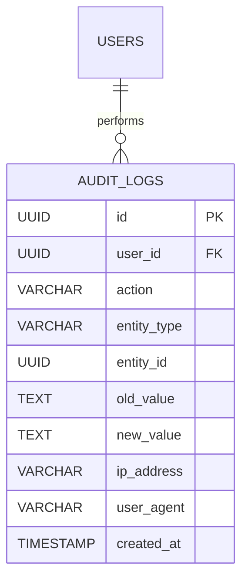

# Tài liệu Nghiệp vụ Module: Nhật ký Kiểm toán & Truy vết Hệ thống (Audit Log & Audit Trail)

> **Module Code:** `audit`  
> **Package:** `com.cyclosa.audit`  
> **Phiên bản:** 2.0 (Chuẩn hóa Backend Standards & Enterprise Compliance)  
> **Căn cứ pháp lý & Tiêu chuẩn:**  
> - **Tiêu chuẩn Quốc tế ISO/IEC 27001 & SOC 2:** Kiểm soát an toàn thông tin, toàn vẹn hệ thống và lưu vết truy cập dữ liệu nhạy cảm.  
> - **Nghị định 13/2023/NĐ-CP:** Bảo vệ dữ liệu cá nhân (Personal Data Protection) — bắt buộc lưu vết mọi thao tác truy xuất, chỉnh sửa, xóa bỏ thông tin nhân sự.  
> - **Bộ luật Lao động 2019:** Minh bạch hóa các quyết định hành chính (kỷ luật lao động, nâng lương, điều chuyển, chấm dứt hợp đồng).

---

## 1. Tôn chỉ Nghiệp vụ & Nguyên tắc Thiết kế (Core Principles)

Trong hệ thống quản trị nhân sự doanh nghiệp CYCLOSA HRM, module **Audit Log** đóng vai trò là "chiếc hộp đen" ghi nhận mọi biến động dữ liệu nhạy cảm, phục vụ thanh kiểm tra nội bộ, phát hiện gian lận và chứng minh tính hợp pháp của các quyết định nhân sự.

```
┌─────────────────────────────────┐
│     Business Modules (Caller)   │
│  - Payroll, Contract, Employee  │
│  - Leave, Discipline, Roles...  │
└────────────────┬────────────────┘
                 │
                 ├── 1. @Auditable Annotation (AOP Aspect)
                 ├── 2. AuditLogEvent (Spring Event Bus)
                 └── 3. AuditLogService.log(...) (Direct Call)
                 │
┌────────────────▼────────────────┐       ┌─────────────────────────┐
│    Module com.cyclosa.audit     │ ────> │   PostgreSQL Database   │
│  - Asynchronous Execution       │       │   - audit_logs (append) │
│  - Propagation.REQUIRES_NEW     │       │   - Immutable Log Store │
└─────────────────────────────────┘       └─────────────────────────┘
```

### 1.1. Tính Bất Biến Tuyệt Đối (Immutable / Append-Only)
- Bảng cơ sở dữ liệu `audit_logs` **chỉ cho phép thao tác `INSERT` và `SELECT`**.
- **Tuyệt đối cấm mọi hành vi `UPDATE` và `DELETE`**: Không một người dùng nào trong hệ thống (kể cả Super Admin, System Architect hay Database Administrator) được phép sửa hoặc xóa lịch sử log thông qua ứng dụng.
- Dữ liệu lưu vết là chứng cứ pháp lý cao nhất khi xảy ra tranh chấp lao động hoặc khiếu nại nội bộ.

### 1.2. Khả Năng Chịu Lỗi & Không Chặn Luồng Chính (Fault-Tolerant & Non-blocking)
- Toàn bộ tác vụ lưu vết kiểm toán được thực thi bất đồng bộ (`@Async`) hoặc chạy trong một Transaction vật lý độc lập tách biệt:
  ```java
  @Transactional(propagation = Propagation.REQUIRES_NEW)
  ```
- **Quy tắc Nuốt Lỗi An Toàn (Fail-Safe Principle):** Nếu việc ghi log gặp sự cố ngoài ý muốn (lỗi mạng DB, quá tải chuỗi JSON...), **nghiệp vụ chính của người dùng vẫn phải hoàn tất thành công bình thường**, tuyệt đối không để lỗi log làm rollback giao dịch nghiệp vụ cốt lõi.

### 1.3. Đóng Gói Kiến Trúc Modular Monolith & Chống N+1 Query
- Module `com.cyclosa.audit` hoạt động độc lập, không truy cập trực tiếp bảng `users` hay `employees`.
- Khi client truy vấn danh sách log kiểm toán, Service thu thập toàn bộ tập hợp `userIds` trong trang kết quả và thực hiện **Batch Enrichment** qua `userService.getUserSummaries(userIds)` để nạp thông tin người thực hiện (`UserSummary: username, fullName, email, avatarUrl`) chỉ với 1 query duy nhất.

### 1.4. Lưu Vết Chi Tiết Trước / Sau (Diff Tracking JSON)
- Cung cấp hai trường `old_value` và `new_value` dạng chuỗi JSON snapshot.
- Cho phép giao diện quản trị Frontend dễ dàng kết xuất bảng đối chiếu màu (Side-by-side Diff View) trực quan cho kiểm toán viên.

---

## 2. Mô hình Thực thể & CSDL Chi tiết (Database Schema)



### 2.1. Bảng `audit_logs` — Nhật Ký Kiểm Toán Toàn Hệ Thống

| Tên Cột | Kiểu Dữ Liệu | Ràng Buộc | Ý Nghĩa Nghiệp Vụ & Kỹ Thuật |
| :--- | :--- | :--- | :--- |
| `id` | `UUID` | `PK, NOT NULL` | Định danh duy nhất của bản ghi nhật ký kiểm toán. |
| `user_id` | `UUID` | `NULLABLE, INDEX` | ID tài khoản người dùng thực hiện thao tác (null nếu là tác vụ ngầm hệ thống). |
| `action` | `VARCHAR(50)` | `NOT NULL, INDEX` | Hành động chuẩn hóa: `CREATE`, `UPDATE`, `DELETE`, `APPROVE`, `REJECT`, `OVERRIDE`, `EXPORT`,... |
| `entity_type` | `VARCHAR(100)`| `NOT NULL, INDEX` | Tên loại thực thể nghiệp vụ: `CONTRACT`, `PAYROLL_RECORD`, `DISCIPLINE`, `EMPLOYEE`,... |
| `entity_id` | `UUID` | `NULLABLE, INDEX` | Khóa chính ID của đối tượng nghiệp vụ được thao tác. |
| `old_value` | `TEXT` | `NULLABLE` | Chuỗi JSON snapshot dữ liệu trước khi thay đổi (Diff tracking). |
| `new_value` | `TEXT` | `NULLABLE` | Chuỗi JSON snapshot dữ liệu sau khi thay đổi (Diff tracking). |
| `ip_address` | `VARCHAR(45)` | `NULLABLE` | Địa chỉ IP của máy khách gửi yêu cầu (hỗ trợ cả IPv4 và IPv6). |
| `user_agent` | `VARCHAR(500)`| `NULLABLE` | Thông tin trình duyệt, hệ điều hành và thiết bị của người thực hiện. |
| `created_at` | `TIMESTAMP` | `NOT NULL, INDEX` | Thời điểm ghi nhận thao tác (mặc định sắp xếp giảm dần `DESC`). |

* **Quy chuẩn Đánh Chỉ Mục (Index Optimization):**
  - Index đơn trên `created_at DESC`: Tối ưu hóa truy vấn xem log mới nhất theo phân trang.
  - Index đơn trên `user_id`: Tối ưu hóa lọc lịch sử thao tác của 1 nhân sự cụ thể.
  - Index kép trên `(entity_type, entity_id)`: Tối ưu hóa truy vấn dòng lịch sử của 1 bản ghi nghiệp vụ (Entity Audit Trail).

---

## 3. Các Luồng Nghiệp vụ Trọng tâm & Hướng dẫn Tích hợp (Business Workflows)

```mermaid
flowchart TD
    subgraph Client [Tác Nhân / Trình Duyệt]
        Req[Client gửi Request: Sửa lương, Duyệt phép, Xóa vai trò...]
    end

    subgraph BusinessLayer [Tầng Nghiệp Vụ Cốt Lõi]
        Ctrl[Business Controller]
        Svc[Business Service]
        DBMain[(PostgreSQL: Bảng Nghiệp Vụ)]
    end

    subgraph AuditEngine [Hạ Tầng com.cyclosa.audit]
        AOP[AuditLogAspect / @Auditable]
        EvtListener[AuditLogEventListener]
        AuditSvc[AuditLogServiceImpl]
        AuditRepo[AuditLogRepository]
        DBAudit[(Bảng audit_logs)]
    end

    Req --> Ctrl
    Ctrl --> Svc
    Svc --> DBMain

    %% Luồng 1
    Ctrl -.->|1. Intercept @Auditable| AOP
    AOP -.->|Async| AuditSvc

    %% Luồng 2
    Svc -.->|2. publishEvent(AuditLogEvent)| EvtListener
    EvtListener -.->|Async| AuditSvc

    %% Luồng 3
    Svc -.->|3. auditLogService.log(...)| AuditSvc

    AuditSvc -->|REQUIRES_NEW| AuditRepo
    AuditRepo --> DBAudit
```

### 3.1. Kênh 1: Sử dụng Annotation `@Auditable` (AOP Tự Động)
Phù hợp cho các API tạo mới, cập nhật trạng thái đơn giản hoặc xóa dữ liệu:
```java
@RestController
@RequestMapping("/api/v1/roles")
public class RoleController {

    @Auditable(action = "DELETE", entityType = "ROLE")
    @DeleteMapping("/{id}")
    @PreAuthorize("@perm.has('role.delete')")
    public ResponseEntity<ApiResponse<Void>> deleteRole(@PathVariable UUID id) {
        roleService.deleteRole(id);
        return ResponseEntity.ok(ApiResponse.noContent("Xóa vai trò thành công"));
    }
}
```
* **Cơ chế:** `AuditLogAspect` tự động bắt `userId` từ `SecurityContext`, trích xuất `ipAddress` và `userAgent` từ `HttpServletRequest` mà lập trình viên không cần viết mã thủ công.

---

### 3.2. Kênh 2: Bắn Domain Event `AuditLogEvent` (Event-Driven Decoupled)
Phù hợp khi muốn giảm thiểu tối đa sự phụ thuộc mã nguồn trực tiếp giữa các module:
```java
eventPublisher.publishEvent(AuditLogEvent.builder()
    .userId(currentUserId)
    .action("APPROVE")
    .entityType("LEAVE_REQUEST")
    .entityId(leaveId)
    .oldValue("{\"status\": \"PENDING\"}")
    .newValue("{\"status\": \"APPROVED\"}")
    .build()
);
```

---

### 3.3. Kênh 3: Gọi trực tiếp `AuditLogService` (Diff So sánh Chi tiết Trước / Sau)
Phù hợp cho các nghiệp vụ tài chính, sửa lương, can thiệp hợp đồng nhạy cảm:
```java
@Service
@RequiredArgsConstructor
public class PayrollServiceImpl implements PayrollService {

    private final AuditLogService auditLogService;

    @Transactional
    public void overrideSalary(UUID employeeId, BigDecimal oldSalary, BigDecimal newSalary) {
        // Thực hiện logic sửa lương...
        
        // Ghi nhật ký kiểm toán với JSON Diff
        UUID currentUserId = SecurityUtils.getCurrentUserId();
        auditLogService.log(
            currentUserId,
            "OVERRIDE",
            "EMPLOYEE_SALARY",
            employeeId,
            String.format("{\"salary\": %s}", oldSalary),
            String.format("{\"salary\": %s}", newSalary)
        );
    }
}
```

---

### 3.4. Bảng Tổng Hợp Các File Thành Phần Trong Module

| STT | Tên File & Đường Dẫn | Phân Loại | Vai Trò & Chức Năng Kỹ Thuật |
| :---: | :--- | :--- | :--- |
| 1 | [`AuditLog.java`](file:///f:/Project/CYCLOSA/cyclosa_be/src/main/java/com/cyclosa/audit/entity/AuditLog.java) | **Entity** | Ánh xạ bảng `audit_logs`, chứa đầy đủ thông tin lưu vết và audit trail. |
| 2 | [`AuditAction.java`](file:///f:/Project/CYCLOSA/cyclosa_be/src/main/java/com/cyclosa/audit/enums/AuditAction.java) | **Enum** | Danh mục chuẩn các hành động: `CREATE`, `UPDATE`, `DELETE`, `APPROVE`, `REJECT`, `OVERRIDE`, `EXPORT`,... |
| 3 | [`AuditLogRepository.java`](file:///f:/Project/CYCLOSA/cyclosa_be/src/main/java/com/cyclosa/audit/repository/AuditLogRepository.java) | **Repository** | Cung cấp truy vấn động đa tiêu chí và hàm truy vấn theo thực thể: `findByEntityTypeAndEntityIdOrderByCreatedAtDesc`. |
| 4 | [`AuditLogCommand.java`](file:///f:/Project/CYCLOSA/cyclosa_be/src/main/java/com/cyclosa/audit/dto/request/AuditLogCommand.java) | **DTO Request** | Đóng gói tham số đầu vào khi ghi log qua Service nội bộ. |
| 5 | [`AuditLogFilter.java`](file:///f:/Project/CYCLOSA/cyclosa_be/src/main/java/com/cyclosa/audit/dto/request/AuditLogFilter.java) | **DTO Request** | Kế thừa `BaseFilterRequest`, nhận tiêu chí lọc (`page`, `size`, `action`, `entityType`, `fromDate`, `toDate`). |
| 6 | [`AuditLogResponse.java`](file:///f:/Project/CYCLOSA/cyclosa_be/src/main/java/com/cyclosa/audit/dto/response/AuditLogResponse.java) | **DTO Response** | Trả về danh sách log, áp dụng chuẩn Nested `UserSummary` nạp thông tin người thao tác dạng batch. |
| 7 | [`AuditLogDetailResponse.java`](file:///f:/Project/CYCLOSA/cyclosa_be/src/main/java/com/cyclosa/audit/dto/response/AuditLogDetailResponse.java) | **DTO Response** | Trả về chi tiết 1 bản ghi log, kèm `oldValue`, `newValue` và `userAgent`. |
| 8 | [`AuditLogEvent.java`](file:///f:/Project/CYCLOSA/cyclosa_be/src/main/java/com/cyclosa/audit/event/AuditLogEvent.java) | **Domain Event** | Đối tượng sự kiện chuyển phát qua Spring ApplicationEventPublisher. |
| 9 | [`AuditLogEventListener.java`](file:///f:/Project/CYCLOSA/cyclosa_be/src/main/java/com/cyclosa/audit/listener/AuditLogEventListener.java) | **Listener** | Lắng nghe `AuditLogEvent` trong background thread (`@Async`) và ghi DB. |
| 10 | [`AuditLogMapper.java`](file:///f:/Project/CYCLOSA/cyclosa_be/src/main/java/com/cyclosa/audit/mapper/AuditLogMapper.java) | **Mapper** | MapStruct chuyển đổi giữa Command/Event sang Entity và Entity sang Response. |
| 11 | [`Auditable.java`](file:///f:/Project/CYCLOSA/cyclosa_be/src/main/java/com/cyclosa/audit/aop/Auditable.java) | **Annotation** | Đánh dấu lên method controller/service cần tự động bắt log. |
| 12 | [`AuditLogAspect.java`](file:///f:/Project/CYCLOSA/cyclosa_be/src/main/java/com/cyclosa/audit/aop/AuditLogAspect.java) | **AOP Aspect** | Can thiệp phương thức có `@Auditable` để thu thập context và ghi log. |
| 13 | [`AuditLogService.java`](file:///f:/Project/CYCLOSA/cyclosa_be/src/main/java/com/cyclosa/audit/service/AuditLogService.java) | **Service Contract** | Khai báo các phương thức nghiệp vụ lưu vết và tra cứu nhật ký kiểm toán. |
| 14 | [`AuditLogServiceImpl.java`](file:///f:/Project/CYCLOSA/cyclosa_be/src/main/java/com/cyclosa/audit/service/impl/AuditLogServiceImpl.java) | **Service Impl** | Thực thi logic với `REQUIRES_NEW`, try-catch an toàn và nạp batch `UserSummary`. |
| 15 | [`AuditLogController.java`](file:///f:/Project/CYCLOSA/cyclosa_be/src/main/java/com/cyclosa/audit/controller/AuditLogController.java) | **Controller** | Cung cấp RESTful API tra cứu nhật ký cho Kiểm toán viên và Super Admin. |

---

## 4. Danh mục RESTful API Chi tiết

Base URI: `/api/v1/audit-logs`

| HTTP Method | Endpoint URI | Phân Quyền (@PreAuthorize) | DTO Request / Response | Chức Năng Nghiệp Vụ |
| :---: | :--- | :--- | :--- | :--- |
| `GET` | `/` | `@perm.has('audit.view')` | `AuditLogFilter` $\rightarrow$ `ApiResponse<PageData<AuditLogResponse>>` | Tra cứu danh sách nhật ký kiểm toán (phân trang, lọc theo keyword, user, action, entity, ngày). |
| `GET` | `/{id}` | `@perm.has('audit.view')` | Path `id` $\rightarrow$ `ApiResponse<AuditLogDetailResponse>` | Xem chi tiết 1 bản ghi log (gồm diff `old_value`, `new_value`, thiết bị `userAgent`). |
| `GET` | `/entity/{entityType}/{entityId}` | `@perm.has('audit.view')` | Path `entityType, entityId` $\rightarrow$ `ApiResponse<PageData<AuditLogResponse>>` | Lấy toàn bộ dòng lịch sử thay đổi của một bản ghi nghiệp vụ cụ thể (Audit Trail). |

---

## 5. Danh mục Mã lỗi & Cơ chế Chịu lỗi (Error Handling)

### 5.1. Bảng Xử Lý Lỗi API
| Mã Lỗi (Code) | HTTP Status | Thông Điệp Tiếng Việt | Nguyên Nhân & Ngữ Cảnh Kích Hoạt |
| :--- | :---: | :--- | :--- |
| `AUDIT_LOG_NOT_FOUND` | `404 Not Found` | Không tìm thấy bản ghi nhật ký kiểm toán được chỉ định | `id` bản ghi log không tồn tại trong bảng `audit_logs`. |
| `FORBIDDEN_AUDIT_ACCESS` | `403 Forbidden` | Bạn không có quyền truy cập nhật ký kiểm toán của hệ thống | Người dùng không sở hữu quyền `audit.view`. |

### 5.2. Cơ Chế Fail-Safe Khi Ghi Log (Nuốt Lỗi An Toàn)
- Trong `AuditLogServiceImpl`, phương thức `log(...)` được bọc khối `try - catch (Exception e)` toàn diện và ghi log cảnh báo (`log.warn(...)` / `log.error(...)`).
- Không cho phép ngoại lệ ghi log lan truyền làm gián đoạn transaction của người dùng.

---

## 6. Phân bổ Quyền Hạn & Ma trận Vai trò (RBAC Matrix)

| Mã Quyền (Permission) | Mô Tả Hành Động | Super Admin | Auditor / Compliance | HR Admin | Dept Manager | Employee |
| :--- | :--- | :---: | :---: | :---: | :---: | :---: |
| `audit.view` | Truy vấn danh sách, xem chi tiết và dòng lịch sử audit trail toàn hệ thống | **FULL** | **FULL** | ⛔ | ⛔ | ⛔ |
| `audit.export` | Xuất báo cáo dữ liệu nhật ký kiểm toán phục vụ thanh kiểm tra định kỳ | **FULL** | **FULL** | ⛔ | ⛔ | ⛔ |
