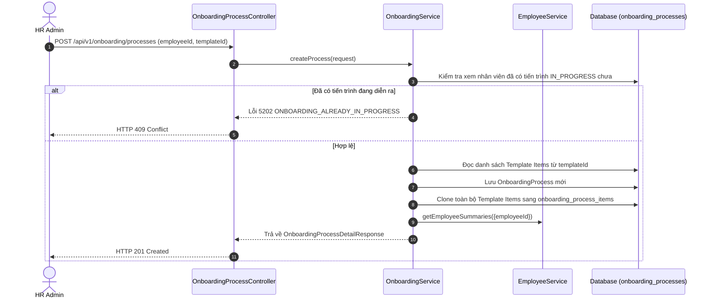

# Tài liệu Nghiệp vụ Module 03: Hội nhập Nhân sự (Onboarding Management)

> **Module Code:** `onboarding`  
> **Package:** `com.cyclosa.onboarding`  
> **Phiên bản:** 2.0 (Chuẩn hóa Backend Standards & Automation)  
> **Căn cứ nghiệp vụ & Thiết kế:**  
> - **Chuyển tiếp Vòng đời Tuyển dụng - Tiếp nhận:** Tự động khởi tạo tiến trình Onboarding khi ứng viên trúng tuyển (`Convert to Employee`).  
> - **Tiêu chuẩn Hóa Quy trình Đầu Việc (Checklist Template):** Cấu hình danh mục việc cần làm theo từng phòng ban và vị trí việc làm.  
> - **Tích hợp Liên Module & Tự động Kích hoạt:** Kiểm tra chéo cấp phát tài sản (`asset`), tài khoản IT (`account_provisioning`), số hóa hồ sơ pháp lý (`employee_documents`) và tự động chuyển nhân viên từ `PROBATION` sang `ACTIVE`.

---

## 1. Tôn chỉ Nghiệp vụ & Nguyên tắc Thiết kế (Core Principles)

Trong hệ sinh thái **CYCLOSA HRM**, **Hội nhập Nhân sự (Onboarding)** đóng vai trò mắt xích chiến lược giữa giai đoạn Tuyển dụng và Làm việc chính thức của nhân sự:

```
[ Tuyển dụng (Recruitment) ]
         │ (Ứng viên trúng tuyển / Convert to Employee)
         ▼
[ Hồ sơ nhân sự: PROBATION ]
         │ (Khởi tạo Onboarding Process)
         ▼
[ ONBOARDING WORKFLOW ] ◄── Cấp phát thiết bị (Asset Module)
  ├─ 1. Thu thập & Thẩm định giấy tờ hồ sơ
  ├─ 2. Đề nghị IT cấp tài khoản & hòm thư
  ├─ 3. Đào tạo định hướng văn hóa & quy định
  └─ 4. Bàn giao trang thiết bị & tiếp nhận vị trí
         │ (100% việc bắt buộc hoàn tất)
         ▼
[ Kích hoạt tự động: ACTIVE ] ──► Chấm công, HĐLĐ & Tính lương
```

### 1.1. Chuẩn hóa Thiết kế Không dùng Interface + Impl thừa thãi (Concrete Service Pattern)
Theo chuẩn kiến trúc tại `docs/BACKEND_STANDARDS.md`:
- Toàn bộ service của module được viết trực tiếp dưới dạng **Concrete Service**:
  - `OnboardingService.java`: Service trung tâm duy nhất xử lý khởi tạo tiến trình, thực hiện đầu việc, cấp phát tài khoản, điều phối lịch đào tạo và nghiệm thu kích hoạt nhân viên.
- **Tuyệt đối không tạo thư mục `impl/`** hay interface 1-1 hình thức.

### 1.2. Đóng gói Kiến trúc Modular Monolith & Giao tiếp Liên Module
1. **Lấy dữ liệu hạ tầng qua Public Service của module lân cận:**
   - `EmployeeService`: `getEmployeeByIdInternal`, `updateEmploymentStatus`, `getEmployeeSummaries`.
   - `OrganizationalUnitService` & `PositionService`: nạp thông tin tóm tắt đơn vị và chức danh (`getUnitSummaries`, `getPositionSummaries`).
   - `AssetService`: lấy danh sách trang thiết bị đã được bàn giao cho nhân viên mới (`getEmployeeAssets`).
2. **Không inject Repository của module khác**, không truy cập trực tiếp Entity module khác.
3. **Batch Enrichment chống N+1 Query:** Khi trả về danh sách tiến trình (`PageData<OnboardingProcessResponse>`), gom `Set<UUID>` và gọi hàm batch 1 lần để map vào `EmployeeSummary`, `PositionSummary`, `OrgUnitSummary`.

### 1.3. Tự Động Hóa Kích Hoạt Nhân Viên (Clear-to-Active Automation)
- Khi 100% các hạng mục bắt buộc (`is_required = true`) trong tiến trình Onboarding được đánh dấu hoàn thành:
  - Hệ thống cho phép HR thực hiện nghiệm thu (`completeProcess`).
  - Tự động gọi `employeeService.updateEmploymentStatus(employeeId, EmploymentStatus.ACTIVE)` chuyển nhân viên sang làm việc chính thức.
- **Ràng buộc tiến trình độc quyền:** Mỗi nhân viên chỉ được phép có **tối đa một tiến trình Onboarding đang hoạt động** (`5202 ONBOARDING_ALREADY_IN_PROGRESS`).

### 1.4. Thẩm Định Hồ Sơ & Cấp Phát Tài Khoản IT (Cross-Validation Guard)
- **Hạng mục `ACCOUNT`:** Không thể đánh dấu hoàn thành nếu hệ thống chưa ghi nhận tài khoản IT tương ứng ở trạng thái `PROVISIONED` (`5207 ACCOUNT_NOT_PROVISIONED_YET`).
- **Hạng mục `DOCUMENT`:** Tài liệu giấy tờ nhân thân tải lên (CCCD, bằng cấp, chứng chỉ) phải được HR thẩm định (`is_verified = true`) trước khi chốt hồ sơ.

---

## 2. Mô hình Thực thể & CSDL Chi tiết (Database Schema)

```mermaid
erDiagram
    COMPANIES ||--o{ ONBOARDING_CHECKLIST_TEMPLATES : "sở hữu"
    ONBOARDING_CHECKLIST_TEMPLATES ||--o{ ONBOARDING_CHECKLIST_TEMPLATE_ITEMS : "chứa"
    EMPLOYEES ||--o{ ONBOARDING_PROCESSES : "trải qua"
    ONBOARDING_PROCESSES ||--o{ ONBOARDING_PROCESS_ITEMS : "thực thi"
    ONBOARDING_PROCESSES ||--o{ ACCOUNT_PROVISIONING : "yêu cầu"
    ONBOARDING_PROCESSES ||--o{ ORIENTATION_SESSIONS : "tham gia"
    EMPLOYEES ||--o{ EMPLOYEE_DOCUMENTS : "nộp"

    ONBOARDING_CHECKLIST_TEMPLATES {
        UUID id PK
        UUID company_id FK
        VARCHAR template_name
        TEXT description
        UUID applicable_department_id FK
        UUID applicable_position_id FK
        BOOLEAN is_default
        TIMESTAMP deleted_at
    }

    ONBOARDING_CHECKLIST_TEMPLATE_ITEMS {
        UUID id PK
        UUID template_id FK
        VARCHAR title
        VARCHAR category
        INT order_index
        BOOLEAN is_required
    }

    ONBOARDING_PROCESSES {
        UUID id PK
        UUID company_id FK
        UUID employee_id FK
        UUID checklist_template_id FK
        VARCHAR status
        DATE start_date
        DATE target_completion_date
        TIMESTAMP completed_at
        TEXT notes
        TIMESTAMP deleted_at
    }

    ONBOARDING_PROCESS_ITEMS {
        UUID id PK
        UUID onboarding_process_id FK
        UUID template_item_id FK
        VARCHAR title
        VARCHAR category
        INT order_index
        BOOLEAN is_required
        VARCHAR status
        UUID completed_by_employee_id FK
        TIMESTAMP completed_at
        TEXT note
    }

    ACCOUNT_PROVISIONING {
        UUID id PK
        UUID company_id FK
        UUID onboarding_process_id FK
        UUID employee_id FK
        VARCHAR system_name
        VARCHAR account_username
        VARCHAR status
        UUID provisioned_by_employee_id FK
        TIMESTAMP provisioned_at
        TIMESTAMP revoked_at
    }

    ORIENTATION_SESSIONS {
        UUID id PK
        UUID company_id FK
        UUID onboarding_process_id FK
        VARCHAR session_name
        TEXT description
        VARCHAR location
        TIMESTAMP scheduled_at
        UUID trainer_employee_id FK
        VARCHAR status
    }

    EMPLOYEE_DOCUMENTS {
        UUID id PK
        UUID company_id FK
        UUID employee_id FK
        VARCHAR document_type
        VARCHAR document_name
        VARCHAR file_url
        BIGINT file_size
        BOOLEAN is_verified
        UUID verified_by_employee_id FK
        TIMESTAMP verified_at
        TIMESTAMP deleted_at
    }
```



### 2.1. Bảng `onboarding_processes` — Tiến Trình Hội Nhập
| Tên Cột | Kiểu Dữ Liệu | Ràng Buộc | Ý Nghĩa Nghiệp Vụ |
| :--- | :--- | :--- | :--- |
| `id` | `UUID` | `PK, NOT NULL` | Định danh duy nhất tiến trình Onboarding. |
| `company_id` | `UUID` | `NOT NULL, INDEX` | Công ty sở hữu tiến trình. |
| `employee_id` | `UUID` | `NOT NULL, INDEX` | Nhân viên mới tiếp nhận (FK `employees`). |
| `checklist_template_id`| `UUID` | `NOT NULL, FK` | Mẫu Checklist áp dụng. |
| `status` | `VARCHAR(30)` | `NOT NULL` | Trạng thái: `IN_PROGRESS`, `COMPLETED`, `CANCELLED`. |
| `start_date` | `DATE` | `NOT NULL` | Ngày bắt đầu tiến trình hội nhập. |
| `target_completion_date`| `DATE`| `NULLABLE` | Hạn chót dự kiến hoàn thành. |
| `completed_at` | `TIMESTAMP` | `NULLABLE` | Thời điểm nghiệm thu hoàn thành 100%. |

---

### 2.2. Bảng `onboarding_process_items` — Chi Tiết Hạng Mục Đầu Việc
| Tên Cột | Kiểu Dữ Liệu | Ràng Buộc | Ý Nghĩa Nghiệp Vụ |
| :--- | :--- | :--- | :--- |
| `id` | `UUID` | `PK, NOT NULL` | Định danh hạng mục đầu việc. |
| `onboarding_process_id`| `UUID` | `NOT NULL, FK` | Tiến trình trực thuộc. |
| `title` | `VARCHAR(250)` | `NOT NULL` | Tiêu đề công việc cần làm. |
| `category` | `VARCHAR(30)` | `NOT NULL` | Phân loại: `DOCUMENT`, `ACCOUNT`, `ASSET`, `ORIENTATION`, `OTHER`. |
| `order_index` | `INT` | `NOT NULL` | Thứ tự ưu tiên thực hiện. |
| `is_required` | `BOOLEAN` | `NOT NULL` | Cờ bắt buộc phải hoàn tất trước khi nghiệm thu. |
| `status` | `VARCHAR(30)` | `NOT NULL` | Trạng thái: `PENDING`, `COMPLETED`, `SKIPPED`. |
| `completed_by_employee_id` | `UUID` | `NULLABLE` | Nhân sự (HR/IT/Manager) xác nhận hoàn thành. |
| `completed_at` | `TIMESTAMP` | `NULLABLE` | Thời điểm xác nhận hoàn tất. |

---

## 3. Các Luồng Nghiệp vụ Trọng tâm (Business Workflows)

### 3.1. Luồng Khởi Tạo Tiến Trình & Nhân Bản Checklist (F1: Initialize Process)


---

### 3.2. Luồng Nghiệm Thu & Tự Động Kích Hoạt Nhân Sự (F2: Complete & Active)
1. HR hoặc Người phụ trách gọi: `PUT /api/v1/onboarding/processes/{id}/complete`.
2. Hệ thống kiểm tra:
   - Toàn bộ các hạng mục có `is_required = true` phải ở trạng thái `COMPLETED` (`5208 REQUIRED_ITEMS_NOT_COMPLETED`).
   - Các tài khoản IT bắt buộc phải ở trạng thái `PROVISIONED`.
3. Nếu hợp lệ:
   - Cập nhật tiến trình `status = COMPLETED` và lưu `completed_at = NOW()`.
   - Tự động gọi `employeeService.updateEmploymentStatus(employeeId, ACTIVE)` kích hoạt nhân viên.
   - Bắn thông báo chúc mừng gia nhập tổ chức tới nhân viên và trưởng phòng ban.

---

## 4. Danh mục RESTful API Chi tiết

Base URI: `/api/v1/onboarding`

| HTTP Method | Endpoint URI | Phân Quyền (@PreAuthorize) | DTO Request / Response | Chức Năng Nghiệp Vụ |
| :---: | :--- | :--- | :--- | :--- |
| `POST` | `/templates` | `@perm.has('onboarding.template.create')` | `CreateTemplateRequest` $\rightarrow$ `ApiResponse<TemplateResponse>` | Tạo mới mẫu Checklist hội nhập. |
| `GET` | `/templates` | `@perm.has('onboarding.template.view')` | `TemplateFilter` $\rightarrow$ `ApiResponse<PageData<TemplateResponse>>` | Danh sách mẫu Checklist (phân trang + lọc). |
| `GET` | `/templates/{id}` | `@perm.has('onboarding.template.view')` | Path `id` $\rightarrow$ `ApiResponse<TemplateDetailResponse>` | Chi tiết mẫu Checklist kèm danh sách items. |
| `PUT` | `/templates/{id}` | `@perm.has('onboarding.template.manage')`| `UpdateTemplateRequest` $\rightarrow$ `ApiResponse<TemplateResponse>` | Cập nhật thông tin mẫu Checklist. |
| `DELETE` | `/templates/{id}` | `@perm.has('onboarding.template.manage')`| Path `id` $\rightarrow$ `ApiResponse<Void>` | Xóa mềm mẫu Checklist. |
| `POST` | `/templates/{id}/items` | `@perm.has('onboarding.template.manage')`| `CreateTemplateItemRequest` $\rightarrow$ `ApiResponse<Void>` | Thêm hạng mục đầu việc vào Template. |
| `POST` | `/processes` | `@perm.has('onboarding.process.create')` | `CreateProcessRequest` $\rightarrow$ `ApiResponse<ProcessResponse>` | Khởi tạo tiến trình Onboarding cho nhân sự mới. |
| `GET` | `/processes` | `@perm.has('onboarding.process.view')` | `ProcessFilter` $\rightarrow$ `ApiResponse<PageData<ProcessResponse>>` | Danh sách tiến trình Onboarding (lọc, phân trang). |
| `GET` | `/processes/{id}` | `@perm.has('onboarding.process.view')` | Path `id` $\rightarrow$ `ApiResponse<ProcessDetailResponse>` | Chi tiết tiến trình (tiến độ, items, tài sản, tài khoản). |
| `PUT` | `/processes/items/{itemId}/complete` | `@perm.has('onboarding.process.manage')`| `CompleteItemRequest` $\rightarrow$ `ApiResponse<Void>` | Đánh dấu hoàn thành một hạng mục đầu việc. |
| `PUT` | `/processes/{id}/complete` | `@perm.has('onboarding.process.manage')`| Path `id` $\rightarrow$ `ApiResponse<Void>` | Nghiệm thu hoàn tất Onboarding (Kích hoạt `ACTIVE`). |
| `PUT` | `/processes/{id}/cancel` | `@perm.has('onboarding.process.manage')`| Path `id` $\rightarrow$ `ApiResponse<Void>` | Hủy tiến trình Onboarding. |
| `POST` | `/processes/{id}/accounts` | `@perm.has('onboarding.account.manage')`| `CreateAccountRequest` $\rightarrow$ `ApiResponse<AccountResponse>` | Đăng ký cấp phát tài khoản IT cho nhân viên mới. |
| `PUT` | `/processes/accounts/{id}/status` | `@perm.has('onboarding.account.manage')`| `UpdateAccountStatusRequest` $\rightarrow$ `ApiResponse<Void>` | Cập nhật trạng thái cấp phát tài khoản IT. |
| `POST` | `/sessions` | `@perm.has('onboarding.session.create')` | `CreateSessionRequest` $\rightarrow$ `ApiResponse<SessionResponse>` | Lên lịch buổi đào tạo hội nhập văn hóa. |
| `GET` | `/sessions` | `@perm.has('onboarding.session.view')` | `SessionFilter` $\rightarrow$ `ApiResponse<PageData<SessionResponse>>` | Danh sách các buổi đào tạo định hướng. |
| `PUT` | `/sessions/{id}` | `@perm.has('onboarding.session.manage')` | `UpdateSessionRequest` $\rightarrow$ `ApiResponse<SessionResponse>` | Cập nhật thông tin/trạng thái buổi đào tạo. |
| `POST` | `/documents/employees/{employeeId}` | `@perm.has('onboarding.document.upload')`| Multipart `file` $\rightarrow$ `ApiResponse<DocumentResponse>` | Tải lên tài liệu hồ sơ nhân sự số hóa. |
| `GET` | `/documents/employees/{employeeId}` | `@perm.has('onboarding.document.view')` | Path `employeeId` $\rightarrow$ `ApiResponse<List<DocumentResponse>>` | Xem danh mục tài liệu số hóa của nhân viên. |
| `PUT` | `/documents/{id}/verify` | `@perm.has('onboarding.document.verify')`| Path `id` $\rightarrow$ `ApiResponse<Void>` | Thẩm định & xác thực tính pháp lý của hồ sơ. |

---

## 5. Danh mục Mã lỗi Module Onboarding (`OnboardingErrorCode`)

| Mã Lỗi (Enum) | Mã Số | HTTP Status | Thông Điệp Tiếng Việt | Nguyên Nhân & Ngữ Cảnh Kích Hoạt |
| :--- | :---: | :---: | :--- | :--- |
| `ONBOARDING_PROCESS_NOT_FOUND` | **5201** | `404 Not Found` | Không tìm thấy tiến trình onboarding | `process_id` không tồn tại trong hệ thống. |
| `ONBOARDING_ALREADY_IN_PROGRESS` | **5202** | `409 Conflict` | Nhân viên đã có quy trình onboarding đang diễn ra | Nhân viên đã có 1 tiến trình ở trạng thái `IN_PROGRESS`. |
| `CHECKLIST_TEMPLATE_NOT_FOUND` | **5203** | `404 Not Found` | Không tìm thấy mẫu danh sách onboarding | `template_id` không tồn tại trong kho mẫu. |
| `PROCESS_ITEM_NOT_FOUND` | **5204** | `404 Not Found` | Không tìm thấy hạng mục công việc onboarding | `item_id` không nằm trong tiến trình Onboarding. |
| `ONBOARDING_PROCESS_CLOSED` | **5205** | `422 Unprocessable` | Quy trình onboarding đã kết thúc hoặc bị hủy, không thể chỉnh sửa | Cập nhật task trên tiến trình đã `COMPLETED` hoặc `CANCELLED`. |
| `ITEM_ALREADY_COMPLETED` | **5206** | `422 Unprocessable` | Hạng mục công việc đã được hoàn thành trước đó | Thao tác complete lại trên item đã `COMPLETED`. |
| `ACCOUNT_NOT_PROVISIONED_YET` | **5207** | `422 Unprocessable` | Cần cấp phát tài khoản tương ứng ở trạng thái đã cấp (PROVISIONED) trước khi hoàn thành | Hoàn thành task Account khi IT chưa cấp tài khoản. |
| `REQUIRED_ITEMS_NOT_COMPLETED` | **5208** | `422 Unprocessable` | Các hạng mục bắt buộc chưa hoàn thành đầy đủ | Nghiệm thu tiến trình khi còn item bắt buộc `PENDING`. |
| `ACCOUNT_PROVISIONING_NOT_FOUND`| **5209** | `404 Not Found` | Không tìm thấy thông tin cấp phát tài khoản | `account_id` không tồn tại trong hệ thống. |
| `ORIENTATION_SESSION_NOT_FOUND` | **5210** | `404 Not Found` | Không tìm thấy buổi đào tạo định hướng | `session_id` không tồn tại trong hệ thống. |
| `EMPLOYEE_DOCUMENT_NOT_FOUND` | **5211** | `404 Not Found` | Không tìm thấy tài liệu hồ sơ nhân viên | `document_id` không tồn tại trong CSDL. |
| `TEMPLATE_ITEM_NOT_FOUND` | **5212** | `404 Not Found` | Không tìm thấy hạng mục trong mẫu checklist | `template_item_id` không tồn tại trong mẫu. |
| `ONBOARDING_CANNOT_CANCEL` | **5213** | `400 Bad Request` | Quy trình onboarding đã hoàn thành, không thể hủy | Cố gắng gọi API cancel trên tiến trình đã nghiệm thu. |

---

## 6. Phân bổ Quyền Hạn & Ma trận Vai trò (RBAC Matrix)

| Mã Quyền (Permission) | Mô Tả Hành Động | Super Admin | HR Admin | IT Support | Dept Manager | Employee |
| :--- | :--- | :---: | :---: | :---: | :---: | :---: |
| `onboarding.template.view` | Xem danh sách & chi tiết mẫu Checklist | **FULL** | **FULL** | ⛔ | **VIEW ONLY** | ⛔ |
| `onboarding.template.create`| Tạo mới mẫu Checklist hội nhập | **FULL** | **FULL** | ⛔ | ⛔ | ⛔ |
| `onboarding.template.manage`| Cập nhật, xóa mẫu Checklist và thêm item | **FULL** | **FULL** | ⛔ | ⛔ | ⛔ |
| `onboarding.process.view` | Theo dõi tiến độ hội nhập của nhân sự mới | **FULL** | **FULL** | **VIEW** | **DEPT ONLY** | **SELF ONLY** |
| `onboarding.process.create` | Khởi tạo tiến trình Onboarding cho nhân viên | **FULL** | **FULL** | ⛔ | ⛔ | ⛔ |
| `onboarding.process.manage` | Đánh dấu hoàn thành việc, nghiệm thu kích hoạt | **FULL** | **FULL** | ⛔ | **Duyệt việc** | ⛔ |
| `onboarding.account.manage` | Đăng ký & cập nhật trạng thái cấp tài khoản IT | **FULL** | **FULL** | **FULL** | ⛔ | ⛔ |
| `onboarding.session.view` | Xem lịch các buổi đào tạo định hướng | **FULL** | **FULL** | ⛔ | **FULL** | **SELF ONLY** |
| `onboarding.session.create` | Lên lịch lớp học định hướng văn hóa | **FULL** | **FULL** | ⛔ | ⛔ | ⛔ |
| `onboarding.session.manage` | Cập nhật trạng thái và điểm danh buổi học | **FULL** | **FULL** | ⛔ | **Giảng viên** | ⛔ |
| `onboarding.document.upload`| Tải lên tài liệu hồ sơ cá nhân | **FULL** | **FULL** | ⛔ | ⛔ | **SELF ONLY** |
| `onboarding.document.view` | Xem danh mục tài liệu hồ sơ số hóa | **FULL** | **FULL** | ⛔ | **DEPT ONLY** | **SELF ONLY** |
| `onboarding.document.verify`| Thẩm định & xác thực tính pháp lý của hồ sơ | **FULL** | **FULL** | ⛔ | ⛔ | ⛔ |
