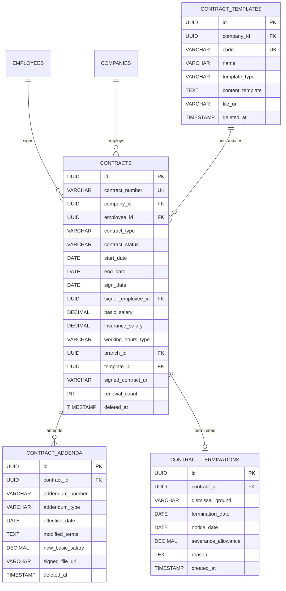
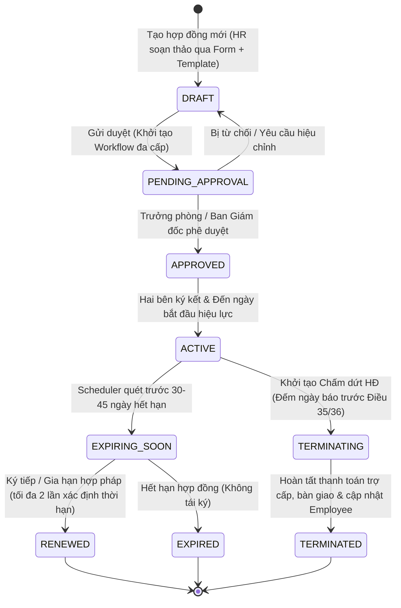

# Tài liệu Nghiệp vụ Module 05: Quản lý Hợp đồng Lao động (Contract Management & Legal Compliance)

> **Module Code:** `contract`  
> **Package:** `com.cyclosa.contract`  
> **Phiên bản:** 2.0 (Chuẩn hóa Backend Standards & Legal Automation)  
> **Căn cứ pháp lý:**  
> - **Bộ luật Lao động 2019** (Luật số 45/2019/QH14) — Chương III: Hợp đồng lao động (Điều 13 đến Điều 51).  
> - **Nghị định 145/2020/NĐ-CP:** Quy định chi tiết điều kiện lao động, quan hệ lao động, tiền trợ cấp thôi việc & mất việc làm.  
> - **Luật Bảo hiểm Xã hội 2014 & Luật Việc làm 2013:** Mức lương đóng BHXH bắt buộc, thời gian tham gia BHTN.  
> - **Nghị định số 74/2024/NĐ-CP:** Mức lương tối thiểu vùng theo địa bàn chi nhánh làm việc.

---

## 1. Tôn chỉ Nghiệp vụ & Nguyên tắc Thiết kế (Core Principles)

Trong hệ sinh thái **CYCLOSA HRM**, **Hợp đồng Lao động (HĐLĐ)** là cơ sở pháp lý cao nhất ràng buộc quyền lợi và nghĩa vụ giữa Người sử dụng lao động (NSDLĐ) và Người lao động (NLĐ).

```
┌─────────────────────────┐       ┌────────────────────────────────┐       ┌─────────────────────────┐
│   Module 04: Employee   │       │  Module 05: Contract           │       │  Module 08: Payroll     │
│  - Nhân viên tiếp nhận  │ ────> │  - Hợp đồng lao động, Phụ lục  │ ────> │  - Lương cơ bản đóng BH │
│  - Vị trí, Chi nhánh    │       │  - Thẩm định cứng BLLĐ 2019    │       │  - Trợ cấp thôi việc    │
└─────────────────────────┘       │  - Template Mail-Merge & E-Sign│       └─────────────────────────┘
                                  └────────────────────────────────┘
```

### 1.1. Chuẩn hóa Thiết kế Không dùng Interface + Impl thừa thãi (Concrete Service Pattern)
Theo chuẩn kiến trúc tại `docs/BACKEND_STANDARDS.md`:
- Toàn bộ service của module được viết trực tiếp dưới dạng **Concrete Service**:
  - `ContractService.java`: Service trung tâm duy nhất quản lý vòng đời hợp đồng, phụ lục, gia hạn, chấm dứt và tích hợp nghiệp vụ.
  - `ContractTemplateService.java`: Quản lý kho mẫu hợp đồng động và cơ chế Mail-Merge.
  - `ContractScheduler.java`: Job quét định kỳ hằng ngày lúc **01:30 AM** để phát hiện hợp đồng sắp hết hạn (30-45 ngày) và tự động chuyển đổi hợp đồng sau 30 ngày (Điều 20.2.b).
  - `ContractLegalValidator.java`: Bộ thẩm định độc lập chặn cứng các vi phạm pháp luật lao động.
- **Tuyệt đối không tạo thư mục `impl/`** hay interface 1-1 hình thức.

### 1.2. Đóng gói Kiến trúc Modular Monolith & Giao tiếp Liên Module
1. **Lấy dữ liệu hạ tầng qua Public Service của module lân cận:**
   - `EmployeeService`: `getEmployeeByIdInternal`, `getEmployeeSummaries`, `updateEmploymentStatus` — xác thực nhân viên, người ký, cập nhật trạng thái làm việc khi HĐ kích hoạt hoặc chấm dứt.
   - `PositionService` & `JobLevelService`: nạp chức danh, cấp bậc để đối chiếu thời hạn thử việc tối đa (Điều 25).
   - `LeaveRequestService`: kiểm tra xem nhân viên có đang nghỉ ốm, thai sản (Điều 37) khi NSDLĐ đơn phương chấm dứt.
2. **Batch Enrichment chống N+1 Query:** Mọi API danh sách gom `Set<UUID>` (`employeeIds`, `signerIds`, `companyIds`) và nạp batch dạng `EmployeeSummary`.

### 1.3. Nguyên Tắc Bắt Buộc: Hard Validation (Chặn Cứng Pháp Lý)
> [!CAUTION]
> **Hệ thống PHẢI CHẶN CỨNG mọi thao tác vi phạm quy định của pháp luật lao động Việt Nam, TUYỆT ĐỐI KHÔNG CHỈ DỪNG Ở MỨC CẢNH BÁO (WARNING)**. Mọi hành vi nhập sai thời hạn, lương dưới chuẩn, gia hạn quá số lần quy định hoặc chấm dứt sai thủ tục đều phải trả về lỗi HTTP 422 hoặc 409 kèm mã lỗi pháp lý `ContractErrorCode` cụ thể.

### 1.4. Template Engine Động & Tự Động Hóa Giám Sát Hiệu Lực
- Áp dụng cơ chế **Template Variable Engine + Mail-Merge** với các biến chuẩn `{{employee_name}}`, `{{basic_salary}}`, `{{basic_salary_words}}` để sinh văn bản PDF/DOCX chuẩn A4 khóa sửa tự do.
- Scheduler giám sát tự động cảnh báo trước 30-45 ngày và hỗ trợ chuyển đổi tự động nếu quá 30 ngày vẫn phát sinh ngày công thực tế.

---

## 2. Tuân thủ Bộ Luật Lao Động 2019 & Mô hình CSDL Chi tiết

### 2.1. Phân loại Loại Hợp đồng Hợp pháp (Điều 20 BLLĐ 2019)
Hệ thống chỉ hỗ trợ **02 loại HĐLĐ chính thức**:

| Loại Hợp đồng | Ký hiệu Enum | Thời hạn hiệu lực | Quy tắc Chặn cứng (Hard Rule) |
| :--- | :--- | :--- | :--- |
| **Không xác định thời hạn** | `INDEFINITE_TERM` | Vô hạn (không ấn định ngày kết thúc) | `end_date` bắt buộc phải là `null` (`4317 INDEFINITE_CONTRACT_CANNOT_HAVE_END_DATE`). |
| **Xác định thời hạn** | `DEFINITE_TERM` | Tối đa **không quá 36 tháng** | `end_date` bắt buộc có; Chặn `4304 CONTRACT_DURATION_EXCEEDS_LIMIT` nếu vượt quá 36 tháng. |
| **Hợp đồng Thử việc** | `PROBATION` | Theo quy định Điều 25 | Không vượt quá 180 / 60 / 30 / 6 ngày tùy cấp bậc chức danh. |

* **Ràng buộc Tính Độc quyền:** Tại một thời điểm, một nhân viên chỉ được phép có **DUY NHẤT 01 hợp đồng lao động đang ở trạng thái hiệu lực (`contract_status = ACTIVE`)**. Chặn lỗi `4303 ACTIVE_CONTRACT_ALREADY_EXISTS`.

---

### 2.2. Chế định Thử việc (Điều 24, 25, 26, 27 BLLĐ 2019)
1. **Thời hạn thử việc tối đa theo chức danh (Điều 25):**
   * Tối đa 180 ngày: Người quản lý doanh nghiệp.
   * Tối đa 60 ngày: Công việc trình độ cao đẳng trở lên.
   * Tối đa 30 ngày: Công việc trình độ trung cấp, công nhân kỹ thuật.
   * Tối đa 06 ngày làm việc: Công việc đơn giản khác.
   * ⛔ Vượt quá số ngày quy định $\rightarrow$ Chặn `4306 PROBATION_DURATION_EXCEEDS_LIMIT`.
2. **Tiền lương thử việc (Điều 26):** `probation_salary` $\ge 0.85 \times$ `official_salary`. Nhỏ hơn 85% $\rightarrow$ Chặn `4307 PROBATION_SALARY_BELOW_LEGAL_MINIMUM`.
3. **Thử việc 1 lần (Điều 24.2):** Nếu nhân viên đã từng thử việc vị trí này $\rightarrow$ Chặn `4308 PROBATION_ALREADY_COMPLETED`.

---

### 2.3. Quy tắc Gia hạn Hợp đồng Xác định Thời hạn (Điều 20.2 BLLĐ 2019)
- *"HĐLĐ xác định thời hạn chỉ được ký tiếp 01 lần. Nếu tiếp tục làm việc thì phải ký HĐLĐ không xác định thời hạn."*
- Nếu đã ký đủ 2 lần HĐ xác định thời hạn mà HR cố tình tạo thêm lần 3 $\rightarrow$ Chặn `4305 MAX_DEFINITE_CONTRACTS_EXCEEDED`.
- **Tự động chuyển đổi sau 30 ngày (Điều 20.2.b):** Quá 30 ngày hết hạn mà NLĐ vẫn làm việc mà chưa ký HĐ mới $\rightarrow$ Scheduler tự động chuyển đổi sang loại `INDEFINITE_TERM`.

---

### 2.4. Cấm Đơn Phương Chấm Dứt (Điều 37 & 137.3 BLLĐ 2019)
Hệ thống **CHẶN CỨNG** chức năng Chấm dứt HĐLĐ nếu nhân sự thuộc diện bảo vệ:
1. Đang nghỉ ốm đau, tai nạn lao động điều trị y tế có phép.
2. Đang trong kỳ nghỉ phép năm, nghỉ việc riêng được duyệt.
3. Lao động nữ mang thai, nghỉ thai sản hoặc nam/nữ nuôi con dưới 12 tháng tuổi.
- ⛔ Trả về lỗi: `4309 TERMINATION_RESTRICTED_BY_LAW`.

---

### 2.5. Thuật toán Tính Trợ Cấp Thôi Việc vs Mất Việc Làm (Điều 46, 47)
- **Trợ cấp thôi việc (Điều 46):** Mỗi năm làm việc được trợ cấp 1/2 tháng tiền lương:
  $$\text{Tiền trợ cấp thôi việc} = \text{Thời gian tính trợ cấp (năm)} \times \text{Tiền lương bình quân 6 tháng liền kề} \times 0.5$$
- **Trợ cấp mất việc làm (Điều 47):** Áp dụng khi thay đổi cơ cấu, công nghệ: Mỗi năm làm việc trả 01 tháng tiền lương, tối thiểu bằng 02 tháng tiền lương.
- **Thời gian tính trợ cấp:** Tổng thời gian làm việc thực tế trừ đi thời gian đã tham gia BHTN theo Luật Việc làm.

---

### 2.6. Mô hình Thực thể & CSDL Chi tiết (Database Schema)



---

## 3. Các Luồng Nghiệp vụ Trọng tâm & Máy Trạng Thái (Workflows)

### 3.1. Máy Trạng Thái Vòng Đời Hợp Đồng (Contract Lifecycle State Machine)



### 3.2. Luồng Tác Động Lan Tỏa Sang Các Phân Hệ Khác
1. **Module Employee:** HĐ chuyển `ACTIVE` $\rightarrow$ Cập nhật `EmploymentStatus = ACTIVE`. Khi HĐ chuyển `TERMINATED` $\rightarrow$ Tự động chuyển `EmploymentStatus = TERMINATED` và khóa tài khoản `User` liên kết.
2. **Module Payroll:** Cung cấp `basic_salary` và `insurance_salary` làm căn cứ trích đóng BHXH và thuế TNCN hàng tháng.
3. **Module Workflow:** Mọi HĐ mới và đề xuất chấm dứt đều đi qua Workflow engine phê duyệt có kiểm tra điều kiện ngân sách.

---

## 4. Danh mục RESTful API Chi tiết

Base URI: `/api/v1/contracts`

| HTTP Method | Endpoint URI | Phân Quyền (@PreAuthorize) | DTO Request / Response | Chức Năng Nghiệp Vụ |
| :---: | :--- | :--- | :--- | :--- |
| `GET` | `/` | `@perm.has('contract.view')` | `ContractFilter` $\rightarrow$ `ApiResponse<PageData<ContractResponse>>` | Tra cứu danh sách HĐ (phân trang, lọc theo DataScope). |
| `GET` | `/{id}` | `@perm.has('contract.view')` | Path `id` $\rightarrow$ `ApiResponse<ContractDetailResponse>` | Xem chi tiết hợp đồng, phụ lục, tiền lương, bản scan ký. |
| `POST` | `/` | `@perm.has('contract.create')` | `CreateContractRequest` $\rightarrow$ `ApiResponse<ContractResponse>` | Soạn thảo HĐLĐ mới từ Form + Template (kiểm tra BLLĐ). |
| `PUT` | `/{id}` | `@perm.has('contract.update')` | `UpdateContractRequest` $\rightarrow$ `ApiResponse<ContractResponse>` | Cập nhật dự thảo HĐLĐ (chỉ khi `status = DRAFT`). |
| `POST` | `/{id}/submit-approval` | `@perm.has('contract.create')` | Path `id` $\rightarrow$ `ApiResponse<Void>` | Gửi hợp đồng vào quy trình phê duyệt đa cấp. |
| `GET` | `/{id}/export/pdf` | `@perm.has('contract.view')` | Path `id` $\rightarrow$ `ResponseEntity<byte[]>` | Sinh & tải file PDF hợp đồng chuẩn in ấn A4. |
| `GET` | `/{id}/export/docx`| `@perm.has('contract.view')` | Path `id` $\rightarrow$ `ResponseEntity<byte[]>` | Sinh & tải file Word (.docx) đã trộn biến placeholder. |
| `POST` | `/{id}/upload-signed` | `@perm.has('contract.manage')`| Multipart `file` $\rightarrow$ `ApiResponse<ContractResponse>` | Lưu trữ file PDF scan có chữ ký sống và con dấu đỏ. |
| `POST` | `/{id}/addenda` | `@perm.has('contract.manage')`| `CreateAddendumRequest` $\rightarrow$ `ApiResponse<AddendumResponse>` | Lập Phụ lục hợp đồng điều chỉnh mức lương / vị trí. |
| `POST` | `/{id}/renew` | `@perm.has('contract.create')` | `RenewContractRequest` $\rightarrow$ `ApiResponse<ContractResponse>` | Tái ký / Gia hạn HĐLĐ (kiểm soát số lần Điều 20.2). |
| `POST` | `/{id}/terminate` | `@perm.has('contract.terminate')`| `TerminateContractRequest` $\rightarrow$ `ApiResponse<Void>` | Chấm dứt HĐLĐ (chặn Điều 37, tính thời hạn báo trước). |
| `GET` | `/{id}/severance-estimate` | `@perm.has('contract.view')` | Path `id` $\rightarrow$ `ApiResponse<SeveranceEstimateResponse>` | Tính toán dự báo tiền trợ cấp thôi việc/mất việc. |
| `GET` | `/expiring` | `@perm.has('contract.view')` | Query `days` $\rightarrow$ `ApiResponse<List<ContractSummaryResponse>>`| Danh sách hợp đồng sắp hết hạn phục vụ cảnh báo HR. |
| `GET` | `/api/v1/contract-templates` | `@perm.has('contract.config')` | `TemplateFilter` $\rightarrow$ `ApiResponse<PageData<TemplateResponse>>` | Danh sách mẫu hợp đồng chuẩn trong kho doanh nghiệp. |
| `POST` | `/api/v1/contract-templates` | `@perm.has('contract.config')` | `CreateTemplateRequest` $\rightarrow$ `ApiResponse<TemplateResponse>` | Upload mẫu hợp đồng DOCX/HTML mới kèm gài biến. |

---

## 5. Danh mục Mã lỗi Module Contract (`ContractErrorCode`)

| Mã Lỗi (Enum) | Mã Số | HTTP Status | Thông Điệp Tiếng Việt | Nguyên Nhân & Căn Cứ Kích Hoạt |
| :--- | :---: | :---: | :--- | :--- |
| `CONTRACT_NOT_FOUND` | **4301** | `404 Not Found` | Không tìm thấy hợp đồng lao động | `contract_id` không tồn tại hoặc đã bị xóa mềm. |
| `CONTRACT_NUMBER_EXISTS` | **4302** | `409 Conflict` | Số hợp đồng đã tồn tại trong hệ thống | Trùng `contract_number` trong cùng `company_id`. |
| `ACTIVE_CONTRACT_ALREADY_EXISTS` | **4303** | `409 Conflict` | Nhân viên hiện đang có hợp đồng lao động có hiệu lực | Nhân sự đã có 1 HĐLĐ ở trạng thái `ACTIVE`. |
| `CONTRACT_DURATION_EXCEEDS_LIMIT` | **4304** | `422 Unprocessable` | Thời hạn hợp đồng xác định thời hạn không được vượt quá 36 tháng | Vi phạm Điều 20 BLLĐ 2019: `end_date - start_date > 36 tháng`. |
| `MAX_DEFINITE_CONTRACTS_EXCEEDED` | **4305** | `422 Unprocessable` | Đã ký đủ 02 lần HĐ xác định thời hạn, lần tiếp theo phải ký HĐ không xác định thời hạn | Vi phạm Điều 20.2 BLLĐ 2019: ký lần thứ 3 xác định thời hạn. |
| `PROBATION_DURATION_EXCEEDS_LIMIT`| **4306** | `422 Unprocessable` | Thời gian thử việc vượt quá giới hạn luật định theo cấp bậc | Vi phạm Điều 25 BLLĐ 2019 (vượt quá 180, 60, 30 hoặc 6 ngày). |
| `PROBATION_SALARY_BELOW_LEGAL_MINIMUM` | **4307** | `422 Unprocessable` | Tiền lương thử việc phải đạt ít nhất 85% lương chính thức | Vi phạm Điều 26 BLLĐ 2019: lương thử việc < 85% lương chính thức. |
| `PROBATION_ALREADY_COMPLETED` | **4308** | `422 Unprocessable` | Nhân sự chỉ được thử việc 01 lần duy nhất cho một vị trí công việc | Vi phạm Điều 24.2 BLLĐ 2019: thử việc lại vị trí đã làm. |
| `TERMINATION_RESTRICTED_BY_LAW` | **4309** | `422 Unprocessable` | Cấm NSDLĐ đơn phương chấm dứt HĐ với nhân sự đang nghỉ ốm đau, thai sản hoặc con dưới 12 tháng | Vi phạm Điều 37 & Điều 137.3 BLLĐ 2019. |
| `CANNOT_MODIFY_ACTIVE_CONTRACT` | **4310** | `400 Bad Request` | Hợp đồng đang có hiệu lực không thể sửa trực tiếp, vui lòng lập Phụ lục | Vi phạm Điều 22 BLLĐ 2019: sửa nội dung HĐ đang `ACTIVE`. |
| `INVALID_CONTRACT_STATUS_TRANSITION`| **4311** | `400 Bad Request` | Chuyển đổi trạng thái hợp đồng không hợp lệ | Sai luồng máy trạng thái (VD: từ `TERMINATED` về `DRAFT`). |
| `ADDENDUM_NOT_FOUND` | **4312** | `404 Not Found` | Không tìm thấy phụ lục hợp đồng | `addendum_id` không tồn tại trong hệ thống. |
| `ADDENDUM_NUMBER_EXISTS` | **4313** | `409 Conflict` | Số phụ lục hợp đồng đã tồn tại cho hợp đồng này | Trùng lặp `addendum_number`. |
| `CONTRACT_TEMPLATE_NOT_FOUND` | **4314** | `404 Not Found` | Không tìm thấy mẫu hợp đồng yêu cầu | `template_id` không tồn tại trong kho mẫu. |
| `TEMPLATE_CODE_EXISTS` | **4315** | `409 Conflict` | Mã mẫu hợp đồng đã tồn tại trong hệ thống | Trùng lặp `code` mẫu hợp đồng trong công ty. |
| `CONTRACT_ALREADY_TERMINATED` | **4316** | `400 Bad Request` | Hợp đồng này đã chấm dứt trước đó | Gọi API chấm dứt trên HĐ đã ở trạng thái `TERMINATED`. |
| `INDEFINITE_CONTRACT_CANNOT_HAVE_END_DATE` | **4317** | `400 Bad Request` | Hợp đồng không xác định thời hạn không được có ngày kết thúc | Loại `INDEFINITE_TERM` nhưng request gửi lên `end_date != null`. |
| `DEFINITE_CONTRACT_REQUIRES_END_DATE` | **4318** | `400 Bad Request` | Hợp đồng xác định thời hạn bắt buộc phải có ngày kết thúc | Loại `DEFINITE_TERM` nhưng request để `end_date == null`. |
| `INVALID_NOTICE_PERIOD` | **4319** | `422 Unprocessable` | Vi phạm thời hạn báo trước theo luật định khi chấm dứt hợp đồng | Vi phạm Điều 35, 36 BLLĐ 2019 (thiếu thời hạn 45/30/3 ngày). |

---

## 6. Phân bổ Quyền Hạn & Ma trận Vai trò (RBAC Matrix)

| Mã Quyền (Permission) | Mô Tả Hành Động | Super Admin | HR Admin | Dept Manager | Employee |
| :--- | :--- | :---: | :---: | :---: | :---: |
| `contract.view` | Xem danh sách HĐ, chi tiết điều khoản, phụ lục và tải PDF | **FULL (ALL)** | **FULL (COMPANY)** | **DEPT ONLY** | **SELF ONLY (OWN)** |
| `contract.create` | Soạn thảo dự thảo HĐLĐ mới, gửi duyệt, tái ký | **FULL** | **FULL** | ⛔ | ⛔ |
| `contract.update` | Hiệu chỉnh nội dung dự thảo HĐ đang ở trạng thái DRAFT | **FULL** | **FULL** | ⛔ | ⛔ |
| `contract.manage` | Ký phụ lục hợp đồng, upload bản scan ký chính thức | **FULL** | **FULL** | ⛔ | ⛔ |
| `contract.terminate` | Quyết định đơn phương hoặc thỏa thuận chấm dứt HĐLĐ | **FULL** | **FULL** | **Đề xuất / Xem** | ⛔ |
| `contract.config` | Quản trị kho mẫu biểu hợp đồng động (Template Engine) | **FULL** | **FULL** | ⛔ | ⛔ |
