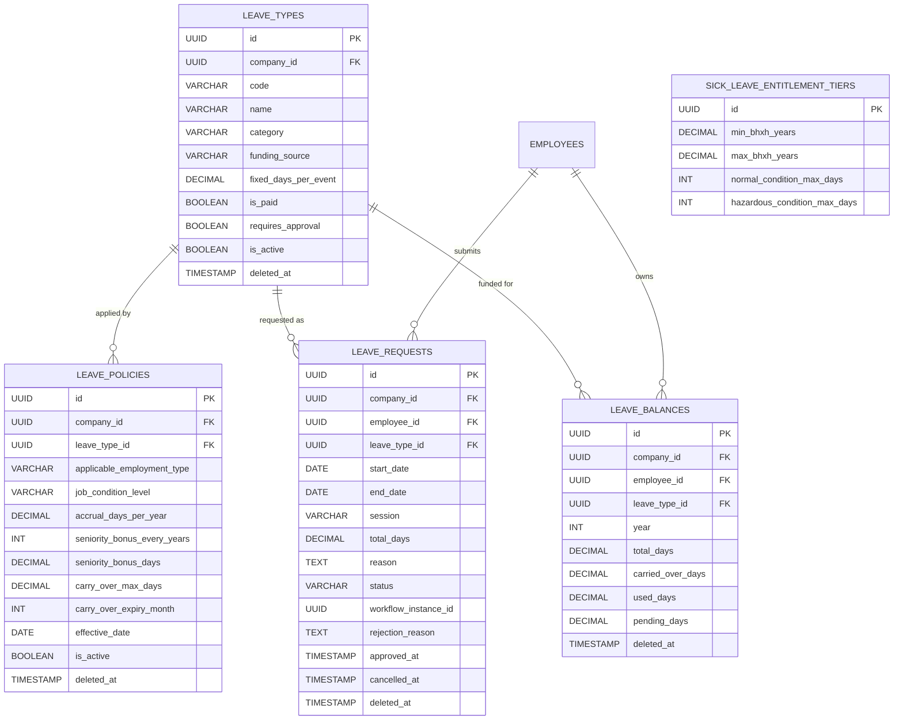
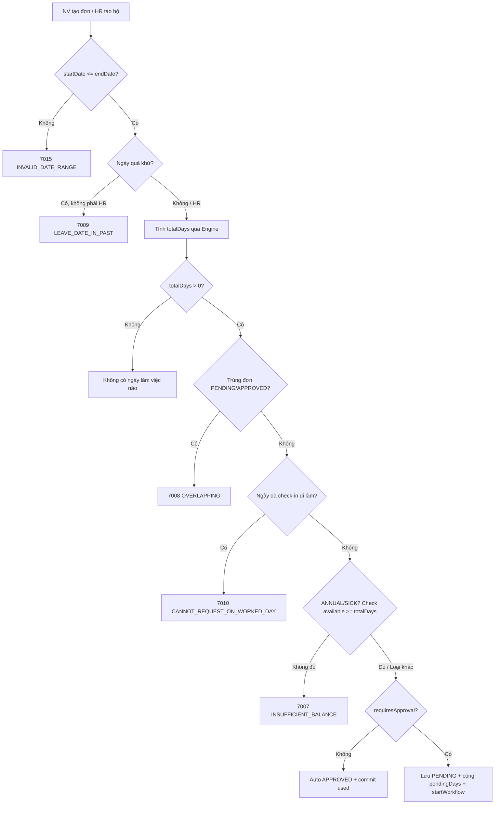

# Tài liệu Nghiệp vụ Module: Quản lý Nghỉ phép (Leave Management)

> **Module Code:** `leave`  
> **Package:** `com.cyclosa.leave`  
> **Phiên bản:** 2.0 (Chuẩn hóa Backend Standards & Automation)  
> **Căn cứ pháp lý:**  
> - **Bộ luật Lao động 2019** (Luật số 45/2019/QH14)  
>   - *Điều 112:* Nghỉ lễ, Tết hưởng nguyên lương (11 ngày).  
>   - *Điều 113:* Nghỉ hằng năm — 12/14/16 ngày theo điều kiện làm việc; thâm niên; thanh toán phép chưa nghỉ khi thôi việc (Điều 113.3).  
>   - *Điều 114:* Ngày nghỉ hằng năm tăng thêm theo thâm niên (đủ 05 năm + 01 ngày).  
>   - *Điều 115:* Nghỉ việc riêng hưởng lương (kết hôn, tang) và không hưởng lương theo thỏa thuận.  
> - **Luật Bảo hiểm xã hội:** Chế độ ốm đau, thai sản do Quỹ BHXH chi trả (định mức theo năm đóng BHXH).

---

## 1. Tôn chỉ Nghiệp vụ & Nguyên tắc Thiết kế (Core Principles)

Module **Leave** là trung tâm quản lý toàn bộ vòng đời nghỉ phép: từ danh mục loại nghỉ, chính sách định mức, quỹ phép cá nhân đến đơn nghỉ và luồng duyệt. Mọi ngày nghỉ hưởng lương đều liên kết trực tiếp đến **Chấm công (Attendance)** và **Bảng lương (Payroll)**.

```
┌─────────────────────────┐       ┌────────────────────────────────┐       ┌─────────────────────────┐
│   Module 04: Employee   │       │  Module Leave                  │       │ Attendance / Payroll    │
│  - Nhân viên, HĐLĐ      │ ────> │  - Loại nghỉ, Chính sách        │ ────> │  - Trừ công, tính lương  │
│  - Ngày vào làm         │       │  - Quỹ phép, Đơn nghỉ (WF)      │       │  - Thanh toán phép tồn   │
└─────────────────────────┘       └────────────────────────────────┘       └─────────────────────────┘
```

### 1.1. Chuẩn hóa Thiết kế Không dùng Interface + Impl thừa thãi (Concrete Service Pattern)
Theo chuẩn kiến trúc tại `docs/BACKEND_STANDARDS.md`:
- Toàn bộ service của module được viết trực tiếp dưới dạng **Concrete Services**:
  - `LeaveTypeService.java`: Quản lý danh mục loại nghỉ.
  - `LeavePolicyService.java`: Quản lý chính sách định mức theo Điều 113, 114.
  - `LeaveBalanceService.java`: Quản lý quỹ phép (giữ chỗ pending, chốt used, hoàn khi hủy/từ chối).
  - `LeaveRequestService.java`: Tạo, duyệt, từ chối, hủy đơn nghỉ + kích hoạt Workflow.
  - `LeaveCalculationEngine.java`: Engine tính số ngày nghỉ (loại cuối tuần, lễ, nửa ngày, việc riêng fixed).
- **Tuyệt đối không tạo thư mục `impl/`** hay interface 1-1 hình thức.

### 1.2. Đóng gói Kiến trúc Modular Monolith & Giao tiếp Liên Module
1. **Lấy dữ liệu hạ tầng qua Public Service của module lân cận:**
   - `EmployeeService`: `findEmployeeIdByUserId`, `getEmployeeSummaries`, `getEmployeeIdsByDepartment`, `getSubordinateEmployeeIds` — xác thực người nghỉ, enrich, phân quyền dữ liệu.
   - `CompanyService`: enrich công ty.
   - `ContractService`: `getActiveContractByEmployee` — lấy lương cơ bản tính thanh toán phép tồn.
   - `WorkflowEngineService`: `startWorkflow(LEAVE_REQUEST)`, `getInstanceHistory` — duyệt đa cấp, lịch sử duyệt.
   - `AttendanceRecordRepository`: kiểm tra ngày đã chấm công đi làm thì cấm xin nghỉ.
2. **Giao tiếp Bất đồng bộ qua Domain Events:**
   - `LeaveWorkflowListener` lắng nghe `WorkflowCompletedEvent` (`@Async @EventListener`) để tự động duyệt/từ chối đơn và cộng/trừ quỹ phép.
3. **Cung cấp Public Service cho Module khác:**
   - `isEmployeeOnApprovedLeave`, `getPaidLeaveDays`, `getUnpaidLeaveDays`, `getMonthlyPaidLeaveDaysBatch`, `getTotalRemainingLeaveDays` — phục vụ Attendance (cấm kỷ luật khi đang nghỉ) và Payroll.

### 1.3. Giữ chỗ Quỹ phép & Hoàn trả An toàn (Pending Hold & Rollback)
- Khi tạo đơn chờ duyệt: cộng `pendingDays` (giữ chỗ, chưa trừ hẳn).
- Khi duyệt: chuyển `pending → used` (`commitApprovedLeave`).
- Khi từ chối/hủy đơn chờ duyệt: trừ `pendingDays`; khi hủy đơn đã duyệt: trừ `usedDays` (`rollbackLeave`). Mọi phép trừ đều `max(0, ...)` chống âm.

### 1.4. Tự động hóa Định mức & Tính toán (Entitlement Automation)
- `LeaveCalculationEngine` tự đếm ngày làm việc (loại T7, CN, lễ dương lịch cố định), tự trả `fixedDaysPerEvent` cho việc riêng (cưới/tang), tự xử lý nửa ngày `0.5`.
- `POST /leave-balances/recalculate` tính lại quỹ phép năm cho 1 hoặc toàn bộ nhân viên: định mức cơ bản 12/14/16 + thâm niên + pro-rata tuyển giữa năm.
- Loại không cần duyệt (`requiresApproval = false`, VD: lễ Tết) được **auto-approve** ngay khi tạo.

---

## 2. Mô hình Thực thể & CSDL Chi tiết (Database Schema)



---

### 2.1. Bảng `leave_types` — Danh mục Loại nghỉ

| Thuộc tính | Kiểu dữ liệu | Ràng buộc | Diễn giải nghiệp vụ |
| :--- | :--- | :--- | :--- |
| `id` | `UUID` | PK | Khóa chính |
| `company_id` | `UUID` | Nullable | `null` = dùng chung toàn hệ thống (seed mặc định) |
| `code` | `VARCHAR(50)` | Not Null, Unique per Company | `ANNUAL_LEAVE`, `PUBLIC_HOLIDAY`, `MARRIAGE_LEAVE`... |
| `name` | `VARCHAR(100)` | Not Null | Tên loại nghỉ |
| `category` | `ENUM` | Not Null | `ANNUAL` (Đ113), `PUBLIC_HOLIDAY` (Đ112), `PERSONAL_PAID` / `PERSONAL_UNPAID` (Đ115), `SICK`, `MATERNITY` (BHXH) |
| `funding_source` | `ENUM` | Default `COMPANY` | `COMPANY` (DN trả lương), `SOCIAL_INSURANCE_FUND` (BHXH trả) |
| `fixed_days_per_event` | `DECIMAL(4,1)` | Nullable | Số ngày cố định mỗi sự kiện (VD: cưới 3.0, con cưới 1.0); NV không được sửa |
| `is_paid` | `BOOLEAN` | Default True | Hưởng lương hay không |
| `requires_approval` | `BOOLEAN` | Default True | `false` = auto-approve (VD: lễ Tết) |
| `is_active` | `BOOLEAN` | Default True | `false` = chặn tạo đơn mới |
| `description` | `TEXT` | Nullable | Căn cứ luật |
| `deleted_at` | `TIMESTAMP` | Nullable | Xóa mềm |

> [!IMPORTANT]
> Chặn xóa loại nghỉ đang có policy hoặc đơn liên kết (`7014 LEAVE_TYPE_IN_USE`).

### 2.2. Bảng `leave_policies` — Chính sách Định mức

| Thuộc tính | Kiểu dữ liệu | Ràng buộc | Diễn giải nghiệp vụ |
| :--- | :--- | :--- | :--- |
| `id` | `UUID` | PK | Khóa chính |
| `company_id` | `UUID` | Not Null | Multi-tenancy |
| `leave_type_id` | `UUID` | FK logic, Not Null | Loại nghỉ áp dụng |
| `applicable_employment_type` | `ENUM` | Nullable | Theo loại HĐ, `null` = mọi loại |
| `job_condition_level` | `ENUM` | Default `NORMAL` | `NORMAL` (12 ngày), `HAZARDOUS` (14 ngày), `SPECIAL_HAZARDOUS` (16 ngày) — Điều 113 |
| `accrual_days_per_year` | `DECIMAL(4,1)` | Default `12.0` | Mức cơ bản |
| `seniority_bonus_every_years` | `INT` | Default `5` | Cứ đủ N năm + phép (Điều 114) |
| `seniority_bonus_days` | `DECIMAL(4,1)` | Default `1.0` | Số ngày cộng mỗi chu kỳ |
| `carry_over_max_days` | `DECIMAL(4,1)` | Nullable | Max chuyển sang năm sau |
| `carry_over_expiry_month` | `INT` | Default `3` | Hết hạn 31/03 năm sau |
| `effective_date` | `DATE` | Nullable | Ngày hiệu lực |
| `is_active` | `BOOLEAN` | Default True | Kích hoạt |
| `deleted_at` | `TIMESTAMP` | Nullable | Xóa mềm |

### 2.3. Bảng `leave_balances` — Quỹ phép NV/Năm/Loại

Unique `(company_id, employee_id, leave_type_id, year)`:

| Thuộc tính | Kiểu dữ liệu | Ràng buộc | Diễn giải nghiệp vụ |
| :--- | :--- | :--- | :--- |
| `id` | `UUID` | PK | Khóa chính |
| `company_id` | `UUID` | Not Null | Multi-tenancy |
| `employee_id` | `UUID` | Not Null | Nhân viên sở hữu quỹ |
| `leave_type_id` | `UUID` | Not Null | Loại nghỉ |
| `year` | `INT` | Not Null | Năm quỹ |
| `total_days` | `DECIMAL(5,2)` | Default `0` | Tổng được cấp (gồm thâm niên + pro-rata) |
| `carried_over_days` | `DECIMAL` | Default `0` | Phép năm trước chuyển sang |
| `used_days` | `DECIMAL` | Default `0` | Đã duyệt |
| `pending_days` | `DECIMAL` | Default `0` | Đang chờ duyệt (giữ chỗ) |
| `availableDays` | `@Transient` | — | `(total + carriedOver) - (used + pending)`, floor 0 — dùng check `7007` |
| `remainingDays` | `@Transient` | — | `(total + carriedOver) - used`, floor 0 — dùng tính payout thôi việc |
| `deleted_at` | `TIMESTAMP` | Nullable | Xóa mềm |

### 2.4. Bảng `leave_requests` — Đơn xin nghỉ

| Thuộc tính | Kiểu dữ liệu | Ràng buộc | Diễn giải nghiệp vụ |
| :--- | :--- | :--- | :--- |
| `id` | `UUID` | PK | Khóa chính |
| `company_id` | `UUID` | Not Null | Suy từ công ty của nhân viên |
| `employee_id` | `UUID` | Not Null | Người nghỉ (tự nghỉ hoặc HR tạo hộ) |
| `leave_type_id` | `UUID` | Not Null | Loại nghỉ |
| `start_date / end_date` | `DATE` | Not Null | Bắt buộc `start <= end` |
| `session` | `ENUM` | Default `FULL_DAY` | `FULL_DAY` (1.0), `MORNING` / `AFTERNOON` (0.5, chỉ khi 1 ngày) |
| `total_days` | `DECIMAL(4,1)` | Not Null | Snapshot do `LeaveCalculationEngine` tính |
| `reason` | `TEXT` | Not Null | Lý do nghỉ |
| `status` | `ENUM` | Default `PENDING_APPROVAL` | `DRAFT` → `PENDING_APPROVAL` → `APPROVED` / `REJECTED` / `CANCELLED` |
| `workflow_instance_id` | `UUID` | Nullable | Phiên duyệt bên Workflow Engine |
| `rejection_reason` | `TEXT` | Nullable | Lý do từ chối |
| `approved_at` | `TIMESTAMP` | Nullable | Thời điểm duyệt |
| `cancelled_at / cancelled_by` | `TIMESTAMP / UUID` | Nullable | Người hủy (NV tự hủy hoặc HR hủy hộ) |
| `deleted_at` | `TIMESTAMP` | Nullable | Xóa mềm |

### 2.5. Bảng `sick_leave_entitlement_tiers` — Định mức Ốm đau (BHXH, dùng chung)

| Thuộc tính | Kiểu dữ liệu | Ràng buộc | Diễn giải nghiệp vụ |
| :--- | :--- | :--- | :--- |
| `id` | `UUID` | PK | Khóa chính |
| `min_bhxh_years` | `DECIMAL(4,1)` | Not Null | Từ số năm đóng BHXH (0 / 15 / 30) |
| `max_bhxh_years` | `DECIMAL(4,1)` | Nullable | `null` = không giới hạn trên |
| `normal_condition_max_days` | `INT` | Not Null | 30 / 40 / 60 ngày |
| `hazardous_condition_max_days` | `INT` | Not Null | 40 / 50 / 70 ngày |

---

## 3. Các Luồng Nghiệp vụ Trọng tâm (Business Workflows)

### 3.1. Luồng Tạo đơn nghỉ (Validation 6 lớp + Giữ chỗ + Workflow)



### 3.2. Luồng Duyệt / Từ chối / Hủy qua Workflow Engine

```mermaid
sequenceDiagram
    autonumber
    actor NV as Nhân viên
    participant Svc as LeaveRequestService
    participant WF as WorkflowEngineService
    actor QL as Quản lý (leave.approve)
    participant L as LeaveWorkflowListener

    NV->>Svc: POST /leave-requests (PENDING + giữ pendingDays)
    Svc->>WF: startWorkflow(LEAVE_REQUEST, totalDays, category...)
    WF->>QL: Giao việc duyệt
    alt Duyệt trực tiếp / Workflow APPROVED
        QL->>Svc: PUT /{id}/approve
        Svc->>Svc: APPROVED + commitApprovedLeave (pending→used)
    else Từ chối
        QL->>Svc: PUT /{id}/reject (lý do)
        Svc->>Svc: REJECTED + rollback pending
    end
    WF->>L: WorkflowCompletedEvent (Async)
    L->>Svc: Đồng bộ APPROVED/REJECTED/CANCELLED + cộng/trừ quỹ
    NV->>Svc: PUT /{id}/cancel (chỉ khi chưa đến ngày nghỉ)
    Note over Svc: Hủy đơn duyệt → trừ used; hủy đơn chờ → trừ pending
```

**Quy tắc hủy:** chỉ hủy `PENDING` hoặc `APPROVED`; chặn khi `startDate <= today` (`7011 LEAVE_ALREADY_STARTED`); NV chỉ hủy đơn của mình, HR (`leave.manage`) được hủy hộ.

### 3.3. Công thức Tính ngày nghỉ (`LeaveCalculationEngine`)

| Tình huống | Cách tính |
| :--- | :--- |
| Việc riêng có `fixedDaysPerEvent > 0` (cưới 3, con cưới 1, tang 3) | Trả luôn fixed, bỏ qua khoảng ngày nhập |
| Nửa ngày (`start == end` + `MORNING/AFTERNOON`, không rơi cuối tuần/lễ) | `0.5` |
| Còn lại | Đếm từng ngày `[start, end]`, loại T7/CN và lễ dương lịch cố định (01/01, 30/04, 01/05, 01/09, 02/09) |

### 3.4. Công thức Quỹ phép năm (Recalculate)

$$totalDays = base \times \frac{monthsWorked}{12} + bonus$$
- `base` = 12/14/16 (hoặc `accrualDaysPerYear` custom), `monthsWorked = 12 - month(hire) + 1` (vào sau ngày 15 trừ 1 tháng).
- `bonus = (yearsOfService / seniorityBonusEveryYears) × seniorityBonusDays` (mặc định 5 năm +1).
- Giữ nguyên `used / pending / carriedOver` cũ khi upsert.

### 3.5. Thanh toán phép tồn khi thôi việc (Điều 113.3)

$$dailyRate = \frac{basicSalary}{22} \quad ; \quad payout = dailyRate \times remainingDays$$
- `remainingDays = (total + carriedOver) - used`, `basicSalary` từ HĐLĐ đang hiệu lực (không có = 0), chuẩn 22 công.

---

## 4. Danh mục RESTful API Chi tiết

### 4.1. Nhóm API Loại nghỉ (`/api/v1/leave-types`)

| Method | Endpoint | Mô tả chức năng | Quyền yêu cầu | Response DTO |
| :---: | :--- | :--- | :--- | :--- |
| `GET` | `/api/v1/leave-types` | Danh sách loại nghỉ có phân trang, tìm kiếm | `leave.view` | `ApiResponse<PageData<LeaveTypeResponse>>` |
| `GET` | `/api/v1/leave-types/{id}` | Chi tiết loại nghỉ | `leave.view` | `ApiResponse<LeaveTypeResponse>` |
| `POST` | `/api/v1/leave-types` | Tạo loại nghỉ (check trùng code) | `leave.manage` | `ApiResponse<LeaveTypeResponse>` (201) |
| `PUT` | `/api/v1/leave-types/{id}` | Cập nhật loại nghỉ | `leave.manage` | `ApiResponse<LeaveTypeResponse>` |
| `DELETE` | `/api/v1/leave-types/{id}` | Xóa mềm (chặn khi đang dùng) | `leave.manage` | `ApiResponse<Void>` |

### 4.2. Nhóm API Chính sách (`/api/v1/leave-policies`)

| Method | Endpoint | Mô tả chức năng | Quyền yêu cầu | Response DTO |
| :---: | :--- | :--- | :--- | :--- |
| `GET` | `/api/v1/leave-policies` | Danh sách chính sách toàn công ty | `leave.view` | `ApiResponse<PageData<LeavePolicyResponse>>` |
| `GET` | `/api/v1/leave-policies/{id}` | Chi tiết chính sách | `leave.view` | `ApiResponse<LeavePolicyResponse>` |
| `POST` | `/api/v1/leave-policies` | Tạo chính sách (chặn trùng combo) | `leave.manage` | `ApiResponse<LeavePolicyResponse>` (201) |
| `PUT` | `/api/v1/leave-policies/{id}` | Cập nhật chính sách | `leave.manage` | `ApiResponse<LeavePolicyResponse>` |
| `DELETE` | `/api/v1/leave-policies/{id}` | Xóa chính sách | `leave.manage` | `ApiResponse<Void>` |

### 4.3. Nhóm API Đơn nghỉ (`/api/v1/leave-requests`)

| Method | Endpoint | Mô tả chức năng | Quyền yêu cầu | Response DTO |
| :---: | :--- | :--- | :--- | :--- |
| `POST` | `/api/v1/leave-requests` | Tạo đơn (check số dư + kích hoạt Workflow) | `leave.apply` | `ApiResponse<LeaveRequestResponse>` (201) |
| `GET` | `/api/v1/leave-requests/my` | Lịch sử đơn của bản thân (ESS) | Xác thực (tự suy NV) | `ApiResponse<List<LeaveRequestResponse>>` |
| `GET` | `/api/v1/leave-requests` | Danh sách theo DataScope | `leave.view` | `ApiResponse<PageData<LeaveRequestResponse>>` |
| `GET` | `/api/v1/leave-requests/{id}` | Chi tiết + lịch sử luồng duyệt | `leave.view` | `ApiResponse<LeaveRequestDetailResponse>` |
| `PUT` | `/api/v1/leave-requests/{id}/approve` | Phê duyệt (chỉ `PENDING`) | `leave.approve` | `ApiResponse<LeaveRequestResponse>` |
| `PUT` | `/api/v1/leave-requests/{id}/reject` | Từ chối kèm lý do | `leave.approve` | `ApiResponse<LeaveRequestResponse>` |
| `PUT` | `/api/v1/leave-requests/{id}/cancel` | Hủy đơn (chưa đến ngày nghỉ) | `leave.apply` | `ApiResponse<LeaveRequestResponse>` |

### 4.4. Nhóm API Quỹ phép (`/api/v1/leave-balances`)

| Method | Endpoint | Mô tả chức năng | Quyền yêu cầu | Response DTO |
| :---: | :--- | :--- | :--- | :--- |
| `GET` | `/api/v1/leave-balances/my?year=` | NV tự tra quỹ phép năm (ESS) | Xác thực (tự suy NV) | `ApiResponse<List<LeaveBalanceResponse>>` |
| `GET` | `/api/v1/leave-balances` | Tra quỹ theo DataScope | `leave.view` | `ApiResponse<PageData<LeaveBalanceResponse>>` |
| `POST` | `/api/v1/leave-balances/recalculate` | Tính lại quỹ năm (1 hoặc toàn công ty) | `leave.manage` | `ApiResponse<Integer>` (số NV) |
| `GET` | `/api/v1/leave-balances/{employeeId}/unused-annual-leave-payout` | Tiền phép tồn khi thôi việc (Đ113.3) | `leave.view` | `ApiResponse<UnusedLeavePayoutResponse>` |

---

## 5. Danh mục Mã lỗi Module Leave (`LeaveErrorCode`)

Dải mã `7001 - 7016`, định nghĩa tại `LeaveErrorCode.java`:

| Mã lỗi | Enum Name | HTTP Status | Thông điệp lỗi chuẩn |
| :---: | :--- | :--- | :--- |
| `7001` | `LEAVE_TYPE_NOT_FOUND` | 404 Not Found | Không tìm thấy loại ngày nghỉ |
| `7002` | `LEAVE_TYPE_CODE_EXISTS` | 409 Conflict | Mã loại ngày nghỉ đã tồn tại trong công ty |
| `7003` | `LEAVE_POLICY_NOT_FOUND` | 404 Not Found | Không tìm thấy chính sách nghỉ phép |
| `7004` | `LEAVE_POLICY_EXISTS` | 409 Conflict | Chính sách nghỉ phép cho điều kiện này đã tồn tại |
| `7005` | `LEAVE_BALANCE_NOT_FOUND` | 404 Not Found | Không tìm thấy quỹ phép của nhân viên cho năm này |
| `7006` | `LEAVE_REQUEST_NOT_FOUND` | 404 Not Found | Không tìm thấy đơn xin nghỉ phép |
| `7007` | `INSUFFICIENT_LEAVE_BALANCE` | 422 Unprocessable | Số dư phép khả dụng không đủ (kèm `Hiện có X, Cần Y`) |
| `7008` | `OVERLAPPING_LEAVE_REQUEST` | 409 Conflict | Khoảng nghỉ trùng với đơn đã gửi |
| `7009` | `LEAVE_DATE_IN_PAST` | 422 Unprocessable | Ngày bắt đầu không được ở quá khứ |
| `7010` | `CANNOT_REQUEST_LEAVE_ON_WORKED_DAY` | 422 Unprocessable | Không thể xin nghỉ ngày đã chấm công đi làm |
| `7011` | `LEAVE_ALREADY_STARTED` | 422 Unprocessable | Đơn đã đến/quá ngày bắt đầu, không thể hủy |
| `7012` | `LEAVE_REQUEST_ALREADY_PROCESSED` | 400 Bad Request | Đơn đã được xử lý trước đó |
| `7013` | `CURRENT_USER_NOT_EMPLOYEE` | 400 Bad Request | Tài khoản chưa liên kết hồ sơ nhân viên |
| `7014` | `LEAVE_TYPE_IN_USE` | 400 Bad Request | Loại nghỉ đang có đơn/chính sách liên kết, không thể xóa |
| `7015` | `INVALID_DATE_RANGE` | 400 Bad Request | Ngày kết thúc phải sau hoặc bằng ngày bắt đầu |
| `7016` | `LEAVE_BALANCE_ALREADY_EXISTS` | 409 Conflict | Quỹ phép của NV cho loại nghỉ và năm này đã tồn tại |

---

## 6. Phân bổ Quyền Hạn & Ma trận Vai trò (RBAC Matrix)

| Mã quyền (Permission Code) | Diễn giải quyền | Gán vai trò mặc định & DataScope |
| :--- | :--- | :--- |
| `leave.view` | Xem loại nghỉ, chính sách, đơn, quỹ, payout | `DEPARTMENT_MANAGER` (DEPARTMENT), `HR_ADMIN` (COMPANY), `SUPER_ADMIN` (ALL); list lọc `OWN / TEAM / DEPARTMENT / COMPANY / ALL` |
| `leave.manage` | Quản trị loại/chính sách, tạo đơn hộ, bỏ check quá khứ, hủy hộ, recalculate | `HR_ADMIN` (COMPANY), `SUPER_ADMIN` (ALL) |
| `leave.apply` | NV tạo đơn, hủy đơn của mình | `EMPLOYEE` (OWN), `DEPARTMENT_MANAGER` (OWN), `HR_ADMIN` (OWN) |
| `leave.approve` | Phê duyệt / từ chối trực tiếp | `DEPARTMENT_MANAGER` (DEPARTMENT), `HR_ADMIN` (COMPANY), `SUPER_ADMIN` (ALL) |

> [!NOTE]
> Hai API ESS (`GET /leave-requests/my`, `GET /leave-balances/my`) không cần `@PreAuthorize`, tự suy `employeeId` từ user đăng nhập.
