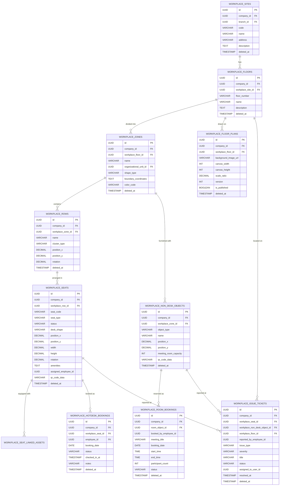
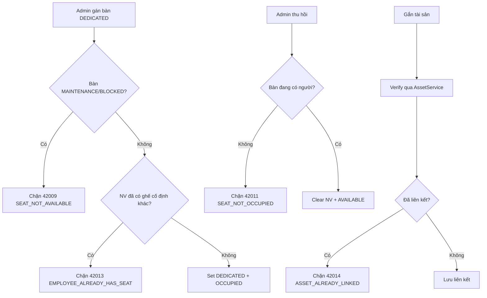
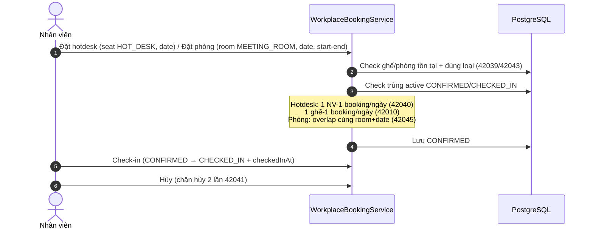
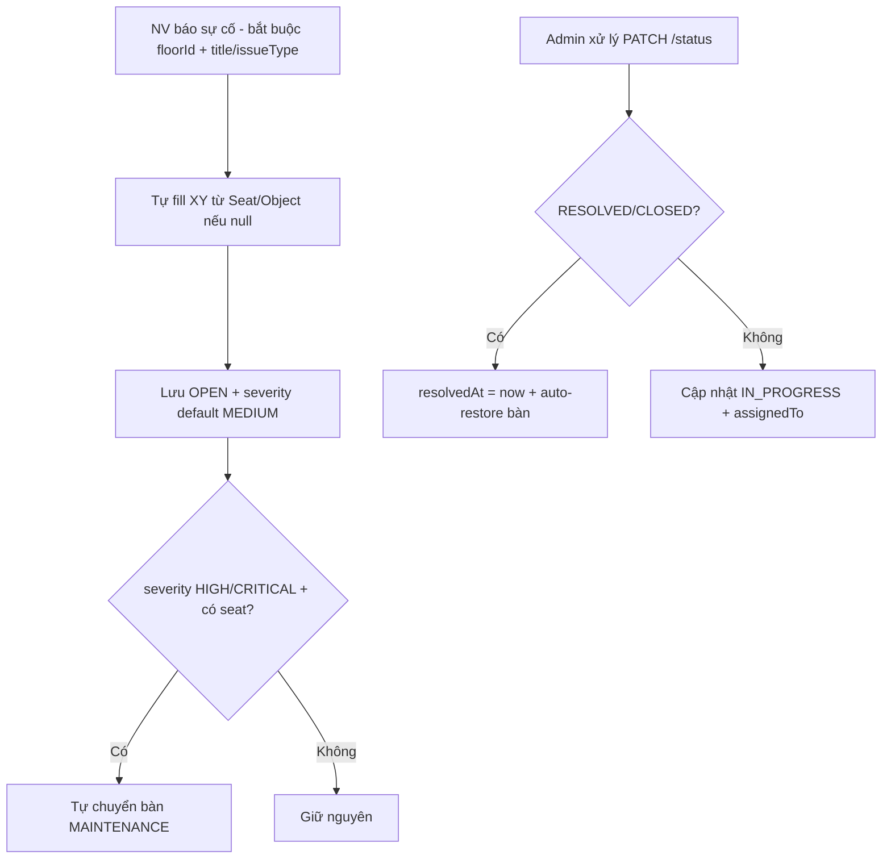
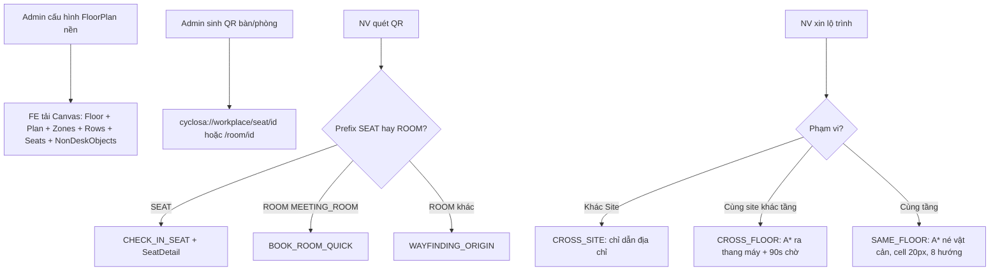

# Tài liệu Nghiệp vụ Module: Quản lý Nơi làm việc (Smart Workplace Management)

> **Module Code:** `workplace`  
> **Package:** `com.cyclosa.workplace`  
> **Phiên bản:** 2.0 (Chuẩn hóa Backend Standards & Automation)  
> **Phạm vi nghiệp vụ:**  
> - Quản lý mặt bằng vật lý 5 cấp: Cơ sở (`Site`) → Tầng (`Floor`) → Phân khu (`Zone`) → Cụm bàn (`Row`) → Chỗ ngồi (`Seat`).  
> - Bản đồ số 2D (`FloorPlan` + Canvas), mã QR định danh bàn/phòng, điều hướng trong nhà (Indoor Wayfinding A*).  
> - Vận hành linh hoạt: bàn cố định (`DEDICATED`), bàn linh hoạt (`HOT_DESK`), đặt phòng họp, báo sự cố cơ sở vật chất.  
> - Cổng tự phục vụ cho nhân viên (`My Workplace`) + cổng quản trị cho Office Admin.

---

## 1. Tôn chỉ Nghiệp vụ & Nguyên tắc Thiết kế (Core Principles)

Module **Workplace** là bản sao số (Digital Twin) của văn phòng vật lý, đóng vai trò cầu nối giữa **Nhân sự – Tài sản – Không gian**. Mọi chỗ ngồi, phòng họp, sự cố đều được định vị 2D chính xác để tra cứu, đặt chỗ và điều hướng.

```
┌─────────────────────────┐       ┌────────────────────────────────┐       ┌─────────────────────────┐
│   Employee / Asset      │       │  Module Workplace              │       │   Booking / Ticket      │
│  - Nhân viên, Chi nhánh │ ────> │  - Site > Floor > Zone > Row   │ ────> │  - Hotdesk, Phòng họp    │
│  - Tài sản gắn trên bàn │       │  - Seat QR, Canvas 2D, A*      │       │  - Sự cố, Điều hướng     │
└─────────────────────────┘       └────────────────────────────────┘       └─────────────────────────┘
```

### 1.1. Chuẩn hóa Thiết kế Không dùng Interface + Impl thừa thãi (Concrete Service Pattern)
Theo chuẩn kiến trúc tại `docs/BACKEND_STANDARDS.md`:
- Toàn bộ service của module được viết trực tiếp dưới dạng **Concrete Services**:
  - `WorkplaceHierarchyService.java`: Quản lý phân cấp Site/Floor/Zone/Row.
  - `WorkplaceSeatService.java`: Tạo bàn, sinh bàn hàng loạt, gán/thu hồi, đổi trạng thái, gắn tài sản.
  - `WorkplaceBookingService.java`: Đặt bàn hotdesk, đặt phòng họp, hủy, check-in, kiểm tra trống.
  - `WorkplaceIssueTicketService.java`: Báo và xử lý sự cố cơ sở vật chất, tự khóa/mở bàn.
  - `WorkplaceFloorPlanService.java`: Nền bản vẽ tầng + Canvas 2D tổng hợp.
  - `WorkplaceNavigationService.java` + `AStarPathfinder.java`: Tính lộ trình A*, quét QR, tìm đồng nghiệp.
  - `WorkplaceQrService.java`: Sinh và giải mã QR bàn/phòng.
  - `WorkplaceSearchService.java`: Tìm kiếm không gian.
  - `MyWorkplaceService.java`: Facade tự phục vụ (ép `employeeId` = người đang đăng nhập).
- **Tuyệt đối không tạo thư mục `impl/`** hay interface 1-1 hình thức.

### 1.2. Đóng gói Kiến trúc Modular Monolith & Giao tiếp Liên Module
1. **Lấy dữ liệu hạ tầng qua Public Service của module lân cận:**
   - `EmployeeService`: `getEmployeeSummaries` — enrich người ngồi bàn, người đặt, người báo sự cố.
   - `GeographyService` / `BranchService`: `getBranchSummary` — enrich chi nhánh của Site.
   - `OrganizationalUnitService`: `getUnitSummaries` — tô màu Zone theo phòng ban.
   - `AssetService`: `getAssetById` — xác thực tài sản khi gắn lên bàn.
2. **Tự phục vụ an toàn:** `MyWorkplaceService` chỉ là facade gọi lại `WorkplaceBookingService / WorkplaceIssueTicketService / WorkplaceSeatService` sau khi ép `employeeId = securityContext.getRequiredEmployeeId()`.
3. **Batch Enrichment chống N+1 Query:** Canvas, danh sách bàn/booking/ticket gom `Set<UUID>` gọi batch 1 lần.

### 1.3. Bất biến Định danh & Chuẩn hóa Mã (Identity Normalization)
- `site.code` và `seat.seatCode` luôn `trim().toUpperCase()`, unique theo `companyId`.
- Mã bàn bulk tự sinh 5 cấp: `{SiteCode}-{FloorNumber}-{ZoneName}-{RowName}-{Prefix}{NN}` (VD: `HN-F8-Z1-R02-S15`). Bản ghi trùng được bỏ qua (skip), không ghi đè.
- QR chuẩn 2 prefix: `cyclosa://workplace/seat/{seatId}?code={seatCode}` và `cyclosa://workplace/room/{roomId}?code={name}`.

### 1.4. Tự động hóa Trạng thái Không gian (Space State Automation)
- Sự cố `HIGH / CRITICAL` tự chuyển bàn sang `MAINTENANCE`; khi `RESOLVED / CLOSED` hết ticket active thì tự khôi phục `OCCUPIED / AVAILABLE`.
- Booking hotdesk/phòng họp chặn trùng 2 chiều và chỉ cho `check-in` từ `CONFIRMED`, chặn hủy 2 lần.
- Điều hướng A* tự phân loại `SAME_FLOOR / CROSS_FLOOR / CROSS_SITE`, fallback đường thẳng khi không tìm được đường.

---

## 2. Mô hình Thực thể & CSDL Chi tiết (Database Schema)



---

### 2.1. Bảng `workplace_sites` — Cơ sở / Tòa nhà

| Thuộc tính | Kiểu dữ liệu | Ràng buộc | Diễn giải nghiệp vụ |
| :--- | :--- | :--- | :--- |
| `id` | `UUID` | PK | Khóa chính |
| `company_id` | `UUID` | Not Null | Multi-tenancy |
| `branch_id` | `UUID` | FK logic, Not Null | Chi nhánh gắn với cơ sở (enrich `BranchSummary`) |
| `code` | `VARCHAR(50)` | Not Null, Unique per Company | Mã tòa nhà, chuẩn hóa UPPER |
| `name` | `VARCHAR(150)` | Not Null | Tên cơ sở |
| `address` | `VARCHAR(255)` | Nullable | Địa chỉ |
| `description` | `TEXT` | Nullable | Mô tả |
| `deleted_at` | `TIMESTAMP` | Nullable | Xóa mềm |

### 2.2. Bảng `workplace_floors` — Tầng

| Thuộc tính | Kiểu dữ liệu | Ràng buộc | Diễn giải nghiệp vụ |
| :--- | :--- | :--- | :--- |
| `id` | `UUID` | PK | Khóa chính |
| `company_id` | `UUID` | Not Null | Multi-tenancy |
| `workplace_site_id` | `UUID` | FK, Not Null | Tòa nhà chứa tầng |
| `floor_number` | `VARCHAR(50)` | Not Null | Số tầng (`8`, `F08`, `Tầng trệt`); unique theo `(company, site, floorNumber)` |
| `name` | `VARCHAR(150)` | Nullable | Tên tầng (VD: Tầng 8 – Khối Công nghệ) |
| `description` | `TEXT` | Nullable | Mô tả |
| `deleted_at` | `TIMESTAMP` | Nullable | Xóa mềm |

### 2.3. Bảng `workplace_zones` — Phân khu trên Tầng

| Thuộc tính | Kiểu dữ liệu | Ràng buộc | Diễn giải nghiệp vụ |
| :--- | :--- | :--- | :--- |
| `id` | `UUID` | PK | Khóa chính |
| `company_id` | `UUID` | Not Null | Multi-tenancy |
| `workplace_floor_id` | `UUID` | FK, Not Null | Tầng chứa phân khu |
| `name` | `VARCHAR(150)` | Not Null | Tên phân khu |
| `organizational_unit_id` | `UUID` | Nullable | Phòng ban sở hữu (tô màu Zone) |
| `shape_type` | `ENUM` | Default `RECTANGLE` | `RECTANGLE`, `POLYGON` |
| `boundary_coordinates` | `TEXT` | Nullable | JSON biên `[{"x":100,"y":200},...]` |
| `color_code` | `VARCHAR(30)` | Nullable | Mã màu (VD: `#3B82F6`) |
| `description` | `TEXT` | Nullable | Mô tả |
| `deleted_at` | `TIMESTAMP` | Nullable | Xóa mềm |

### 2.4. Bảng `workplace_rows` — Cụm / Dãy bàn

| Thuộc tính | Kiểu dữ liệu | Ràng buộc | Diễn giải nghiệp vụ |
| :--- | :--- | :--- | :--- |
| `id` | `UUID` | PK | Khóa chính |
| `company_id` | `UUID` | Not Null | Multi-tenancy |
| `workplace_zone_id` | `UUID` | FK, Not Null | Phân khu chứa cụm |
| `name` | `VARCHAR(100)` | Not Null | Tên cụm (VD: `R01`, `Dãy Backend 1`) |
| `cluster_type` | `ENUM` | Default `SINGLE_ROW` | `SINGLE_ROW`, `POD_4_FACING` (cụm 4 đối diện 2x2), `POD_6_FACING` (cụm 6 đối diện 3x2) |
| `position_x / position_y` | `DECIMAL(10,2)` | Nullable | Tọa độ 2D cụm |
| `rotation` | `DECIMAL(5,2)` | Default `0` | Góc xoay |
| `deleted_at` | `TIMESTAMP` | Nullable | Xóa mềm |

### 2.5. Bảng `workplace_seats` — Chỗ ngồi (Đối tượng trung tâm)

| Thuộc tính | Kiểu dữ liệu | Ràng buộc | Diễn giải nghiệp vụ |
| :--- | :--- | :--- | :--- |
| `id` | `UUID` | PK | Khóa chính |
| `company_id` | `UUID` | Not Null | Multi-tenancy |
| `workplace_row_id` | `UUID` | FK, Not Null | Cụm chứa bàn |
| `seat_code` | `VARCHAR(100)` | Not Null, Unique per Company | Mã bàn chuẩn hóa UPPER |
| `seat_type` | `ENUM` | Default `DEDICATED` | `DEDICATED` (cố định), `HOT_DESK` (linh hoạt theo ngày), `VISITOR` (khách/TTS) |
| `status` | `ENUM` | Default `AVAILABLE` | `AVAILABLE`, `OCCUPIED`, `MAINTENANCE`, `BLOCKED` |
| `desk_shape` | `ENUM` | Default `RECTANGLE` | `RECTANGLE`, `L_SHAPE_LEFT`, `L_SHAPE_RIGHT`, `ROUND` |
| `position_x / position_y` | `DECIMAL(10,2)` | Not Null | Tọa độ 2D bắt buộc |
| `width / height` | `DECIMAL(8,2)` | Default `60 / 40` | Kích thước vẽ canvas |
| `rotation` | `DECIMAL(5,2)` | Default `0` | Góc xoay |
| `amenities` | `TEXT` | Nullable | JSON tiện ích `["2_MONITORS","STANDING_DESK","NEAR_WINDOW"]` |
| `assigned_employee_id` | `UUID` | Nullable | NV cố định khi `DEDICATED` |
| `qr_code_data` | `VARCHAR(255)` | Nullable | Lúc tạo `CYCLOSA:WORKPLACE:SEAT:{company}:{seatCode}`; sau sinh QR `cyclosa://workplace/seat/{id}?code=...` |
| `visual_metadata` | `TEXT` | Nullable | JSON mở rộng canvas |
| `deleted_at` | `TIMESTAMP` | Nullable | Xóa mềm |

### 2.6. Bảng `workplace_seat_linked_assets` — Tài sản gắn trên Bàn

| Thuộc tính | Kiểu dữ liệu | Ràng buộc | Diễn giải nghiệp vụ |
| :--- | :--- | :--- | :--- |
| `id` | `UUID` | PK | Khóa chính |
| `company_id` | `UUID` | Not Null | Multi-tenancy |
| `workplace_seat_id` | `UUID` | FK, Not Null | Bàn được gắn tài sản |
| `asset_id` | `UUID` | FK logic, Not Null | Tài sản (verify qua `AssetService`) |
| `deleted_at` | `TIMESTAMP` | Nullable | Xóa mềm |

### 2.7. Bảng `workplace_floor_plans` — Nền Bản vẽ Tầng

| Thuộc tính | Kiểu dữ liệu | Ràng buộc | Diễn giải nghiệp vụ |
| :--- | :--- | :--- | :--- |
| `id` | `UUID` | PK | Khóa chính |
| `company_id` | `UUID` | Not Null | Multi-tenancy |
| `workplace_floor_id` | `UUID` | FK, Not Null | Tầng (1 tầng – 1 plan hiện hành, versioning) |
| `background_image_url` | `VARCHAR(500)` | Not Null | Ảnh nền CAD/SVG/PNG |
| `canvas_width / canvas_height` | `INT` | Default `3000 / 2000` | Kích thước canvas px |
| `scale_ratio` | `DECIMAL` | Default `0.05` | `1px = 0.05m = 5cm`, dùng tính `distanceMeters` |
| `version` | `INT` | Default `1` | +1 mỗi lần save |
| `is_published` | `BOOLEAN` | Default True | Phát hành cho FE vẽ |
| `deleted_at` | `TIMESTAMP` | Nullable | Xóa mềm |

### 2.8. Bảng `workplace_non_desk_objects` — Vật thể Không phải Bàn

| Thuộc tính | Kiểu dữ liệu | Ràng buộc | Diễn giải nghiệp vụ |
| :--- | :--- | :--- | :--- |
| `id` | `UUID` | PK | Khóa chính |
| `company_id` | `UUID` | Not Null | Multi-tenancy |
| `workplace_zone_id` | `UUID` | FK, Not Null | Phân khu chứa vật thể |
| `object_type` | `ENUM` | Not Null | `MEETING_ROOM`, `ELEVATOR`, `STAIRS`, `ENTRANCE`, `EXIT`, `RESTROOM`, `PANTRY`, `PRINTER`, `LOCKER` |
| `name` | `VARCHAR(150)` | Not Null | Tên (VD: Phòng Fansipan, Pantry tầng 8) |
| `position_x / position_y` | `DECIMAL(10,2)` | Nullable | Tọa độ 2D |
| `width / height / rotation` | `DECIMAL` | Default `100 / 100 / 0` | Kích thước vẽ |
| `meeting_room_capacity` | `INT` | Nullable | Sức chứa nếu là phòng họp |
| `qr_code_data` | `VARCHAR(255)` | Nullable | `CYCLOSA:WORKPLACE:OBJECT:{company}:{name}` |
| `description` | `TEXT` | Nullable | Mô tả |
| `deleted_at` | `TIMESTAMP` | Nullable | Xóa mềm |

> [!NOTE]
> `getIsBookable()` = `true` khi và chỉ khi `objectType == MEETING_ROOM`.

### 2.9. Bảng `workplace_hotdesk_bookings` — Đặt Bàn Linh hoạt theo Ngày

| Thuộc tính | Kiểu dữ liệu | Ràng buộc | Diễn giải nghiệp vụ |
| :--- | :--- | :--- | :--- |
| `id` | `UUID` | PK | Khóa chính |
| `company_id` | `UUID` | Not Null | Multi-tenancy |
| `workplace_seat_id` | `UUID` | FK, Not Null | Bàn (bắt buộc `HOT_DESK`) |
| `employee_id` | `UUID` | Not Null | Người đặt |
| `booking_date` | `DATE` | Not Null | Ngày đặt (default hôm nay nếu null) |
| `status` | `ENUM` | Default `CONFIRMED` khi tạo | `BOOKED`, `CONFIRMED`, `CHECKED_IN`, `CANCELLED`, `EXPIRED` |
| `checked_in_at` | `TIMESTAMP` | Nullable | Thời điểm check-in |
| `notes` | `VARCHAR(255)` | Nullable | Ghi chú |
| `deleted_at` | `TIMESTAMP` | Nullable | Xóa mềm |

### 2.10. Bảng `workplace_room_bookings` — Đặt Phòng Họp theo Khung giờ

| Thuộc tính | Kiểu dữ liệu | Ràng buộc | Diễn giải nghiệp vụ |
| :--- | :--- | :--- | :--- |
| `id` | `UUID` | PK | Khóa chính |
| `company_id` | `UUID` | Not Null | Multi-tenancy |
| `room_object_id` | `UUID` | FK, Not Null | Phòng (bắt buộc `MEETING_ROOM`) |
| `booked_by_employee_id` | `UUID` | Not Null | Người đặt |
| `meeting_title` | `VARCHAR(200)` | Not Null | Tên cuộc họp |
| `booking_date` | `DATE` | Not Null | Ngày họp |
| `start_time / end_time` | `TIME` | Not Null | Khung giờ, bắt buộc `start < end` |
| `participant_count` | `INT` | Default `1` | Số người tham dự |
| `status` | `ENUM` | Default `CONFIRMED` | `CONFIRMED`, `CHECKED_IN`, `CANCELLED`, `COMPLETED` |
| `notes` | `TEXT` | Nullable | Ghi chú |
| `deleted_at` | `TIMESTAMP` | Nullable | Xóa mềm |

### 2.11. Bảng `workplace_issue_tickets` — Phiếu Sự cố Cơ sở vật chất

| Thuộc tính | Kiểu dữ liệu | Ràng buộc | Diễn giải nghiệp vụ |
| :--- | :--- | :--- | :--- |
| `id` | `UUID` | PK | Khóa chính |
| `company_id` | `UUID` | Not Null | Multi-tenancy |
| `workplace_seat_id` | `UUID` | Nullable | Bàn xảy ra sự cố |
| `workplace_non_desk_object_id` | `UUID` | Nullable | Vật thể/phòng xảy ra sự cố |
| `workplace_floor_id` | `UUID` | FK, Not Null | Tầng (bắt buộc để định vị) |
| `reported_by_employee_id` | `UUID` | Not Null | Người báo |
| `issue_type` | `ENUM` | Not Null | `ELECTRICAL`, `FURNITURE`, `AIR_CONDITIONING`, `HARDWARE_EQUIPMENT`, `CLEANLINESS`, `OTHER` |
| `severity` | `ENUM` | Default `MEDIUM` | `LOW`, `MEDIUM`, `HIGH`, `URGENT`, `CRITICAL` |
| `title` | `VARCHAR(200)` | Not Null | Tiêu đề sự cố |
| `description` | `TEXT` | Nullable | Chi tiết |
| `position_x / position_y` | `DECIMAL(10,2)` | Nullable | Tự fill từ Seat/Object nếu user không nhập |
| `status` | `ENUM` | Tạo mới = `OPEN` | `REPORTED`, `OPEN`, `IN_PROGRESS`, `RESOLVED`, `CLOSED`, `CANCELLED` |
| `assigned_to_user_id` | `UUID` | Nullable | Kỹ thuật viên / Office Admin |
| `resolved_at` | `TIMESTAMP` | Nullable | Set khi `RESOLVED / CLOSED` |
| `resolution_notes` | `TEXT` | Nullable | Ghi chú xử lý |
| `deleted_at` | `TIMESTAMP` | Nullable | Xóa mềm |

---

## 3. Các Luồng Nghiệp vụ Trọng tâm (Business Workflows)

### 3.1. Luồng Quản lý Phân cấp & Sinh bàn Hàng loạt

```mermaid
flowchart TD
    A[Admin tạo Site] --> B[Tạo Floor trong Site]
    B --> C[Tạo Zone trong Floor]
    C --> D[Tạo Row trong Zone]
    D --> E{Tạo 1 bàn hay sinh hàng loạt?}
    E -- 1 bàn --> F[POST /seats]
    E -- Hàng loạt --> G[POST /rows/{id}/bulk-generate-seats]
    G --> H{Tính tọa độ theo clusterType}
    H -- SINGLE_ROW --> H1[posX = ox + i*(dw+sx)]
    H -- POD_4_FACING --> H2[Lưới 2x2, hàng trên rot=180]
    H -- POD_6_FACING --> H3[Lưới 3x2 tương tự]
    H1 --> I[Mã 5 cấp, skip trùng, AVAILABLE + QR mặc định]
    H2 --> I
    H3 --> I
```

### 3.2. Luồng Gán / Thu hồi Bàn cố định & Gắn Tài sản



> [!NOTE]
> `releaseSeatByEmployeeId` dùng khi offboarding; `recommendSeatsForOnboarding` gợi ý ghế trống khi nhận việc.

### 3.3. Luồng Đặt Bàn Hotdesk & Đặt Phòng Họp



**Quy tắc:**
1. Hotdesk chỉ cho `seatType == HOT_DESK`, ngược lại `42039 / 42012`; bàn `MAINTENANCE / BLOCKED` chặn `42038`.
2. Phòng họp yêu cầu `start < end` (`42025`), `objectType == MEETING_ROOM && isBookable` (`42043 / 42044`).
3. `getRoomAvailability(roomId, date)` trả `bookedSlots {bookingId, meetingTitle, start/end, bookedByName} + capacity`.

### 3.4. Luồng Báo & Xử lý Sự cố Gắn Vị trí



**Auto-restore:** chỉ khôi phục `OCCUPIED` (nếu còn NV) / `AVAILABLE` khi không còn ticket `OPEN / IN_PROGRESS` khác (`hasActiveTicketsForSeat`).

### 3.5. Luồng Canvas 2D, QR & Điều hướng A*



**Công thức Wayfinding:** `distanceMeters = pixels × scaleRatio` (làm tròn 0.1m), `walkSeconds = max(5, distance / 1.2)`, `turnByTurn` rẽ trái/phải/đi thẳng theo `cross product`. Mặc định canvas `3000×2000`, `scale 0.05` (`1px = 5cm`).

---

## 4. Danh mục RESTful API Chi tiết

### 4.1. Nhóm API Quản trị Mặt bằng (`/api/v1/workplace`)

| Method | Endpoint | Mô tả chức năng | Quyền yêu cầu | Response DTO |
| :---: | :--- | :--- | :--- | :--- |
| `POST` | `/api/v1/workplace/sites` | Tạo cơ sở/tòa nhà | `workplace.manage` | `ApiResponse<WorkplaceSiteResponse>` (201) |
| `PUT` | `/api/v1/workplace/sites/{id}` | Cập nhật cơ sở | `workplace.manage` | `ApiResponse<WorkplaceSiteResponse>` |
| `GET` | `/api/v1/workplace/sites` | Danh sách cơ sở | `workplace.view` | `ApiResponse<PageData<WorkplaceSiteResponse>>` |
| `GET` | `/api/v1/workplace/sites/{id}` | Chi tiết cơ sở | `workplace.view` | `ApiResponse<WorkplaceSiteResponse>` |
| `DELETE` | `/api/v1/workplace/sites/{id}` | Xóa cơ sở | `workplace.manage` | `ApiResponse<Void>` |
| `POST` | `/api/v1/workplace/floors` | Tạo tầng | `workplace.manage` | `ApiResponse<WorkplaceFloorResponse>` (201) |
| `PUT` | `/api/v1/workplace/floors/{id}` | Cập nhật tầng | `workplace.manage` | `ApiResponse<WorkplaceFloorResponse>` |
| `GET` | `/api/v1/workplace/sites/{siteId}/floors` | Danh sách tầng thuộc cơ sở | `workplace.view` | `ApiResponse<List<WorkplaceFloorResponse>>` |
| `DELETE` | `/api/v1/workplace/floors/{id}` | Xóa tầng | `workplace.manage` | `ApiResponse<Void>` |
| `POST` | `/api/v1/workplace/zones` | Tạo phân khu | `workplace.manage` | `ApiResponse<WorkplaceZoneResponse>` (201) |
| `PUT` | `/api/v1/workplace/zones/{id}` | Cập nhật phân khu | `workplace.manage` | `ApiResponse<WorkplaceZoneResponse>` |
| `GET` | `/api/v1/workplace/floors/{floorId}/zones` | Danh sách phân khu trên tầng | `workplace.view` | `ApiResponse<List<WorkplaceZoneResponse>>` |
| `DELETE` | `/api/v1/workplace/zones/{id}` | Xóa phân khu | `workplace.manage` | `ApiResponse<Void>` |
| `POST` | `/api/v1/workplace/rows` | Tạo cụm/dãy bàn | `workplace.manage` | `ApiResponse<WorkplaceRowResponse>` (201) |
| `PUT` | `/api/v1/workplace/rows/{id}` | Cập nhật cụm bàn | `workplace.manage` | `ApiResponse<WorkplaceRowResponse>` |
| `GET` | `/api/v1/workplace/zones/{zoneId}/rows` | Danh sách cụm thuộc phân khu | `workplace.view` | `ApiResponse<List<WorkplaceRowResponse>>` |
| `DELETE` | `/api/v1/workplace/rows/{id}` | Xóa cụm bàn | `workplace.manage` | `ApiResponse<Void>` |
| `POST` | `/api/v1/workplace/seats` | Tạo 1 chỗ ngồi | `workplace.manage` | `ApiResponse<WorkplaceSeatResponse>` (201) |
| `POST` | `/api/v1/workplace/rows/{rowId}/bulk-generate-seats` | Sinh bàn tự động theo cụm | `workplace.manage` | `ApiResponse<List<WorkplaceSeatResponse>>` |
| `PUT` | `/api/v1/workplace/seats/{id}` | Cập nhật bàn + tọa độ 2D | `workplace.manage` | `ApiResponse<WorkplaceSeatResponse>` |
| `GET` | `/api/v1/workplace/seats/{id}` | Chi tiết bàn (vị trí 5 cấp + tài sản) | `workplace.view` | `ApiResponse<WorkplaceSeatDetailResponse>` |
| `GET` | `/api/v1/workplace/seats` | Lọc bàn có phân trang | `workplace.view` | `ApiResponse<PageData<WorkplaceSeatResponse>>` |
| `DELETE` | `/api/v1/workplace/seats/{id}` | Xóa bàn | `workplace.manage` | `ApiResponse<Void>` |
| `POST` | `/api/v1/workplace/seats/{id}/assign` | Gán bàn cố định cho NV | `workplace.manage` | `ApiResponse<WorkplaceSeatResponse>` |
| `POST` | `/api/v1/workplace/seats/{id}/release` | Thu hồi gán | `workplace.manage` | `ApiResponse<WorkplaceSeatResponse>` |
| `PATCH` | `/api/v1/workplace/seats/{id}/status` | Đổi trạng thái (khóa, bảo trì, trống) | `workplace.manage` | `ApiResponse<WorkplaceSeatResponse>` |
| `POST` | `/api/v1/workplace/seats/{id}/link-asset/{assetId}` | Gắn tài sản lên bàn | `workplace.manage` | `ApiResponse<WorkplaceSeatResponse>` |
| `DELETE` | `/api/v1/workplace/seats/{id}/unlink-asset/{assetId}` | Gỡ tài sản | `workplace.manage` | `ApiResponse<Void>` |
| `POST` | `/api/v1/workplace/seats/{id}/qr-code` | Sinh mã QR cho bàn | `workplace.manage` | `ApiResponse<QrScanResultResponse>` |
| `GET` | `/api/v1/workplace/floors/{floorId}/canvas-layout` | Tải toàn bộ Canvas 2D | `workplace.view` | `ApiResponse<FloorLayoutCanvasResponse>` |
| `POST` | `/api/v1/workplace/floors/{floorId}/floor-plan` | Cấu hình Floor Plan nền | `workplace.manage` | `ApiResponse<WorkplaceFloorPlanResponse>` |
| `POST` | `/api/v1/workplace/non-desk-objects` | Tạo vật thể (phòng họp, thang máy...) | `workplace.manage` | `ApiResponse<WorkplaceNonDeskObjectResponse>` (201) |
| `PUT` | `/api/v1/workplace/non-desk-objects/{id}` | Cập nhật vật thể | `workplace.manage` | `ApiResponse<WorkplaceNonDeskObjectResponse>` |
| `DELETE` | `/api/v1/workplace/non-desk-objects/{id}` | Xóa vật thể | `workplace.manage` | `ApiResponse<Void>` |
| `GET` | `/api/v1/workplace/analytics/occupancy-report?siteId=` | Báo cáo tỷ lệ lấp đầy | `workplace.view` | `ApiResponse<WorkplaceOccupancyReportResponse>` |

### 4.2. Nhóm API Đặt chỗ – Admin (`/api/v1/workplace/bookings`)

| Method | Endpoint | Mô tả chức năng | Quyền yêu cầu | Response DTO |
| :---: | :--- | :--- | :--- | :--- |
| `GET` | `/api/v1/workplace/bookings/hotdesk` | Lọc đặt bàn hotdesk | `workplace.booking.view` | `ApiResponse<PageData<HotdeskBookingResponse>>` |
| `POST` | `/api/v1/workplace/bookings/hotdesk` | Tạo lượt đặt bàn (hộ NV) | `workplace.booking.manage` | `ApiResponse<HotdeskBookingResponse>` (201) |
| `POST` | `/api/v1/workplace/bookings/hotdesk/{id}/cancel` | Hủy đặt bàn | `workplace.booking.manage` | `ApiResponse<HotdeskBookingResponse>` |
| `POST` | `/api/v1/workplace/bookings/hotdesk/{id}/check-in` | Check-in bàn | `workplace.booking.manage` | `ApiResponse<HotdeskBookingResponse>` |
| `GET` | `/api/v1/workplace/bookings/rooms` | Lọc đặt phòng họp | `workplace.booking.view` | `ApiResponse<PageData<RoomBookingResponse>>` |
| `POST` | `/api/v1/workplace/bookings/rooms` | Tạo lịch họp (chống trùng) | `workplace.booking.manage` | `ApiResponse<RoomBookingResponse>` (201) |
| `POST` | `/api/v1/workplace/bookings/rooms/{id}/cancel` | Hủy lịch họp | `workplace.booking.manage` | `ApiResponse<RoomBookingResponse>` |
| `POST` | `/api/v1/workplace/bookings/rooms/{id}/check-in` | Check-in phòng | `workplace.booking.manage` | `ApiResponse<RoomBookingResponse>` |
| `GET` | `/api/v1/workplace/bookings/rooms/{roomId}/availability?date=` | Khung giờ trống/đã đặt theo ngày | `workplace.booking.view` | `ApiResponse<RoomAvailabilityResponse>` |

### 4.3. Nhóm API Sự cố – Admin (`/api/v1/workplace/issue-tickets`)

| Method | Endpoint | Mô tả chức năng | Quyền yêu cầu | Response DTO |
| :---: | :--- | :--- | :--- | :--- |
| `GET` | `/api/v1/workplace/issue-tickets` | Lọc sự cố có phân trang | `workplace.ticket.view` | `ApiResponse<PageData<IssueTicketResponse>>` |
| `GET` | `/api/v1/workplace/issue-tickets/{id}` | Chi tiết sự cố | `workplace.ticket.view` | `ApiResponse<IssueTicketResponse>` |
| `PATCH` | `/api/v1/workplace/issue-tickets/{id}/status` | Cập nhật tiến độ / hoàn tất (tự khôi phục bàn) | `workplace.ticket.manage` | `ApiResponse<IssueTicketResponse>` |

### 4.4. Nhóm API Điều hướng (`/api/v1/workplace/navigation`)

| Method | Endpoint | Mô tả chức năng | Quyền yêu cầu | Response DTO |
| :---: | :--- | :--- | :--- | :--- |
| `POST` | `/api/v1/workplace/navigation/route` | Tính lộ trình nội bộ A* né vật cản | `workplace.view` | `ApiResponse<NavigationRouteResponse>` |
| `POST` | `/api/v1/workplace/navigation/scan-qr` | Quét QR bàn/phòng để định vị + hành động | `workplace.view` | `ApiResponse<QrScanResultResponse>` |
| `GET` | `/api/v1/workplace/navigation/colleagues?search=` | Tìm vị trí đồng nghiệp | `workplace.view` | `ApiResponse<List<ColleagueLocationResponse>>` |
| `GET` | `/api/v1/workplace/navigation/colleagues/{employeeId}` | Vị trí chi tiết 1 đồng nghiệp | `workplace.view` | `ApiResponse<ColleagueLocationResponse>` |
| `GET` | `/api/v1/workplace/navigation/bookable-rooms?floorId=` | Phòng họp có thể đặt | `workplace.view` | `ApiResponse<List<WorkplaceNonDeskObjectResponse>>` |

### 4.5. Nhóm API Tự phục vụ (`/api/v1/my-workplace`)

| Method | Endpoint | Mô tả chức năng | Quyền yêu cầu | Response DTO |
| :---: | :--- | :--- | :--- | :--- |
| `GET` | `/api/v1/my-workplace/seat` | Bàn + tài sản của tôi | `my_workplace.view` | `ApiResponse<WorkplaceSeatDetailResponse>` |
| `GET` | `/api/v1/my-workplace/hotdesk-bookings` | Lượt đặt bàn của tôi | `my_workplace.view` | `ApiResponse<List<HotdeskBookingResponse>>` |
| `POST` | `/api/v1/my-workplace/hotdesk-bookings` | Tự đặt bàn linh hoạt | `my_workplace.manage` | `ApiResponse<HotdeskBookingResponse>` (201) |
| `POST` | `/api/v1/my-workplace/hotdesk-bookings/{id}/cancel` | Hủy đặt bàn của tôi | `my_workplace.manage` | `ApiResponse<HotdeskBookingResponse>` |
| `POST` | `/api/v1/my-workplace/hotdesk-bookings/{id}/check-in` | Check-in bàn của tôi | `my_workplace.manage` | `ApiResponse<HotdeskBookingResponse>` |
| `GET` | `/api/v1/my-workplace/room-bookings` | Lịch họp của tôi | `my_workplace.view` | `ApiResponse<List<RoomBookingResponse>>` |
| `POST` | `/api/v1/my-workplace/room-bookings` | Tự đặt phòng họp | `my_workplace.manage` | `ApiResponse<RoomBookingResponse>` (201) |
| `POST` | `/api/v1/my-workplace/room-bookings/{id}/cancel` | Hủy lịch họp của tôi | `my_workplace.manage` | `ApiResponse<RoomBookingResponse>` |
| `POST` | `/api/v1/my-workplace/room-bookings/{id}/check-in` | Check-in phòng của tôi | `my_workplace.manage` | `ApiResponse<RoomBookingResponse>` |
| `POST` | `/api/v1/my-workplace/issue-tickets` | Báo sự cố tại bàn/phòng | `my_workplace.manage` | `ApiResponse<IssueTicketResponse>` (201) |
| `GET` | `/api/v1/my-workplace/issue-tickets` | Sự cố do tôi báo | `my_workplace.view` | `ApiResponse<List<IssueTicketResponse>>` |

---

## 5. Danh mục Mã lỗi Module Workplace (`WorkplaceErrorCode`)

Dải mã `42001 - 42046`, định nghĩa tại `WorkplaceErrorCode.java`:

| Mã lỗi | Enum Name | HTTP Status | Thông điệp lỗi chuẩn |
| :---: | :--- | :---: | :--- |
| `42001` | `SITE_NOT_FOUND` | 404 Not Found | Không tìm thấy tòa nhà/cơ sở |
| `42002` | `SITE_CODE_ALREADY_EXISTS` | 409 Conflict | Mã tòa nhà đã tồn tại trong công ty |
| `42003` | `FLOOR_NOT_FOUND` | 404 Not Found | Không tìm thấy tầng |
| `42004` | `FLOOR_ALREADY_EXISTS` | 409 Conflict | Tầng đã tồn tại trong tòa nhà |
| `42005` | `ZONE_NOT_FOUND` | 404 Not Found | Không tìm thấy khu vực |
| `42006` | `ROW_NOT_FOUND` | 404 Not Found | Không tìm thấy dãy bàn |
| `42007` | `SEAT_NOT_FOUND` | 404 Not Found | Không tìm thấy chỗ ngồi |
| `42008` | `SEAT_CODE_ALREADY_EXISTS` | 409 Conflict | Mã chỗ ngồi đã tồn tại trong công ty |
| `42009` | `SEAT_NOT_AVAILABLE` | 409 Conflict | Chỗ ngồi không khả dụng (có người/bảo trì) |
| `42010` | `SEAT_ALREADY_OCCUPIED` | 409 Conflict | Chỗ ngồi đã gán cho nhân viên khác |
| `42011` | `SEAT_NOT_OCCUPIED` | 400 Bad Request | Chỗ ngồi chưa gán cho ai |
| `42012` | `SEAT_NOT_HOTDESK` | 400 Bad Request | Chỗ ngồi không phải hot-desk |
| `42013` | `EMPLOYEE_ALREADY_HAS_SEAT` | 409 Conflict | Nhân viên đã có chỗ cố định khác |
| `42014` | `ASSET_ALREADY_LINKED` | 409 Conflict | Tài sản đã liên kết với chỗ ngồi |
| `42015` | `ASSET_LINK_NOT_FOUND` | 404 Not Found | Không tìm thấy liên kết tài sản |
| `42016` | `NON_DESK_OBJECT_NOT_FOUND` | 404 Not Found | Không tìm thấy tiện ích/phòng họp |
| `42017` | `NOT_A_MEETING_ROOM` | 400 Bad Request | Đối tượng không phải phòng họp |
| `42018` | `FLOOR_PLAN_NOT_FOUND` | 404 Not Found | Không tìm thấy bản vẽ tầng |
| `42019` | `HOTDESK_BOOKING_NOT_FOUND` | 404 Not Found | Không tìm thấy đặt bàn hot-desk |
| `42020` | `HOTDESK_ALREADY_BOOKED` | 409 Conflict | Bàn đã được đặt trong ngày chọn |
| `42021` | `HOTDESK_ALREADY_HAS_BOOKING_FOR_DAY` | 409 Conflict | Bạn đã có lịch hot-desk trong ngày này |
| `42022` | `HOTDESK_BOOKING_INVALID_STATUS` | 400 Bad Request | Trạng thái đặt bàn không hợp lệ |
| `42023` | `ROOM_BOOKING_NOT_FOUND` | 404 Not Found | Không tìm thấy lịch đặt phòng |
| `42024` | `ROOM_BOOKING_TIME_OVERLAPPING` | 409 Conflict | Phòng kín lịch khung giờ này |
| `42025` | `ROOM_BOOKING_INVALID_TIME` | 400 Bad Request | Thời gian bắt đầu/kết thúc không hợp lệ |
| `42026` | `ROOM_BOOKING_INVALID_STATUS` | 400 Bad Request | Trạng thái đặt phòng không hợp lệ |
| `42027` | `ISSUE_TICKET_NOT_FOUND` | 404 Not Found | Không tìm thấy phiếu sự cố |
| `42028` | `NAVIGATION_POINT_NOT_FOUND` | 404 Not Found | Không tìm thấy điểm đi/đến |
| `42029` | `NAVIGATION_SAME_POINT` | 400 Bad Request | Điểm đi và đến không được trùng |
| `42030` | `QR_CODE_INVALID` | 400 Bad Request | Mã QR không hợp lệ/hết hạn |
| `42031` | `CURRENT_USER_NOT_LINKED_EMPLOYEE` | 400 Bad Request | Tài khoản chưa liên kết hồ sơ nhân viên |
| `42032` | `EMPLOYEE_NOT_FOUND` | 404 Not Found | Không tìm thấy nhân viên |
| `42033` | `BRANCH_NOT_FOUND` | 404 Not Found | Không tìm thấy chi nhánh |
| `42034` | `EMPLOYEE_NOT_SPECIFIED` | 400 Bad Request | Chưa xác định nhân viên thực hiện |
| `42035` | `EMPLOYEE_HAS_NO_ASSIGNED_SEAT` | 400 Bad Request | Nhân viên chưa có chỗ cố định |
| `42036` | `NAVIGATION_ORIGIN_NOT_FOUND` | 404 Not Found | Không xác định điểm xuất phát |
| `42037` | `NAVIGATION_DESTINATION_NOT_FOUND` | 404 Not Found | Không xác định điểm đến |
| `42038` | `SEAT_IN_MAINTENANCE` | 409 Conflict | Chỗ ngồi đang bảo trì/khóa |
| `42039` | `SEAT_NOT_AVAILABLE_FOR_HOTDESK` | 400 Bad Request | Chỗ ngồi không mở cho hotdesk |
| `42040` | `HOTDESK_ALREADY_BOOKED_FOR_DATE` | 409 Conflict | Bạn đã có lịch hotdesk ngày này |
| `42041` | `BOOKING_ALREADY_CANCELLED` | 400 Bad Request | Lịch đã bị hủy trước đó |
| `42042` | `HOTDESK_CANNOT_CHECKIN` | 400 Bad Request | Không thể check-in do trạng thái không hợp lệ |
| `42043` | `ROOM_NOT_FOUND` | 404 Not Found | Không tìm thấy phòng họp |
| `42044` | `ROOM_NOT_BOOKABLE` | 400 Bad Request | Phòng không mở đặt lịch họp |
| `42045` | `ROOM_TIME_CONFLICT` | 409 Conflict | Khung giờ trùng cuộc họp khác đã xác nhận |
| `42046` | `ROOM_CANNOT_CHECKIN` | 400 Bad Request | Không thể check-in phòng do trạng thái không hợp lệ |

---

## 6. Phân bổ Quyền Hạn & Ma trận Vai trò (RBAC Matrix)

| Mã quyền (Permission Code) | Diễn giải quyền | Gán vai trò mặc định & DataScope |
| :--- | :--- | :--- |
| `workplace.manage` | Quản trị Site/Floor/Zone/Row/Seat/Asset/QR/FloorPlan/NonDesk | `OFFICE_ADMIN` (COMPANY), `HR_ADMIN` (COMPANY), `SUPER_ADMIN` (ALL) |
| `workplace.view` | Xem mặt bằng, Canvas, điều hướng, quét QR, tìm đồng nghiệp, báo cáo lấp đầy | `EMPLOYEE` (OWN), `DEPARTMENT_MANAGER` (DEPARTMENT), `HR_ADMIN` (COMPANY), `SUPER_ADMIN` (ALL) |
| `workplace.booking.view` | Xem/lọc booking hotdesk + phòng, xem trống phòng | `DEPARTMENT_MANAGER` (DEPARTMENT), `HR_ADMIN` (COMPANY), `SUPER_ADMIN` (ALL) |
| `workplace.booking.manage` | Tạo/hủy/check-in booking (quyền admin đặt hộ) | `OFFICE_ADMIN` (COMPANY), `HR_ADMIN` (COMPANY), `SUPER_ADMIN` (ALL) |
| `workplace.ticket.view` | Xem/lọc/chi tiết ticket sự cố | `DEPARTMENT_MANAGER` (DEPARTMENT), `HR_ADMIN` (COMPANY), `SUPER_ADMIN` (ALL) |
| `workplace.ticket.manage` | Xử lý ticket (gán, đổi trạng thái, hoàn tất) | `OFFICE_ADMIN` (COMPANY), `HR_ADMIN` (COMPANY), `SUPER_ADMIN` (ALL) |
| `my_workplace.view` | NV xem ghế, booking, ticket của chính mình | `EMPLOYEE` (OWN), `DEPARTMENT_MANAGER` (OWN), `HR_ADMIN` (OWN) |
| `my_workplace.manage` | NV tự đặt/hủy/check-in hotdesk + phòng, báo sự cố | `EMPLOYEE` (OWN), `DEPARTMENT_MANAGER` (OWN), `HR_ADMIN` (OWN) |
