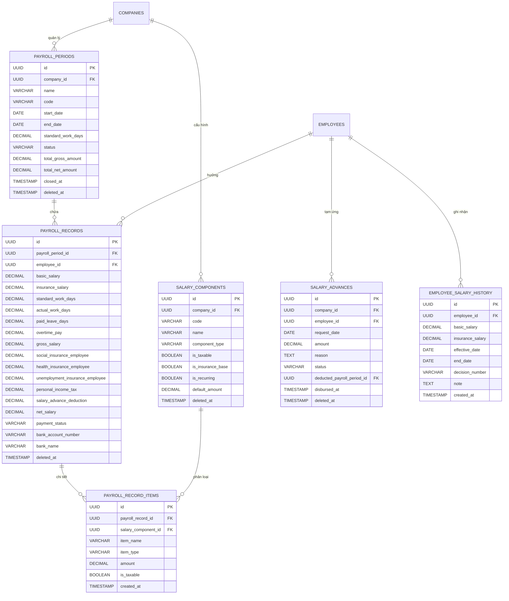
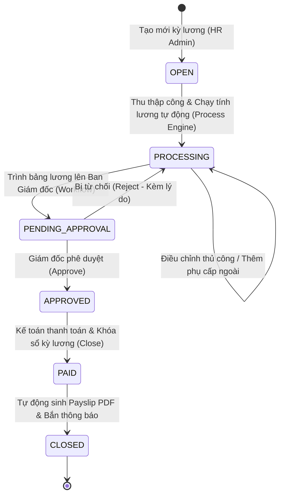

# Tài liệu Nghiệp vụ Module 08: Quản lý Tiền lương & Tính toán Tự động (Payroll Management & Legal Compliance Engine)

> **Module Code:** `payroll`  
> **Package:** `com.cyclosa.payroll`  
> **Phiên bản:** 2.0 (Chuẩn hóa Backend Standards & Legal Automation)  
> **Căn cứ pháp lý:**  
> - **Bộ luật Lao động 2019** (Luật số 45/2019/QH14) — Chương VI: Tiền lương (Điều 90 đến Điều 104).  
> - **Nghị định 145/2020/NĐ-CP:** Quy định chi tiết về tiền lương, làm thêm giờ (OT), làm việc ban đêm.  
> - **Luật Thuế Thu nhập Cá nhân & Nghị quyết 954/2020/UBTVQH14:** Biểu thuế lũy tiến từng phần 7 bậc; giảm trừ gia cảnh bản thân 11 triệu đồng/tháng, người phụ thuộc 4.4 triệu đồng/tháng.  
> - **Luật Bảo hiểm Xã hội 2014 & Luật Việc làm 2013:** Tỷ lệ đóng BHXH 8%, BHYT 1.5%, BHTN 1.0%; khống chế trần 20 lần mức lương cơ sở (Nghị định 73/2024/NĐ-CP: 2.340.000 VNĐ) và 20 lần lương tối thiểu vùng (Nghị định 74/2024/NĐ-CP).

---

## 1. Tôn chỉ Nghiệp vụ & Nguyên tắc Thiết kế (Core Principles)

Module **Payroll** là trái tim tài chính và đãi ngộ nhân sự của hệ sinh thái CYCLOSA HRM. Module này biến đổi toàn bộ dữ liệu lao động (Hợp đồng, Ca kíp, Chấm công thực tế, Đơn nghỉ phép, Thành tích/Kỷ luật) thành bảng lương chính xác tuyệt đối, tuân thủ pháp lý và minh bạch.

```
┌──────────────────────────────────────┐
│  Dữ liệu Đầu vào từ các Module       │
│  - Contract: Lương cơ bản, BHXH      │
│  - Attendance: Công chuẩn, OT, Đêm   │
│  - Leave: Phép hưởng lương, không lg │
│  - Employee: Người phụ thuộc, CCCD   │
└──────────────────┬───────────────────┘
                   │
                   ▼
┌──────────────────────────────────────┐       ┌────────────────────────────────┐
│   Module com.cyclosa.payroll         │ ────> │   Bảng lương & Phiếu lương PDF │
│  - PayrollCalculationEngine          │       │  - Snapshot pháp lý bất biến   │
│  - Thuế TNCN 7 bậc & Khống chế Trần  │       │  - Tự động mã hóa mật khẩu CCCD│
└──────────────────────────────────────┘       └────────────────────────────────┘
```

### 1.1. Chuẩn hóa Thiết kế Không dùng Interface + Impl thừa thãi (Concrete Service Pattern)
Theo chuẩn kiến trúc tại `docs/BACKEND_STANDARDS.md`:
- Toàn bộ service của module được viết trực tiếp dưới dạng **Concrete Service**:
  - `PayrollService.java`: Service trung tâm điều phối chu kỳ tính lương, chốt sổ, phê duyệt và sinh phiếu lương.
  - `SalaryComponentService.java`: Quản lý danh mục thành phần lương (phụ cấp, thưởng, khấu trừ).
  - `SalaryAdvanceService.java`: Quản lý quy trình ứng lương và đối trừ tự động khi tính lương (Điều 101 BLLĐ).
  - `PayrollCalculationEngine.java`: Công cụ tính toán tiền lương, làm thêm giờ, BHXH và Thuế TNCN độc lập.
- **Tuyệt đối không tạo thư mục `impl/`** hay interface 1-1 hình thức.

### 1.2. Đóng gói Kiến trúc Modular Monolith & Giao tiếp Liên Module
1. **Dữ liệu đầu vào lấy qua Public Service:**
   - `ContractService`: lấy `basic_salary`, `insurance_salary`.
   - `AttendanceService`: lấy số ngày công thực tế (`actual_work_days`), số giờ làm thêm theo từng loại (ngày thường, ngày nghỉ, ngày lễ, ban đêm).
   - `LeaveRequestService`: lấy số ngày nghỉ phép năm hưởng 100% lương, số ngày nghỉ không lương, nghỉ chế độ BHXH.
   - `EmployeeService`: lấy số người phụ thuộc giảm trừ gia cảnh, mã số thuế, tài khoản ngân hàng.
2. **Batch Enrichment chống N+1 Query:** Nạp thông tin nhân sự và đơn vị qua các hàm `getEmployeeSummaries`, `getUnitSummaries` gom theo lô `Set<UUID>`.

### 1.3. Nguyên Tắc Bất Biến Dữ Liệu Lịch Sử (Legal Snapshot Immutability)
> [!IMPORTANT]
> **DỮ LIỆU LƯƠNG ĐÃ DUYỆT HOẶC ĐÃ CHI TRẢ LÀ SNAPSHOT BẤT BIẾN.**  
> Khi kỳ lương đã chốt (`status = CLOSED`): Mọi biến động sau này của Hợp đồng hay Phòng ban **KHÔNG ĐƯỢC PHÉP** làm thay đổi số liệu kỳ lương quá khứ. Mọi trường: `basic_salary`, `gross_salary`, `social_insurance_employee`, `personal_income_tax`, `net_salary` trong bảng `payroll_records` là các snapshot pháp lý độc lập.

### 1.4. Cơ Chế Khóa Kỳ Lương & Tránh Xử Lý Trùng Lặp (Idempotency & State Locking)
- Không cho phép tính toán lại (`process`) một kỳ lương đang ở trạng thái `CLOSED` hoặc đang trình duyệt `PENDING_APPROVAL`.
- Áp dụng Optimistic Locking (`version`) để chặn xung đột dữ liệu khi nhiều kế toán lương cùng thao tác trên một kỳ.

---

## 2. Mô hình Thực thể & CSDL Chi tiết (Database Schema)



---

## 3. Các Luồng Nghiệp vụ Trọng tâm & Thuật toán Tính toán (Business Workflows)

### 3.1. Máy Trạng Thái Vòng Đời Kỳ Lương (Payroll Lifecycle)



### 3.2. Thuật toán Tính Tiền Làm Thêm Giờ (Overtime - Điều 98 BLLĐ 2019)
$$\text{Tiền lương giờ thực trả} = \frac{\text{Lương cơ bản} + \text{Phụ cấp lương}}{\text{Số ngày làm việc tiêu chuẩn} \times 8}$$

| Trường hợp làm thêm | Tỷ lệ ban ngày | Tỷ lệ ban đêm (22h - 06h) | Căn cứ luật định |
| :--- | :---: | :---: | :--- |
| **Ngày làm việc thường** | **150%** | **210%** *(150% + 30% đêm + 30% phụ trội)* | Điều 98.1.a & Điều 98.3 |
| **Ngày nghỉ hằng tuần (T7, CN)** | **200%** | **270%** *(200% + 30% đêm + 40% phụ trội)* | Điều 98.1.b & Điều 98.3 |
| **Ngày nghỉ Lễ, Tết, Nghỉ có hưởng lương** | **300%** | **390%** *(300% + 30% đêm + 60% phụ trội)* | Điều 98.1.c & Điều 98.3 |

---

### 3.3. Thuật toán Trích Đóng Bảo Hiểm Bắt Buộc (BHXH / BHYT / BHTN)
Tỷ lệ trích đóng trên mức lương đóng bảo hiểm (`insurance_salary`):
- **Người lao động (10.5%):** BHXH 8.0%, BHYT 1.5%, BHTN 1.0%.
- **Doanh nghiệp (21.5%):** BHXH 17.5%, BHYT 3.0%, BHTN 1.0%.
- **Trần đóng BHXH & BHYT:** Bằng 20 lần mức lương cơ sở (2.340.000 VNĐ $\times 20 = \mathbf{46.800.000 \text{ VNĐ}}$).
- **Trần đóng BHTN:** Bằng 20 lần mức lương tối thiểu vùng (Vùng 1: $4.960.000 \times 20 = \mathbf{99.200.000 \text{ VNĐ}}$).

---

### 3.4. Thuật toán Tính Thuế Thu Nhập Cá Nhân (Biểu thuế Lũy tiến 7 Bậc)
$$\text{Thu nhập tính thuế (TNTT)} = \text{Tổng Gross} - \text{Khoản miễn thuế} - \text{BH bắt buộc (10.5%)} - \text{Giảm trừ gia cảnh}$$
$$\text{Giảm trừ gia cảnh} = 11.000.000 \text{ VNĐ (Bản thân)} + (\text{Số người phụ thuộc} \times 4.400.000 \text{ VNĐ})$$

| Bậc | Thu nhập tính thuế / tháng (triệu VNĐ) | Thuế suất | Cách tính lũy tiến rút gọn |
| :---: | :--- | :---: | :--- |
| **1** | Đến 5 triệu | **5%** | $\text{TNTT} \times 5\%$ |
| **2** | Trên 5 đến 10 triệu | **10%** | $\text{TNTT} \times 10\% - 0.25 \text{ tr}$ |
| **3** | Trên 10 đến 18 triệu | **15%** | $\text{TNTT} \times 15\% - 0.75 \text{ tr}$ |
| **4** | Trên 18 đến 32 triệu | **20%** | $\text{TNTT} \times 20\% - 1.65 \text{ tr}$ |
| **5** | Trên 32 đến 52 triệu | **25%** | $\text{TNTT} \times 25\% - 3.25 \text{ tr}$ |
| **6** | Trên 52 đến 80 triệu | **30%** | $\text{TNTT} \times 30\% - 5.85 \text{ tr}$ |
| **7** | Trên 80 triệu | **35%** | $\text{TNTT} \times 35\% - 9.85 \text{ tr}$ |

---

## 4. Danh mục RESTful API Chi tiết

Base URI: `/api/v1`

| HTTP Method | Endpoint URI | Phân Quyền (@PreAuthorize) | DTO Request / Response | Chức Năng Nghiệp Vụ |
| :---: | :--- | :--- | :--- | :--- |
| `POST` | `/payroll-periods` | `@perm.has('payroll.config')` | `CreatePayrollPeriodRequest` $\rightarrow$ `ApiResponse<PayrollPeriodResponse>` | Tạo kỳ lương mới (công chuẩn, dải ngày). |
| `GET` | `/payroll-periods` | `@perm.has('payroll.view')` | `PayrollPeriodFilter` $\rightarrow$ `ApiResponse<PageData<PayrollPeriodResponse>>` | Danh sách các kỳ tính lương doanh nghiệp. |
| `GET` | `/payroll-periods/{id}` | `@perm.has('payroll.view')` | Path `id` $\rightarrow$ `ApiResponse<PayrollPeriodDetailResponse>` | Chi tiết kỳ lương và số liệu tổng hợp Gross/Net. |
| `POST` | `/payroll-periods/{id}/process`| `@perm.has('payroll.process')` | Path `id` $\rightarrow$ `ApiResponse<Void>` | Khởi chạy tính toán tự động hàng loạt nhân viên. |
| `POST` | `/payroll-periods/{id}/submit-approval`| `@perm.has('payroll.process')`| Path `id` $\rightarrow$ `ApiResponse<Void>` | Gửi bảng lương vào quy trình phê duyệt Ban Giám đốc. |
| `PUT` | `/payroll-periods/{id}/approve`| `@perm.has('payroll.approve')` | Path `id` $\rightarrow$ `ApiResponse<Void>` | Ban Giám đốc phê duyệt bảng lương tháng. |
| `PUT` | `/payroll-periods/{id}/close` | `@perm.has('payroll.process')` | Path `id` $\rightarrow$ `ApiResponse<Void>` | Khóa sổ kỳ lương, kích hoạt sinh phiếu lương PDF. |
| `GET` | `/payroll-records` | `@perm.has('payroll.view')` | `PayrollRecordFilter` $\rightarrow$ `ApiResponse<PageData<PayrollRecordResponse>>` | Tra cứu danh sách bảng lương chi tiết theo phòng ban. |
| `GET` | `/payroll-records/{id}`| `@perm.has('payroll.view')` | Path `id` $\rightarrow$ `ApiResponse<PayrollRecordDetailResponse>` | Chi tiết bảng lương nhân viên (phụ cấp, thuế, bảo hiểm). |
| `GET` | `/payroll-records/my-payslips`| `isAuthenticated()` | None $\rightarrow$ `ApiResponse<List<PayrollRecordResponse>>` | Nhân viên tự tra cứu các phiếu lương cá nhân (ESS). |
| `GET` | `/payroll-records/{id}/download-payslip`| `isAuthenticated()` | Path `id` $\rightarrow$ `ResponseEntity<byte[]>` | Tải file PDF phiếu lương (khóa mật khẩu CCCD). |
| `PUT` | `/payroll-records/{id}/adjust` | `@perm.has('payroll.process')` | `AdjustSalaryRecordRequest` $\rightarrow$ `ApiResponse<PayrollRecordDetailResponse>`| Kế toán điều chỉnh số liệu / bổ sung thưởng phạt ngoài. |
| `POST` | `/salary-advances` | `@perm.has('payroll.advance')` | `CreateSalaryAdvanceRequest` $\rightarrow$ `ApiResponse<SalaryAdvanceResponse>`| Nhân viên tạo yêu cầu xin tạm ứng lương (Điều 101). |
| `GET` | `/salary-advances` | `@perm.has('payroll.view')` | `SalaryAdvanceFilter` $\rightarrow$ `ApiResponse<PageData<SalaryAdvanceResponse>>`| Danh sách các khoản đề xuất tạm ứng lương. |
| `PUT` | `/salary-advances/{id}/disburse`| `@perm.has('payroll.process')` | Path `id` $\rightarrow$ `ApiResponse<Void>` | Kế toán xác nhận đã chi tiền tạm ứng lương. |
| `GET` | `/salary-components` | `@perm.has('payroll.view')` | None $\rightarrow$ `ApiResponse<List<SalaryComponentResponse>>` | Danh mục thành phần phụ cấp, thưởng, khấu trừ. |
| `POST` | `/salary-components` | `@perm.has('payroll.config')` | `CreateSalaryComponentRequest` $\rightarrow$ `ApiResponse<SalaryComponentResponse>`| Tạo mới khoản mục lương. |

---

## 5. Danh mục Mã lỗi Module Payroll (`PayrollErrorCode`)

| Mã Lỗi (Enum) | Mã Số | HTTP Status | Thông Điệp Tiếng Việt | Nguyên Nhân & Ngữ Cảnh Kích Hoạt |
| :--- | :---: | :---: | :--- | :--- |
| `PAYROLL_PERIOD_NOT_FOUND` | **4401** | `404 Not Found` | Không tìm thấy kỳ tính lương | `period_id` không tồn tại trong hệ thống. |
| `PAYROLL_PERIOD_CODE_EXISTS` | **4402** | `409 Conflict` | Mã kỳ tính lương đã tồn tại trong công ty | Trùng lặp `code` kỳ lương trong cùng `company_id`. |
| `PAYROLL_PERIOD_LOCKED` | **4403** | `423 Locked` | Kỳ lương đã chốt hoặc đang duyệt, không được phép chỉnh sửa | Thao tác chỉnh sửa/tính lại trên kỳ đã `CLOSED` hoặc `PENDING_APPROVAL`. |
| `PAYROLL_NOT_YET_PROCESSED` | **4404** | `422 Unprocessable` | Kỳ tính lương chưa được chạy tính toán dữ liệu | Gửi duyệt khi chưa chạy tính toán (`process`). |
| `PAYROLL_ALREADY_APPROVED` | **4405** | `409 Conflict` | Bảng lương đã được phê duyệt trước đó | Phê duyệt lại bảng lương đã ở trạng thái `APPROVED` hoặc `PAID`. |
| `SALARY_COMPONENT_NOT_FOUND` | **4406** | `404 Not Found` | Không tìm thấy thành phần lương | `component_id` không tồn tại trong CSDL. |
| `SALARY_COMPONENT_CODE_EXISTS` | **4407** | `409 Conflict` | Mã thành phần lương đã tồn tại | Trùng mã thành phần lương trong cùng công ty. |
| `SALARY_ADVANCE_EXCEEDS_LIMIT` | **4408** | `400 Bad Request` | Số tiền xin tạm ứng vượt quá hạn mức lương tối đa cho phép | Số tiền ứng vượt quá mức lương cơ bản hiện tại của nhân sự. |
| `SALARY_ADVANCE_ALREADY_PROCESSED`| **4409** | `409 Conflict` | Yêu cầu tạm ứng này đã được xử lý | Thao tác giải ngân hoặc hủy trên đơn tạm ứng đã xử lý. |
| `PAYROLL_RECORD_NOT_FOUND` | **4410** | `404 Not Found` | Không tìm thấy bản ghi lương của nhân viên | `record_id` không tồn tại trong kỳ lương. |
| `PAYSLIP_NOT_AVAILABLE` | **4411** | `400 Bad Request` | Phiếu lương chưa sẵn sàng hoặc kỳ lương chưa được chốt | Tải phiếu lương khi kỳ lương chưa ở trạng thái `CLOSED`. |

---

## 6. Phân bổ Quyền Hạn & Ma trận Vai trò (RBAC Matrix)

| Mã Quyền (Permission) | Mô Tả Hành Động | Super Admin | Kế toán Lương / HR Admin | Giám Đốc | Dept Manager | Employee |
| :--- | :--- | :---: | :---: | :---: | :---: | :---: |
| `payroll.view` | Xem bảng lương, quỹ lương, phiếu lương | **FULL (ALL)** | **FULL (COMPANY)** | **FULL (COMPANY)** | **DEPT (Tổng quỹ)** | **OWN (Phiếu của mình)** |
| `payroll.process` | Khởi chạy tính lương, điều chỉnh phụ cấp, chốt sổ | **FULL** | **FULL** | ⛔ | ⛔ | ⛔ |
| `payroll.approve` | Ký duyệt chính thức bảng lương tháng | **FULL** | ⛔ | **FULL** | ⛔ | ⛔ |
| `payroll.config` | Thiết lập kỳ lương, cấu hình thành phần lương/BH | **FULL** | **FULL** | ⛔ | ⛔ | ⛔ |
| `payroll.advance` | Tạo đơn yêu cầu xin tạm ứng lương | **FULL** | **FULL** | ⛔ | ⛔ | **SELF ONLY** |
