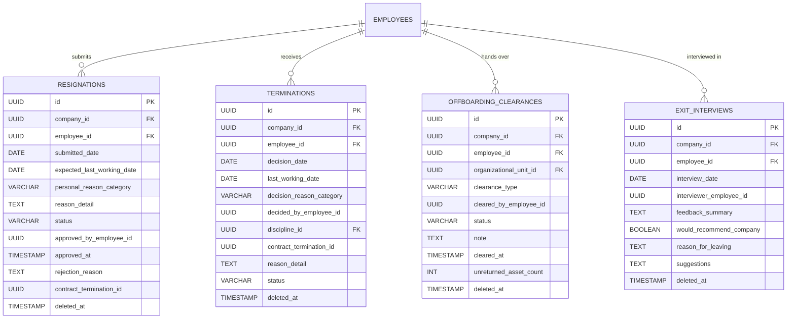
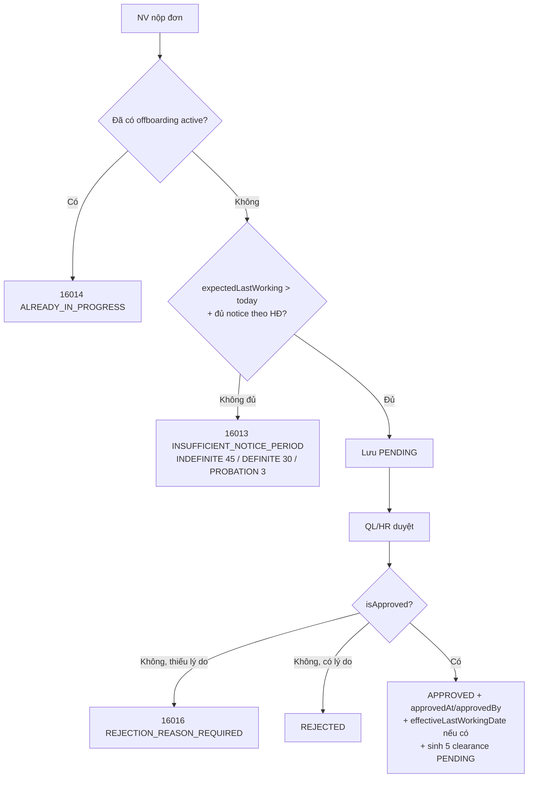
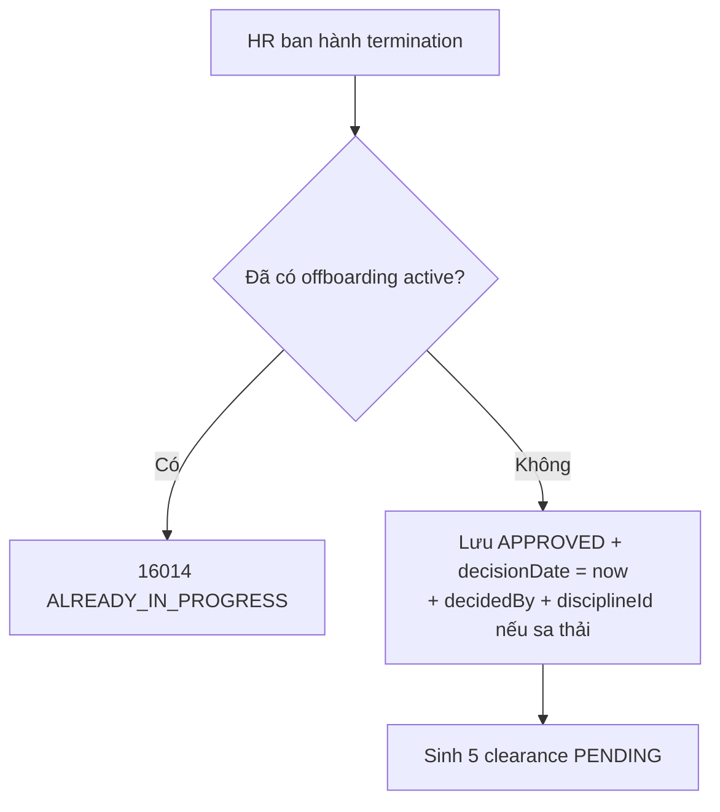
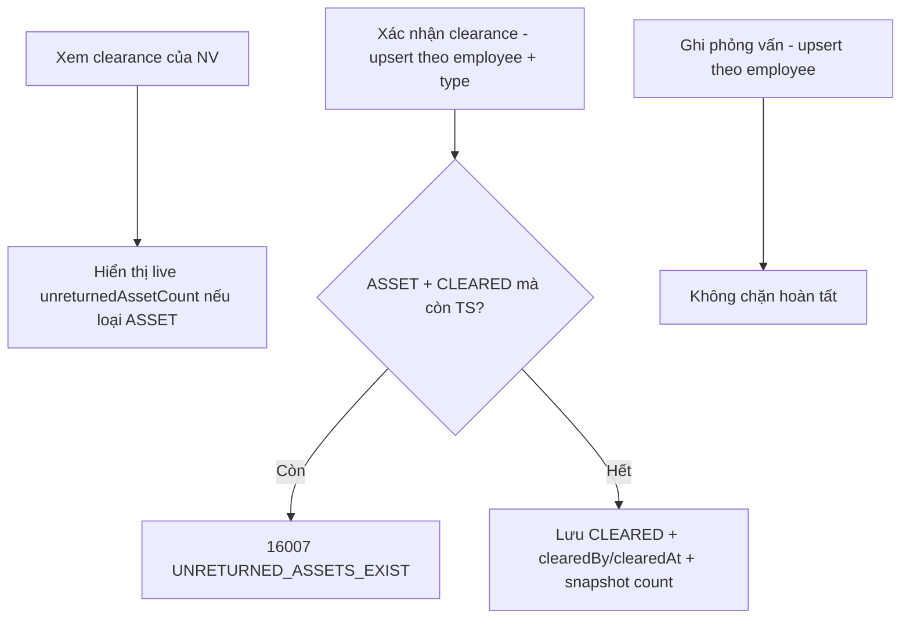
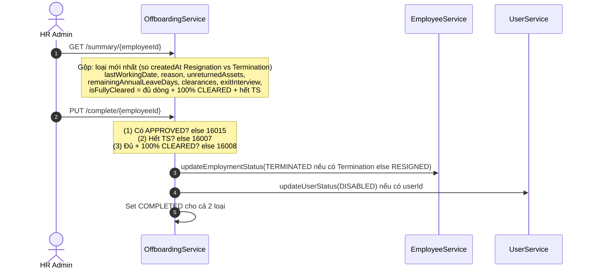

# Tài liệu Nghiệp vụ Module: Thôi việc & Bàn giao (Offboarding Management)

> **Module Code:** `offboarding`  
> **Package:** `com.cyclosa.offboarding`  
> **Phiên bản:** 2.0 (Chuẩn hóa Backend Standards & Automation)  
> **Căn cứ pháp lý:**  
> - **Bộ luật Lao động 2019** (Luật số 45/2019/QH14)  
>   - *Điều 34:* Các trường hợp chấm dứt hợp đồng lao động (hết hạn, thỏa thuận, sa thải, đơn phương...).  
>   - *Điều 35:* Quyền đơn phương chấm dứt — thời hạn báo trước (HĐ không xác định 45 ngày, HĐ xác định 30 ngày, thử việc 03 ngày).  
>   - *Điều 113.3:* Thanh toán phép năm chưa nghỉ khi thôi việc.  
>   - *Điều 125:* Sa thải do kỷ luật (liên kết `disciplineId + DISCIPLINARY_DISMISSAL`).

---

## 1. Tôn chỉ Nghiệp vụ & Nguyên tắc Thiết kế (Core Principles)

Module **Offboarding** là trạm cuối của vòng đời nhân sự, đảm bảo mọi ca thôi việc (tự nguyện, sa thải, tinh giản, hết hạn, thỏa thuận) đều đi qua 4 chốt: **phê duyệt → bàn giao 5 hạng mục → thu hồi tài sản → khóa tài khoản**, với đầy đủ vết lịch sử và số dư phép tồn.

```
┌─────────────────────────┐       ┌────────────────────────────────┐       ┌─────────────────────────┐
│   Discipline / Contract │       │  Module Offboarding            │       │ Employee / Asset / Leave│
│  - Sa thải kỷ luật      │ ────> │  - Resignation, Termination    │ ────> │  - RESIGNED/TERMINATED   │
│  - HĐLĐ (notice period) │       │  - Clearance, Exit interview   │       │  - Thu hồi TS, phép tồn  │
└─────────────────────────┘       └────────────────────────────────┘       └─────────────────────────┘
```

### 1.1. Chuẩn hóa Thiết kế Không dùng Interface + Impl thừa thãi (Concrete Service Pattern)
Theo chuẩn kiến trúc tại `docs/BACKEND_STANDARDS.md`:
- Toàn bộ service của module được viết trực tiếp dưới dạng **Concrete Service**:
  - `OffboardingService.java`: Service trung tâm duy nhất — xin nghỉ, duyệt, ban hành chấm dứt, bàn giao, phỏng vấn nghỉ việc, tổng hợp và hoàn tất.
- **Tuyệt đối không tạo thư mục `impl/`** hay interface 1-1 hình thức.

### 1.2. Đóng gói Kiến trúc Modular Monolith & Giao tiếp Liên Module
1. **Lấy dữ liệu hạ tầng qua Public Service của module lân cận:**
   - `EmployeeService`: `findEmployeeIdByUserId`, `getEmployeeByIdInternal`, `getEmployeeSummaries`, `updateEmploymentStatus(RESIGNED / TERMINATED)` — xác thực, enrich, chốt trạng thái nhân sự.
   - `ContractService`: `getActiveContractByEmployee` — lấy `ContractType` tính thời hạn báo trước Điều 35.
   - `AssetService`: `countUnreturnedAssets` — chốt chặn bàn giao `ASSET` và hoàn tất.
   - `LeaveBalanceService`: `getTotalRemainingLeaveDays` — hiển thị phép tồn trong summary.
   - `UserService` + `SecurityUtils` + `SecurityPermissionEvaluator`: `getCurrentUserId`, `updateUserStatus(DISABLED)`, `perm.has / getDataScope`.
2. **Nhận đầu vào từ Module Discipline:** `Termination.disciplineId + TerminationReason.DISCIPLINARY_DISMISSAL` khi sa thải do kỷ luật.
3. **Batch Enrichment chống N+1 Query:** mọi API list/detail gom `employeeIds` gọi `getEmployeeSummaries` 1 lần; `OffboardingMapper` (MapStruct `componentModel="spring"`) chỉ map thuần, không query trong loop.

### 1.3. Một Offboarding Active tại một thời điểm (Single Active Guard)
- Nhân viên đã có đơn/quyết định ở `PENDING / APPROVED` (resignation) hoặc `DRAFT / APPROVED` (termination) thì chặn tạo mới (`16014 OFFBOARDING_ALREADY_IN_PROGRESS`).

### 1.4. Không hoàn tất khi chưa sạch Bàn giao & Tài sản (Clear-to-Close Automation)
- `ensureDefaultClearances()` tự sinh 5 hạng mục `ASSET, IT, FINANCE, HR, DEPARTMENT` ở trạng thái `PENDING` ngay khi đơn được duyệt (hoặc ngay khi ban hành termination).
- `completeOffboarding` kiểm tra tuần tự: có `APPROVED` → hết tài sản chưa trả → 100% clearance `CLEARED` → chuyển trạng thái NV → khóa tài khoản → chốt `COMPLETED`.

---

## 2. Mô hình Thực thể & CSDL Chi tiết (Database Schema)



---

### 2.1. Bảng `resignations` — Đơn xin nghỉ Tự nguyện

| Thuộc tính | Kiểu dữ liệu | Ràng buộc | Diễn giải nghiệp vụ |
| :--- | :--- | :--- | :--- |
| `id` | `UUID` | PK | Khóa chính |
| `company_id` | `UUID` | Not Null | Copy từ `employee.company.id` |
| `employee_id` | `UUID` | Not Null | NV nộp đơn (suy từ `currentUserId`) |
| `submitted_date` | `DATE` | Not Null | Auto = hôm nay khi nộp |
| `expected_last_working_date` | `DATE` | Not Null, `@Future` | Ngày nghỉ mong muốn; có thể bị ghi đè bởi `effectiveLastWorkingDate` khi duyệt |
| `personal_reason_category` | `ENUM` | Not Null | `BETTER_OPPORTUNITY`, `PERSONAL_FAMILY`, `HEALTH`, `RELOCATION`, `CAREER_CHANGE`, `WORK_ENVIRONMENT`, `COMPENSATION`, `OTHER` |
| `reason_detail` | `TEXT` | Nullable | Chi tiết tự do |
| `status` | `ENUM` | Default `PENDING` | `PENDING` → `APPROVED` / `REJECTED` → `COMPLETED` (`CANCELLED` khai báo, chưa dùng) |
| `approved_by_employee_id` | `UUID` | Nullable | Người duyệt (map từ `currentUserId`) |
| `approved_at` | `TIMESTAMP` | Nullable | Thời điểm duyệt |
| `rejection_reason` | `TEXT` | Bắt buộc khi từ chối | Lý do không phê duyệt |
| `contract_termination_id` | `UUID` | Nullable | Link module Contract (hiện chỉ lưu, chưa tự tạo) |
| `deleted_at` | `TIMESTAMP` | Nullable | Xóa mềm |

### 2.2. Bảng `terminations` — Quyết định Chấm dứt do Công ty ban hành

| Thuộc tính | Kiểu dữ liệu | Ràng buộc | Diễn giải nghiệp vụ |
| :--- | :--- | :--- | :--- |
| `id` | `UUID` | PK | Khóa chính |
| `company_id` | `UUID` | Not Null | Ưu tiên `request.companyId`, fallback công ty của NV |
| `employee_id` | `UUID` | Not Null | NV bị chấm dứt |
| `decision_date` | `DATE` | Not Null | Auto = hôm nay |
| `last_working_date` | `DATE` | Not Null | Ngày làm việc cuối |
| `decision_reason_category` | `ENUM` | Not Null | `PERFORMANCE`, `DISCIPLINARY_DISMISSAL`, `RESTRUCTURING_DOWNSIZING`, `CONTRACT_EXPIRED_NOT_RENEWED`, `MUTUAL_AGREEMENT`, `PROBATION_FAILED`, `OTHER` |
| `decided_by_employee_id` | `UUID` | Nullable | Người ban hành |
| `discipline_id` | `UUID` | Nullable | Link Discipline khi `DISCIPLINARY_DISMISSAL` |
| `contract_termination_id` | `UUID` | Nullable | Link Contract |
| `reason_detail` | `TEXT` | Nullable | Chi tiết |
| `status` | `ENUM` | Tạo mới luôn `APPROVED` | `DRAFT`, `APPROVED`, `CANCELLED`, `COMPLETED` (`DRAFT/CANCELLED` chỉ dùng để check tồn tại) |
| `deleted_at` | `TIMESTAMP` | Nullable | Xóa mềm |

### 2.3. Bảng `offboarding_clearances` — Hạng mục Bàn giao

Unique logic cặp `(employeeId, clearanceType)`:

| Thuộc tính | Kiểu dữ liệu | Ràng buộc | Diễn giải nghiệp vụ |
| :--- | :--- | :--- | :--- |
| `id` | `UUID` | PK | Khóa chính |
| `company_id` | `UUID` | Not Null | Multi-tenancy |
| `employee_id` | `UUID` | Not Null | NV bàn giao |
| `organizational_unit_id` | `UUID` | Nullable | Đơn vị phụ trách (hiện chưa set) |
| `clearance_type` | `ENUM` | Not Null | `IT`, `ASSET`, `FINANCE`, `HR`, `DEPARTMENT` (luôn đủ 5 dòng sau APPROVED) |
| `cleared_by_employee_id` | `UUID` | Nullable | Người xác nhận |
| `status` | `ENUM` | Default `PENDING` | `PENDING` → `CLEARED` / `REJECTED` |
| `note` | `TEXT` | Nullable | Ghi chú |
| `cleared_at` | `TIMESTAMP` | Nullable | Set `now()` khi `CLEARED`, null khi khác |
| `unreturned_asset_count` | `INT` | Default `0` | Snapshot `countUnreturnedAssets()` khi update loại `ASSET` |
| `deleted_at` | `TIMESTAMP` | Nullable | Xóa mềm |

### 2.4. Bảng `exit_interviews` — Phỏng vấn Nghỉ việc (1 NV = 1 bản, upsert)

| Thuộc tính | Kiểu dữ liệu | Ràng buộc | Diễn giải nghiệp vụ |
| :--- | :--- | :--- | :--- |
| `id` | `UUID` | PK | Khóa chính |
| `company_id` | `UUID` | Not Null | Multi-tenancy |
| `employee_id` | `UUID` | Not Null | NV được phỏng vấn (unique logic) |
| `interview_date` | `DATE` | Not Null | Mặc định hôm nay nếu không nhập |
| `interviewer_employee_id` | `UUID` | Nullable | Mặc định người đang đăng nhập |
| `feedback_summary` | `TEXT` | Nullable | Tổng hợp phản hồi |
| `would_recommend_company` | `BOOLEAN` | Nullable | Có giới thiệu công ty không |
| `reason_for_leaving` | `TEXT` | Nullable | Lý do rời đi |
| `suggestions` | `TEXT` | Nullable | Đề xuất cải thiện |
| `deleted_at` | `TIMESTAMP` | Nullable | Xóa mềm |

> [!NOTE]
> Phỏng vấn nghỉ việc **không bắt buộc** để hoàn tất — chỉ hiển thị trong summary.

---

## 3. Các Luồng Nghiệp vụ Trọng tâm (Business Workflows)

### 3.1. Luồng Xin nghỉ Tự nguyện (F1)



### 3.2. Luồng Ban hành Chấm dứt từ Công ty (F2 — link Discipline)



### 3.3. Luồng Bàn giao & Phỏng vấn (F3–F4)



### 3.4. Luồng Tổng hợp & Hoàn tất (F5)



---

## 4. Danh mục RESTful API Chi tiết

### 4.1. Nhóm API Đơn xin nghỉ (`/api/v1/offboarding/resignations`)

| Method | Endpoint | Mô tả chức năng | Quyền yêu cầu | Response DTO |
| :---: | :--- | :--- | :--- | :--- |
| `POST` | `/api/v1/offboarding/resignations` | NV nộp đơn xin thôi việc | `offboarding.view_own` | `ApiResponse<ResignationResponse>` (201) |
| `PUT` | `/api/v1/offboarding/resignations/{id}/approve` | QL/HR duyệt hoặc từ chối | `offboarding.approve` | `ApiResponse<ResignationResponse>` |
| `GET` | `/api/v1/offboarding/resignations/{id}` | Chi tiết đơn | `offboarding.view` (+ `view_own` cho chính mình) | `ApiResponse<ResignationDetailResponse>` |
| `GET` | `/api/v1/offboarding/resignations` | Danh sách phân trang + filter | `offboarding.view` | `ApiResponse<PageData<ResignationResponse>>` |

### 4.2. Nhóm API Quyết định chấm dứt (`/api/v1/offboarding/terminations`)

| Method | Endpoint | Mô tả chức năng | Quyền yêu cầu | Response DTO |
| :---: | :--- | :--- | :--- | :--- |
| `POST` | `/api/v1/offboarding/terminations` | Ban hành QĐ (sa thải/tinh giản/hết hạn) | `offboarding.manage` | `ApiResponse<TerminationResponse>` (201) |
| `GET` | `/api/v1/offboarding/terminations/{id}` | Chi tiết QĐ | `offboarding.view` | `ApiResponse<TerminationDetailResponse>` |
| `GET` | `/api/v1/offboarding/terminations` | Danh sách phân trang + filter | `offboarding.view` | `ApiResponse<PageData<TerminationResponse>>` |

### 4.3. Nhóm API Bàn giao (`/api/v1/offboarding/clearances`)

| Method | Endpoint | Mô tả chức năng | Quyền yêu cầu | Response DTO |
| :---: | :--- | :--- | :--- | :--- |
| `GET` | `/api/v1/offboarding/clearances/employee/{employeeId}` | Hạng mục bàn giao của NV (kèm TS chưa trả live) | `offboarding.view` (+ `view_own`) | `ApiResponse<List<OffboardingClearanceResponse>>` |
| `PUT` | `/api/v1/offboarding/clearances` | Xác nhận bàn giao (check thu hồi TS nếu `ASSET`) | `offboarding.approve` | `ApiResponse<OffboardingClearanceResponse>` |

### 4.4. Nhóm API Phỏng vấn nghỉ việc (`/api/v1/offboarding/exit-interviews`)

| Method | Endpoint | Mô tả chức năng | Quyền yêu cầu | Response DTO |
| :---: | :--- | :--- | :--- | :--- |
| `POST` | `/api/v1/offboarding/exit-interviews` | Ghi nhận KQ phỏng vấn (upsert) | `offboarding.manage` | `ApiResponse<ExitInterviewResponse>` (201) |
| `GET` | `/api/v1/offboarding/exit-interviews/employee/{employeeId}` | Xem phỏng vấn của NV | `offboarding.view` | `ApiResponse<ExitInterviewDetailResponse>` |

### 4.5. Nhóm API Điều phối (`/api/v1/offboarding`)

| Method | Endpoint | Mô tả chức năng | Quyền yêu cầu | Response DTO |
| :---: | :--- | :--- | :--- | :--- |
| `GET` | `/api/v1/offboarding/summary/{employeeId}` | Bảng tổng hợp (hồ sơ, TS chưa trả, phép tồn, clearance, phỏng vấn) | `offboarding.view` (+ `view_own`) | `ApiResponse<OffboardingSummaryResponse>` |
| `PUT` | `/api/v1/offboarding/complete/{employeeId}` | Hoàn tất (check bàn giao, TS, chuyển trạng thái, khóa account) | `offboarding.manage` | `ApiResponse<OffboardingSummaryResponse>` |

---

## 5. Danh mục Mã lỗi Module Offboarding (`OffboardingErrorCode`)

Dải mã `16001 - 16016`, định nghĩa tại `OffboardingErrorCode.java`:

| Mã lỗi | Enum Name | HTTP Status | Thông điệp lỗi chuẩn |
| :---: | :--- | :--- | :--- |
| `16001` | `RESIGNATION_NOT_FOUND` | 404 Not Found | Không tìm thấy đơn xin thôi việc |
| `16002` | `TERMINATION_NOT_FOUND` | 404 Not Found | Không tìm thấy quyết định chấm dứt HĐLĐ |
| `16003` | `CLEARANCE_NOT_FOUND` | 404 Not Found | Không tìm thấy thông tin thủ tục bàn giao |
| `16004` | `EXIT_INTERVIEW_NOT_FOUND` | 404 Not Found | Không tìm thấy bản phỏng vấn thôi việc |
| `16005` | `RESIGNATION_ALREADY_PROCESSED` | 409 Conflict | Đơn đã được xử lý phê duyệt/từ chối trước đó |
| `16006` | `TERMINATION_ALREADY_PROCESSED` | 409 Conflict | Quyết định đã được xử lý trước đó |
| `16007` | `UNRETURNED_ASSETS_EXIST` | 422 Unprocessable | Nhân viên còn tài sản chưa hoàn trả, không thể hoàn tất |
| `16008` | `CLEARANCES_INCOMPLETE` | 422 Unprocessable | Chưa hoàn tất đủ thủ tục bàn giao |
| `16009` | `OFFBOARDING_ALREADY_COMPLETED` | 409 Conflict | Thủ tục đã hoàn tất trước đó |
| `16010` | `CURRENT_USER_NOT_LINKED_EMPLOYEE` | 400 Bad Request | Tài khoản chưa liên kết hồ sơ nhân viên |
| `16011` | `EMPLOYEE_NOT_FOUND` | 404 Not Found | Không tìm thấy nhân viên |
| `16012` | `UNAUTHORIZED_OFFBOARDING_ACCESS` | 403 Forbidden | Không có quyền thao tác hồ sơ này |
| `16013` | `INSUFFICIENT_NOTICE_PERIOD` | 422 Unprocessable | Thời gian báo trước không đủ theo HĐ + Điều 35 BLLĐ |
| `16014` | `OFFBOARDING_ALREADY_IN_PROGRESS` | 409 Conflict | Nhân viên đã có đơn/quyết định đang xử lý |
| `16015` | `NO_APPROVED_OFFBOARDING` | 422 Unprocessable | Nhân viên không có đơn/quyết định nào ở trạng thái đã phê duyệt |
| `16016` | `REJECTION_REASON_REQUIRED` | 400 Bad Request | Lý do từ chối bắt buộc khi không phê duyệt |

---

## 6. Phân bổ Quyền Hạn & Ma trận Vai trò (RBAC Matrix)

| Mã quyền (Permission Code) | Diễn giải quyền | Gán vai trò mặc định & DataScope |
| :--- | :--- | :--- |
| `offboarding.view_own` | NV tự nộp đơn xin thôi việc | `EMPLOYEE` (OWN), `DEPARTMENT_MANAGER` (OWN), `HR_ADMIN` (OWN) |
| `offboarding.view` | Xem chi tiết/list/summary/clearance/phỏng vấn | `DEPARTMENT_MANAGER` (DEPARTMENT), `HR_ADMIN` (COMPANY), `SUPER_ADMIN` (ALL); list lọc `OWN / TEAM / DEPARTMENT / COMPANY / ALL`; xem chi tiết người khác ngoài `view/manage` bị chặn `16012` |
| `offboarding.approve` | Duyệt đơn, xác nhận bàn giao | `DEPARTMENT_MANAGER` (DEPARTMENT), `HR_ADMIN` (COMPANY), `SUPER_ADMIN` (ALL) |
| `offboarding.manage` | Ban hành termination, ghi phỏng vấn, hoàn tất offboarding | `HR_ADMIN` (COMPANY), `SUPER_ADMIN` (ALL) |
