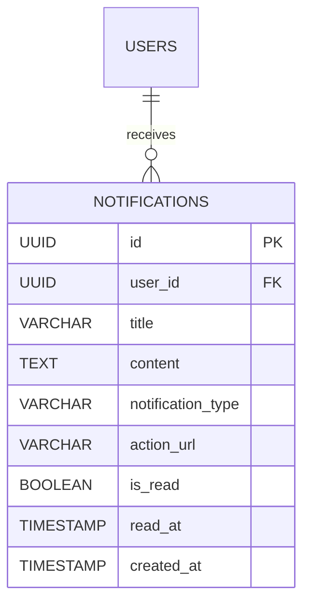
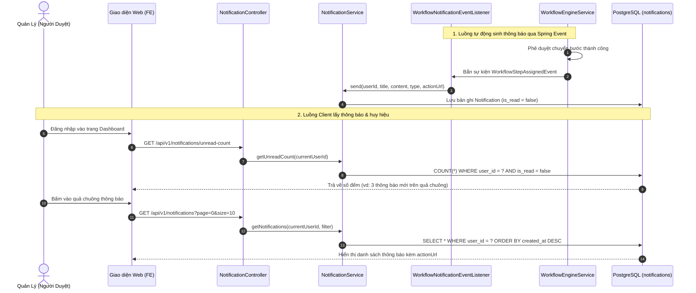

# Tài liệu Nghiệp vụ Module: Thông Báo Nội Bộ (In-app Notification Center)

> **Module Code:** `notification`  
> **Package:** `com.cyclosa.notification`  
> **Phiên bản:** 2.0 (Chuẩn hóa Backend Standards & Enterprise Event-Driven)  
> **Căn cứ nghiệp vụ & Thiết kế:**  
> - **Trung Tâm Tin Tức Nội Bộ (In-app Notification Center):** Gửi nhắc nhở, cảnh báo hạn chót và thông báo phê duyệt tới đúng đối tượng.  
> - **Kiến Trúc Tách Rời (Event-Driven Decoupling):** Lắng nghe các Spring Events phát ra từ các module nghiệp vụ (`WorkflowCompletedEvent`, `WorkflowStepAssignedEvent`, `ContractExpiringEvent`).  
> - **Mô Hình Pull-based REST API Tiết Kiệm Tài Nguyên:** Không duy trì WebSocket connection treo liên tục, Client tra cứu qua REST API khi nạp trang hoặc mở quả chuông.

---

## 1. Tôn chỉ Nghiệp vụ & Nguyên tắc Thiết kế (Core Principles)

Trong hệ sinh thái **CYCLOSA HRM**, Module **Notification** đóng vai trò là kênh giao tiếp nội bộ thông suốt giữa hệ thống, quản lý và nhân viên:

```
┌─────────────────────────────────┐
│     Business Modules (Caller)   │
│  - Workflow, Contract, Leave    │
│  - Payroll, Discipline, Asset   │
└────────────────┬────────────────┘
                 │
                 ├── 1. Spring Domain Event (ApplicationEventPublisher)
                 └── 2. NotificationService.send(...) (Direct Call)
                 │
┌────────────────▼────────────────┐       ┌─────────────────────────┐
│  Module com.cyclosa.notification│ ────> │   PostgreSQL Database   │
│  - Pull-based Polling (REST)    │       │   - notifications       │
│  - Unread Count & Deep Linking  │       │   - Privacy Enforcement │
└─────────────────────────────────┘       └─────────────────────────┘
```

### 1.1. Chuẩn hóa Thiết kế Không dùng Interface + Impl thừa thãi (Concrete Service Pattern)
Theo chuẩn kiến trúc tại `docs/BACKEND_STANDARDS.md`:
- Toàn bộ service của module được viết trực tiếp dưới dạng **Concrete Service**:
  - `NotificationService.java`: Service trung tâm duy nhất quản lý gửi thông báo, đếm số chưa đọc, đánh dấu đã đọc (`markAsRead`, `markAllAsRead`) và xóa thông báo.
  - `WorkflowNotificationEventListener.java`: Listener lắng nghe sự kiện duyệt đơn từ Workflow Engine.
- **Tuyệt đối không tạo thư mục `impl/`** hay interface 1-1 hình thức.

### 1.2. Đóng gói Kiến trúc Modular Monolith & Giao Tiếp Event-Driven
1. **Lắng nghe sự kiện không làm nghẽn luồng chính:**
   - Các module khác khi hoàn tất nghiệp vụ chỉ cần bắn `ApplicationEvent` (ví dụ: `WorkflowStepAssignedEvent`).
   - Notification Listener xử lý tạo bản ghi thông báo trong giao dịch độc lập, không làm chậm tốc độ phản hồi của request chính.
2. **Không inject chéo Entity:** Chỉ lưu trữ `user_id` người nhận, không truy cập bảng `users` hay `employees`.

### 1.3. Mô Hình Hoạt Động Pull-Based & Zero Socket Overhead
- Không duy trì kết nối WebSocket / Socket.IO treo liên tục nhằm tối ưu hóa tài nguyên server và tương thích tốt với môi trường hạ tầng container/load-balancer.
- Giao diện Web Client lấy số đếm quả chuông qua API nhẹ `GET /unread-count` khi người dùng tải trang hoặc theo chu kỳ polling định kỳ.

### 1.4. Bảo Mật Riêng Tư Tuyệt Đối & Điều Hướng Nhanh (Deep Linking)
- **Quyền riêng tư:** Một người dùng tuyệt đối không thể đọc, xem hoặc xóa thông báo của người khác (`4902 NOTIFICATION_ACCESS_DENIED`).
- **Deep Link (`action_url`):** Mỗi thông báo đính kèm đường dẫn trực tiếp (ví dụ: `/workflows/pending`, `/contracts/123`). Người dùng click quả chuông sẽ được chuyển ngay đến màn hình xử lý công việc.

---

## 2. Mô hình Thực thể & CSDL Chi tiết (Database Schema)



### 2.1. Bảng `notifications` — Nhật Ký Thông Báo Người Dùng

| Tên Cột | Kiểu Dữ Liệu | Ràng Buộc | Ý Nghĩa Nghiệp Vụ & Kỹ Thuật |
| :--- | :--- | :--- | :--- |
| `id` | `UUID` | `PK, NOT NULL` | Định danh duy nhất của thông báo. |
| `user_id` | `UUID` | `NOT NULL, INDEX` | Tài khoản người dùng nhận thông báo (FK `users`). |
| `title` | `VARCHAR(200)` | `NOT NULL` | Tiêu đề tóm tắt hiển thị trên quả chuông. |
| `content` | `TEXT` | `NOT NULL` | Nội dung chi tiết của thông báo. |
| `notification_type` | `VARCHAR(50)` | `NOT NULL, INDEX` | Phân loại: `WORKFLOW`, `CONTRACT`, `PAYROLL`, `ANNOUNCEMENT`, `SYSTEM`. |
| `action_url` | `VARCHAR(500)` | `NULLABLE` | Đường dẫn Deep Link chuyển hướng người dùng khi click. |
| `is_read` | `BOOLEAN` | `NOT NULL, DEFAULT FALSE` | Cờ trạng thái: `false` (chưa đọc), `true` (đã đọc). |
| `read_at` | `TIMESTAMP` | `NULLABLE` | Thời điểm người dùng click xem/đánh dấu đã đọc. |
| `created_at` | `TIMESTAMP` | `NOT NULL, INDEX` | Thời điểm sinh thông báo (sắp xếp mặc định `DESC`). |

* **Index Tối Ưu:** Đánh chỉ mục kép trên `(user_id, is_read)` giúp truy vấn `COUNT(*)` số lượng chưa đọc đạt tốc độ sub-millisecond.

---

## 3. Các Luồng Nghiệp vụ Trọng tâm (Business Workflows)

### 3.1. Luồng Tự Động Sinh Thông Báo & Tra Cứu Quả Chuông (Sequence)



---

### 3.2. Luồng Đánh Dấu Đã Đọc & Điều Hướng
1. Khi người dùng click vào 1 thông báo trên giao diện:
   - Frontend kích hoạt: `PUT /api/v1/notifications/{id}/read`.
   - Hệ thống cập nhật `is_read = true`, `read_at = NOW()`.
   - Frontend điều hướng người dùng tới `action_url` được gắn kèm.
2. Khi người dùng click nút "Đánh dấu tất cả là đã đọc":
   - Frontend gọi: `PUT /api/v1/notifications/read-all`.
   - Hệ thống thực thi: `UPDATE notifications SET is_read = true, read_at = NOW() WHERE user_id = ? AND is_read = false`.
   - Huy hiệu số đỏ trên quả chuông lập tức trở về `0`.

---

## 4. Danh mục RESTful API Chi tiết

Base URI: `/api/v1/notifications`

| HTTP Method | Endpoint URI | Phân Quyền (@PreAuthorize) | DTO Request / Response | Chức Năng Nghiệp Vụ |
| :---: | :--- | :--- | :--- | :--- |
| `GET` | `/` | `isAuthenticated()` | `NotificationFilter` $\rightarrow$ `ApiResponse<PageData<NotificationResponse>>` | Tra cứu danh sách thông báo cá nhân (phân trang, lọc chưa đọc). |
| `GET` | `/unread-count` | `isAuthenticated()` | None $\rightarrow$ `ApiResponse<UnreadCountResponse>` | Đếm số lượng thông báo chưa đọc cho huy hiệu quả chuông. |
| `GET` | `/{id}` | `isAuthenticated()` | Path `id` $\rightarrow$ `ApiResponse<NotificationResponse>` | Xem chi tiết 1 thông báo cụ thể. |
| `PUT` | `/{id}/read` | `isAuthenticated()` | Path `id` $\rightarrow$ `ApiResponse<Void>` | Đánh dấu 1 thông báo là đã đọc. |
| `PUT` | `/read-all` | `isAuthenticated()` | None $\rightarrow$ `ApiResponse<Void>` | Đánh dấu toàn bộ thông báo của bản thân là đã đọc. |
| `DELETE`| `/{id}` | `isAuthenticated()` | Path `id` $\rightarrow$ `ApiResponse<Void>` | Xóa thông báo khỏi hộp thư cá nhân. |
| `POST` | `/send-system` | `@perm.has('notification.broadcast')` | `BroadcastNotificationRequest` $\rightarrow$ `ApiResponse<Void>` | Quản trị viên phát thông báo hệ thống toàn thể công ty. |

---

## 5. Danh mục Mã lỗi Module Notification (`NotificationErrorCode`)

| Mã Lỗi (Enum) | Mã Số | HTTP Status | Thông Điệp Tiếng Việt | Nguyên Nhân & Ngữ Cảnh Kích Hoạt |
| :--- | :---: | :---: | :--- | :--- |
| `NOTIFICATION_NOT_FOUND` | **4901** | `404 Not Found` | Không tìm thấy thông báo | `id` thông báo không tồn tại trong hệ thống. |
| `NOTIFICATION_ACCESS_DENIED` | **4902** | `403 Forbidden` | Bạn không có quyền thao tác trên thông báo này | Người dùng cố tình đọc, đánh dấu hoặc xóa thông báo của người khác. |
| `RECIPIENT_USER_NOT_FOUND` | **4903** | `404 Not Found` | Không tìm thấy tài khoản người nhận thông báo | Gửi thông báo tới `user_id` không tồn tại trong hệ thống. |

---

## 6. Phân bổ Quyền Hạn & Ma trận Vai trò (RBAC Matrix)

| Mã Quyền (Permission) | Mô Tả Hành Động | Super Admin | HR Admin | Dept Manager | Employee |
| :--- | :--- | :---: | :---: | :---: | :---: |
| `isAuthenticated()` | Xem, đếm, đọc và xóa thông báo cá nhân của chính mình | **SELF (Hộp thư)** | **SELF (Hộp thư)** | **SELF (Hộp thư)** | **SELF (Hộp thư)** |
| `notification.broadcast`| Bắn thông báo thông cáo chung toàn công ty / toàn hệ thống | **FULL** | **COMPANY** | ⛔ | ⛔ |
