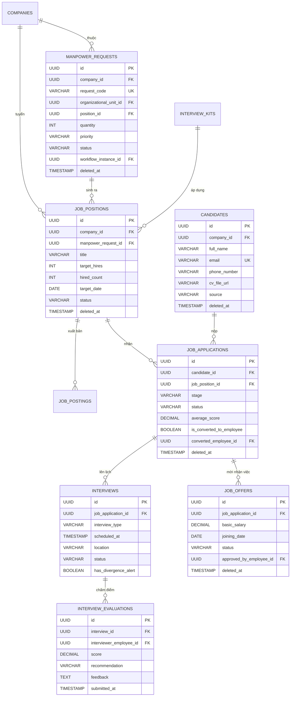
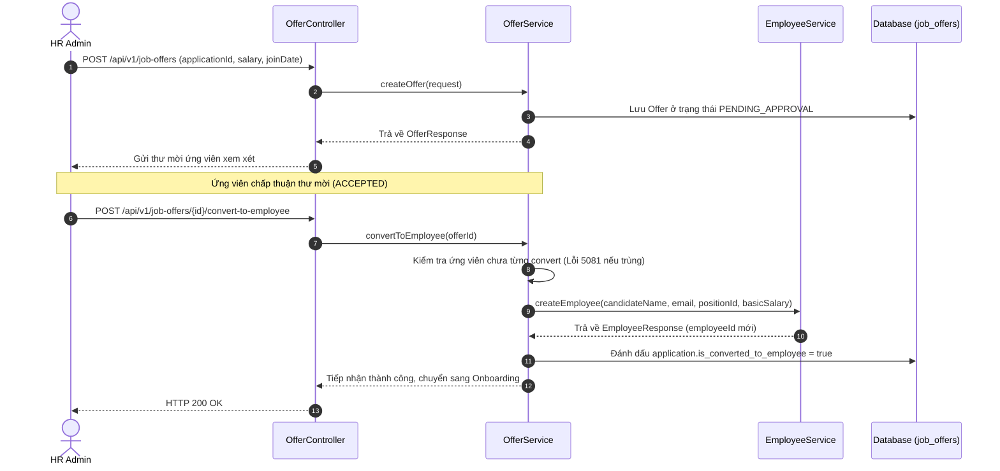

# Tài liệu Nghiệp vụ Module 02: Tuyển dụng & Thu hút Nhân tài (Recruitment & Talent Acquisition)

> **Module Code:** `recruitment` (gồm Phân hệ Phỏng vấn 2.1 & Module 31 Thị trường Nhân tài Nội bộ được hợp nhất)  
> **Package:** `com.cyclosa.recruitment`  
> **Phiên bản:** 2.0 (Chuẩn hóa Backend Standards & Talent Acquisition)  
> **Căn cứ nghiệp vụ & Thiết kế:**  
> - **Khung Quản trị Tuyển dụng Toàn diện (ATS Pipeline):** Từ khâu đề xuất bổ sung nhân sự, xuất bản tin đa kênh đến sàng lọc hồ sơ ứng viên.  
> - **Hệ thống Đánh giá Phỏng vấn Độc lập (Blind Grading & Divergence Alert):** Chấm điểm không thiên vị, tự động phát hiện mâu thuẫn nhận xét giữa các giám khảo.  
> - **Chuyển Đổi Tự Động Ứng Viên Thành Nhân Viên (Convert to Employee):** Tiếp nhận ứng viên trúng tuyển thẳng vào Core Employee Profile, tạo Hợp đồng lao động và tài khoản người dùng.  
> - **Thị trường Nhân tài Nội bộ (Internal Talent Marketplace):** Đăng tuyển các dự án ngắn hạn/nhiệm vụ nội bộ để tận dụng năng lực nội bộ (Module 31 gộp).

---

## 1. Tôn chỉ Nghiệp vụ & Nguyên tắc Thiết kế (Core Principles)

Module **Recruitment** quản lý toàn bộ chu trình tiếp nhận nhân tài của doanh nghiệp, từ khi phát sinh nhu cầu định biên cho đến khi chuyển đổi ứng viên trúng tuyển thành nhân viên chính thức trong tổ chức:

```
[1. Đề Xuất Tuyển Dụng] ──(Workflow Duyệt)──► [2. Vị Trí & Đăng Tin]
                                                      │
                                                      ▼
[4. Phỏng Vấn Hội Đồng] ◄──(ATS Pipeline)─── [3. Ứng Viên & Hồ Sơ]
    - Interview Kit & Rubrics                         │
    - Blind Grading                                   ▼
    - Divergence Alert                         [Talent Pool]
    - Bias Awareness
          │
          ▼
[5. Offer Mời Việc] ──(Workflow Duyệt)──► [6. Tiếp Nhận (Convert to Employee)]
                                                  │
                                                  ▼
                                      Tự động tạo Employee Profile
                                      (Mã NV, Hợp đồng, Tài khoản)
```

### 1.1. Chuẩn hóa Thiết kế Không dùng Interface + Impl thừa thãi (Concrete Service Pattern)
Theo chuẩn kiến trúc tại `docs/BACKEND_STANDARDS.md`:
- Toàn bộ service của module được viết trực tiếp dưới dạng **Concrete Service**:
  - `RecruitmentService.java`: Service trung tâm điều phối đề xuất tuyển dụng (`ManpowerRequest`), vị trí (`JobPosition`), tin tuyển dụng (`JobPosting`), ứng viên (`Candidate`) và hồ sơ ứng tuyển (`JobApplication`).
  - `InterviewService.java`: Quản lý bộ câu hỏi phỏng vấn chuẩn hóa (`InterviewKit`), lịch hội đồng phỏng vấn, chấm điểm độc lập (`Blind Grading`) và phát hiện phân kỳ nhận xét.
  - `OfferService.java`: Quản lý thư mời nhận việc (`JobOffer`), phê duyệt đãi ngộ và chuyển đổi ứng viên thành nhân viên chính thức (`Convert to Employee`).
  - `InternalTalentMarketplaceService.java`: Quản lý các cơ hội dự án và luân chuyển nội bộ.
- **Tuyệt đối không tạo thư mục `impl/`** hay interface 1-1 hình thức.

### 1.2. Đóng gói Kiến trúc Modular Monolith & Giao tiếp Liên Module
1. **Lấy dữ liệu hạ tầng qua Public Service của module lân cận:**
   - `EmployeeService`: `createEmployee`, `getEmployeeByIdInternal`, `getEmployeeSummaries` — kiểm tra giám khảo phỏng vấn, tạo mới hồ sơ nhân sự khi accept Offer.
   - `PositionService` & `OrganizationalUnitService`: xác thực vị trí tuyển dụng và phòng ban tiếp nhận.
   - `WorkflowEngine`: tích hợp duyệt đa cấp cho đề xuất tuyển dụng (`MANPOWER_REQUEST`) và thư mời việc (`JOB_OFFER`).
2. **Batch Enrichment chống N+1 Query:** Nạp thông tin ứng viên, người phỏng vấn và vị trí theo lô `Set<UUID>`.

### 1.3. Tiếp Nhận Một Chạm (Convert to Employee Automation)
- Khi ứng viên đồng ý thư mời việc (`OfferStatus = ACCEPTED`):
  - HR gọi API `convertToEmployee`.
  - Hệ thống tự động kiểm tra chống tạo trùng lặp (`5081 APPLICATION_ALREADY_CONVERTED`).
  - Gọi sang `employeeService.createEmployee(...)` để khởi tạo hồ sơ nhân viên gốc, chuyển tiếp ứng viên sang Module 03 (Onboarding).

### 1.4. Chấm Điểm Độc Lập & Cảnh Báo Phân Kỳ (Blind Grading & Divergence Alert)
- **Blind Grading:** Các giám khảo không được xem điểm số hoặc nhận xét của nhau cho đến khi bản thân đã nộp phiếu chấm điểm (`5063 EVALUATION_ALREADY_SUBMITTED`).
- **Divergence Alert:** Nếu trong cùng 1 buổi phỏng vấn có giám khảo đánh giá `STRONG_YES` trong khi giám khảo khác đánh giá `STRONG_NO`, hệ thống tự động gắn cờ cảnh báo mâu thuẫn nhận xét để HR can thiệp tổ chức phiên họp đối soát (Debrief Meeting).

---

## 2. Mô hình Thực thể & CSDL Chi tiết (Database Schema)



---

## 3. Các Luồng Nghiệp vụ Trọng tâm (Business Workflows)

### 3.1. Luồng Tuyển Dụng & Phỏng Vấn ATS Pipeline (F1: ATS Pipeline)
1. **Đề xuất & Đăng tin:** Trưởng bộ phận lập đề xuất `ManpowerRequest` $\rightarrow$ Workflow phê duyệt $\rightarrow$ Sinh `JobPosition` $\rightarrow$ Xuất bản `JobPosting` đa kênh.
2. **Nộp đơn & Sàng lọc:** Ứng viên nộp hồ sơ (`JobApplication`) $\rightarrow$ Sàng lọc CV (`SCREENING`) $\rightarrow$ Chọn vào vòng phỏng vấn (`INTERVIEWING`).
3. **Phỏng vấn Hội đồng:** Lên lịch `Interview` với hội đồng giám khảo $\rightarrow$ Các giám khảo chấm điểm độc lập qua `InterviewKit` $\rightarrow$ Hệ thống tự tổng hợp điểm bình quân và kiểm tra Divergence Alert.

---

### 3.2. Luồng Thư Mời Việc & Tiếp Nhận Nhân Sự (F2: Offer & Convert)


---

## 4. Danh Sách 32 RESTful API Endpoints Chi Tiết

Base URI: `/api/v1`

| Nhóm Chức Năng | Method | Endpoint URI | Mã Quyền RBAC | Diễn Giải Nghiệp Vụ |
| :--- | :---: | :--- | :--- | :--- |
| **Đề Xuất Tuyển Dụng** | `POST` | `/manpower-requests` | `recruitment.create` | Tạo mới đề xuất tuyển dụng nhân sự |
| | `GET` | `/manpower-requests` | `recruitment.view` | Danh sách đề xuất tuyển dụng (phân trang, lọc) |
| | `GET` | `/manpower-requests/{id}` | `recruitment.view` | Xem chi tiết 1 đề xuất tuyển dụng |
| | `PUT` | `/manpower-requests/{id}/cancel` | `recruitment.manage` | Người tạo hủy đề xuất khi đang chờ duyệt |
| **Vị Trí Tuyển Dụng** | `POST` | `/job-positions` | `recruitment.create` | Mở vị trí tuyển dụng mới |
| | `GET` | `/job-positions` | `recruitment.view` | Danh sách vị trí tuyển dụng (phân trang) |
| | `GET` | `/job-positions/{id}` | `recruitment.view` | Xem chi tiết vị trí tuyển dụng |
| | `PUT` | `/job-positions/{id}/status` | `recruitment.manage` | Đổi trạng thái vị trí (`OPEN`, `PAUSED`, `CLOSED`) |
| **Tin Đăng Tuyển** | `POST` | `/job-postings` | `recruitment.create` | Tạo tin đăng tuyển |
| | `GET` | `/job-postings` | `recruitment.view` | Danh sách tin tuyển dụng đa kênh |
| | `PUT` | `/job-postings/{id}/publish` | `recruitment.manage` | Xuất bản tin tuyển dụng |
| | `PUT` | `/job-postings/{id}/close` | `recruitment.manage` | Đóng/gỡ tin tuyển dụng |
| **Quản Lý Ứng Viên** | `POST` | `/candidates` | `recruitment.create` | Tiếp nhận hồ sơ ứng viên mới |
| | `GET` | `/candidates` | `recruitment.view` | Tra cứu ngân hàng hồ sơ ứng viên (Talent Pool) |
| | `GET` | `/candidates/{id}` | `recruitment.view` | Xem chi tiết hồ sơ & CV ứng viên |
| **ATS Pipeline** | `POST` | `/job-applications` | `recruitment.create` | Nộp hồ sơ ứng tuyển vào vị trí |
| | `GET` | `/job-applications` | `recruitment.view` | Pipeline ứng tuyển theo vị trí tuyển dụng |
| | `GET` | `/job-applications/{id}` | `recruitment.view` | Chi tiết tiến trình ứng tuyển |
| | `PUT` | `/job-applications/{id}/stage` | `recruitment.manage` | Kéo thả chuyển giai đoạn (Screening, Interview...) |
| **Phỏng Vấn & Đánh Giá**| `POST` | `/interviews` | `interview.schedule` | Lên lịch phỏng vấn hội đồng |
| | `GET` | `/interviews` | `interview.view` | Danh sách lịch phỏng vấn |
| | `GET` | `/interviews/{id}` | `interview.view` | Chi tiết buổi phỏng vấn & các giám khảo |
| | `POST` | `/interviews/{id}/evaluations` | `interview.grade` | Giám khảo nộp phiếu chấm điểm độc lập |
| | `GET` | `/interviews/{id}/consolidated-feedback` | `interview.view` | Bảng tổng hợp điểm & Cảnh báo phân kỳ nhận xét |
| **Thư Mời Việc & Tiếp Nhận**| `POST` | `/job-offers` | `recruitment.manage` | Lập thư mời nhận việc (Offer) |
| | `GET` | `/job-offers/{id}` | `recruitment.view` | Xem chi tiết thư mời việc |
| | `PUT` | `/job-offers/{id}/status` | `recruitment.manage` | Cập nhật phản hồi Offer của ứng viên |
| | `POST` | `/job-offers/{id}/convert-to-employee` | `recruitment.convert` | Tiếp nhận ứng viên thành nhân viên chính thức |
| **Thị Trường Nội Bộ** | `POST` | `/internal-marketplace/opportunities` | `recruitment.create` | Đăng cơ hội dự án / nhiệm vụ nội bộ |
| | `GET` | `/internal-marketplace/opportunities` | `recruitment.view` | Danh sách cơ hội nội bộ đang mở |
| | `POST` | `/internal-marketplace/opportunities/{id}/apply` | `recruitment.apply_internal` | Nhân viên nộp đơn ứng tuyển nhiệm vụ nội bộ |
| | `PUT` | `/internal-assignments/{id}/complete` | `recruitment.manage` | Hoàn thành & chấm điểm đánh giá nhiệm vụ |

---

## 5. Danh mục Mã lỗi Module Recruitment (`RecruitmentErrorCode`)

| Mã Lỗi (Enum) | Mã Số | HTTP Status | Thông Điệp Tiếng Việt | Ý Nghĩa / Nguyên Nhân Kích Hoạt |
| :--- | :---: | :---: | :--- | :--- |
| `MANPOWER_REQUEST_NOT_FOUND` | **5001** | `404 Not Found` | Đề xuất tuyển dụng không tồn tại | ID đề xuất tuyển dụng không hợp lệ. |
| `INVALID_REQUEST_STATUS` | **5002** | `400 Bad Request` | Đề xuất tuyển dụng không ở trạng thái hợp lệ để thao tác | Thao tác trên đề xuất đã hoàn tất hoặc bị hủy. |
| `JOB_POSITION_NOT_FOUND` | **5010** | `404 Not Found` | Vị trí tuyển dụng không tồn tại | ID vị trí tuyển dụng không tìm thấy trong công ty. |
| `POSITION_CLOSED_OR_FILLED` | **5011** | `400 Bad Request` | Vị trí tuyển dụng đã đóng hoặc đạt đủ số lượng tuyển | Không thể nộp thêm hồ sơ hoặc đăng tuyển mới. |
| `JOB_POSTING_NOT_FOUND` | **5020** | `404 Not Found` | Tin tuyển dụng không tồn tại | ID tin đăng tuyển không tồn tại. |
| `CANDIDATE_NOT_FOUND` | **5030** | `404 Not Found` | Hồ sơ ứng viên không tồn tại | ID ứng viên không tìm thấy trong hệ thống. |
| `CANDIDATE_EMAIL_EXISTS` | **5031** | `400 Bad Request` | Email ứng viên đã tồn tại trong hệ thống | Trùng lặp thông tin ứng viên trong công ty. |
| `APPLICATION_NOT_FOUND` | **5040** | `404 Not Found` | Hồ sơ ứng tuyển không tồn tại | ID đơn ứng tuyển không tìm thấy. |
| `APPLICATION_ALREADY_EXISTS` | **5041** | `400 Bad Request` | Ứng viên đã ứng tuyển vào vị trí này trước đó | Không cho phép nộp trùng đơn vào cùng vị trí. |
| `INTERVIEW_KIT_NOT_FOUND` | **5050** | `404 Not Found` | Bộ câu hỏi phỏng vấn (Interview Kit) không tồn tại | ID Kit tiêu chí không hợp lệ. |
| `CRITERIA_NOT_FOUND` | **5051** | `404 Not Found` | Câu hỏi phỏng vấn không tồn tại | ID câu hỏi tiêu chí không hợp lệ. |
| `INTERVIEW_NOT_FOUND` | **5060** | `404 Not Found` | Lịch phỏng vấn không tồn tại | ID buổi phỏng vấn không tìm thấy. |
| `INTERVIEW_CLOSED_OR_CANCELLED` | **5061** | `400 Bad Request` | Lịch phỏng vấn đã hoàn tất hoặc bị hủy | Không thể nộp phiếu chấm điểm sau khi đã đóng. |
| `UNAUTHORIZED_INTERVIEWER` | **5062** | `403 Forbidden` | Bạn không thuộc hội đồng phỏng vấn này | Người nộp điểm không có tên trong danh sách ban giám khảo. |
| `EVALUATION_ALREADY_SUBMITTED` | **5063** | `400 Bad Request` | Bạn đã nộp đánh giá cho buổi phỏng vấn này rồi | Mỗi giám khảo chỉ nộp đánh giá một lần (Blind Grading). |
| `OFFER_NOT_FOUND` | **5070** | `404 Not Found` | Thư mời việc (Offer) không tồn tại | ID thư mời không tìm thấy. |
| `INVALID_OFFER_STATUS` | **5071** | `400 Bad Request` | Trạng thái Offer không hợp lệ để thao tác | Thao tác trên Offer đã đóng hoặc hết hạn. |
| `OFFER_NOT_ACCEPTED` | **5080** | `400 Bad Request` | Hồ sơ ứng tuyển chưa được chấp nhận Offer | Không thể Convert to Employee khi ứng viên chưa accept. |
| `APPLICATION_ALREADY_CONVERTED`| **5081** | `400 Bad Request` | Ứng viên này đã được tiếp nhận thành nhân viên trước đó | Tránh tạo trùng lặp nhân sự trong Core HRM. |
| `OPPORTUNITY_NOT_FOUND` | **5090** | `404 Not Found` | Không tìm thấy cơ hội nội bộ | ID cơ hội không tồn tại trong công ty. |
| `OPPORTUNITY_CLOSED` | **5091** | `400 Bad Request` | Cơ hội nội bộ này hiện không còn mở ứng tuyển | Cơ hội đã kết thúc hoặc bị hủy. |
| `APPLICATION_ALREADY_SUBMITTED`| **5092** | `409 Conflict` | Bạn đã nộp đơn bày tỏ quan tâm vào cơ hội này rồi | Tránh nộp trùng lặp vào cùng 1 cơ hội nội bộ. |
| `INTERNAL_APP_NOT_FOUND` | **5093** | `404 Not Found` | Không tìm thấy đơn ứng tuyển nội bộ | ID đơn ứng tuyển nội bộ không hợp lệ. |
| `ASSIGNMENT_NOT_FOUND` | **5094** | `404 Not Found` | Không tìm thấy nhiệm vụ phân công nội bộ | ID phân công nhiệm vụ không tìm thấy. |
| `ASSIGNMENT_COMPLETED` | **5095** | `400 Bad Request` | Nhiệm vụ phân công nội bộ đã hoàn thành hoặc kết thúc | Không thể cập nhật nhiệm vụ đã đóng. |

---

## 6. Phân bổ Quyền Hạn & Ma trận Vai trò (RBAC Matrix)

| Mã Quyền (Permission) | Mô Tả Hành Động | Super Admin | HR Admin / Recruiter | Dept Manager / Giám khảo | Employee |
| :--- | :--- | :---: | :---: | :---: | :---: |
| `recruitment.view` | Xem danh sách đề xuất, vị trí, tin tuyển dụng, ATS pipeline | **FULL** | **FULL** | **DEPT ONLY** | **TIN NỘI BỘ** |
| `recruitment.create` | Lập đề xuất tuyển dụng, mở vị trí, đăng tin, tạo ứng viên | **FULL** | **FULL** | **Đề xuất** | ⛔ |
| `recruitment.manage` | Cập nhật vị trí, kéo thả pipeline ATS, duyệt tin | **FULL** | **FULL** | ⛔ | ⛔ |
| `interview.schedule` | Lên lịch phỏng vấn hội đồng và phân công giám khảo | **FULL** | **FULL** | ⛔ | ⛔ |
| `interview.grade` | Chấm điểm phỏng vấn độc lập theo Interview Kit | **FULL** | **FULL** | **GIÁM KHẢO ĐƯỢC MỜI**| ⛔ |
| `recruitment.convert` | Tiếp nhận ứng viên trúng tuyển thành nhân viên chính thức | **FULL** | **FULL** | ⛔ | ⛔ |
| `recruitment.apply_internal`| Ứng tuyển cơ hội/dự án nhiệm vụ nội bộ (Marketplace) | **FULL** | **FULL** | **FULL** | **FULL (ESS)** |
