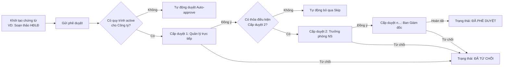

# HƯỚNG DẪN SỬ DỤNG PHÂN HỆ QUY TRÌNH PHÊ DUYỆT DÙNG CHUNG (MODULE 09)

Hệ thống CYCLOSA HRM cung cấp phân hệ **Quy trình Phê duyệt dùng chung (Generic Approval Workflow)** nhằm tự động hóa luồng duyệt đa cấp cho mọi loại chứng từ, nghiệp vụ nhân sự trong doanh nghiệp (Hợp đồng lao động, Đơn nghỉ việc, Đăng ký làm thêm giờ, Nghỉ phép, Điều chỉnh đãi ngộ).

---

## 📌 1. Khái niệm cốt lõi & Cơ chế hoạt động

### 1.1. Các trạng thái tổng thể của hồ sơ (`overallStatus`)
* **`PENDING` (Chờ phê duyệt):** Hồ sơ đang trong quá trình xét duyệt tại một bước cụ thể.
* **`APPROVED` (Đã hoàn tất duyệt):** Toàn bộ các bước phê duyệt hợp lệ đã được đồng ý thông qua. Chứng từ gốc tự động được chuyển sang trạng thái sẵn sàng phát hành hoặc ký kết.
* **`REJECTED` (Đã từ chối):** Hồ sơ bị một trong các cấp duyệt từ chối. Ngay khi bị từ chối, toàn bộ các bước còn lại sẽ dừng lại.
* **`CANCELLED` (Đã hủy bỏ):** Người gửi chủ động thu hồi hoặc hủy bỏ yêu cầu khi chưa hoàn tất.

### 1.2. Các hình thức phân công người duyệt (`approverType`)
* **Quản lý trực tiếp (`DIRECT_MANAGER`):** Hệ thống tự động tra cứu cây quản lý trực tiếp của nhân viên gửi đơn để gán trách nhiệm duyệt.
* **Trưởng phòng ban (`DEPARTMENT_HEAD`):** Hệ thống tra cứu người đứng đầu phòng ban/đơn vị phụ trách nhân sự.
* **Theo vai trò / Nhóm quyền (`ROLE`):** Tất cả các nhân sự sở hữu vai trò được cấu hình (VD: *Trưởng phòng Nhân sự*, *Kế toán trưởng*, *Tổng Giám đốc*) đều có quyền xem và ra quyết định.
* **Chỉ định nhân viên (`SPECIFIC_EMPLOYEE`):** Gán đích danh một nhân sự cụ thể chịu trách nhiệm cho cấp duyệt đó.

### 1.3. Điều kiện kích hoạt bước duyệt (`conditionType`)
* **Luôn luôn (`ALWAYS`):** Bước này luôn bắt buộc phải thực hiện trong mọi trường hợp.
* **Vượt định mức số tiền (`AMOUNT_ABOVE_THRESHOLD`):** Chỉ kích hoạt khi giá trị của hồ sơ (VD: Lương thỏa thuận, Giá trị hợp đồng) lớn hơn ngưỡng số tiền quy định. Nếu giá trị nhỏ hơn hoặc bằng ngưỡng, bước này sẽ tự động được **Bỏ qua (`SKIPPED`)** và chuyển tiếp ngay sang bước sau.
* **Vượt khung dải lương (`SALARY_ABOVE_BAND`):** Kích hoạt đặc cách khi mức lương đề xuất vượt khung trần quy chế lương của công ty.

---

## 🛠️ 2. Hướng dẫn thiết lập Quy trình (Dành cho Quản trị viên)

### Bước 1: Truy cập màn hình cấu hình
* Trên menu thanh bên (Sidebar), chọn **HỆ THỐNG & PHÂN QUYỀN** ➔ **Quy trình phê duyệt** (hoặc truy cập đường dẫn `/settings/workflows`).

### Bước 2: Tạo quy trình mới
1. Nhấn nút **"Thêm quy trình mới"** ở góc phải màn hình.
2. Tại màn hình **Thiết lập Quy trình Phê duyệt Mới** (`/settings/workflows/new`), điền các thông tin:
   * **Công ty áp dụng:** Chọn pháp nhân/công ty trực thuộc áp dụng quy trình này.
   * **Loại chứng từ:** Chọn loại nghiệp vụ (Hợp đồng lao động, Nghỉ việc, Làm thêm giờ,...).
   * **Tên quy trình:** Nhập tên mô tả rõ ràng (VD: *Quy trình phê duyệt Hợp đồng lao động & Phụ cấp*).
   * **Mô tả:** Ghi chú phạm vi áp dụng.

### Bước 3: Cấu hình các cấp duyệt tuần tự
* Mặc định hệ thống tạo sẵn cấp duyệt đầu tiên. Quản trị viên nhấn **"Thêm cấp duyệt"** để bổ sung các bước tiếp theo.
* Với mỗi cấp duyệt:
  1. Nhập **Tên bước duyệt** (VD: *Quản lý trực tiếp xác nhận chuyên môn*).
  2. Chọn **Đối tượng duyệt**:
     * Nếu chọn *Theo vai trò*: Chọn vai trò tương ứng từ danh sách.
     * Nếu chọn *Chỉ định nhân viên*: Chọn nhân viên đích danh từ danh sách.
  3. Chọn **Điều kiện kích hoạt**:
     * Chọn *Luôn luôn* hoặc *Mức lương / số tiền vượt ngưỡng*.
     * Nếu chọn *Vượt ngưỡng*: Nhập số tiền định mức (VNĐ).
  4. Sử dụng nút mũi tên **Lên (↑)** / **Xuống (↓)** để sắp xếp lại thứ tự ưu tiên duyệt tuần tự.
3. Nhấn **"Tạo quy trình phê duyệt"** để lưu lại.

### Bước 4: Quản lý trạng thái áp dụng
* Tại danh sách quy trình, sử dụng công tắc **Switch** để Bật (`Áp dụng`) hoặc Tắt (`Tạm dừng`) quy trình mà không cần xóa cấu hình.

---

## 📥 3. Hướng dẫn xử lý hồ sơ (Dành cho Nhân sự & Quản lý)

Truy cập màn hình **Hộp thư Phê duyệt** tại menu **QUẢN TRỊ NHÂN SỰ** ➔ **Hộp thư phê duyệt** (đường dẫn `/approvals`).

Màn hình được chia làm 3 tab làm việc:

### 3.1. Tab "Chờ tôi duyệt" (Inbox)
* Danh sách tất cả các yêu cầu đang dừng tại bước mà bạn là người được phân công duyệt (hoặc bạn có vai trò tương ứng).
* Thao tác:
  * **Xem tiến trình duyệt:** Nhấn vào tiêu đề yêu cầu hoặc chọn *Xem tiến trình duyệt* để mở sơ đồ Timeline hiển thị các bước duyệt tuần tự, người đã duyệt, ý kiến và thời gian.
  * **Phê duyệt:** Nhấn nút **"Phê duyệt"** trên menu thao tác. Hộp thoại mở ra cho phép nhập ghi chú phản hồi (không bắt buộc) và nhấn xác nhận. Yêu cầu sẽ tự động được chuyển sang bước tiếp theo hoặc hoàn tất.
  * **Từ chối:** Nhấn nút **"Từ chối"**. Hộp thoại yêu cầu bạn **bắt buộc nhập lý do từ chối (tối thiểu 5 ký tự)** để người gửi nắm được thông tin điều chỉnh. Khi từ chối, toàn bộ quy trình sẽ kết thúc.

### 3.2. Tab "Tôi đã gửi" (My Submitted)
* Danh sách tất cả các hồ sơ, hợp đồng hoặc đơn từ do bạn tạo và gửi phê duyệt.
* Bạn có thể theo dõi thời gian thực xem hồ sơ đang nằm ở bước nào, ai đang phụ trách duyệt.
* **Hủy yêu cầu:** Với các hồ sơ đang ở trạng thái `Chờ phê duyệt`, bạn có thể nhấn menu thao tác ➔ **"Hủy yêu cầu"** và nhập lý do hủy.

### 3.3. Tab "Lịch sử đã duyệt" (History)
* Lưu trữ toàn bộ các hồ sơ bạn đã từng đưa ra quyết định (Phê duyệt hoặc Từ chối) để phục vụ kiểm toán nội bộ và tra cứu lịch sử.

---

## 🔗 4. Tích hợp tự động với Hợp đồng Lao động (Module 08)

Khi soạn thảo Hợp đồng lao động trên màn hình chi tiết hợp đồng (`/contracts/[id]`):
1. Nhấn nút **"Gửi phê duyệt"**:
   * Hệ thống tự động kiểm tra xem có quy trình phê duyệt active cho công ty của hợp đồng hay không.
   * Nếu **có quy trình**: Hợp đồng chuyển sang `PENDING_APPROVAL`. Cột bên phải màn hình sẽ tự động hiển thị khối **Tiến trình Phê duyệt** với danh sách các cấp duyệt theo đúng quy trình đã cấu hình.
   * Nếu **không có quy trình cấu hình**: Hệ thống tự động phê duyệt ngay lập tức (Auto-approve) và chuyển hợp đồng sang trạng thái `APPROVED`, cho phép phát lệnh ký số ngay.
2. Cấp quản lý có thể thao tác Duyệt hoặc Từ chối trực tiếp ngay trên màn hình chi tiết Hợp đồng thông qua khối **Tiến trình Phê duyệt**.
3. Sau khi cấp duyệt cuối cùng đồng ý, hợp đồng chuyển sang `APPROVED` và nút **"Phát lệnh ký số"** sẽ sáng lên.

---

## ⚠️ 5. Các lưu ý & Ràng buộc nghiệp vụ

1. **Tính tuần tự (Sequential Flow):** Các bước được thực hiện theo đúng thứ tự `stepOrder` (1, 2, 3...). Người ở bước sau không thể duyệt trước khi bước trước hoàn tất.
2. **Quy định từ chối:** Khi từ chối bắt buộc phải có ý kiến phản hồi rõ ràng tối thiểu 5 ký tự nhằm đảm bảo tính minh bạch trong quản trị.
3. **Phân quyền truy cập:**
   * Quyền `workflow.manage`: Cấu hình quy trình, thêm/sửa/xóa bước.
   * Quyền `workflow.view`: Truy cập hộp thư phê duyệt và xem tiến trình duyệt chứng từ.

